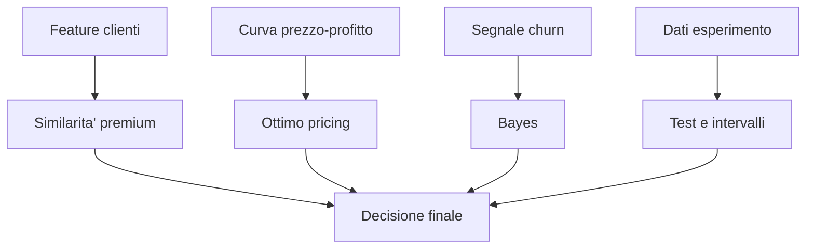

import { Aside } from '@astrojs/starlight/components'

Hai un SaaS con tre problemi contemporanei:

- vuoi trovare utenti simili ai clienti premium
- vuoi capire se il prezzo mensile e' vicino al punto ottimale
- vuoi decidere se una nuova onboarding email riduce il churn

Questo caso studio usa gli strumenti del modulo senza trasformarli in esercizio accademico.

## Mappa del caso



## Scenario dati

Useremo tre blocchi:

- `customers`: feature comportamentali
- `pricing_curve`: relazione tra prezzo e profitto
- `experiment`: test controllo vs variante

## Step 1 - Similarita' con i clienti premium

```python
import numpy as np
import pandas as pd

customers = pd.DataFrame({
    "user_id": [201, 202, 203, 204, 205],
    "sessions_30d": [22, 9, 31, 28, 12],
    "projects_created": [4, 1, 5, 4, 2],
    "feature_adoption": [0.72, 0.21, 0.81, 0.76, 0.33],
})

target = np.array([30, 5, 0.80])

def cosine_similarity(x, y):
    return np.dot(x, y) / (np.linalg.norm(x) * np.linalg.norm(y))

features = customers[["sessions_30d", "projects_created", "feature_adoption"]].to_numpy()
customers["premium_similarity"] = [cosine_similarity(row, target) for row in features]

print(customers.sort_values("premium_similarity", ascending=False))
```

Output utile: shortlist di utenti da spingere verso upsell o sales assistita.

### Interpretazione manageriale

Questa prima parte non decide ancora nulla. Serve a restringere il campo: quali utenti assomigliano abbastanza al target premium da meritare un'azione dedicata.

## Step 2 - Prezzo e profitto marginale

Assumiamo una curva profitto semplificata:

```python
def profit(price):
    return 520 * price - 4 * price**2 - 3000

prices = np.arange(20, 81, 5)
profits = [profit(p) for p in prices]
print(list(zip(prices, profits))[:5])
```

Per trovare il punto ottimo:

```python
from sympy import symbols, diff, solve

p = symbols("p")
f = 520 * p - 4 * p**2 - 3000
critical = solve(diff(f, p), p)

print(critical)
```

Se il prezzo attuale e' molto lontano dal punto critico, hai un'indicazione forte di revisione pricing.

### Cosa non dice questa curva

La curva proposta e' un modello utile, non la realta' finale. Va letta come supporto a una decisione, non come verita' definitiva sul mercato.

## Step 3 - Bayes su segnale di churn

Il 5% dei clienti churna. Tra i churner, il 65% mostra calo netto di attivita'. Il 14% della base mostra quel segnale.

```python
p_churn = 0.05
p_signal_given_churn = 0.65
p_signal = 0.14

p_churn_given_signal = p_signal_given_churn * p_churn / p_signal
print(round(p_churn_given_signal, 4))
```

Questo valore guida soglie di alert e priorita' del team success.

## Step 4 - Intervallo di confidenza sull'effetto email

```python
from scipy.stats import t

uplifts = np.array([0.012, 0.018, 0.009, 0.021, 0.015, 0.017, 0.013, 0.019])
mean = uplifts.mean()
se = uplifts.std(ddof=1) / np.sqrt(len(uplifts))
critical = t.ppf(0.975, df=len(uplifts) - 1)

ci = (mean - critical * se, mean + critical * se)
print(np.round(ci, 4))
```

Qui non guardi solo il lift medio: guardi quanto e' incerto.

## Step 5 - Test d'ipotesi sul churn rate

```python
from statsmodels.stats.proportion import proportions_ztest

churned = np.array([96, 74])       # controllo, variante
exposed = np.array([1800, 1785])

z_stat, p_value = proportions_ztest(churned, exposed)
print(round(z_stat, 3), round(p_value, 4))
```

Se il p-value e' compatibile con la decisione, unisci il risultato a:

- effect size
- costo della variante
- rischio operativo

## Estensione notebook con librerie reali

Se vuoi trasformare questo caso in un laboratorio piu' robusto, puoi sostituire i toy data con mini dataset reali e tenere lo stesso flusso mentale:

- `load_wine()` per similarity e riduzione dimensionale
- `load_diabetes()` per curve di risposta e intervalli di confidenza
- `load_breast_cancer()` per scoring probabilistico e ROC-AUC
- `statsmodels` per test su proporzioni, OLS e correzione dei p-value

```python
from sklearn.datasets import load_breast_cancer, load_diabetes, load_wine
from sklearn.decomposition import PCA
from sklearn.linear_model import LogisticRegression
from statsmodels.stats.proportion import proportions_ztest
import statsmodels.api as sm
```

Il punto non e' cambiare il caso. E' portarlo dal livello concettuale al livello notebook mantenendo la stessa narrativa decisionale.

## Perche' questo caso e' utile

Il punto non e' accumulare tecniche. Il punto e' vedere che:

- la similarita' filtra i target
- l'ottimizzazione guida i trade-off
- Bayes aggiorna il rischio
- inferenza e test proteggono da decisioni impulsive

## Sintesi decisionale

Una tabella finale credibile potrebbe essere:

| Decisione | Segnale |
|-----------|---------|
| Upsell mirato | utenti con similarity premium alta |
| Review pricing | prezzo attuale lontano dal massimo teorico |
| Churn intervention | posterior Bayes elevata dato il segnale |
| Rollout email | p-value + effect size + IC coerenti |

<Aside type="note">
Questo e' il punto del modulo: usare matematica diversa dentro la stessa decisione, non trattare ogni formula come un mondo separato.
</Aside>

## Errori da evitare nel caso reale

- similarity calcolata su feature non scalate
- curva pricing costruita con pochi punti eccessivamente rumorosi
- Bayes senza tasso base
- test lanciato e fermato in anticipo

## Riepilogo operativo

- I vettori servono per somiglianza e segmentazione.
- Le derivate servono per leggere il margine decisionale.
- Bayes serve per aggiornare rischio e priorita'.
- Intervalli e test servono per decidere con un livello minimo di rigore.

## Prompt finale

Prendi un tuo caso reale e prova a separarlo in quattro domande:

1. c'e' un problema di similarita'?
2. c'e' un problema di ottimizzazione?
3. c'e' un problema di probabilita' condizionata?
4. c'e' un problema di inferenza statistica?

Se riesci a rispondere a queste quattro domande, hai gia' trasformato un problema confuso in un problema analitico.
