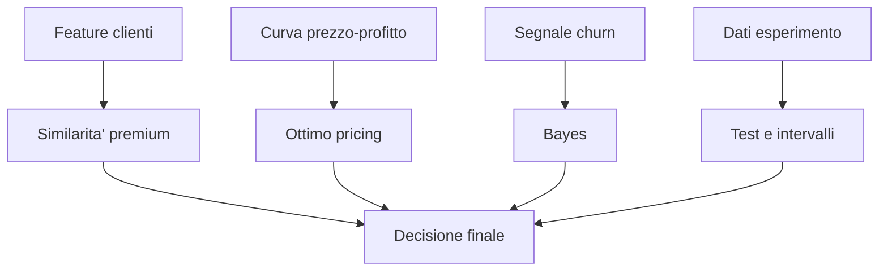

import { Aside } from '@astrojs/starlight/components'

Hai un SaaS con tre problemi contemporanei:

- vuoi trovare utenti simili ai clienti premium
- vuoi capire se il prezzo mensile e' vicino al punto ottimale
- vuoi decidere se una nuova onboarding email riduce il churn

Questo caso studio usa gli strumenti del modulo senza trasformarli in esercizio accademico.

Il punto importante non e' che ogni strumento matematico "funziona": e' che ogni strumento risponde a un tipo di domanda diverso. La similarita' risponde a "chi assomiglia a chi". L'ottimizzazione risponde a "dove si massimizza". Bayes risponde a "quanto devo aggiornare la mia stima". Inferenza e test rispondono a "posso fidarmi di questo segnale". Usarli insieme dentro la stessa decisione e' molto piu' potente che usarli separatamente.

## Mappa del caso



## Scenario dati

Useremo tre blocchi:

- `customers`: feature comportamentali
- `pricing_curve`: relazione tra prezzo e profitto
- `experiment`: test controllo vs variante

## Step 1 - Similarita' con i clienti premium

```python
import numpy as np
import pandas as pd

customers = pd.DataFrame({
    "user_id": [201, 202, 203, 204, 205],
    "sessions_30d": [22, 9, 31, 28, 12],
    "projects_created": [4, 1, 5, 4, 2],
    "feature_adoption": [0.72, 0.21, 0.81, 0.76, 0.33],
})

target = np.array([30, 5, 0.80])

def cosine_similarity(x, y):
    return np.dot(x, y) / (np.linalg.norm(x) * np.linalg.norm(y))

features = customers[["sessions_30d", "projects_created", "feature_adoption"]].to_numpy()
customers["premium_similarity"] = [cosine_similarity(row, target) for row in features]

print(customers.sort_values("premium_similarity", ascending=False))
```

Output utile: shortlist di utenti da spingere verso upsell o sales assistita.

### Interpretazione manageriale

Questa prima parte non decide ancora nulla. Serve a restringere il campo: quali utenti assomigliano abbastanza al target premium da meritare un'azione dedicata.

Un punteggio di similarita' sopra 0.90 indica un match molto forte: stessa combinazione di attivita', profondita' di utilizzo delle feature, frequenza di sessione. Sotto 0.70 il match e' debole e l'azione probabilmente non vale l'effort commerciale.

**Attenzione alla scala delle feature**: la cosine similarity non e' sensibile alla scala solo se le feature sono gia' comparabili tra loro. Nel nostro esempio, `sessions_30d` va da 0 a 50, `projects_created` da 0 a 10, `feature_adoption` da 0 a 1. Un utente con 40 sessioni e 0.3 di feature_adoption ha un vettore dominato dalle sessioni. Se vuoi una similarita' bilanciata tra le tre dimensioni, devi normalizzare prima.

```python
from sklearn.preprocessing import StandardScaler

scaler = StandardScaler()
features_scaled = scaler.fit_transform(
    customers[["sessions_30d", "projects_created", "feature_adoption"]]
)
target_scaled = scaler.transform([target])

customers["premium_similarity_scaled"] = [
    cosine_similarity(row, target_scaled[0])
    for row in features_scaled
]
```

La versione scalata cambia i ranking: un utente con alta feature_adoption e poche sessioni puo' risultare piu' simile al target premium rispetto a uno che ha molte sessioni ma usa pochissime feature.

## Step 2 - Prezzo e profitto marginale

Assumiamo una curva profitto semplificata:

```python
def profit(price):
    return 520 * price - 4 * price**2 - 3000

prices = np.arange(20, 81, 5)
profits = [profit(p) for p in prices]
print(list(zip(prices, profits))[:5])
```

Per trovare il punto ottimo:

```python
from sympy import symbols, diff, solve

p = symbols("p")
f = 520 * p - 4 * p**2 - 3000
critical = solve(diff(f, p), p)

print(critical)
```

Se il prezzo attuale e' molto lontano dal punto critico, hai un'indicazione forte di revisione pricing.

Con i nostri parametri:

```python
# derivata prima: 520 - 8p = 0 → p_ottimo = 65
# profitto a p=65: 520*65 - 4*65^2 - 3000 = 33800 - 16900 - 3000 = 13900
```

Se il prezzo attuale e' 40€, il gap rispetto all'ottimo teorico e' 25€ per unita'. Prima di muoversi, vale la pena stimare l'elasticita' reale della domanda con dati storici.

### Cosa non dice questa curva

La curva proposta e' un modello utile, non la realta' finale. Va letta come supporto a una decisione, non come verita' definitiva sul mercato.

I limiti principali sono:
- la funzione di domanda e' assunta lineare, ma spesso non lo e' (ci sono price points psicologici, concorrenza, effetti di ancoraggio)
- i parametri `520` e `4` sono ipotesi: cambiali con dati storici reali di conversione per canale di prezzo
- il modello ignora i costi variabili aggiuntivi a volumi diversi

Usala per orientarti sul range ragionevole di prezzo, non per giustificare un numero preciso al board.

## Step 3 - Bayes su segnale di churn

Il 5% dei clienti churna. Tra i churner, il 65% mostra calo netto di attivita'. Il 14% della base mostra quel segnale.

```python
p_churn = 0.05
p_signal_given_churn = 0.65
p_signal = 0.14

p_churn_given_signal = p_signal_given_churn * p_churn / p_signal
print(round(p_churn_given_signal, 4))
```

Il risultato: `p_churn_given_signal ≈ 0.232`. Un utente che mostra il segnale di calo attivita' ha il 23% di probabilita' di churning, rispetto al 5% baseline.

Questo valore guida soglie di alert e priorita' del team success.

**Interpretazione operativa**: se il team CS ha capacita' per 50 interventi proattivi a settimana, e hai 300 utenti con il segnale attivo, non puoi intervenire su tutti. Con il posterior Bayesiano, puoi:
1. ordinare gli utenti per probabilita' di churn
2. aggiungere altri segnali (ticket aperti, NPS basso, calo frequenza login) per raffinare la stima
3. concentrare le risorse sul top 50 per probability

Senza Bayes, il team interverrebbe su tutti i 300 per "sicurezza", sprecando effort su utenti che non avrebbero churna comunque.

## Step 4 - Intervallo di confidenza sull'effetto email

```python
from scipy.stats import t

uplifts = np.array([0.012, 0.018, 0.009, 0.021, 0.015, 0.017, 0.013, 0.019])
mean = uplifts.mean()
se = uplifts.std(ddof=1) / np.sqrt(len(uplifts))
critical = t.ppf(0.975, df=len(uplifts) - 1)

ci = (mean - critical * se, mean + critical * se)
print(np.round(ci, 4))
```

Se l'IC risulta `(0.0118, 0.0192)`, entrambi gli estremi sono positivi: l'email ha un effetto significativo anche nel caso pessimistico. Un lift medio dell'1.5% su una base di 10.000 utenti attivi significa 150 utenti in piu' che superano il periodo critico ogni mese.

Qui non guardi solo il lift medio: guardi quanto e' incerto.

## Step 5 - Test d'ipotesi sul churn rate

```python
from statsmodels.stats.proportion import proportions_ztest

churned = np.array([96, 74])       # controllo, variante
exposed = np.array([1800, 1785])

z_stat, p_value = proportions_ztest(churned, exposed)
print(round(z_stat, 3), round(p_value, 4))
```

Con i nostri dati: controllo 96/1800 = 5.33%, variante 74/1785 = 4.15%. Una riduzione del churn rate dell'1.2 punti percentuali assoluti.

Se il p-value e' significativo (es: 0.023), unisci il risultato a:

- **effect size**: 1.2pp di riduzione assoluta del churn → annualizzato, quanto vale in MRR?
- **costo della variante**: quanto costa configurare e inviare questa sequenza email per tutti gli utenti?
- **rischio operativo**: ci sono effetti collaterali negativi (es: piu' unsubscribe, peggioramento di altra metrica)?

**Il calcolo di valore**: se il churn mensile scende dall'5.33% al 4.15% su 10.000 utenti con ARR medio di 500€, la riduzione di churn salva circa `10000 * 0.0118 * 500 / 12 ≈ 4.916€/mese` di MRR. Con un costo di implementazione stimato in 2-3 mesi di effort, il ROI e' chiaramente positivo. Il test non ha solo dimostrato che "l'email funziona": ha dato i numeri per costruire il business case.

## Estensione notebook con librerie reali

Se vuoi trasformare questo caso in un laboratorio piu' robusto, puoi sostituire i toy data con mini dataset reali e tenere lo stesso flusso mentale:

- `load_wine()` per similarity e riduzione dimensionale
- `load_diabetes()` per curve di risposta e intervalli di confidenza
- `load_breast_cancer()` per scoring probabilistico e ROC-AUC
- `statsmodels` per test su proporzioni, OLS e correzione dei p-value

```python
from sklearn.datasets import load_breast_cancer, load_diabetes, load_wine
from sklearn.decomposition import PCA
from sklearn.linear_model import LogisticRegression
from statsmodels.stats.proportion import proportions_ztest
import statsmodels.api as sm
```

Il punto non e' cambiare il caso. E' portarlo dal livello concettuale al livello notebook mantenendo la stessa narrativa decisionale.

## Perche' questo caso e' utile

Il punto non e' accumulare tecniche. Il punto e' vedere che:

- la similarita' filtra i target
- l'ottimizzazione guida i trade-off
- Bayes aggiorna il rischio
- inferenza e test proteggono da decisioni impulsive

## Sintesi decisionale

Una tabella finale credibile potrebbe essere:

| Decisione | Segnale matematico | Azione concreta |
|-----------|---------|---------|
| Upsell mirato | similarity premium > 0.88 | sequenza email commerciale o trial esteso |
| Review pricing | prezzo attuale (40€) lontano da ottimo teorico (65€) | test di prezzo graduale con coorti |
| Churn intervention | posterior Bayes > 20% dato il segnale | priorita' CS sui top 50 per probability |
| Rollout email | p-value 0.023 + lift 1.2pp + IC positivo | attivazione su tutti i nuovi trial |

<Aside type="note">
Questo e' il punto del modulo: usare matematica diversa dentro la stessa decisione, non trattare ogni formula come un mondo separato.
</Aside>

## Decisione finale integrata

Le quattro analisi convergono verso una risposta coerente:

- **Breve termine**: concentra il CS sui 50 utenti con churn risk piu' alto (Bayes). Attiva l'email di onboarding su tutti i nuovi trial (test).
- **Medio termine**: revisione graduale del pricing partendo da un A/B test a 55€ su nuove acquisizioni (derivate + dati storici di conversione).
- **Lungo termine**: costruisci un sistema di scoring continuativo basato sulla similarity premium per alimentare il funnel commerciale.

Le decisioni non si escludono. Ognuna usa uno strumento diverso perche' risponde a una domanda diversa. Questa e' la differenza tra un analista che "conosce la matematica" e uno che sa quale matematica usare per quale domanda.

## Errori da evitare nel caso reale

- **similarity calcolata su feature non scalate**: i risultati sono dominati dalla feature con il range piu' ampio
- **curva pricing costruita con pochi punti eccessivamente rumorosi**: la derivata di una curva rumorosa non ha senso — fai smoothing prima
- **Bayes senza tasso base**: il p(churn) senza prior porta a stime molto ottimistiche o pessimistiche
- **test lanciato e fermato in anticipo**: il p-value cambia continuamente durante un test — decidere quando vedi "p&lt;0.05 per la prima volta" e' un bias sistematico (peeking problem)
- **effect size ignorato**: un risultato statisticamente significativo con effect size trascurabile non giustifica l'investimento
- **ignorare i costi di implementazione nell'interpretazione**: un IC positivo non basta — serve un'analisi costo-beneficio esplicita

## Riepilogo operativo

- I vettori servono per somiglianza e segmentazione.
- Le derivate servono per leggere il margine decisionale.
- Bayes serve per aggiornare rischio e priorita'.
- Intervalli e test servono per decidere con un livello minimo di rigore.

## Prompt finale

Prendi un tuo caso reale e prova a separarlo in quattro domande:

1. c'e' un problema di similarita'?
2. c'e' un problema di ottimizzazione?
3. c'e' un problema di probabilita' condizionata?
4. c'e' un problema di inferenza statistica?

Se riesci a rispondere a queste quattro domande, hai gia' trasformato un problema confuso in un problema analitico.
