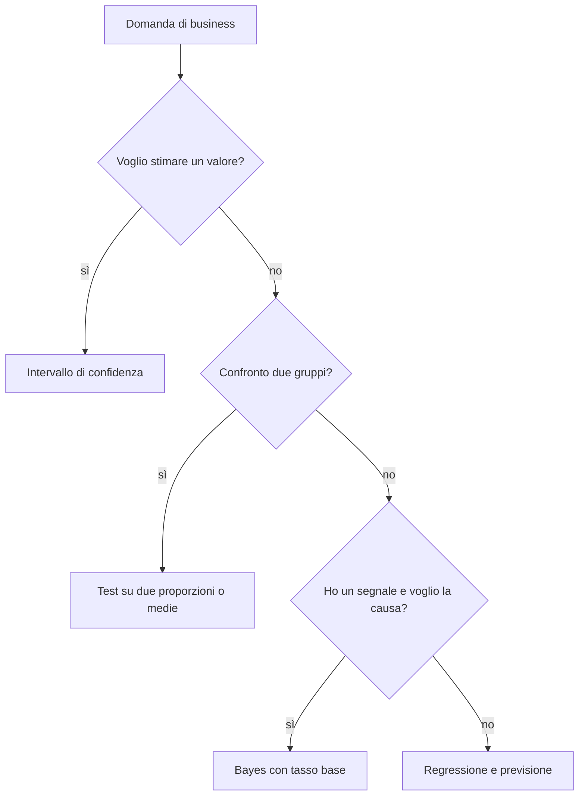

Un e-commerce italiano ha testato due versioni della pagina di checkout. È uno scenario costruito, con numeri di esempio: la versione A, quella attuale, ha convertito 200 visitatori su 4.000; la versione B, con meno campi nel modulo, ne ha convertiti 248 su 4.000. Il responsabile di prodotto chiede una decisione entro la riunione di venerdì: adottare B, restare su A oppure raccogliere altri dati. In parallelo, il team marketing ha un lead score da valutare e un budget da prevedere.

Il problem set che segue usa questo scenario per far lavorare insieme gli strumenti del modulo. Non è una raccolta di esercizi scollegati: ogni risposta alimenta la successiva, e ogni esercizio parte dalla stessa domanda, quale strumento serve qui e quale conclusione i numeri permettono davvero.

## Prima del calcolo: scegliere lo strumento e dichiarare le assunzioni

L'errore più costoso di un'analisi non è sbagliare un'addizione, ma applicare lo strumento giusto alla domanda sbagliata. Prima di qualunque formula conviene scrivere tre cose: la domanda in una frase, l'assunzione che rende valido lo strumento e la soglia oltre la quale cambierai decisione.

> **Idea chiave:** Ogni esercizio parte da tre dichiarazioni scritte prima del calcolo, cioè la domanda, l'assunzione e la soglia di decisione; il numero ottenuto dopo vale solo dentro quella cornice.

| Domanda | Strumento | Assunzione da verificare | Uscita |
| :--- | :--- | :--- | :--- |
| Quanto vale un tasso e quanto è incerto? | Intervallo di confidenza | Campione casuale, $n\hat{p}$ e $n(1-\hat{p})$ almeno 10 | Forchetta di valori compatibili |
| Due versioni differiscono davvero? | Test su due proporzioni | Gruppi indipendenti, assegnazione casuale | Statistica $z$, valore $p$, intervallo della differenza |
| Un segnale a cosa corrisponde? | Teorema di Bayes | Probabilità condizionate note, tasso base corretto | Probabilità del fenomeno dato il segnale |
| Come cambia $y$ al variare di $x$? | Regressione lineare | Relazione circa lineare, previsioni dentro l'intervallo osservato | Pendenza, $R^2$, previsione |
| Quanti dati servono? | Dimensionamento del campione | Effetto minimo rilevante, potenza e livello $\alpha$ fissati | Numerosità per gruppo |



Per lo scenario dichiariamo subito la soglia: adotti B solo se l'intervallo al 95% della differenza di conversione esclude lo zero e il guadagno minimo plausibile, cioè l'estremo inferiore, resta commercialmente rilevante. In caso contrario non cambi nulla e dimensioni un test più lungo.

## Esercizio 1: quanto è precisa la conversione della versione A

La conversione osservata per A è $\hat{p}_A = 200/4.000 = 0{,}05$, cioè 5,0%. Serve un intervallo al 95%.

L'errore standard è $SE_A = \sqrt{0{,}05 \times 0{,}95 / 4.000} = \sqrt{0{,}0000119} = 0{,}00345$, cioè 0,345 punti percentuali. Il margine al 95% vale quindi $1{,}96 \times 0{,}345 = 0{,}68$ punti percentuali, e l'intervallo va da $5{,}00 - 0{,}68 = 4{,}32\%$ a $5{,}00 + 0{,}68 = 5{,}68\%$. In altre parole, i dati non permettono di escludere nessun tasso di conversione vero compreso fra poco più del 4,3% e poco meno del 5,7%.

Le assunzioni reggono: $n\hat{p} = 200$ e $n(1-\hat{p}) = 3.800$ sono ben oltre 10, e le visite sono state assegnate casualmente. Per B, con $\hat{p}_B = 248/4.000 = 0{,}062$, l'errore standard è $\sqrt{0{,}062 \times 0{,}938/4.000} = 0{,}00381$, quindi 0,381 pp, il margine è 0,75 pp e l'intervallo va da 5,45% a 6,95%. I due intervalli si sovrappongono fra 5,45% e 5,68%: come nella lezione sugli intervalli, questa sovrapposizione non permette ancora di concludere nulla, e serve il confronto diretto della differenza.

## Esercizio 2: B è davvero meglio di A

La domanda è una differenza fra due proporzioni. Le ipotesi sono $H_0: p_B = p_A$ contro $H_1: p_B \ne p_A$, livello $\alpha = 0{,}05$ fissato prima di guardare i dati. Sotto $H_0$ le due versioni hanno la stessa probabilità, stimata mettendo insieme i gruppi.

1. Proporzione comune: $\hat{p} = (200 + 248)/(4.000 + 4.000) = 448/8.000 = 0{,}056$.
2. Errore standard sotto $H_0$: $SE_0 = \sqrt{0{,}056 \times 0{,}944 \times (1/4.000 + 1/4.000)} = \sqrt{0{,}052864 \times 0{,}0005} = \sqrt{0{,}00002643} = 0{,}00514$, cioè 0,514 pp.
3. Differenza osservata: $0{,}062 - 0{,}050 = 0{,}012$, cioè 1,2 punti percentuali.
4. Statistica: $z = 0{,}012/0{,}00514 = 2{,}33$.
5. Valore $p$ bilaterale: $2\,(1 - \Phi(2{,}33)) \approx 0{,}0196$, circa 1,96%.

Poiché $0{,}0196 < 0{,}05$ rifiuti $H_0$. Il valore $p$ non dice che B ha il 98% di probabilità di essere migliore: dice che, se A e B fossero uguali, una differenza tanto grande si osserverebbe in circa il 2% dei test. Per la decisione serve l'intervallo della differenza. L'errore standard non pooled è $\sqrt{0{,}00345^2 + 0{,}00381^2} = \sqrt{0{,}0000119 + 0{,}0000145} = 0{,}00514$, il margine $1{,}96 \times 0{,}514 = 1{,}01$ pp, e l'intervallo $[0{,}19;\ 2{,}21]$ punti percentuali.

Raccomandazione: adotta B con confidenza del 95%, ma comunica la forchetta onesta. Il guadagno atteso è 1,2 pp e il minimo plausibile 0,19 pp. Su 100.000 visite mensili il guadagno è 1.200 conversioni, mentre nello scenario prudente scende a 190. Dopo il rilascio monitora la conversione per almeno quattro settimane.

## Esercizio 3: quanto vale un lead score

Il marketing usa un punteggio che classifica i lead come «alti» o «bassi». Dai dati storici: l'8% dei lead diventa cliente; il punteggio alto compare nel 70% dei lead che diventano clienti e nel 15% di quelli che non lo diventano. Qual è la probabilità che un lead con punteggio alto diventi cliente?

Il contributo dei lead che diventano clienti alla probabilità di vedere un punteggio alto è $0{,}70 \times 0{,}08 = 0{,}056$, quello dei lead che non lo diventano è $0{,}15 \times 0{,}92 = 0{,}138$. La probabilità totale di punteggio alto è la somma, $0{,}056 + 0{,}138 = 0{,}194$. Per Bayes, $P(\text{cliente} \mid \text{alto}) = 0{,}056/0{,}194 = 0{,}289$, cioè 28,9%. Il denominatore mostra subito perché il risultato è modesto: i falsi allarmi, 0,138, pesano due volte e mezzo i veri segnali, 0,056, perché i lead che non diventano clienti sono la grande maggioranza.

Il punteggio alto più che triplica la probabilità rispetto all'8% di partenza ma resta lontano da una certezza: oltre sette lead «alti» su dieci non diventano clienti. Se la squadra commerciale contatta solo i lead alti, il lavoro è ben indirizzato; se li tratta come vendite quasi concluse, la previsione di fatturato sarà gonfiata.

## Esercizio 4: regressione e previsione del budget

Quattro mesi di dati: budget pubblicitario $x$ (migliaia di euro) e lead generati $y$: $(2, 30)$, $(4, 50)$, $(6, 75)$, $(8, 95)$. Si stima una retta e si prevede il risultato per un budget di 10.000 euro.

1. Medie: $\bar{x} = 5$, $\bar{y} = (30 + 50 + 75 + 95)/4 = 62{,}5$.
2. Pendenza: $\hat{\beta}_1 = \sum (x - \bar{x})(y - \bar{y}) / \sum (x - \bar{x})^2$. Il numeratore è $(-3)(-32{,}5) + (-1)(-12{,}5) + (1)(12{,}5) + (3)(32{,}5) = 97{,}5 + 12{,}5 + 12{,}5 + 97{,}5 = 220$, il denominatore $9 + 1 + 1 + 9 = 20$. Quindi $\hat{\beta}_1 = 11$ lead per migliaio di euro.
3. Intercetta: $\hat{\beta}_0 = 62{,}5 - 11 \times 5 = 7{,}5$.
4. Residui: $+0{,}5;\ -1{,}5;\ +1{,}5;\ -0{,}5$, con $SSE = 0{,}25 + 2{,}25 + 2{,}25 + 0{,}25 = 5{,}0$ e $SST = 2.425$, quindi $R^2 = 1 - 5/2.425 = 0{,}998$.
5. Previsione a 10 migliaia di euro: $7{,}5 + 11 \times 10 = 117{,}5$ lead.

Qui scatta la clausola dichiarata all'inizio: il budget osservato va da 2 a 8, quindi 10 è un'estrapolazione, e con quattro punti non c'è modo di sapere se il canale satura. La risposta corretta è «circa 118 lead se la relazione resta lineare», con la proposta di testare gradualmente il nuovo livello di spesa prima di impegnarlo.

## Esercizio 5: quanto deve durare il test successivo

Se vuoi riconoscere con potenza 80% un effetto della stessa dimensione osservata, cioè un passaggio dal 5,0% al 6,2%, quanti visitatori servono per gruppo? La formula con livello $\alpha = 0{,}05$ bilaterale usa $z_{\alpha/2} = 1{,}96$ e $z_{\beta} = 0{,}84$:

$$n = \frac{(z_{\alpha/2} + z_{\beta})^2\,\bigl[p_1(1-p_1) + p_2(1-p_2)\bigr]}{(p_2 - p_1)^2}.$$

Il calcolo: $(1{,}96 + 0{,}84)^2 = 7{,}84$; $0{,}05 \times 0{,}95 + 0{,}062 \times 0{,}938 = 0{,}0475 + 0{,}0582 = 0{,}1057$; il denominatore è $0{,}012^2 = 0{,}000144$. Quindi $n = 7{,}84 \times 0{,}1057/0{,}000144 \approx 5.750$ visitatori per gruppo. Il test già eseguito con 4.000 per gruppo aveva potenza inferiore all'80% per questo effetto, ed è un motivo per cui il risultato va confermato.

Questo calcolo mostra anche una conseguenza pratica che si perde facilmente: la potenza di un test dipende dall'effetto che vuoi riconoscere, non solo dal campione che hai raccolto. Un risultato significativo con potenza insufficiente va letto con cautela, perché le stime di effetto ottenute in test poco potenti tendono a sovrastimare il vero guadagno. Prima di rilasciare B su tutto il traffico conviene quindi pianificare una verifica di conferma con la numerosità calcolata, tenendo B su una quota del traffico e confrontando di nuovo la differenza.

Il codice seguente riproduce l'intero problem set e permette di cambiare i numeri.

```python
# Problem set finale: intervalli, test, Bayes, regressione e dimensionamento
import numpy as np
from scipy.stats import norm

# Esercizio 1-2: due proporzioni
na = nb = 4000
ca, cb = 200, 248
pa, pb = ca / na, cb / nb
se_nonpooled = np.sqrt(pa * (1 - pa) / na + pb * (1 - pb) / nb)
p_comune = (ca + cb) / (na + nb)
se0 = np.sqrt(p_comune * (1 - p_comune) * (1 / na + 1 / nb))
z = (pb - pa) / se0
p_value = 2 * norm.sf(abs(z))
ic = (pb - pa) + np.array([-1.96, 1.96]) * se_nonpooled
print(f"diff={pb-pa:.3f} z={z:.2f} p={p_value:.4f} IC95=[{ic[0]*100:.2f}, {ic[1]*100:.2f}] pp")

# Esercizio 3: Bayes sul lead score
base, sens, fpr = 0.08, 0.70, 0.15
posterior = sens * base / (sens * base + fpr * (1 - base))
print(f"P(cliente | punteggio alto) = {posterior:.3f}")

# Esercizio 4: regressione sui quattro mesi
x = np.array([2, 4, 6, 8.0])
y = np.array([30, 50, 75, 95.0])
X = np.column_stack([np.ones_like(x), x])
beta = np.linalg.solve(X.T @ X, X.T @ y)          # equazioni normali
sse = ((y - X @ beta) ** 2).sum()
r2 = 1 - sse / ((y - y.mean()) ** 2).sum()
print(f"beta0={beta[0]:.1f} beta1={beta[1]:.1f} R2={r2:.3f} previsione(10)={beta[0]+beta[1]*10:.1f}")

# Esercizio 5: numerosità per gruppo, potenza 80%
n = (1.96 + 0.84) ** 2 * (pa * (1 - pa) + pb * (1 - pb)) / (pb - pa) ** 2
print(f"numerosita per gruppo = {n:.0f}")
```

L'esecuzione restituisce differenza 0,012, $z = 2{,}33$, $p = 0{,}0196$ e intervallo $[0{,}19;\ 2{,}21]$ pp, poi 0,289 per il posterior, $\beta_0 = 7{,}5$, $\beta_1 = 11{,}0$, $R^2 = 0{,}998$ con previsione 117,5, e una numerosità di circa 5.750 per gruppo.

## Errori tipici nei problem set integrati

### Scegliere lo strumento dopo aver visto il risultato

Il sintomo è un'analisi che passa da test t a Mann-Whitney a bootstrap finché un valore $p$ scende sotto 0,05. Succede perché provare più strade sembra prudenza mentre moltiplica le occasioni di un falso positivo. Si evita dichiarando prima domanda, test e soglia, e riportando tutti i tentativi se ne fai più d'uno.

### Presentare il valore p come probabilità che B sia migliore

Il sintomo è la frase «c'è il 98% di probabilità che B sia migliore». Succede perché $p = 0{,}0196$ e $1 - p = 0{,}98$ sembrano la risposta alla domanda del manager. In realtà $p$ è la probabilità dei dati assumendo $H_0$ vera. La traduzione corretta è l'intervallo della differenza, con il guadagno minimo plausibile accanto a quello atteso.

### Usare una retta fuori dall'intervallo osservato

Il sintomo è un budget previsto per un livello di spesa mai provato. Succede perché $R^2 = 0{,}998$ dà una fiducia che non si estende oltre i dati. Si evita dichiarando l'intervallo di validità e testando il nuovo livello a piccoli passi prima di impegnare il budget.

## Controllo finale sul problem set

1. Nell'esercizio 2 il team scopre che il 30% delle visite a B proveniva da una campagna email attiva solo su B. Quale assunzione crolla e cosa cambia nella raccomandazione?

<details>
<summary>Mostra risposta</summary>

Crolla l'assegnazione casuale: la differenza può dipendere dalla campagna e non dalla pagina. L'effetto di B non è più identificato; serve ripetere il test con assegnazione casuale a parità di sorgente di traffico, oppure stratificare per sorgente.

</details>

2. Con 4.000 visite per gruppo il margine sulla differenza è 1,01 pp. Quante visite per gruppo servono, in ordine di grandezza, per dimezzarlo?

<details>
<summary>Mostra risposta</summary>

Il margine scala con $1/\sqrt{n}$: per dimezzarlo serve quadruplicare, quindi circa 16.000 visite per gruppo.

</details>

3. Un lead con punteggio basso ha probabilità di diventare cliente pari a $0{,}30 \times 0{,}08 / (0{,}30 \times 0{,}08 + 0{,}85 \times 0{,}92)$. Quanto vale e come lo confronti con il caso del punteggio alto?

<details>
<summary>Mostra risposta</summary>

Numeratore $0{,}024$; denominatore $0{,}024 + 0{,}782 = 0{,}806$; risultato $0{,}0298$, cioè circa 3,0%. Un lead con punteggio alto ha 28,9%, quasi dieci volte la probabilità di uno con punteggio basso, ma il punteggio basso non è zero.

</details>

4. Perché la previsione di 117,5 lead a 10.000 euro è meno affidabile di quella a 5.000 euro?

<details>
<summary>Mostra risposta</summary>

Perché 5.000 euro cade dentro l'intervallo osservato da 2.000 a 8.000 euro (interpolazione), mentre 10.000 euro lo supera (estrapolazione) e la linearità non è verificata oltre 8.000.

</details>
