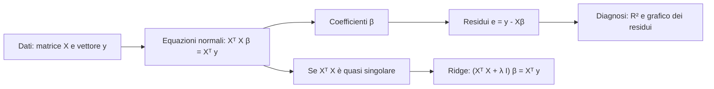

Un team marketing ha costruito un modello che prevede il fatturato settimanale dalla spesa pubblicitaria, e lo usa come una scatola nera: entra il budget, esce un numero. È uno scenario costruito, con numeri di esempio. Quando il budget raddoppia oltre i valori storici, il modello promette un fatturato impossibile; quando si aggiunge una seconda variabile di spesa, molto correlata alla prima, i coefficienti cambiano segno da un mese all'altro. Il modello era corretto dal punto di vista dell'algoritmo e inaffidabile dal punto di vista della diagnosi.

Questa scheda raccoglie quello che serve per aprire la scatola: la geometria dei minimi quadrati, la formula che risolve il problema, gli indicatori di qualità e il comportamento delle variabili correlate. Funziona come mappa del tema regressione dentro il modulo e come promemoria da consultare prima di fidarsi di un coefficiente.

## La regressione come proiezione e come minimizzazione

Dati $n$ osservazioni, la matrice $X$ ha una riga per osservazione e una colonna per variabile (più una colonna di uni per l'intercetta), mentre $y$ è il vettore dei valori da prevedere. Il modello lineare cerca un vettore di coefficienti $\beta$ tale che $X\beta$ si avvicini a $y$. Le due letture, geometrica e di ottimizzazione, descrivono lo stesso oggetto.

Nella lettura geometrica le colonne di $X$ generano un sottospazio, e $X\beta$ è un punto di quel sottospazio. Il punto più vicino a $y$ è la proiezione ortogonale di $y$ sul sottospazio: i residui $e = y - X\beta$ sono perpendicolari a ogni colonna di $X$. Nella lettura di ottimizzazione si minimizza la somma dei quadrati dei residui

$$S(\beta) = \lVert y - X\beta \rVert^2 = (y - X\beta)^\top (y - X\beta).$$

> **Idea chiave:** I minimi quadrati sono la proiezione ortogonale di y sullo spazio generato dalle variabili: i residui sono perpendicolari alle colonne di X, e da questa perpendicolarità discendono le equazioni normali.



Il gradiente di $S$ rispetto a $\beta$ è $-2X^\top(y - X\beta)$. Annullarlo equivale a imporre $X^\top e = 0$, cioè la perpendicolarità dei residui, e conduce alle equazioni normali

$$X^\top X\,\beta = X^\top y \quad\Longrightarrow\quad \hat{\beta} = (X^\top X)^{-1} X^\top y.$$

La stessa soluzione si raggiunge per via iterativa con la discesa del gradiente, che aggiorna $\beta \leftarrow \beta + \eta\,X^\top(y - X\beta)/n$ fino a convergenza. Con poche variabili conviene risolvere direttamente il sistema; con milioni di righe e molte colonne la discesa del gradiente, o il suo uso a blocchi, evita di formare $X^\top X$.

## Calcolo completo su cinque punti

Il modo migliore per fissare le equazioni normali è eseguirle a mano su un esempio piccolo. Cinque settimane con spesa pubblicitaria $x$ in migliaia di euro e fatturato $y$ in decine di migliaia di euro: $x = (1, 2, 3, 4, 5)$ e $y = (3{,}1;\ 4{,}9;\ 7{,}2;\ 8{,}8;\ 11{,}0)$.

1. Costruisci $X$ con una colonna di uni e una con $x$. Allora $X^\top X = \begin{pmatrix} 5 & 15 \\ 15 & 55 \end{pmatrix}$, perché $\sum 1 = 5$, $\sum x = 15$, $\sum x^2 = 1+4+9+16+25 = 55$.
2. Il vettore $X^\top y$ ha componenti $\sum y = 35{,}0$ e $\sum xy = 3{,}1 + 9{,}8 + 21{,}6 + 35{,}2 + 55{,}0 = 124{,}7$.
3. Il determinante di $X^\top X$ è $5 \times 55 - 15 \times 15 = 275 - 225 = 50$.
4. Intercetta: $\hat{\beta}_0 = (55 \times 35{,}0 - 15 \times 124{,}7)/50 = (1925 - 1870{,}5)/50 = 1{,}09$.
5. Pendenza: $\hat{\beta}_1 = (5 \times 124{,}7 - 15 \times 35{,}0)/50 = (623{,}5 - 525)/50 = 1{,}97$.

Il modello è $\hat{y} = 1{,}09 + 1{,}97\,x$: ogni migliaio di euro in più di spesa si associa a 1,97 decine di migliaia di euro di fatturato, cioè 19.700 euro. Le previsioni sui cinque punti sono 3,06; 5,03; 7,00; 8,97; 10,94 e i residui $+0{,}04;\ -0{,}13;\ +0{,}20;\ -0{,}17;\ +0{,}06$. Somma dei residui: zero, come deve essere con l'intercetta nel modello.

| Settimana | $x$ (k€) | $y$ osservato | $\hat{y}$ | Residuo | Residuo al quadrato |
| :--- | ---: | ---: | ---: | ---: | ---: |
| 1 | 1 | 3,1 | 3,06 | 0,04 | 0,0016 |
| 2 | 2 | 4,9 | 5,03 | -0,13 | 0,0169 |
| 3 | 3 | 7,2 | 7,00 | 0,20 | 0,0400 |
| 4 | 4 | 8,8 | 8,97 | -0,17 | 0,0289 |
| 5 | 5 | 11,0 | 10,94 | 0,06 | 0,0036 |

La somma dei quadrati dei residui è $0{,}0016 + 0{,}0169 + 0{,}0400 + 0{,}0289 + 0{,}0036 = 0{,}091$.

## R², varianza spiegata e limiti della lettura

L'indice $R^2$ confronta il modello con la baseline più semplice, quella che prevede sempre la media di $y$. La somma totale dei quadrati è $SST = \sum (y_i - \bar{y})^2$ e la quota non spiegata è $SSE/SST$:

$$R^2 = 1 - \frac{SSE}{SST}.$$

Nell'esempio la media di $y$ è $35/5 = 7{,}0$, gli scarti sono $-3{,}9;\ -2{,}1;\ 0{,}2;\ 1{,}8;\ 4{,}0$ e $SST = 15{,}21 + 4{,}41 + 0{,}04 + 3{,}24 + 16{,}00 = 38{,}9$. Quindi $R^2 = 1 - 0{,}091/38{,}9 = 1 - 0{,}00234 = 0{,}9977$: la spesa spiega il 99,8% della variabilità del fatturato in queste cinque settimane.

Il valore è così alto per due motivi: i dati sono costruiti, e con cinque punti qualsiasi relazione quasi lineare produce un $R^2$ elevato. Un $R^2$ alto non dimostra causalità, non garantisce previsioni fuori dall'intervallo osservato e cresce comunque aggiungendo variabili, anche irrilevanti. Il modello con $x$ da 1 a 5 non ha informazione su cosa accada a $x = 12$: l'estrapolazione supera di oltre due volte il massimo osservato e la linearità potrebbe non reggere, per esempio per saturazione del canale. Il grafico dei residui contro $\hat{y}$ è lo strumento diagnostico di base: se mostra una curva o una dispersione crescente, il modello lineare è mal specificato anche con $R^2$ elevato.

## Collinearità: quando i coefficienti diventano instabili

Se due variabili esplicative sono quasi la stessa informazione, $X^\top X$ è quasi singolare e il suo inverso amplifica il rumore. I coefficienti stimati possono essere enormi, di segno opposto e cambiare molto aggiungendo o togliendo poche righe, mentre la previsione complessiva resta ragionevole. Il sintomo tipico è un modello con buon $R^2$ e coefficienti individuali privi di senso.

Il blocco seguente simula 40 settimane con due canali di spesa correlati a 0,999 e mostra l'effetto sulle stime.

```python
# Collinearità e Ridge: due canali di spesa quasi identici (dati simulati, seme 3)
import numpy as np

rng = np.random.default_rng(3)
n = 40
x1 = rng.normal(100, 20, n)                 # spesa canale A, in migliaia di euro
x2 = 0.9 * x1 + rng.normal(0, 1, n)         # canale B quasi proporzionale ad A
y = 50 + 2 * x1 + rng.normal(0, 15, n)      # il fatturato dipende in realtà da un solo effetto combinato

print("correlazione:", np.corrcoef(x1, x2)[0, 1].round(4))
Z = np.column_stack([np.ones(n), x1, x2])
print("numero di condizionamento di XtX:", f"{np.linalg.cond(Z.T @ Z):.3g}")

# Variabili centrate: l'intercetta si ricostruisce dalle medie
Xc = np.column_stack([x1 - x1.mean(), x2 - x2.mean()])
yc = y - y.mean()

for lam in (0, 1, 100, 1000):
    # Ridge: (XtX + lambda I) beta = Xt y; con lambda = 0 coincide con OLS
    beta = np.linalg.solve(Xc.T @ Xc + lam * np.eye(2), Xc.T @ yc)
    print(f"lambda={lam:>5}  beta={beta.round(3)}  somma={beta.sum():.3f}")
```

Con questi dati la correlazione è 0,9988 e il numero di condizionamento di $X^\top X$ supera 360.000. Con $\lambda = 0$ (OLS) i coefficienti sono $4{,}32$ e $-2{,}48$: segni opposti per due canali quasi identici, con una somma di 1,85. Dividendo il campione in due metà i coefficienti diventano $(5{,}17;\ -3{,}54)$ e $(3{,}81;\ -1{,}75)$: sono instabili, mentre la loro combinazione resta fra 1,6 e 2,1. Con $\lambda = 1000$ la stima diventa $(1{,}19;\ 0{,}94)$, più equilibrata, con somma complessiva di circa 2,1.

La penalità Ridge aggiunge $\lambda\lVert\beta\rVert^2$ alla funzione da minimizzare e produce $\hat{\beta}_\lambda = (X^\top X + \lambda I)^{-1} X^\top y$. Sommare $\lambda I$ alla diagonale allontana la matrice dalla singolarità e riduce l'ampiezza dei coefficienti. Introduce un piccolo bias e riduce molto la varianza. Il parametro $\lambda$ non si fissa a occhio: lo scegli per validazione incrociata. Le variabili vanno standardizzate prima, perché la penalità dipende dall'unità di misura.

## Errori tipici nell'uso della regressione in azienda

### Interpretare ogni coefficiente come effetto causale

Il sintomo è la frase «ogni euro in più sul canale B riduce il fatturato», letta da un coefficiente negativo. Succede perché il coefficiente misura l'effetto «a parità delle altre variabili», e con variabili collineari la parità è impossibile da osservare. Si evita controllando la correlazione fra regressori, il numero di condizionamento e la stabilità delle stime su sottocampioni.

### Estrapolare fuori dall'intervallo dei dati

Il sintomo è una previsione per un budget mai osservato. Succede perché la retta continua matematicamente all'infinito mentre il fenomeno reale satura. Si corregge dichiarando l'intervallo di validità del modello e confrontando con un esperimento sul nuovo livello di spesa.

### Confidare nel solo R²

Il sintomo è un modello promosso perché $R^2 = 0{,}95$ su dati con andamento stagionale, mentre i residui mostrano un'onda. Succede perché $R^2$ aggrega e nasconde la struttura. Si corregge ispezionando i residui nel tempo e confrontando su dati non usati per l'addestramento.

## Verifica sulla regressione

1. Nell'esempio dei cinque punti, quale previsione dà il modello per una spesa di 3,5 migliaia di euro e perché è affidabile?

<details>
<summary>Mostra risposta</summary>

$\hat{y} = 1{,}09 + 1{,}97 \times 3{,}5 = 1{,}09 + 6{,}895 = 7{,}985$, cioè circa 7,99 decine di migliaia di euro. È un'interpolazione: 3,5 cade dentro l'intervallo osservato da 1 a 5.

</details>

2. Con $SSE = 0{,}091$ e $SST = 38{,}9$ quanto vale $R^2$ e cosa non dimostra?

<details>
<summary>Mostra risposta</summary>

$R^2 = 1 - 0{,}091/38{,}9 = 0{,}9977$. Non dimostra causalità, non garantisce previsioni fuori dall'intervallo 1-5 e con cinque soli punti è poco robusto.

</details>

3. Due regressori hanno correlazione 0,999 e i coefficienti OLS hanno segni opposti. Quale rimedio proponi?

<details>
<summary>Mostra risposta</summary>

Rimuovere uno dei due regressori, combinarli in una sola variabile oppure applicare la penalità Ridge con $\lambda$ scelto per validazione incrociata, dopo aver standardizzato le variabili.

</details>

4. Perché i residui di una regressione con intercetta sommano zero?

<details>
<summary>Mostra risposta</summary>

Perché i residui sono perpendicolari a ogni colonna di $X$, compresa la colonna di uni dell'intercetta. Il prodotto scalare fra residui e colonna di uni è proprio la somma dei residui, che quindi vale zero.

</details>
