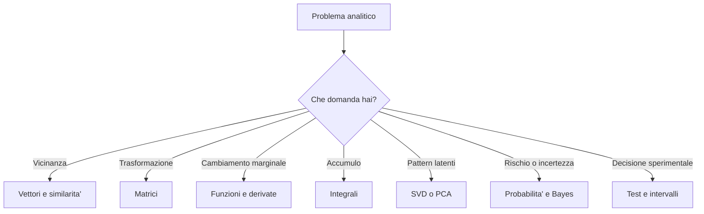

import { Aside } from '@astrojs/starlight/components'

Questa lezione raccoglie i pattern minimi del modulo in formato operativo.

## Mappa decisionale



## Notazione minima da leggere al volo

### Algebra lineare

- `x` = vettore
- `A` = matrice
- `x dot y` = prodotto scalare
- `||x||` = norma
- `A @ x` = trasformazione lineare

### Analisi

- `f(x)` = funzione
- `f'(x)` = derivata
- `df/dx` = derivata o derivata parziale
- `integrale f(x) dx` = accumulo o area
- `grad f` = gradiente

### Probabilita' e statistica

- `P(A)` = probabilita' di A
- `P(A|B)` = probabilita' di A dato B
- `E[X]` = valore atteso
- `Var(X)` = varianza
- `SE` = errore standard
- `CI` = intervallo di confidenza

## Librerie Python da tenere vicine

```python
import numpy as np
import pandas as pd
from scipy import stats
from sklearn.decomposition import PCA, TruncatedSVD
```

## Quando usare cosa

### Vettori e cosine similarity

Usali per:

- similarita' cliente-prodotto
- recommendation
- ranking di profili vicini

### Matrici

Usale per:

- trasformazioni lineari
- sistemi di equazioni
- matrici utenti-feature

### Derivate

Usale per:

- leggere effetto marginale
- trovare massimi/minimi
- capire saturazione del budget

### Integrali

Usali per:

- area sotto una curva
- accumulo nel tempo
- probabilita' continua

### SVD / PCA

Usali per:

- comprimere feature
- trovare strutture latenti
- visualizzare dati ad alta dimensione

### Bayes

Usalo per:

- aggiornare probabilita' con un segnale
- ragionare su classi rare
- leggere fraud e churn score

### Intervalli di confidenza

Usali per:

- mostrare incertezza
- confrontare stime
- evitare precisione apparente

### Test non parametrici

Usali per:

- campioni piccoli
- distribuzioni distorte
- outlier forti

## Mini dataset e librerie per fare pratica

- `sklearn.datasets.load_wine()`: similarity, scaling, PCA, clustering di base
- `sklearn.datasets.load_diabetes()`: regressione, curve non lineari, bootstrap su target continuo
- `sklearn.datasets.load_breast_cancer()`: Bayes, ROC-AUC, confronto tra gruppi
- `statsmodels.api.datasets.longley.load_pandas()`: design matrix, OLS, lettura dei coefficienti
- `statsmodels.stats.proportion`: test su tassi di conversione
- `statsmodels.stats.multitest`: correzione per multiple testing

Stack minimo utile per notebook:

```python
import numpy as np
import pandas as pd
import statsmodels.api as sm
from sklearn.preprocessing import StandardScaler
```

## Anti-pattern da evitare

- usare medie su dati fortemente asimmetrici senza controllare la distribuzione
- leggere il p-value come probabilita' che l'ipotesi nulla sia vera
- applicare cosine similarity su feature non scalate
- forzare la normale su dati con code lunghe
- usare l'inversa come scorciatoia numerica
- fermare un test quando "sembra abbastanza buono"

## Come leggere un articolo o una formula in inglese

Traduzioni utili:

- expected value = valore atteso
- variance = varianza
- likelihood = verosimiglianza
- confidence interval = intervallo di confidenza
- eigenvalue = autovalore
- singular vector = vettore singolare
- derivative = derivata
- slope = pendenza

<Aside type="tip">
Quando incontri una formula nuova, non partire dai simboli. Parti dalla domanda: cosa entra, cosa esce, quale fenomeno sta descrivendo?
</Aside>

## Checklist pre-analisi

1. Qual e' l'oggetto matematico giusto: vettore, funzione, probabilita' o test?
2. Le scale delle variabili sono confrontabili?
3. La distribuzione dei dati e' plausibile per il metodo scelto?
4. Sto leggendo incertezza ed effect size insieme?
5. Il risultato cambia una decisione reale?

## Sequenza rapida da usare sul lavoro

Se hai cinque minuti e un problema ambiguo, usa questa sequenza:

- descrivi il fenomeno con una frase
- traduci la frase in oggetto matematico
- scegli una metrica o una funzione
- verifica assunzioni minime
- decidi se l'output e' azionabile

## Riepilogo operativo

- La matematica utile in analytics e' quella che chiarisce una decisione.
- Ogni formula del modulo risponde a una domanda concreta: vicinanza, cambiamento, accumulo, incertezza o evidenza.
- Se non sai da dove partire, torna sempre alla checklist.
