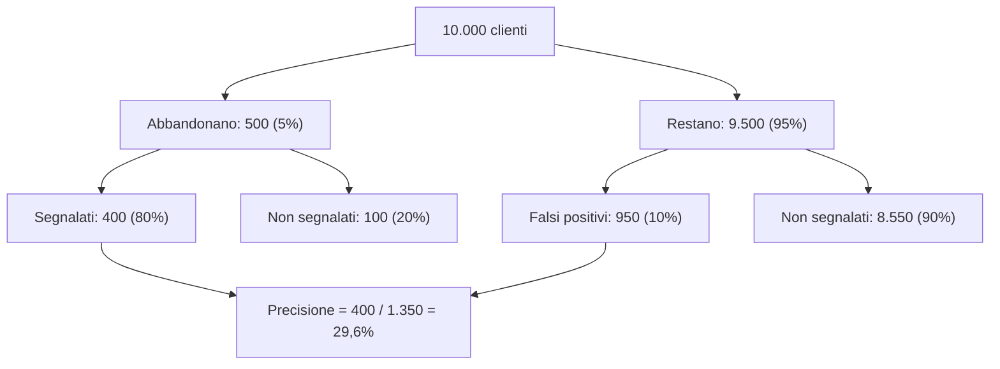

Un team customer success presenta un modello di churn con accuratezza del 95% su 10.000 clienti. È uno scenario costruito, con numeri di esempio. La direzione approva l'uso del modello per decidere dove investire in retention. Poi un analista osserva che il tasso di abbandono è del 5%: un programma che risponde «nessuno abbandonerà» a ogni cliente ha anch'esso accuratezza del 95% e non individua nemmeno un cliente a rischio. Il modello presentato era, per lo scopo che serviva, inutile.

Il problema non è statistico in senso sofisticato: è un errore di ragionamento probabilistico. La domanda utile non è «quante volte il modello ha ragione», ma «se il modello segnala un cliente, qual è la probabilità che abbandoni davvero». Sono due probabilità condizionate diverse e la seconda dipende dal tasso base. Questa lezione costruisce gli strumenti per distinguerle.

## Spazio degli eventi e assiomi di Kolmogorov

Un esperimento casuale ha uno spazio campionario $\Omega$, l'insieme di tutti gli esiti possibili, e una famiglia di eventi, sottoinsiemi di $\Omega$ a cui si assegna una probabilità. Nel caso dei clienti, $\Omega$ è l'insieme dei 10.000 clienti e l'evento $B$ = «il cliente abbandona» è un sottoinsieme di 500 elementi. Una funzione $P$ è una probabilità se soddisfa tre assiomi:

1. $P(A) \ge 0$ per ogni evento $A$.
2. $P(\Omega) = 1$.
3. Per eventi $A_1, A_2, \dots$ a due a due disgiunti, $P\left(\bigcup_i A_i\right) = \sum_i P(A_i)$.

Da questi tre assiomi seguono le regole che si usano ogni giorno. La probabilità del complementare è $P(A^c) = 1 - P(A)$. L'unione di due eventi qualsiasi, anche non disgiunti, vale

$$P(A \cup B) = P(A) + P(B) - P(A \cap B),$$

perché sommando $P(A)$ e $P(B)$ l'intersezione viene contata due volte. In pratica gli assiomi servono come controllo di coerenza: se un report assegna il 60% di probabilità a «acquista entro 7 giorni» e il 55% a «non acquista entro 7 giorni» per lo stesso cliente, le due cifre sommano 115% e almeno una è sbagliata.

> **Idea chiave:** Una probabilità condizionata cambia lo spazio di riferimento: P(A|B) è la quota di A dentro B, non dentro tutto, e P(A|B) e P(B|A) sono quantità diverse che coincidono solo per caso.

## Probabilità condizionata e tabella dei conteggi

La probabilità di $A$ sapendo che $B$ si è verificato si definisce come

$$P(A \mid B) = \frac{P(A \cap B)}{P(B)}, \qquad P(B) > 0.$$

Il denominatore restringe il mondo ai soli casi in cui $B$ è vero, e il numeratore conta quanti di questi soddisfano anche $A$. La lettura concreta passa da una tabella di conteggi. Con 10.000 clienti, un tasso di abbandono del 5%, un modello che segnala l'80% di chi abbandona (sensibilità) e segnala per errore il 10% di chi resta (tasso di falsi positivi), i conteggi sono questi.

| Esito reale | Segnalati dal modello | Non segnalati | Totale |
| :--- | ---: | ---: | ---: |
| Abbandona | 400 | 100 | 500 |
| Resta | 950 | 8.550 | 9.500 |
| Totale | 1.350 | 8.650 | 10.000 |

Da questa tabella si leggono tutte le probabilità che servono, ciascuna con un denominatore diverso. La sensibilità è $P(\text{segnale} \mid \text{abbandona}) = 400/500 = 0{,}80$. L'accuratezza complessiva è $(400 + 8.550)/10.000 = 0{,}895$, cioè 89,5%, più bassa del 95% del modello banale che dice sempre «resta». La quantità che interessa al responsabile retention è la precisione, cioè $P(\text{abbandona} \mid \text{segnale}) = 400/1.350 = 0{,}296$: di 1.350 clienti segnalati meno di tre su dieci stanno davvero per andarsene.

## Invertire il condizionamento: la formula di Bayes

La tabella dà la risposta perché sono disponibili i conteggi. Spesso hai solo le probabilità nel verso sbagliato: sai quanto il modello rileva chi abbandona (80%) e quanto sbaglia su chi resta (10%), non quanto vale un segnale. La formula di Bayes converte l'una nell'altra. Prima serve la probabilità totale del segnale, ottenuta scomponendo sui due casi $B$ e $B^c$:

$$P(S) = P(S \mid B)\,P(B) + P(S \mid B^c)\,P(B^c).$$

Poi

$$P(B \mid S) = \frac{P(S \mid B)\,P(B)}{P(S)} = \frac{P(S \mid B)\,P(B)}{P(S \mid B)\,P(B) + P(S \mid B^c)\,P(B^c)}.$$

Il calcolo con i numeri del modello di churn: $P(B) = 0{,}05$, $P(S \mid B) = 0{,}80$, $P(S \mid B^c) = 0{,}10$.

1. Numeratore: $0{,}80 \times 0{,}05 = 0{,}040$.
2. Contributo dei falsi positivi: $0{,}10 \times 0{,}95 = 0{,}095$.
3. Denominatore: $0{,}040 + 0{,}095 = 0{,}135$.
4. Risultato: $P(B \mid S) = 0{,}040/0{,}135 = 0{,}296$, cioè 29,6%.

Il risultato coincide con il conteggio $400/1.350$, come deve. Il motivo del valore basso è che i falsi positivi (950 clienti) sono più del doppio dei veri positivi (400): il 10% di errore, applicato a una popolazione di 9.500 clienti che restano, produce più rumore di quanto il segnale riesca a coprire. Con un abbandono del 2% invece del 5% lo stesso modello avrebbe precisione $0{,}80 \times 0{,}02 / (0{,}80 \times 0{,}02 + 0{,}10 \times 0{,}98) = 0{,}016/0{,}114 = 14{,}0\%$. Il tasso base conta quanto la qualità del modello.



## Indipendenza: quando puoi moltiplicare le probabilità

Due eventi sono indipendenti se la conoscenza di uno non cambia la probabilità dell'altro, cioè se vale

$$P(A \cap B) = P(A)\,P(B).$$

Equivale a dire che $P(A \mid B) = P(A)$. La moltiplicazione è lecita solo in questo caso, ed è il punto in cui molte analisi scivolano. Supponi che il 20% dei clienti abbia aperto un ticket di supporto nell'ultimo mese ($A$), che il 5% abbandoni ($B$) e che il 3% faccia entrambe le cose. Se i due eventi fossero indipendenti ci si aspetterebbe $0{,}20 \times 0{,}05 = 0{,}01$, cioè l'1% dei clienti. Il dato osservato è il triplo. Ne segue che $P(B \mid A) = 0{,}03/0{,}20 = 0{,}15$: chi apre un ticket ha una probabilità di abbandono del 15%, tre volte la media. L'unione, per la regola dell'inclusione-esclusione, è $0{,}20 + 0{,}05 - 0{,}03 = 0{,}22$.

Il test di indipendenza è quindi un confronto fra una frequenza osservata congiunta e il prodotto delle frequenze marginali. Se non coincidono, moltiplicare probabilità produce stime sbagliate: una stima ingenua del numero di clienti con ticket aperto e abbandono sarebbe 100 invece di 300 su 10.000.

## Calcolare tutto da una tabella di eventi

Il codice seguente parte dai conteggi, ricostruisce le probabilità condizionate e confronta la precisione a due tassi base diversi.

```python
# Probabilità condizionate da una tabella di conteggi e confronto fra tassi base
import numpy as np

N = 10_000
churn = 500                    # clienti che abbandonano (tasso base 5%)
tp, fn = 400, 100              # tra chi abbandona: segnalati / non segnalati
fp, tn = 950, 8_550            # tra chi resta: segnalati / non segnalati

assert tp + fn == churn and fp + tn == N - churn   # controllo di coerenza dei conteggi

sensibilita = tp / churn                       # P(segnale | abbandona)
precisione = tp / (tp + fp)                    # P(abbandona | segnale)
accuratezza = (tp + tn) / N
banale = (N - churn) / N                       # modello che dice sempre "resta"
print(f"sens={sensibilita:.2f} prec={precisione:.3f} acc={accuratezza:.3f} banale={banale:.2f}")

def precisione_bayes(base, sens=0.80, fpr=0.10):
    # Formula di Bayes con probabilità totale a denominatore
    return sens * base / (sens * base + fpr * (1 - base))

for base in (0.05, 0.02, 0.005):
    print(f"tasso base {base:>5.1%} -> precisione {precisione_bayes(base):.3f}")
```

L'output mostra sensibilità 0,80, precisione 0,296, accuratezza 0,895 contro 0,95 del modello banale, poi precisione 0,296 al 5%, 0,140 al 2% e 0,039 allo 0,5%. L'ultima riga è l'avvertimento per gli eventi rari: un modello con sensibilità 80% e falsi positivi 10% segnala quasi esclusivamente clienti che non abbandonerebbero.

La stessa tabella si costruisce in SQL con aggregazioni condizionali, utili quando i dati stanno nel magazzino. Il blocco seguente è ClickHouse.

```sql
-- Conteggi della matrice di confusione e probabilità condizionate in ClickHouse
SELECT
  countIf(churned = 1 AND alert = 1) AS tp,
  countIf(churned = 1 AND alert = 0) AS fn,
  countIf(churned = 0 AND alert = 1) AS fp,
  countIf(churned = 0 AND alert = 0) AS tn,
  round(tp / (tp + fn), 3) AS sensibilita,
  round(tp / (tp + fp), 3) AS precisione
FROM mart_churn_scores
WHERE scored_at >= today() - 30;
```

## Errori tipici nel ragionare con le probabilità

### Scambiare P(A|B) con P(B|A)

Il sintomo è la frase «il 95% dei clienti che hanno abbandonato aveva ricevuto un alert, quindi un alert predice il 95% degli abbandoni». Sembra ragionevole perché la grammatica delle due affermazioni è quasi identica e il cervello le tratta come equivalenti. In realtà la prima è la sensibilità e la seconda la precisione, e la loro relazione passa per il tasso base. Si evita scrivendo sempre il condizionamento esplicito, $P(\text{abbandona}\mid\text{alert})$, e verificando quale denominatore stai usando.

### Giudicare un modello dall'accuratezza su classi sbilanciate

Il sintomo è un'accuratezza altissima su una classe rara, come l'abbandono al 5% o la frode allo 0,1%. Succede perché la classe maggioritaria domina il conteggio: il modello banale con 95% di accuratezza è la baseline minima da battere, non un successo. Si corregge riportando sensibilità, precisione e il confronto con la baseline, oppure il costo atteso di errori di tipo diverso.

### Moltiplicare probabilità senza verificare l'indipendenza

Il sintomo è una stima di sovrapposizione fra due segmenti calcolata come prodotto delle quote, che non torna con il conteggio reale. Succede perché la moltiplicazione è semplice e non richiede dati congiunti. Nell'esempio dei ticket e dell'abbandono la stima per indipendenza era 100 clienti contro 300 osservati. La soluzione è calcolare $P(A \cap B)$ direttamente dai dati, oppure usare la probabilità condizionata $P(A)\,P(B \mid A)$, che vale sempre.

## Controllo sulle tue probabilità

1. In una base di 20.000 clienti il 4% abbandona. Un modello segnala il 75% di chi abbandona e il 6% di chi resta. Quanti clienti vengono segnalati e quale quota di questi abbandona davvero?

<details>
<summary>Mostra risposta</summary>

Abbandonano $20.000 \times 0{,}04 = 800$ clienti, di cui $800 \times 0{,}75 = 600$ segnalati. Restano 19.200 clienti, di cui $19.200 \times 0{,}06 = 1.152$ segnalati per errore. I segnalati sono $600 + 1.152 = 1.752$ e la precisione è $600/1.752 = 34{,}2\%$.

</details>

2. Il 30% dei clienti ha usato la funzione A, il 40% la funzione B e il 12% entrambe. Sono indipendenti? Quanto vale $P(A \cup B)$?

<details>
<summary>Mostra risposta</summary>

Il prodotto è $0{,}30 \times 0{,}40 = 0{,}12$, uguale al valore osservato per l'intersezione: gli eventi sono indipendenti. L'unione è $0{,}30 + 0{,}40 - 0{,}12 = 0{,}58$, cioè 58%.

</details>

3. Un sistema antifrode segnala l'1% delle transazioni; la frode reale è allo 0,2%, il sistema ne rileva il 90% e segnala per errore lo 0,8% di quelle regolari. Perché la precisione è bassa e quanto vale?

<details>
<summary>Mostra risposta</summary>

Numeratore $0{,}90 \times 0{,}002 = 0{,}0018$; falsi positivi $0{,}008 \times 0{,}998 = 0{,}007984$; denominatore $0{,}009784$. Precisione $= 0{,}0018/0{,}009784 = 18{,}4\%$. È bassa perché la frode è rara: le transazioni regolari sono 499 volte più numerose e anche un tasso di errore dello 0,8% produce molti più falsi che veri positivi.

</details>

4. Perché il 95% di accuratezza non basta a promuovere un modello di churn con tasso base del 5%?

<details>
<summary>Mostra risposta</summary>

Perché la baseline che predice sempre «resta» ottiene già il 95% senza individuare nessun cliente a rischio. Il modello va giudicato su sensibilità, precisione e valore economico degli interventi, confrontati con la baseline.

</details>
