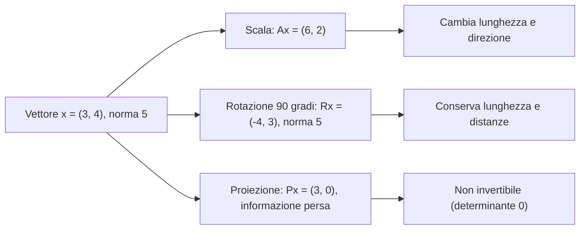

## Il motore di raccomandazione che consigliava il cliente sbagliato

Scenario costruito con numeri di esempio: un catalogo retail italiano vuole suggerire a ogni cliente i "clienti gemelli", cioè quelli con abitudini di acquisto simili, per proporre i prodotti che i gemelli hanno già comprato. Il profilo di ciascun cliente è un vettore con le unità acquistate ogni mese in tre categorie. Il cliente X compra $(2, 1, 1)$ unità, il cliente Y compra $(20, 10, 10)$ e il cliente Z compra $(1, 0, 3)$.

A occhio X e Y fanno la stessa spesa, con le stesse proporzioni, solo che Y la fa dieci volte più grande, per esempio perché è un negozio e non un privato. Eppure il motore basato sulla distanza euclidea indica come gemello più vicino di X il cliente Z, perché Z dista appena 2,45 unità da X mentre Y ne dista 22,05. Il motore non ha sbagliato un calcolo: ha risposto a una domanda diversa da quella del business, "chi compra quantità simili" invece di "chi compra le stesse cose".

> **Idea chiave:** la distanza euclidea confronta posizioni nello spazio, la similarità coseno confronta direzioni; la scelta dipende da quanto conta il volume rispetto alla composizione del profilo.

Una trasformazione lineare, come una normalizzazione o una proiezione, può spostare un problema da una categoria all'altra: dopo aver riportato tutti i vettori a lunghezza 1, distanza euclidea e coseno diventano due misure equivalenti. Questa lezione mette in relazione le due misure, mostra che cosa fa una matrice quando agisce su un vettore e introduce autovalori e SVD come strumenti per scegliere le direzioni che portano più informazione.

## Distanza e coseno, due modi di dire vicino

La distanza euclidea tra due vettori è $d(\mathbf{x}, \mathbf{y}) = \lVert \mathbf{x} - \mathbf{y} \rVert_2$ e cresce con il volume: moltiplicare per 10 un vettore sposta il punto di molto, anche se la direzione non cambia. La similarità coseno è invece $\cos\theta = \dfrac{\mathbf{x}\cdot\mathbf{y}}{\lVert\mathbf{x}\rVert\,\lVert\mathbf{y}\rVert}$ e non cambia se si moltiplica un vettore per una costante positiva.

C'è un legame preciso tra le due. Per due vettori normalizzati a lunghezza 1 vale $\lVert \mathbf{x} - \mathbf{y} \rVert^2 = 2 - 2\cos\theta$, quindi ordinare i vicini per distanza o per coseno produce lo stesso elenco. Per vettori non normalizzati i due ordinamenti possono divergere, e il caso di X, Y e Z lo dimostra.

| Situazione | Misura consigliata | Motivo |
| --- | --- | --- |
| Conteggi di acquisti, parole in un testo, click per categoria | Coseno | contano le proporzioni, il volume dipende dalla dimensione del cliente o del documento |
| Feature fisiche confrontabili (prezzi, tempi, importi) già standardizzate | Euclidea | le differenze assolute hanno significato |
| Vettori di embedding già normalizzati | Coseno o prodotto scalare | equivalenti dopo la normalizzazione |
| Feature correlate con scale diverse | Mahalanobis | corregge correlazione e scala insieme |

La regola pratica è chiedersi se un cliente che compra il doppio di un altro, nelle stesse proporzioni, debba risultare identico oppure diverso. Se deve risultare identico serve il coseno, se deve risultare diverso serve la distanza.

## Che cosa fa una matrice quando agisce su un vettore

Una trasformazione lineare è una funzione $\mathbf{y} = A\mathbf{x}$ in cui la matrice $A$ trasforma un vettore in un altro. Le proprietà che la definiscono sono due: la somma di due vettori viene trasformata come la somma delle trasformate, e moltiplicare un vettore per una costante moltiplica anche il risultato. Il vantaggio per l'analista è che tutta la trasformazione si riassume in una tabella di numeri.

Prendiamo il vettore $\mathbf{x} = (3, 4)$, di norma 5, e tre matrici elementari. La matrice di scala $A = \begin{pmatrix} 2 & 0 \\ 0 & 0{,}5 \end{pmatrix}$ raddoppia la prima coordinata e dimezza la seconda: $A\mathbf{x} = (2\cdot 3 + 0\cdot 4,\; 0\cdot 3 + 0{,}5\cdot 4) = (6, 2)$. La rotazione di 90 gradi $R = \begin{pmatrix} 0 & -1 \\ 1 & 0 \end{pmatrix}$ dà $R\mathbf{x} = (0\cdot 3 - 1\cdot 4,\; 1\cdot 3 + 0\cdot 4) = (-4, 3)$, che ha ancora norma $\sqrt{16 + 9} = 5$. La proiezione sull'asse orizzontale $P = \begin{pmatrix} 1 & 0 \\ 0 & 0 \end{pmatrix}$ dà $P\mathbf{x} = (3, 0)$ e butta via la seconda coordinata.



La distinzione utile per l'analisi dei dati è tra trasformazioni che conservano le distanze, come le rotazioni, e quelle che le alterano, come le scale e le proiezioni. Standardizzare le colonne equivale a moltiplicare per una matrice diagonale che contiene gli inversi delle deviazioni standard: è una scala diversa per ogni asse, ed è per questo che cambia il vicinato dei punti. Il determinante dice quanto la trasformazione cambia le aree: la scala sopra ha determinante $2 \times 0{,}5 = 1$, quindi conserva l'area pur deformando la forma, la rotazione ha determinante 1 e la proiezione ha determinante 0, il segnale che la trasformazione non si può invertire.

## Esempio svolto: euclidea contro coseno su tre clienti

Calcoliamo le due misure sui tre profili dello scenario, passo per passo.

**Passo 1, norme.** $\lVert X \rVert = \sqrt{4 + 1 + 1} = \sqrt{6} \approx 2{,}449$. $\lVert Y \rVert = \sqrt{400 + 100 + 100} = \sqrt{600} \approx 24{,}495$. $\lVert Z \rVert = \sqrt{1 + 0 + 9} = \sqrt{10} \approx 3{,}162$.

**Passo 2, distanze euclidee.** $X - Y = (-18, -9, -9)$ e quindi $d(X, Y) = \sqrt{324 + 81 + 81} = \sqrt{486} \approx 22{,}05$. $X - Z = (1, 1, -2)$ e quindi $d(X, Z) = \sqrt{1 + 1 + 4} = \sqrt{6} \approx 2{,}45$. Per la distanza di Manhattan i valori sono 36 unità per X e Y e 4 unità per X e Z, con lo stesso verdetto.

**Passo 3, prodotti scalari.** $X \cdot Y = 40 + 10 + 10 = 60$ e $X \cdot Z = 2 + 0 + 3 = 5$.

**Passo 4, coseni.** $\cos(X, Y) = 60 / (2{,}449 \times 24{,}495) = 60/60 = 1{,}000$. $\cos(X, Z) = 5 / (2{,}449 \times 3{,}162) = 5/7{,}746 \approx 0{,}645$.

Le due misure danno ordinamenti opposti. Per la distanza X è vicino a Z (2,45) e lontano da Y (22,05); per il coseno X coincide con Y (1,000) e somiglia a Z solo per il 64,5%. Se l'obiettivo è suggerire prodotti sulla base delle categorie acquistate, il coseno indica Y come gemello corretto, e il fatto che Y compra dieci volte di più si gestisce a parte, per esempio con una regola sul volume o con un fattore di scala sulle quantità suggerite.

## Autovalori e SVD, trovare le direzioni che contano

Quando le feature sono molte e correlate, conviene sostituirle con poche combinazioni lineari che catturano la maggior parte della variabilità. Le direzioni di quelle combinazioni sono gli autovettori della matrice di covarianza e le varianze lungo di esse sono gli autovalori. Un autovettore $\mathbf{v}$ di una matrice $C$ è una direzione che la matrice non ruota, ma si limita ad allungare di un fattore $\lambda$: $C\mathbf{v} = \lambda\mathbf{v}$.

Prendiamo la covarianza di due feature, per esempio ordini e spesa standardizzati in unità comparabili, $C = \begin{pmatrix} 4 & 2 \\ 2 & 3 \end{pmatrix}$. Gli autovalori sono le radici di $\det(C - \lambda I) = 0$, cioè $(4 - \lambda)(3 - \lambda) - 4 = \lambda^2 - 7\lambda + 8 = 0$. Quindi $\lambda = \dfrac{7 \pm \sqrt{49 - 32}}{2} = \dfrac{7 \pm \sqrt{17}}{2}$, ovvero $\lambda_1 \approx 5{,}56$ e $\lambda_2 \approx 1{,}44$. La loro somma è 7, uguale alla traccia $4 + 3$, e il prodotto è 8, uguale al determinante $12 - 4$: due controlli rapidi per accorgersi di un errore di calcolo.

L'autovettore relativo a $\lambda_1$ risolve $(4 - 5{,}56)x + 2y = 0$, quindi $y \approx 0{,}78\,x$. Normalizzato diventa circa $(0{,}788;\, 0{,}615)$. La varianza spiegata dalla prima direzione è $5{,}56/7 \approx 79{,}5\%$, quella della seconda è $1{,}44/7 \approx 20{,}5\%$. Proiettando i punti sulla prima direzione, si passa da due feature a una sola perdendo il 20,5% della variabilità: una riduzione che spesso è accettabile.

La decomposizione ai valori singolari (SVD) arriva allo stesso risultato senza formare la matrice di covarianza. Se $X$ è la matrice dei dati centrata, con $n$ righe, si scrive $X = U\Sigma V^\top$: le colonne di $V$ sono le direzioni principali e i valori singolari $\sigma_k$ legano la SVD agli autovalori con $\lambda_k = \sigma_k^2/(n-1)$. In pratica la SVD è numericamente più stabile e si applica anche a matrici rettangolari, ed è la scelta di default nelle librerie.

## Lo stesso calcolo in numpy

Il codice seguente verifica i numeri dell'esempio: distanze e coseni sui tre clienti, autovalori della matrice di covarianza e la relazione tra SVD e autovalori su un campione simulato.

```python
# Distanza euclidea contro similarità coseno, poi autovalori della covarianza
import numpy as np

# acquisti mensili di tre prodotti per tre clienti
X = np.array([2, 1, 1], dtype=float)
Y = np.array([20, 10, 10], dtype=float)
Z = np.array([1, 0, 3], dtype=float)

def cosine(a, b):
    return a @ b / (np.linalg.norm(a) * np.linalg.norm(b))

print("euclidea X-Y:", round(np.linalg.norm(X - Y), 2), " X-Z:", round(np.linalg.norm(X - Z), 2))
print("coseno   X-Y:", round(cosine(X, Y), 3), " X-Z:", round(cosine(X, Z), 3))

# covarianza di due feature e decomposizione spettrale
C = np.array([[4.0, 2.0], [2.0, 3.0]])
valori, vettori = np.linalg.eigh(C)  # in ordine crescente
print("autovalori:", np.round(valori[::-1], 2))
print("varianza spiegata dalla prima componente:", round(valori[-1] / valori.sum(), 3))

# SVD di una matrice centrata: s^2/(n-1) coincide con gli autovalori della covarianza
rng = np.random.default_rng(0)
A = rng.multivariate_normal([0, 0], C, size=2000)
A = A - A.mean(axis=0)
s = np.linalg.svd(A, compute_uv=False)
print("s^2/(n-1):", np.round(s**2 / (len(A) - 1), 2))
print("autovalori di cov(A):", np.round(np.sort(np.linalg.eigvalsh(np.cov(A.T)))[::-1], 2))
```

L'esecuzione stampa 22,05 e 2,45 per le distanze, 1,0 e 0,645 per i coseni, autovalori 5,56 e 1,44, varianza spiegata 0,795. Sul campione simulato di 2.000 righe i valori singolari al quadrato divisi per $n - 1$ coincidono con gli autovalori della covarianza campionaria, circa 5,59 e 1,42, leggermente diversi da 5,56 e 1,44 perché il campione è finito.

## Tre trappole nelle similarità e nelle trasformazioni

### Usare il coseno quando il volume è l'informazione

Il sintomo è un sistema che tratta un cliente da 5 euro al mese come identico a uno da 5.000 euro purché i prodotti siano nelle stesse proporzioni. Succede perché il coseno cancella la lunghezza dei vettori, e a volte la lunghezza è proprio l'informazione, per esempio quando si segmenta per valore. Si corregge combinando le due misure, per esempio applicando il coseno ai profili e un vincolo sul rapporto tra le norme, oppure aggiungendo il volume come feature separata.

### Standardizzare con parametri calcolati su tutto il dataset

Il sintomo è un modello con ottime metriche in sviluppo e prestazioni peggiori in produzione. Il motivo è che media e deviazione standard, calcolate anche sui dati di test, fanno trapelare informazione dal futuro nella trasformazione. La trasformazione lineare va appresa solo sul training set e poi applicata, con gli stessi parametri, a validazione, test e dati nuovi.

### Confrontare tutte le coppie su tabelle grandi

Il sintomo è un job notturno che passa da pochi minuti a molte ore quando la base clienti raddoppia. Il numero di coppie cresce con il quadrato di $n$: con 200.000 clienti le coppie distinte sono $200.000 \times 199.999 / 2 \approx 2{,}0 \times 10^{10}$. A 5 milioni di coppie al secondo servono circa 4.000 secondi, cioè poco più di 66 minuti, e con 400.000 clienti il tempo quadruplica a circa 4,4 ore. Si evita con ricerca approssimata dei vicini (indici come HNSW o LSH), con blocchi per segmento oppure con riduzione dimensionale preliminare.

## Il caso difficile degli spazi ad alta dimensione

Con molte feature accade un fenomeno controintuitivo: i vettori casuali tendono a essere quasi ortogonali e le distanze tra coppie diverse tendono a somigliarsi. In uno spazio a 1.000 dimensioni due vettori scelti a caso hanno coseno attorno a zero, con una dispersione dell'ordine di $1/\sqrt{1000} \approx 0{,}03$. Un coseno di 0,10 diventa allora un segnale forte, mentre in due dimensioni sarebbe irrilevante.

La conseguenza pratica è che le soglie di similarità non si trasportano da un contesto all'altro. Una soglia come "coseno maggiore di 0,8" ha senso con 20 feature molto strutturate, mentre con embedding di testo a 768 dimensioni valori sopra 0,5 possono già indicare quasi sinonimi. Il modo corretto di fissare una soglia è osservare la distribuzione dei coseni su coppie note come simili e su coppie note come diverse, e scegliere il punto che separa meglio le due code. Se la dimensione è alta e i dati sono pochi, la riduzione con SVD alle prime componenti, che conservano per esempio il 90% della varianza, rende i confronti più stabili.

## Verifica su similarità e trasformazioni

1. Due clienti hanno profili $(3, 0, 4)$ e $(6, 0, 8)$. Qual è il loro coseno e quale la distanza euclidea?

<details>
<summary>Mostra risposta</summary>

Il secondo vettore è il doppio del primo: coseno $= \dfrac{18 + 32}{5 \times 10} = 1$. La distanza euclidea è $\lVert(-3, 0, -4)\rVert = 5$. Stessa direzione, volumi diversi.

</details>

2. Applichi $A = \begin{pmatrix} 3 & 0 \\ 0 & 1 \end{pmatrix}$ al vettore $(2, 5)$. Che cosa ottieni e che cosa succede alle distanze tra punti?

<details>
<summary>Mostra risposta</summary>

$A\mathbf{x} = (6, 5)$. La prima coordinata viene triplicata, quindi le distanze lungo il primo asse crescono di un fattore 3 mentre quelle lungo il secondo restano invariate: le distanze euclidee complessive cambiano e anche l'ordine dei vicini può cambiare.

</details>

3. Una matrice di covarianza $2 \times 2$ ha traccia 7 e determinante 8. Quali sono gli autovalori e quanta varianza spiega il primo?

<details>
<summary>Mostra risposta</summary>

Gli autovalori risolvono $\lambda^2 - 7\lambda + 8 = 0$, quindi $\lambda \approx 5{,}56$ e $1{,}44$. Il primo spiega $5{,}56/7 \approx 79{,}5\%$ della varianza totale.

</details>

4. Quante coppie distinte esistono tra 50.000 clienti e perché questo rende impraticabile il confronto esaustivo su base giornaliera?

<details>
<summary>Mostra risposta</summary>

$50.000 \times 49.999 / 2 \approx 1{,}25 \times 10^9$ coppie. A 5 milioni di coppie al secondo servono circa 250 secondi; il costo cresce con il quadrato di $n$ e a 500.000 clienti il tempo sale a circa 7 ore, quindi servono indici approssimati o blocchi per segmento.

</details>
