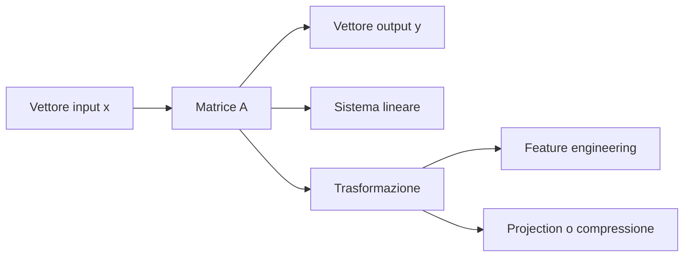

import { Aside } from '@astrojs/starlight/components'

Netflix usa una matrice utenti×film con milioni di righe e migliaia di colonne. La maggior parte dei valori è mancante — la maggioranza degli utenti ha visto solo una piccola frazione del catalogo. Decomponendo questa matrice in fattori più piccoli, il sistema impara i "gusti latenti" degli utenti: non sa che ti piacciono i thriller nordici con protagoniste femminili, ma lo inferisce dai pattern numerici. È così che funziona la recommendation, ed è algebra lineare applicata su scala industriale.

Capire le matrici non è un esercizio accademico. È il modo in cui funzionano regressione lineare, feature engineering, PCA, recommendation engine e quasi ogni pipeline di machine learning. Questa lezione costruisce una comprensione operativa: da cosa rappresenta una matrice, a come si usa in Python per risolvere problemi concreti di analytics.

## Mappa mentale



## Perché le matrici sono dappertutto

Una matrice è una griglia rettangolare di numeri. Questa definizione è corretta ma non particolarmente utile. La definizione operativa più utile è questa: una matrice codifica una relazione tra due insiemi di grandezze.

Nella pratica dell'analytics questo significa:

- **utenti × feature**: ogni riga è un utente, ogni colonna è una caratteristica comportamentale o demografica
- **campagne × canali**: ogni riga è una campagna, ogni colonna è un canale, i valori sono budget allocati o conversioni
- **termini × documenti**: base per TF-IDF e topic modeling
- **osservazioni × variabili**: la design matrix di qualsiasi regressione

Quando leggi una matrice in questo modo — righe come entità, colonne come attributi — smetti di vedere numeri e cominci a vedere struttura. Questa transizione è il vero obiettivo di questa lezione.

## Ripasso minimo

Una matrice `m × n` ha `m` righe e `n` colonne. Ogni elemento è identificato da due indici: riga e colonna.

```text
A =
[a11 a12 a13]
[a21 a22 a23]
```

Questa è una matrice `2 × 3`. Ha due righe e tre colonne.

La moltiplicazione matrice-vettore trasforma un input in un output:

```text
y = A x
```

Per eseguire questa operazione, il numero di colonne di `A` deve coincidere con la lunghezza del vettore `x`. Il risultato `y` ha tante componenti quante sono le righe di `A`.

## La matrice come trasformazione geometrica

Uno dei modi più potenti per sviluppare intuizione sulle matrici è pensarle come trasformazioni dello spazio. Quando moltiplichi una matrice per un vettore, stai spostando quel vettore nello spazio. Ma non in modo arbitrario: le trasformazioni lineari preservano le linee rette e l'origine.

### Scala

Una matrice diagonale scala le componenti del vettore in modo indipendente:

```python
import numpy as np
import matplotlib.pyplot as plt

# Matrice di scala: raddoppia x, comprime y a metà
S = np.array([
    [2.0, 0.0],
    [0.0, 0.5],
])

v = np.array([1.0, 1.0])
v_trasformato = S @ v
print(v_trasformato)  # [2.0, 0.5]
```

In analytics, una trasformazione di scala compare ogni volta che standardizzi le feature: stai applicando una matrice diagonale i cui elementi sono `1/std_i` per ogni feature `i`.

### Rotazione

Una matrice di rotazione ruota un vettore di un angolo `θ` senza modificarne la lunghezza:

```python
theta = np.pi / 4  # 45 gradi

R = np.array([
    [np.cos(theta), -np.sin(theta)],
    [np.sin(theta),  np.cos(theta)],
])

v = np.array([1.0, 0.0])
v_ruotato = R @ v
print(v_ruotato.round(4))  # [0.7071, 0.7071]
```

La PCA (Principal Component Analysis) esegue essenzialmente una rotazione dello spazio delle feature per allineare gli assi alla direzione di massima varianza. Quando fai PCA, stai trovando la matrice di rotazione ottimale per i tuoi dati.

### Proiezione

Una matrice di proiezione comprime un vettore su un sottospazio. È usata quando vuoi ridurre la dimensionalità mantenendo la struttura:

```python
# Proiezione sull'asse x: elimina la componente y
P = np.array([
    [1.0, 0.0],
    [0.0, 0.0],
])

v = np.array([3.0, 4.0])
v_proiettato = P @ v
print(v_proiettato)  # [3.0, 0.0]
```

<Aside type="note">
La distinzione tra scala, rotazione e proiezione non è solo geometrica. In analytics, capire quale tipo di trasformazione stai applicando ti aiuta a prevedere l'effetto sui tuoi dati: la scala cambia le magnitudini, la rotazione cambia la direzione, la proiezione riduce la dimensionalità.
</Aside>

## Moltiplicazione matriciale in Python

```python
import numpy as np

A = np.array([
    [0.6, 0.2, 0.2],
    [0.1, 0.7, 0.2],
])

x = np.array([100, 80, 40])
y = A @ x

print(y)
```

Qui `x` può essere il budget per tre canali e `y` il volume atteso su due KPI aggregati. La matrice `A` contiene i coefficienti di conversione: quanto di ogni canale contribuisce a ogni KPI.

Questo pattern — `y = A @ x` — è uno dei più ricorrenti in tutto il machine learning. La regressione lineare, le reti neurali, l'analisi delle componenti principali: tutti usano questo stesso schema.

### Come leggere righe e colonne senza confondersi

Ogni matrice deve rispondere a due domande molto banali:

- cosa rappresentano le righe?
- cosa rappresentano le colonne?

Se non sai rispondere subito, il rischio è produrre una moltiplicazione formalmente corretta ma semanticamente inutile. Prima di qualsiasi operazione matriciale, scrivi esplicitamente la semantica in un commento o in una stringa di documentazione. Questo abito ti salverà da errori difficili da debuggare.

## Il dataset come matrice

Ogni dataset tabellare è, matematicamente, una matrice. Ogni riga è un'osservazione. Ogni colonna è una feature. Il valore in posizione `(i, j)` è il valore della feature `j` per l'osservazione `i`.

```python
import pandas as pd
import numpy as np

# Dataset sintetico: 5 utenti, 4 feature
dati = {
    'eta': [28, 35, 22, 45, 31],
    'visite_settimana': [12, 4, 20, 2, 8],
    'acquisti_mese': [3, 1, 7, 0, 2],
    'revenue_media': [45.0, 120.0, 22.0, 0.0, 67.0]
}

df = pd.DataFrame(dati)

# Converti in matrice numpy
X = df.values
print(X.shape)   # (5, 4): 5 osservazioni, 4 feature
print(type(X))   # <class 'numpy.ndarray'>
```

La matrice `X` estratta da un dataframe è la **design matrix**: l'oggetto matematico centrale di qualsiasi modello lineare. Ogni operazione che fai su questa matrice — standardizzazione, aggiunta di feature, encoding — corrisponde a una trasformazione matriciale.

### Operazioni sulla design matrix

```python
# Standardizzazione: ogni colonna ha media 0 e std 1
medie = X.mean(axis=0)   # media per colonna
std = X.std(axis=0)      # std per colonna

X_standardizzata = (X - medie) / std
print(X_standardizzata.round(3))

# Aggiunta della colonna costante (intercetta per OLS)
n = X.shape[0]
ones = np.ones((n, 1))
X_con_intercetta = np.hstack([ones, X_standardizzata])
print(X_con_intercetta.shape)   # (5, 5)
```

Quando aggiungi una colonna di uni, stai trasformando la matrice `X` nella design matrix completa. Questo passo è richiesto per la regressione OLS per permettere al modello di stimare l'intercetta.

<Aside type="tip">
`axis=0` nelle operazioni numpy significa "opera lungo l'asse delle righe", ovvero calcola una statistica per ogni colonna. `axis=1` significa "opera lungo l'asse delle colonne", ovvero calcola una statistica per ogni riga. Confondere i due è uno degli errori più comuni quando si inizia con numpy.
</Aside>

## Sistemi lineari e regressione

La regressione lineare può essere formulata interamente come algebra lineare. Hai `n` osservazioni, `p` feature, e vuoi trovare i coefficienti `w` che minimizzano l'errore quadratico medio.

La formulazione matriciale è:

```text
X w = y
```

Dove `X` è la design matrix `(n × p)`, `w` è il vettore dei coefficienti `(p × 1)`, e `y` è il vettore delle variabili dipendenti `(n × 1)`.

Se `n = p` e `X` è invertibile, la soluzione esatta è `w = X⁻¹ y`. Ma in analytics quasi sempre `n >> p`: hai molte più osservazioni che feature. Il sistema è **sovradeterminato** — hai più equazioni che incognite.

La soluzione è il sistema delle **equazioni normali**:

```text
Xᵀ X w = Xᵀ y
```

Che porta alla soluzione OLS:

```text
w = (Xᵀ X)⁻¹ Xᵀ y
```

In Python:

```python
import numpy as np

# Dataset: 6 osservazioni, 2 feature (+ intercetta)
X = np.array([
    [1, 2.5, 150],
    [1, 3.1, 200],
    [1, 1.8, 100],
    [1, 4.2, 320],
    [1, 2.9, 180],
    [1, 3.8, 270],
])

y = np.array([12.0, 18.5, 8.0, 28.0, 15.5, 24.0])

# Soluzione con numpy.linalg.solve (più stabile dell'inversa)
XtX = X.T @ X
Xty = X.T @ y

w = np.linalg.solve(XtX, Xty)
print("Coefficienti:", w.round(4))

# Previsione e residui
y_pred = X @ w
residui = y - y_pred
print("Residui:", residui.round(4))
```

<Aside type="caution">
Non calcolare `np.linalg.inv(XtX) @ Xty` per risolvere le equazioni normali. L'inversione esplicita è numericamente instabile quando la matrice è quasi singolare. Usa sempre `np.linalg.solve()` o, meglio ancora, `np.linalg.lstsq()` che usa la decomposizione QR internamente.
</Aside>

### Il caso pratico: prezzi impliciti nei pacchetti

Scenario: hai due pacchetti commerciali e vuoi stimare il prezzo implicito di due componenti.

```text
2x + y = 29
x + 3y = 31
```

In forma matriciale:

```text
[2 1] [x] = [29]
[1 3] [y]   [31]
```

```python
A = np.array([[2, 1], [1, 3]])
b = np.array([29, 31])

soluzione = np.linalg.solve(A, b)
print(soluzione)   # [10.  9.]
```

Il pacchetto base costa 10, l'add-on costa 9. `np.linalg.solve` è preferibile all'inversa esplicita per tutti i sistemi quadrati ben condizionati.

## Inversa e pseudo-inversa

### Quando una matrice è invertibile

Una matrice quadrata è invertibile se e solo se il suo determinante è diverso da zero. Il determinante misura quanto la trasformazione "espande" o "comprime" lo spazio: se è zero, la trasformazione schiaccia lo spazio in una dimensione inferiore e non è reversibile.

```python
A = np.array([[2, 1], [1, 3]])

det_A = np.linalg.det(A)
inv_A = np.linalg.inv(A)

print("Determinante:", det_A)         # 5.0
print("Inversa:\n", inv_A.round(3))
```

Verifica: `A @ inv_A` deve essere la matrice identità (o molto vicina, a causa degli errori numerici in virgola mobile).

### La pseudo-inversa di Moore-Penrose

In quasi tutti i problemi reali di analytics, la matrice `X` non è quadrata. La design matrix ha molte più righe (osservazioni) che colonne (feature). Non puoi calcolarne l'inversa nel senso classico.

La **pseudo-inversa** di Moore-Penrose, indicata con `X⁺`, generalizza il concetto di inversa a matrici rettangolari e a matrici singolari. È definita come:

```text
X⁺ = (Xᵀ X)⁻¹ Xᵀ   [per matrici a rango pieno con n > p]
```

E la soluzione OLS diventa semplicemente:

```text
w = X⁺ y
```

```python
import numpy as np

X = np.array([
    [1, 2.5],
    [1, 3.1],
    [1, 1.8],
    [1, 4.2],
    [1, 2.9],
])

y = np.array([12.0, 18.5, 8.0, 28.0, 15.5])

# Pseudo-inversa di Moore-Penrose
X_pinv = np.linalg.pinv(X)
print("Shape pseudo-inversa:", X_pinv.shape)   # (2, 5)

w = X_pinv @ y
print("Coefficienti OLS:", w.round(4))

# Equivalentemente con lstsq (raccomandato per stabilità)
w_lstsq, residui, rango, valori_sing = np.linalg.lstsq(X, y, rcond=None)
print("Coefficienti lstsq:", w_lstsq.round(4))
```

`np.linalg.lstsq` usa internamente la decomposizione SVD, che è il metodo più robusto per risolvere sistemi sovradeterminati o mal condizionati. In produzione, è quasi sempre la scelta giusta.

<Aside type="tip">
In pratica, in data science usi raramente l'inversa esplicita su matrici grandi. È più stabile risolvere il sistema con `np.linalg.solve()` per sistemi quadrati, o con `np.linalg.lstsq()` per sistemi sovradeterminati. La pseudo-inversa esplicita tramite `np.linalg.pinv()` è utile quando hai bisogno di riusarla più volte.
</Aside>

## Rango di una matrice

Il **rango** di una matrice è il numero massimo di righe (o colonne) linearmente indipendenti. In termini pratici: quante "dimensioni di informazione" contiene davvero la matrice.

```python
A = np.array([
    [1, 2, 3],
    [4, 5, 6],
    [7, 8, 9],
])

rango = np.linalg.matrix_rank(A)
print("Rango:", rango)   # 2, non 3!
```

Questa matrice ha rango 2 anche se ha 3 colonne. La terza colonna è la somma delle prime due moltiplicate per un fattore: non aggiunge informazione nuova.

### Rango deficiente e multicollinearità

In analytics, il rango deficiente si manifesta come **multicollinearità**: alcune feature nel dataset sono combinazioni lineari di altre. Questo crea problemi seri nella regressione.

```python
# Esempio di design matrix con multicollinearità
np.random.seed(42)
n = 100

x1 = np.random.randn(n)
x2 = np.random.randn(n)
x3 = 2 * x1 + 0.5 * x2   # x3 è combinazione lineare di x1 e x2!

X_multi = np.column_stack([np.ones(n), x1, x2, x3])
print("Shape:", X_multi.shape)           # (100, 4)
print("Rango:", np.linalg.matrix_rank(X_multi))  # 3, non 4!
```

Quando la design matrix ha rango deficiente:

1. `np.linalg.solve()` lancia un'eccezione (`LinAlgError: Singular matrix`)
2. `np.linalg.lstsq()` trova comunque una soluzione, ma non è unica
3. I coefficienti stimati sono numericamente instabili: piccole variazioni nei dati producono grandi variazioni nei coefficienti

Come rilevare la multicollinearità prima di fittare il modello:

```python
# Condition number: misura quanto il problema è mal condizionato
cond = np.linalg.cond(X_multi)
print("Condition number:", cond)
# Se > 1000, attenzione. Se > 100000, problema serio.

# Valori singolari della design matrix
_, valori_sing, _ = np.linalg.svd(X_multi)
print("Valori singolari:", valori_sing.round(4))
# Un valore singolare vicino a zero indica rango deficiente
```

<Aside type="caution">
La multicollinearità non impedisce di fittare un modello, ma rende i coefficienti privi di significato interpretativo. Se `x1` e `x3` sono quasi identiche, il modello può assegnare qualsiasi combinazione di pesi a queste due feature e ottenere lo stesso errore. La soluzione standard è rimuovere una delle feature collineari, applicare ridge regression, o usare la decomposizione SVD.
</Aside>

## Matrici sparse

La maggior parte delle matrici nel mondo reale dell'analytics è **sparsa**: la stragrande maggioranza degli elementi è zero. La matrice Netflix citata nell'apertura è l'esempio canonico: milioni di utenti, migliaia di film, ma ogni utente ha valutato solo una frazione minuscola del catalogo.

Archiviare questa matrice in formato denso (tutti gli elementi, inclusi gli zero) è proibitivo. Una matrice `10M × 50K` in float64 occuperebbe `10.000.000 × 50.000 × 8 bytes = 4 petabyte`.

### scipy.sparse

`scipy.sparse` offre formati di archiviazione efficienti che conservano solo gli elementi non zero:

```python
import numpy as np
from scipy import sparse

# Matrice utenti-item densa (piccola, per illustrazione)
densa = np.array([
    [5, 0, 0, 3, 0],
    [0, 4, 0, 0, 2],
    [0, 0, 5, 0, 0],
    [3, 0, 0, 0, 4],
    [0, 2, 0, 5, 0],
])

# Converti in formato sparse COO
sparsa_coo = sparse.coo_matrix(densa)
print("Shape:", sparsa_coo.shape)
print("Elementi non zero:", sparsa_coo.nnz)
print("Densità:", sparsa_coo.nnz / (densa.shape[0] * densa.shape[1]))

# Stampa rappresentazione compatta
print(sparsa_coo)
```

### Costruire una matrice sparse da zero

Nella pratica, le matrici sparse si costruiscono inserendo direttamente gli elementi non zero, senza passare dalla versione densa:

```python
from scipy import sparse

# Dati di interazione: (utente_id, item_id, valore)
utenti = np.array([0, 0, 1, 2, 3, 3, 4])
items  = np.array([0, 3, 1, 2, 0, 4, 1])
valori = np.array([5, 3, 4, 5, 3, 4, 2], dtype=float)

n_utenti = 5
n_items = 5

# Formato CSR (Compressed Sparse Row): ottimo per operazioni riga per riga
matrice_sparse = sparse.csr_matrix(
    (valori, (utenti, items)),
    shape=(n_utenti, n_items)
)

print("Tipo:", type(matrice_sparse))
print("Shape:", matrice_sparse.shape)
print("Elementi non zero:", matrice_sparse.nnz)

# Recupera le valutazioni di un utente specifico
utente_0 = matrice_sparse.getrow(0)
print("Valutazioni utente 0:", utente_0.toarray())
```

### Formati sparse e quando usarli

Esistono diversi formati interni per le matrici sparse. La scelta dipende dalle operazioni che devi fare:

| Formato | Nome completo | Ottimo per |
|---------|---------------|------------|
| COO | Coordinate | Costruzione incrementale |
| CSR | Compressed Sparse Row | Operazioni riga per riga, moltiplicazione con vettore |
| CSC | Compressed Sparse Column | Operazioni colonna per colonna, decomposizioni |
| LIL | List of Lists | Costruzione riga per riga interattiva |

```python
# Conversione tra formati
sparsa_csr = matrice_sparse.tocsr()
sparsa_csc = matrice_sparse.tocsc()
sparsa_lil = matrice_sparse.tolil()

# Moltiplicazione matrice sparse × vettore
profilo_utente = np.array([1, 0, 0, 0, 0])  # vettore one-hot
item_scores = matrice_sparse.T @ profilo_utente
print("Score degli item per utente 0:", item_scores)
```

<Aside type="note">
Per la recommendation, l'operazione più comune è la moltiplicazione matrice sparse × vettore denso: `R.T @ user_vector`. Il risultato è un vettore di score per ogni item. Questo è il cuore dei sistemi di recommendation basati su collaborative filtering.
</Aside>

## Numpy dense vs scipy sparse: confronto

Quando usare l'uno o l'altro dipende dalla struttura dei tuoi dati e dalle operazioni che devi fare:

| Criterio | numpy dense | scipy sparse |
|----------|-------------|--------------|
| Densità dati | Qualsiasi | < 1-5% non-zero |
| Memoria | `n × m × 8 bytes` | Proporzionale agli nnz |
| Velocità operazioni | BLAS/LAPACK ottimizzato | Dipende dal formato |
| Supporto GPU | Via CuPy | Via CuPy sparse |
| Costruzione | Diretta | COO → CSR/CSC |
| Slicing/indexing | Semplice | Limitato per certi formati |
| Usato in sklearn | Design matrix standard | TF-IDF, one-hot encoding |

La regola pratica: se la tua matrice ha più del 10-20% di elementi non zero, usa il formato denso. Sotto quella soglia, il formato sparse riduce memoria e spesso accelera le operazioni.

## Caso analytics: matrice di transizione semplificata

Una matrice può anche descrivere probabilità di passaggio tra stati.

```python
transition = np.array([
    [0.70, 0.20, 0.10],  # active
    [0.15, 0.60, 0.25],  # passive
    [0.05, 0.10, 0.85],  # churn-risk
])

state_today = np.array([0.55, 0.30, 0.15])
state_next = state_today @ transition

print(state_next.round(4))
```

Questo schema è utile per retention model, forecast semplice e customer lifecycle. Ogni moltiplicazione per `transition` ti porta un passo avanti nel tempo. Dopo `k` passi, lo stato previsto è `state_today @ np.linalg.matrix_power(transition, k)`.

## Esempio avanzato con statsmodels

Per vedere la matrice come oggetto operativo puoi aprire un dataset economico reale e guardare la design matrix che entra in una regressione OLS. Il dataset `longley` è piccolo, storico e molto usato per esempi di econometria.

```python
import statsmodels.api as sm

longley = sm.datasets.longley.load_pandas().data

X = sm.add_constant(longley[["GNP", "UNEMP", "ARMED"]])
y = longley["TOTEMP"]

model = sm.OLS(y, X).fit()

print(X.head())
print(model.params.round(3))
```

Qui la matrice `X` ha:

- una riga per ogni osservazione temporale
- una colonna per ogni feature
- una colonna costante che rappresenta l'intercetta

Leggere `X` in questo modo aiuta a capire che la regressione non è magia statistica: è algebra lineare applicata a una tabella con semantica chiara.

## Performance e ottimizzazione

### BLAS e LAPACK sotto il cofano

Numpy non calcola le moltiplicazioni matriciali in Python puro. Usa librerie ottimizzate scritte in Fortran e C: **BLAS** (Basic Linear Algebra Subprograms) per operazioni dense e **LAPACK** (Linear Algebra PACKage) per decomposizioni e sistemi lineari.

Queste librerie sono automaticamente multi-thread su CPU moderne: una moltiplicazione tra matrici grandi usa tutti i core disponibili senza che tu debba fare nulla.

```python
import numpy as np
import time

# Benchmark: moltiplicazione di matrici grandi
n = 2000
A = np.random.randn(n, n)
B = np.random.randn(n, n)

inizio = time.time()
C = A @ B
fine = time.time()

print(f"Matrice {n}×{n} × {n}×{n}: {fine - inizio:.3f} secondi")
print(f"FLOPS stimati: {2 * n**3 / (fine - inizio) / 1e9:.1f} GFLOPS")
```

<Aside type="tip">
Per sapere quale implementazione BLAS usa numpy sulla tua macchina: `np.show_config()`. OpenBLAS e MKL (Intel Math Kernel Library) sono le implementazioni più comuni e performanti. Se stai lavorando su dati grandi in produzione, verifica che numpy sia collegato a una libreria BLAS ottimizzata, non all'implementazione di riferimento lenta.
</Aside>

### Operazioni in-place per ridurre la memoria

Con matrici molto grandi, le operazioni in-place evitano di creare copie temporanee:

```python
# Standard: crea una copia
X_std = (X - X.mean(axis=0)) / X.std(axis=0)

# In-place: modifica X direttamente (attenzione: sovrascrive i dati originali)
X_inplace = X.copy()  # copia necessaria solo se vuoi preservare l'originale
X_inplace -= X_inplace.mean(axis=0)
X_inplace /= X_inplace.std(axis=0)
```

Per matrici che non entrano in RAM, considera `numpy.memmap` (accesso su disco) o `dask.array` per calcolo distribuito.

## Errori comuni

### Moltiplicare matrici senza controllare le dimensioni

Se le shape non combaciano, il problema non è Python: è il modello che hai in testa. Prima di ogni `@`, esegui un `print(A.shape, B.shape)` e verifica che le dimensioni siano compatibili.

### Inversa come riflesso automatico

In analisi numerica l'inversa esplicita è spesso l'ultima scelta. Usa `np.linalg.solve()` per sistemi quadrati, `np.linalg.lstsq()` per sistemi sovradeterminati.

### Leggere le colonne senza una semantica chiara

Ogni matrice deve avere un significato: righe, colonne e unità di misura. Prima di qualsiasi operazione, documenta cosa rappresentano righe e colonne.

### Confondere matrice sparsa e densa

Una matrice sparse convertita in densa con `.toarray()` può essere ordini di grandezza più grande. Per una matrice `10M × 50K`, non farlo mai.

## Riepilogo operativo

Le matrici sono il linguaggio universale dell'analisi dati quantitativa. Ogni dataset tabellare è una matrice. Ogni modello lineare è un sistema di equazioni matriciali. Ogni trasformazione delle feature è una moltiplicazione matriciale.

I concetti chiave da portare in produzione:

- **`y = A @ x`**: il pattern fondamentale. `A` codifica le regole, `x` è lo stato iniziale, `y` è il risultato.
- **Design matrix**: la rappresentazione matriciale del dataset, con osservazioni sulle righe e feature sulle colonne.
- **Equazioni normali**: `(Xᵀ X) w = Xᵀ y`. La soluzione OLS è algebra lineare, non statistica.
- **`np.linalg.solve()`**: per sistemi quadrati. **`np.linalg.lstsq()`**: per sistemi sovradeterminati o mal condizionati.
- **Rango e multicollinearità**: rango deficiente significa feature ridondanti. Rilevalo con `np.linalg.matrix_rank()` o il condition number.
- **Matrici sparse**: usa `scipy.sparse` quando la densità è sotto il 10%. Il formato CSR è ottimale per moltiplicazione riga per riga.
- **BLAS/LAPACK**: numpy è già ottimizzato per il parallelismo su CPU. Per dataset grandi, verifica di usare OpenBLAS o MKL.

## Mini esercizio

Costruisci una matrice `3 × 3` con pesi di contribuzione tra `paid`, `organic`, `email` e tre KPI finali: lead, ordini, revenue. Quale canale pesa di più sul KPI revenue?

Estensione: aggiungi multicollinearità artificiale inserendo una quarta colonna che è la somma di `paid` e `organic`. Verifica con `np.linalg.matrix_rank()` che il rango della matrice aumentata sia ancora 3. Cosa succede se provi a risolvere un sistema lineare con questa matrice aumentata?
