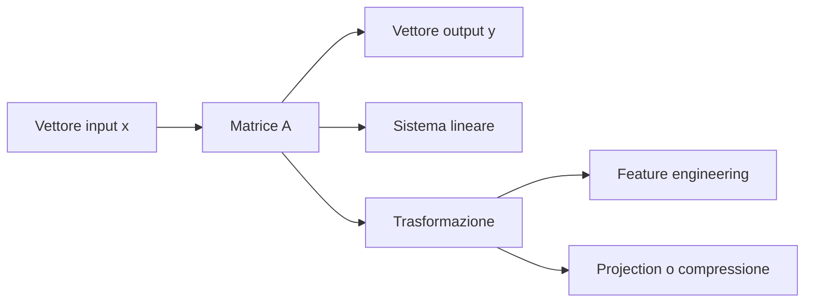

import { Aside } from '@astrojs/starlight/components'

Molte analisi sembrano fatte di righe e colonne. In realta', appena moltiplichi feature, pesi o trasformazioni, stai gia' lavorando con matrici.

## Mappa mentale



## Perche' le matrici sono dappertutto

Una matrice puo' rappresentare:

- utenti x feature
- campagne x canali
- termini x documenti
- variabili x coefficienti

Quando la leggi bene, capisci come funzionano regressioni, trasformazioni lineari, PCA, SVD e molte pipeline ML.

## Ripasso minimo

```text
A =
[a11 a12]
[a21 a22]
```

La moltiplicazione matrice-vettore trasforma un input in un output:

```text
y = A x
```

## Moltiplicazione matriciale in Python

```python
import numpy as np

A = np.array([
    [0.6, 0.2, 0.2],
    [0.1, 0.7, 0.2],
])

x = np.array([100, 80, 40])
y = A @ x

print(y)
```

Qui `x` puo' essere il budget per tre canali e `y` il volume atteso su due KPI aggregati.

### Come leggere righe e colonne senza confondersi

Ogni matrice deve rispondere a due domande molto banali:

- cosa rappresentano le righe?
- cosa rappresentano le colonne?

Se non sai rispondere subito, il rischio e' produrre una moltiplicazione formalmente corretta ma semanticamente inutile.

## Sistema lineare: ricostruire un valore ignoto

Scenario: hai due pacchetti commerciali e vuoi stimare il prezzo implicito di due componenti.

```text
2x + y = 29
x + 3y = 31
```

In forma matriciale:

```text
[2 1] [x] = [29]
[1 3] [y]   [31]
```

```python
A = np.array([[2, 1], [1, 3]])
b = np.array([29, 31])

solution = np.linalg.solve(A, b)
print(solution)
```

## Inversa e determinante: quando il sistema e' risolvibile

Una matrice quadrata e' invertibile solo se il determinante e' diverso da zero.

```python
A = np.array([[2, 1], [1, 3]])

det_A = np.linalg.det(A)
inv_A = np.linalg.inv(A)

print(det_A)
print(inv_A.round(3))
```

<Aside type="tip">
In pratica, in data science usi raramente l'inversa esplicita su matrici grandi. E' piu' stabile risolvere il sistema con `np.linalg.solve()` o decomposizioni numeriche.
</Aside>

## Trasformazioni lineari lette come effetto sulle feature

Se una matrice agisce su un vettore, sta trasformando lo spazio:

- riscalando
- ruotando
- combinando feature

Questo e' il linguaggio matematico dietro:

- feature engineering lineare
- regressione lineare
- change of basis
- compressione dimensionale

```python
traffic = np.array([1200, 400])  # organic, paid
transform = np.array([
    [0.8, 0.3],
    [0.2, 0.7],
])

projected = transform @ traffic
print(projected)
```

## Caso analytics: matrice di transizione semplificata

Una matrice puo' anche descrivere probabilita' di passaggio tra stati.

```python
transition = np.array([
    [0.70, 0.20, 0.10],  # active
    [0.15, 0.60, 0.25],  # passive
    [0.05, 0.10, 0.85],  # churn-risk
])

state_today = np.array([0.55, 0.30, 0.15])
state_next = state_today @ transition

print(state_next.round(4))
```

Questo schema e' utile per retention model, forecast semplice e customer lifecycle.

## Un modello mentale utile

Quando vedi `A @ x`, pensa a questo:

- `x` contiene lo stato o il profilo iniziale
- `A` contiene le regole di trasformazione
- `y` e' il risultato dopo aver applicato quelle regole

Questo e' esattamente il tipo di ragionamento che userai poi in regressione lineare, Markov chain, recommendation e decomposizioni matriciali.

## Esempio avanzato con statsmodels

Per vedere la matrice come oggetto operativo puoi aprire un dataset economico reale e guardare la design matrix che entra in una regressione OLS. Il dataset `longley` e' piccolo, storico e molto usato per esempi di econometria.

```python
import statsmodels.api as sm

longley = sm.datasets.longley.load_pandas().data

X = sm.add_constant(longley[["GNP", "UNEMP", "ARMED"]])
y = longley["TOTEMP"]

model = sm.OLS(y, X).fit()

print(X.head())
print(model.params.round(3))
```

Qui la matrice `X` ha:

- una riga per ogni osservazione temporale
- una colonna per ogni feature
- una colonna costante che rappresenta l'intercetta

Leggere `X` in questo modo aiuta a capire che la regressione non e' magia statistica: e' algebra lineare applicata a una tabella con semantica chiara.

## Errori comuni

### Moltiplicare matrici senza controllare le dimensioni

Se le shape non combaciano, il problema non e' Python: e' il modello che hai in testa.

### Inversa come riflesso automatico

In analisi numerica l'inversa esplicita e' spesso l'ultima scelta.

### Leggere le colonne senza una semantica chiara

Ogni matrice deve avere un significato: righe, colonne e unita' di misura.

## Output atteso

Dopo queste operazioni ottieni di solito:

- coefficienti risolti
- variabili trasformate
- projection table
- matrice di transizione o matrice feature

## Riepilogo operativo

- Le matrici rappresentano trasformazioni e relazioni tra piu' variabili.
- `A @ x` e' uno dei pattern piu' importanti di tutto il modulo.
- Determinante, inversa e sistemi lineari servono per capire quando una relazione e' risolvibile.

## Mini esercizio

Costruisci una matrice `3 x 3` con pesi di contribuzione tra `paid`, `organic`, `email` e tre KPI finali: lead, ordini, revenue. Quale canale pesa di piu' sul KPI revenue?
