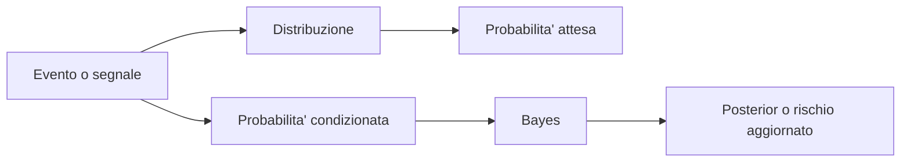

import { Aside } from '@astrojs/starlight/components'

Ogni volta che stimi churn, conversione o rischio di frode stai lavorando con probabilita'. La domanda non e' se usi la probabilita', ma se la usi in modo esplicito e corretto.

## Mappa mentale



## Evento, probabilita' e variabile casuale

Un evento e' un fatto osservabile:

- un click
- un acquisto
- un churn

Una variabile casuale assegna un numero a un risultato:

- numero di ordini
- tempo fino al riacquisto
- revenue per sessione

## Discreto vs continuo

### Variabile discreta

Conta eventi interi.

```python
import numpy as np

orders = np.array([0, 1, 0, 2, 1, 3, 0, 1])
print("media", orders.mean())
print("varianza", orders.var())
```

### Variabile continua

Puo' assumere infiniti valori in un intervallo, ad esempio `time_on_site` o `order_value`.

```python
times = np.array([12.4, 16.8, 8.1, 22.7, 15.5])
print(times.mean())
```

## Distribuzioni che incontri davvero

### Binomiale

Numero di successi in `n` prove indipendenti.

Scenario: quante conversioni ottieni su 1.000 visite con CR del 3%.

```python
from scipy.stats import binom

print(binom.mean(n=1000, p=0.03))
print(binom.std(n=1000, p=0.03))
```

### Poisson

Numero di eventi per intervallo fisso.

Scenario: ticket di supporto per ora.

```python
from scipy.stats import poisson

print(poisson.pmf(12, mu=10))
```

### Normale

Serve quando lavori con medie, errori e approssimazioni continue.

### Lognormale

Molto utile per tempi e ricavi positivi con coda lunga.

## Come scegliere la distribuzione giusta

La domanda pratica non e' "quale formula conosco", ma "che tipo di fenomeno sto osservando?".

Guida rapida:

- conta di successi su un numero fisso di tentativi: binomiale
- conta di eventi per intervallo: Poisson
- media, errore o aggregati continui: normale
- variabile positiva con coda lunga: lognormale

## Probabilita' condizionata

```text
P(A | B)
```

Significa: probabilita' di `A` sapendo che `B` e' avvenuto.

Esempio:

- `A`: utente acquista
- `B`: utente ha visto pricing page

## Teorema di Bayes

```text
P(A | B) = P(B | A) * P(A) / P(B)
```

Utile quando vuoi aggiornare una credenza dopo aver osservato un segnale.

### Esempio di lettura corretta

Se solo il 4% degli utenti churna ma il 60% dei churner mostra un calo di sessioni, non puoi dire che chi cala di sessioni ha 60% di probabilita' di churnare. Devi usare Bayes.

```python
p_churn = 0.04
p_signal_given_churn = 0.60
p_signal = 0.12

p_churn_given_signal = p_signal_given_churn * p_churn / p_signal
print(round(p_churn_given_signal, 4))
```

### Cosa cambia dopo Bayes

Prima di Bayes hai un rischio medio sulla popolazione. Dopo Bayes hai un rischio aggiornato per una sottoclasse osservata. Questo passaggio e' centrale in scoring, targeting e prioritizzazione operativa.

## Perche' Bayes serve in analytics

- fraud scoring
- lead scoring
- churn early warning
- lettura corretta di falsi positivi

<Aside type="caution">
Il tasso base conta sempre. Se ignori la prevalenza iniziale del fenomeno, sovrastimi quasi sempre il rischio reale.
</Aside>

## Esempio avanzato con scikit-learn

Un modo concreto per vedere Bayes al lavoro e' usare un classificatore Naive Bayes su un mini dataset reale. Il dataset `breast_cancer` e' utile perche' ogni riga rappresenta un caso con molte misure numeriche e il modello restituisce direttamente una probabilita' a posteriori.

```python
from sklearn.datasets import load_breast_cancer
from sklearn.model_selection import train_test_split
from sklearn.naive_bayes import GaussianNB
import pandas as pd

data = load_breast_cancer(as_frame=True)

X_train, X_test, y_train, y_test = train_test_split(
    data.data[["mean radius", "mean texture", "worst area"]],
    data.target,
    test_size=0.25,
    random_state=42,
    stratify=data.target,
)

model = GaussianNB()
model.fit(X_train, y_train)

sample = X_test.iloc[[0]]
posterior = model.predict_proba(sample)

labels = [f"p_{name}" for name in data.target_names]
result = pd.DataFrame(posterior, columns=labels, index=["sample_0"])

print(result.round(4))
```

La logica e' la stessa che useresti in churn o fraud scoring: parti da una probabilita' media e la aggiorni dopo aver osservato segnali specifici sul singolo caso.

## Errori comuni

### Scambiare `P(A|B)` con `P(B|A)`

E' uno degli errori piu' costosi in funnel, fraud e diagnostica.

### Usare la normale su dati chiaramente asimmetrici

Order value e tempo di sessione spesso non sono gaussiani.

### Nessuna distinzione tra probabilita' teorica e frequenza osservata

La seconda stima la prima, ma non sono la stessa cosa.

## Output atteso

Le tabelle utili qui contengono:

- probabilita' per evento
- media e varianza attese
- probabilita' condizionate
- posterior bayesiana o score aggiornato

## Riepilogo operativo

- Le distribuzioni danno forma ai dati, non solo formule.
- Binomiale, Poisson e normale coprono molti problemi analytics.
- Bayes e' essenziale quando leggi segnali in presenza di classi rare.

## Mini esercizio

Supponi che il 2% degli utenti churni, il 55% dei churner mostri un crollo di log-in e il 10% della base mostri quel segnale. Calcola `P(churn | segnale)`.
