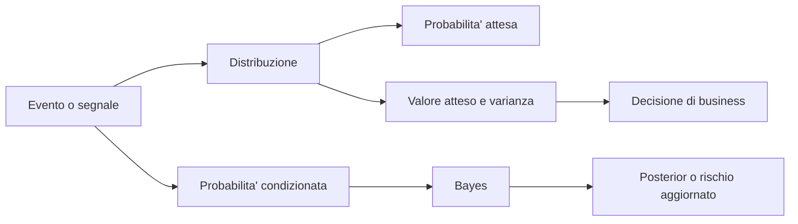

import { Aside } from '@astrojs/starlight/components'

Il team di spam di Gmail nel 2004 uso' il teorema di Bayes per classificare le email in arrivo. Non aveva bisogno di capire il "significato" del testo — solo di calcolare P(spam|parola). La stessa formula, inventata da Thomas Bayes nel 1763, alimenta oggi i filtri ML piu' sofisticati, il fraud scoring di PayPal e gli algoritmi di raccomandazione di Netflix. Ogni volta che stimi churn, conversione o rischio di frode stai lavorando con probabilita'. La domanda non e' se usi la probabilita', ma se la usi in modo esplicito e corretto.

## Mappa mentale



## Evento, probabilita' e variabile casuale

Un evento e' un fatto osservabile:

- un click
- un acquisto
- un churn

Una variabile casuale assegna un numero a un risultato:

- numero di ordini
- tempo fino al riacquisto
- revenue per sessione

La probabilita' di un evento e' un numero tra 0 e 1 che misura quanto spesso ci aspettiamo che quell'evento accada su un numero molto grande di ripetizioni. Non e' un'opinione: e' una frequenza limite. Se su 100.000 sessioni 3.200 si convertono, la probabilita' stimata di conversione e' 0.032 — non "circa il 3%", non "intorno al 3 e qualcosa". Il numero ha un significato preciso.

## Discreto vs continuo

### Variabile discreta

Conta eventi interi. Non ha senso dire "1.7 ordini".

```python
import numpy as np

orders = np.array([0, 1, 0, 2, 1, 3, 0, 1])
print("media", orders.mean())
print("varianza", orders.var())
```

Le variabili discrete seguono distribuzioni discrete: binomiale, Poisson, geometrica. Il loro comportamento si descrive con la funzione di massa di probabilita' (PMF): quanto e' probabile esattamente il valore `k`?

### Variabile continua

Puo' assumere infiniti valori in un intervallo. `time_on_site` non e' mai esattamente 12 secondi: e' 12.3741... Il suo comportamento si descrive con la funzione di densita' di probabilita' (PDF). La probabilita' di un valore esatto e' zero; si ragiona sempre su intervalli.

```python
times = np.array([12.4, 16.8, 8.1, 22.7, 15.5])
print("media", times.mean())
print("deviazione standard", times.std())
```

Per le variabili continue si usa la funzione di distribuzione cumulativa (CDF): qual e' la probabilita' che il valore sia minore o uguale a `x`?

## Probabilita' condizionale

La probabilita' condizionale risponde a questa domanda: dato che so gia' qualcosa, quanto cambia la mia stima?

```text
P(A | B) = P(A e B) / P(B)
```

Significa: probabilita' di `A` sapendo che `B` e' avvenuto.

### Esempio concreto: demo e conversione

Supponi di analizzare il funnel di un prodotto SaaS. Hai questi dati da 10.000 sessioni:

| | Ha convertito | Non ha convertito | Totale |
|---|---|---|---|
| Ha visto la demo | 420 | 1.080 | 1.500 |
| Non ha visto la demo | 330 | 8.170 | 8.500 |
| **Totale** | **750** | **9.250** | **10.000** |

La probabilita' di conversione senza condizionamento e' P(conversione) = 750/10.000 = 0.075, cioe' 7.5%.

La probabilita' condizionata di conversione dato che l'utente ha visto la demo e':

```text
P(conversione | ha visto demo) = 420 / 1.500 = 0.28 = 28%
```

Chi vede la demo converte al 28% contro il 3.9% di chi non la vede. Questo non dice ancora nulla sulla causalita' (gli utenti che guardano la demo sono gia' piu' motivati), ma dice tutto sull'importanza del segmento per il tuo funnel.

```python
# Calcolo in Python
p_conv_given_demo = 420 / 1500
p_conv_given_no_demo = 330 / 8500

print(f"P(conv | demo) = {p_conv_given_demo:.3f}")
print(f"P(conv | no demo) = {p_conv_given_no_demo:.3f}")
print(f"Lift = {p_conv_given_demo / p_conv_given_no_demo:.1f}x")
```

<Aside type="tip">
La probabilita' condizionale e' il cuore della segmentazione. Ogni volta che dici "gli utenti che hanno fatto X convertono meglio", stai calcolando P(conversione | X). Renderlo esplicito ti impedisce di sbagliare le proporzioni.
</Aside>

## Teorema di Bayes applicato

Il teorema di Bayes inverte la direzione della condizionalita':

```text
P(A | B) = P(B | A) * P(A) / P(B)
```

Perche' e' utile? Perche' spesso conosci P(B|A) ma vuoi P(A|B). In medicina: conosci la sensibilita' del test (P(positivo|malato)) ma vuoi sapere P(malato|positivo). In analytics: conosci P(segnale|churn) ma vuoi P(churn|segnale).

### Analogo medico per capire l'intuizione

Consideriamo un test per una malattia rara. La malattia colpisce l'1% della popolazione. Il test ha:
- Sensibilita' 95%: P(positivo | malato) = 0.95
- Specificita' 90%: P(negativo | sano) = 0.90, quindi P(positivo | sano) = 0.10

Cosa significa un test positivo?

```python
p_malato = 0.01
p_pos_dado_malato = 0.95
p_pos_dato_sano = 0.10
p_sano = 1 - p_malato

# P(positivo) = P(pos|malato)*P(malato) + P(pos|sano)*P(sano)
p_pos = p_pos_dado_malato * p_malato + p_pos_dato_sano * p_sano

# P(malato | positivo)
p_malato_dato_pos = (p_pos_dado_malato * p_malato) / p_pos

print(f"P(malato | test positivo) = {p_malato_dato_pos:.3f}")
# Output: 0.087 — circa 8.7%!
```

Un test positivo con il 95% di sensibilita' su una malattia all'1% di prevalenza dice che sei malato con solo l'8.7% di probabilita'. Il 91.3% dei positivi sono falsi positivi. Questo controllo-intuizione e' cruciale in fraud detection, dove la frode e' rarissima rispetto alle transazioni legittime.

### Applicazione analytics: churn scoring

Se solo il 4% degli utenti churna ma il 60% dei churner mostra un calo di sessioni, non puoi dire che chi cala di sessioni ha 60% di probabilita' di churnare. Devi usare Bayes.

```python
p_churn = 0.04
p_signal_given_churn = 0.60
p_signal = 0.12

p_churn_given_signal = p_signal_given_churn * p_churn / p_signal
print(round(p_churn_given_signal, 4))
# Output: 0.2 — il 20%, non il 60%
```

Prima di Bayes hai un rischio medio sulla popolazione (4%). Dopo Bayes hai un rischio aggiornato per chi mostra il segnale (20%). Questo passaggio e' centrale in scoring, targeting e prioritizzazione operativa.

<Aside type="caution">
Il tasso base conta sempre. Se ignori la prevalenza iniziale del fenomeno, sovrastimi quasi sempre il rischio reale. Il 60% di Bayes non e' mai uguale al 60% del segnale.
</Aside>

## Distribuzioni discrete

Le distribuzioni discrete descrivono variabili che assumono valori interi e contabili. Sono il modello naturale per click, acquisti, errori, ticket.

### Bernoulli: un solo tentativo

Il mattone base di tutto. Un evento con due esiti: successo (1) o fallimento (0). Ogni click e' un esperimento di Bernoulli.

```python
from scipy.stats import bernoulli

p_click = 0.03  # CTR del 3%
rv = bernoulli(p_click)

print(f"P(click) = {rv.pmf(1):.3f}")
print(f"P(no click) = {rv.pmf(0):.3f}")
print(f"Media = {rv.mean():.3f}")
print(f"Varianza = {rv.var():.4f}")
```

La varianza di una Bernoulli e' p*(1-p): massima a p=0.5, bassa quando p e' vicino a 0 o 1. Un CTR del 3% ha varianza 0.029 — molto piu' piccola di un CTR del 50%.

### Binomiale: n tentativi indipendenti

Numero di successi in `n` prove indipendenti. Scenario: quante conversioni ottieni su 1.000 visite con CR del 3%.

```python
from scipy.stats import binom

n = 1000
p = 0.03

print(f"Media attesa: {binom.mean(n=n, p=p):.1f} conversioni")
print(f"Deviazione standard: {binom.std(n=n, p=p):.1f}")
print(f"P(almeno 40 conversioni): {1 - binom.cdf(39, n=n, p=p):.4f}")
print(f"P(tra 25 e 35 conversioni): {binom.cdf(35, n=n, p=p) - binom.cdf(24, n=n, p=p):.4f}")
```

La binomiale risponde a: "se il mio CR e' davvero il 3%, quanto spesso vedo 40+ conversioni per puro caso?" Questo e' esattamente la logica del test di significativita' per le campagne.

### Poisson: eventi per intervallo fisso

Numero di eventi per intervallo fisso. Scenario: ticket di supporto per ora, ordini per minuto, errori di sistema per giorno.

```python
from scipy.stats import poisson

lambda_ticket = 10  # media di 10 ticket per ora

print(f"P(esattamente 12 ticket): {poisson.pmf(12, mu=lambda_ticket):.4f}")
print(f"P(piu' di 15 ticket): {1 - poisson.cdf(15, mu=lambda_ticket):.4f}")
print(f"P(meno di 5 ticket): {poisson.cdf(4, mu=lambda_ticket):.4f}")

# Simula un giorno di operazioni (8 ore)
import numpy as np
np.random.seed(42)
giornata = np.random.poisson(lambda_ticket, size=8)
print(f"\nTicket per ora: {giornata}")
print(f"Totale giornata: {giornata.sum()}")
```

La Poisson e' utile anche per modellare eventi rari in grandi popolazioni: frodi su milioni di transazioni, bug in milioni di righe di codice, cancellazioni impreviste in un giorno normale.

<Aside type="note">
La Poisson assume che gli eventi siano indipendenti e il tasso lambda sia costante nel tempo. Se il tuo traffico ha picchi (lunedi' mattina, fine mese), potresti aver bisogno di una Poisson con lambda variabile nel tempo.
</Aside>

## Distribuzioni continue

Le distribuzioni continue descrivono variabili misurabili in modo fluido: tempi, ricavi, errori di misura, pesi. Non si ragiona su valori esatti ma su intervalli: P(8 < tempo_sessione < 12).

### Normale: la distribuzione della media

La distribuzione normale (gaussiana) emerge naturalmente come limite di somme di variabili casuali indipendenti — e' il Teorema del Limite Centrale. Ogni volta che calcoli una media su campioni abbastanza grandi, quella media si distribuisce approssimativamente come una normale, indipendentemente dalla distribuzione originale.

```python
from scipy.stats import norm
import numpy as np

# Revenue media per sessione: media 45€, std 12€
mu = 45
sigma = 12

print(f"P(revenue > 60€): {1 - norm.cdf(60, loc=mu, scale=sigma):.4f}")
print(f"P(revenue tra 30€ e 60€): {norm.cdf(60, mu, sigma) - norm.cdf(30, mu, sigma):.4f}")

# Intervallo di confidenza al 95%
ci_lower, ci_upper = norm.interval(0.95, loc=mu, scale=sigma)
print(f"95% dei valori cade tra {ci_lower:.1f}€ e {ci_upper:.1f}€")
```

La normale e' usata ovunque non perche' tutti i dati siano gaussiani — non lo sono — ma perche' le **medie** di campioni sono gaussiane. Questo e' il motivo per cui i test statistici classici (t-test, z-test) funzionano anche su dati non normali, purche' il campione sia abbastanza grande.

### Esponenziale: tempo tra eventi

Modella il tempo tra eventi in un processo di Poisson. Se arrivano in media 10 ticket per ora, il tempo medio tra un ticket e l'altro e' 6 minuti, distribuito esponenzialmente.

```python
from scipy.stats import expon

# Lambda = 10 ticket/ora => scale = 1/10 = 0.1 ore = 6 minuti
scale = 1/10  # in ore

print(f"Tempo medio tra eventi: {expon.mean(scale=scale)*60:.1f} minuti")
print(f"P(prossimo ticket entro 3 min): {expon.cdf(3/60, scale=scale):.4f}")
print(f"P(aspettare piu' di 20 min): {1 - expon.cdf(20/60, scale=scale):.4f}")
```

L'esponenziale ha la proprieta' di assenza di memoria: il tempo fino al prossimo evento non dipende da quanto tempo e' passato dall'ultimo. Utile per modellare tempo al primo acquisto, tempo alla cancellazione, tempo alla prossima chiamata.

### Log-normale: ricavi e LTV con coda lunga

Quando una variabile e' il prodotto di molti fattori positivi indipendenti, segue una distribuzione log-normale. Il logaritmo di queste variabili e' normale.

Esempi tipici in marketing analytics:
- LTV dei clienti
- Revenue per ordine
- Tempo di retention
- Prezzo delle aste pubblicitarie

```python
from scipy.stats import lognorm
import numpy as np

# Se log(X) ~ Normal(mu=3.5, sigma=0.8), allora X ~ Lognormal
mu_log = 3.5   # media del log
sigma_log = 0.8

rv = lognorm(s=sigma_log, scale=np.exp(mu_log))

print(f"Media LTV: {rv.mean():.2f}€")
print(f"Mediana LTV: {rv.median():.2f}€")  # Molto minore della media
print(f"P(LTV > 100€): {1 - rv.cdf(100):.4f}")
print(f"P(LTV > 500€): {1 - rv.cdf(500):.4f}")
```

Nota che media e mediana sono molto distanti nelle distribuzioni log-normali. Se usi la media per descrivere il LTV "tipico" dei tuoi clienti stai sbagliando: la media e' trascinata verso l'alto dai clienti whale. La mediana ti dice di piu' sull'utente rappresentativo.

<Aside type="caution">
Non applicare la normale a variabili come revenue, LTV o tempo di sessione senza prima verificare. Queste variabili sono spesso log-normali. Usare la normale in questi casi porta a intervalli di confidenza errati e test statistici invalidi.
</Aside>

## Come riconoscere la distribuzione giusta

Scegliere la distribuzione sbagliata non e' un errore formale — e' un errore operativo. Porta a intervalli di confidenza errati, test di significativita' invalidi e previsioni distorte.

### Guida pratica alla scelta

| Domanda | Distribuzione |
|---|---|
| Successo/fallimento su n tentativi fissi | Binomiale |
| Numero di eventi in un intervallo | Poisson |
| Somme o medie, dati simmetrici | Normale |
| Variabile positiva con coda destra lunga | Log-normale |
| Tempo tra eventi in processo Poisson | Esponenziale |
| Un singolo tentativo sì/no | Bernoulli |
| Tasso di conversione (valori 0-1) | Beta |

### QQ plot: il check visivo essenziale

Un QQ plot (Quantile-Quantile plot) confronta i quantili dei tuoi dati reali con i quantili teorici di una distribuzione. Se i punti cadono sulla diagonale, la distribuzione teorica e' un buon modello.

```python
import numpy as np
import scipy.stats as stats
import matplotlib.pyplot as plt

# Simulazione: LTV di 500 clienti
np.random.seed(42)
ltv_data = np.random.lognormal(mean=3.5, sigma=0.8, size=500)

fig, (ax1, ax2) = plt.subplots(1, 2, figsize=(12, 5))

# QQ plot contro normale: vedremo una curva, non una retta
stats.probplot(ltv_data, dist="norm", plot=ax1)
ax1.set_title("QQ plot vs Normale")

# QQ plot contro log-normale: dovrebbe essere quasi una retta
stats.probplot(np.log(ltv_data), dist="norm", plot=ax2)
ax2.set_title("QQ plot di log(LTV) vs Normale")

plt.tight_layout()
plt.savefig("qqplot_ltv.png", dpi=150)
```

Se `log(X)` produce un QQ plot quasi rettilineo, stai lavorando con dati log-normali. Questo e' il segnale operativo piu' diretto.

### Istogramma + test di Shapiro-Wilk

Per campioni piccoli (n < 2000) il test di Shapiro-Wilk testa la normalita' formalmente:

```python
from scipy.stats import shapiro

# Campione piccolo: 200 valori di revenue
np.random.seed(42)
revenue_sample = np.random.lognormal(3.5, 0.8, 200)

stat, p_value = shapiro(revenue_sample)
print(f"Shapiro-Wilk: statistica={stat:.4f}, p-value={p_value:.4e}")

# Se p < 0.05, l'ipotesi di normalita' viene rifiutata
if p_value < 0.05:
    print("I dati NON sono normalmente distribuiti (prova log-normale)")
else:
    print("I dati sono compatibili con la normale")
```

<Aside type="tip">
Nella pratica quotidiana il QQ plot visivo e' piu' utile del test formale: con campioni grandi (n > 500) il test rifiuta la normalita' anche per deviazioni irrilevanti. Il QQ plot ti dice se la deviazione e' abbastanza grande da impattare le tue analisi.
</Aside>

## Valore atteso e varianza

### Valore atteso: la media ponderata dei possibili esiti

Il valore atteso E[X] di una variabile casuale e' la media che osserveresti su infinite ripetizioni. E' la misura del "rendimento" di un processo aleatorio.

```text
E[X] = somma di (valore * probabilita') per ogni valore possibile
```

### Applicazione business: valore atteso di una campagna

Stai valutando tre canali di acquisizione con diversi scenari di outcome:

```python
import numpy as np

# Canale A: email marketing
# Scenari: (revenue_netta, probabilita')
canale_a = [
    (5000, 0.60),   # scenario base
    (12000, 0.30),  # scenario ottimista
    (-1000, 0.10),  # scenario pessimista (opt-out + costo)
]

# Canale B: paid social
canale_b = [
    (3000, 0.40),
    (15000, 0.25),
    (-2000, 0.35),
]

def valore_atteso(scenari):
    return sum(revenue * prob for revenue, prob in scenari)

def varianza(scenari):
    ev = valore_atteso(scenari)
    return sum(prob * (revenue - ev)**2 for revenue, prob in scenari)

print("Canale A:")
print(f"  EV = {valore_atteso(canale_a):.0f}€")
print(f"  Varianza = {varianza(canale_a):.0f}")
print(f"  Std dev = {varianza(canale_a)**0.5:.0f}€")

print("\nCanale B:")
print(f"  EV = {valore_atteso(canale_b):.0f}€")
print(f"  Varianza = {varianza(canale_b):.0f}")
print(f"  Std dev = {varianza(canale_b)**0.5:.0f}€")
```

Il canale B potrebbe avere un valore atteso piu' alto, ma anche una varianza molto maggiore. Se sei un'azienda piccola con budget limitato, la varianza alta e' rischio reale: uno scenario pessimista a -2.000€ potrebbe essere insostenibile. Il valore atteso ti dice il rendimento medio; la varianza ti dice il rischio.

### Interpretazione operativa

- **Valore atteso**: scegli la strategia con EV piu' alto, a parita' di rischio
- **Varianza bassa**: risultati piu' prevedibili, utile per budget fissi
- **Varianza alta**: possibilita' di guadagni grandi ma anche perdite grandi
- **Deviazione standard**: in unita' del fenomeno (euro, conversioni) — piu' interpretabile della varianza

<Aside type="note">
La varianza e' additiva per variabili indipendenti: Var(A+B) = Var(A) + Var(B). Questo spiega perche' diversificare su piu' canali indipendenti riduce il rischio complessivo del portfolio marketing.
</Aside>

## Bayesian A/B testing

Il test A/B classico (frequentista) risponde alla domanda: "se l'ipotesi nulla e' vera, quanto sono strani i miei dati?" L'approccio bayesiano risponde alla domanda piu' utile: "data l'evidenza, qual e' la probabilita' che la variante B sia migliore della variante A?"

### La distribuzione Beta come prior per il tasso di conversione

Il tasso di conversione e' un numero tra 0 e 1. La distribuzione Beta(alfa, beta) e' il modello naturale per quantita' di questo tipo. I parametri alfa e beta hanno un'interpretazione diretta: alfa e' il numero di successi osservati, beta e' il numero di fallimenti.

Una prior non informativa e' Beta(1,1) — equivale a dire "non so nulla sul tasso di conversione". Una prior basata su esperienza storica potrebbe essere Beta(30, 970) — "in media converte circa il 3%".

### Aggiornamento bayesiano

Quando osservi nuovi dati, aggiorni la distribuzione:

```text
Prior: Beta(alfa, beta)
Osservi: s successi su n prove
Posterior: Beta(alfa + s, beta + n - s)
```

Questo e' l'aggiornamento bayesiano: la prior diventa posterior dopo aver visto i dati.

### Simulazione completa di un A/B test bayesiano

```python
import numpy as np
from scipy.stats import beta

np.random.seed(42)

# Dati osservati
# Variante A (controllo)
n_a = 1000
conv_a = 32   # 32 conversioni su 1000 visite

# Variante B (trattamento)
n_b = 1000
conv_b = 45   # 45 conversioni su 1000 visite

# Prior non informativa: Beta(1, 1)
alpha_prior = 1
beta_prior = 1

# Posterior per A e B
alpha_a = alpha_prior + conv_a
beta_a = beta_prior + (n_a - conv_a)

alpha_b = alpha_prior + conv_b
beta_b = beta_prior + (n_b - conv_b)

print(f"Posterior A: Beta({alpha_a}, {beta_a})")
print(f"  Media: {alpha_a / (alpha_a + beta_a):.4f}")
print(f"  95% CI: {beta.interval(0.95, alpha_a, beta_a)}")

print(f"\nPosterior B: Beta({alpha_b}, {beta_b})")
print(f"  Media: {alpha_b / (alpha_b + beta_b):.4f}")
print(f"  95% CI: {beta.interval(0.95, alpha_b, beta_b)}")

# Stima probabilita' che B > A tramite simulazione Monte Carlo
n_samples = 100_000
samples_a = beta.rvs(alpha_a, beta_a, size=n_samples)
samples_b = beta.rvs(alpha_b, beta_b, size=n_samples)

p_b_migliore = (samples_b > samples_a).mean()
uplift_atteso = (samples_b / samples_a - 1).mean()

print(f"\nP(B > A) = {p_b_migliore:.4f} ({p_b_migliore*100:.1f}%)")
print(f"Uplift atteso di B su A: {uplift_atteso*100:.1f}%")
```

### Confronto frequentista vs bayesiano

| Aspetto | Frequentista | Bayesiano |
|---|---|---|
| Domanda | P(dati | H0) | P(B migliore | dati) |
| Output | p-value, significativita' | Distribuzione di probabilita' |
| Interpretazione | Rifiuto o non rifiuto H0 | "B e' migliore con probabilita' X%" |
| Prior | Nessuna | Incorporabile (dati storici) |
| Campione minimo | Calcolato a priori | Adattabile (monitoraggio continuo) |
| Errori | Tipo I (falso positivo) e Tipo II | Stima diretta del rischio |
| Comunicazione | Tecnica, spesso fraintesa | Intuitiva per il business |
| Quando e' preferibile | Standard industriale, replicabilita' | Decisioni rapide, budget limitati |

<Aside type="tip">
L'approccio bayesiano e' particolarmente utile quando hai budget limitato e non puoi permetterti di aspettare la dimensione campionaria "ideale" del test frequentista. Puoi monitorare P(B > A) in tempo reale e fermarti quando hai abbastanza certezza.
</Aside>

## Legge dei grandi numeri e rischio di piccoli campioni

La legge dei grandi numeri afferma che la media di un campione converge alla media vera della popolazione al crescere di n. Sembra ovvio, ma le implicazioni operative sono spesso trascurate.

### Quanto vale davvero un campione di 50 utenti?

```python
import numpy as np
import matplotlib.pyplot as plt

np.random.seed(42)

# Vero tasso di conversione: 5%
p_true = 0.05

# Simula 1000 esperimenti con diversi n
sample_sizes = [20, 50, 100, 200, 500, 1000, 5000]
n_sims = 1000

for n in sample_sizes:
    # Simula n_sims esperimenti di dimensione n
    results = np.random.binomial(n, p_true, size=n_sims) / n
    std_estimate = results.std()
    print(f"n={n:5d}: stima media={results.mean():.4f}, "
          f"std={std_estimate:.4f}, "
          f"errore tipico={std_estimate/p_true*100:.1f}%")
```

Con n=50 e un CR del 5%, l'errore tipico della tua stima e' circa il 30-40% del valore vero. Osservare 3 conversioni su 50 (6%) e' perfettamente compatibile con un CR reale del 5% — e anche del 2% o dell'8%. Non puoi distinguere.

### La regola pratica

L'errore standard di una proporzione e':

```text
SE = sqrt(p * (1-p) / n)
```

Per un CR del 5% con n=100: SE = sqrt(0.05 * 0.95 / 100) = 0.022. L'intervallo di confidenza al 95% e' +/- 2 * SE = +/- 4.4 punti percentuali. Stai stimando il 5% con un margine di errore dell'88% relativo.

```python
import numpy as np

def errore_standard_cr(p, n):
    return np.sqrt(p * (1 - p) / n)

def margine_errore_relativo(p, n, z=1.96):
    se = errore_standard_cr(p, n)
    me = z * se
    return me / p * 100

p = 0.05
for n in [50, 100, 200, 500, 1000, 2000, 5000]:
    me = margine_errore_relativo(p, n)
    print(f"n={n:5d}: margine errore relativo = {me:.1f}%")
```

Con n=50 il margine relativo supera il 100%: non hai abbastanza dati per dire nulla di utile. Con n=1000 scende al 28%, ancora significativo. Per avere un margine del 10% relativo con un CR del 5%, ti servono circa 7.300 osservazioni.

<Aside type="danger">
Prendere decisioni di ottimizzazione su campioni minori di 200-300 eventi di conversione e' quasi sempre rumore presentato come segnale. Questo vale per A/B test, per analisi di coorte e per qualsiasi segmentazione. Prima di agire, calcola il margine di errore.
</Aside>

### Perche' la dimensione del campione non e' relativa al traffico totale

Un errore comune e' pensare che "50 conversioni su 1.000 visite" sia piu' affidabile di "50 conversioni su 200 visite" perche' il primo ha piu' dati. No: l'errore standard di una proporzione dipende dal numero di conversioni e dal numero di non-conversioni, non dal traffico assoluto. Cio' che conta e' quante volte hai osservato l'evento che stai stimando.

## Esempio avanzato con scikit-learn

Un modo concreto per vedere Bayes al lavoro e' usare un classificatore Naive Bayes su un mini dataset reale. Il dataset `breast_cancer` e' utile perche' ogni riga rappresenta un caso con molte misure numeriche e il modello restituisce direttamente una probabilita' a posteriori.

```python
from sklearn.datasets import load_breast_cancer
from sklearn.model_selection import train_test_split
from sklearn.naive_bayes import GaussianNB
import pandas as pd

data = load_breast_cancer(as_frame=True)

X_train, X_test, y_train, y_test = train_test_split(
    data.data[["mean radius", "mean texture", "worst area"]],
    data.target,
    test_size=0.25,
    random_state=42,
    stratify=data.target,
)

model = GaussianNB()
model.fit(X_train, y_train)

sample = X_test.iloc[[0]]
posterior = model.predict_proba(sample)

labels = [f"p_{name}" for name in data.target_names]
result = pd.DataFrame(posterior, columns=labels, index=["sample_0"])

print(result.round(4))
```

La logica e' la stessa che useresti in churn o fraud scoring: parti da una probabilita' media e la aggiorni dopo aver osservato segnali specifici sul singolo caso.

## Errori comuni

### Scambiare P(A|B) con P(B|A)

E' uno degli errori piu' costosi in funnel, fraud e diagnostica. P(test positivo | malato) = 95% non significa P(malato | test positivo) = 95%. P(churner mostra segnale) non significa P(mostra segnale => churner).

### Usare la normale su dati chiaramente asimmetrici

Order value e tempo di sessione spesso non sono gaussiani. Applicare un t-test su revenue con coda lunga porta a intervalli di confidenza errati. Usa il QQ plot prima di scegliere il test.

### Nessuna distinzione tra probabilita' teorica e frequenza osservata

La seconda stima la prima, ma non sono la stessa cosa. Se osservi 3 conversioni su 100 visite, 0.03 e' la tua stima del tasso vero — non il tasso vero. Con campioni piccoli la differenza e' enorme.

### Ignorare il tasso base

Come dimostrato con l'esempio della malattia rara: se ignori la prevalenza iniziale del fenomeno, sovrastimi quasi sempre il rischio reale. Questo vale per fraud scoring, churn scoring, lead scoring.

## Output atteso

Le tabelle utili qui contengono:

- probabilita' per evento con intervallo di confidenza
- media e varianza attese per scenario
- probabilita' condizionate per segmento
- posterior bayesiana o score aggiornato
- P(variante B > variante A) per A/B test

## Riepilogo operativo

**Fondamenti**
- Le distribuzioni danno forma ai dati: sceglierla sbagliata invalida l'analisi a valle
- Binomiale per contare successi su n prove; Poisson per eventi per intervallo; Normale per medie e aggregati; Log-normale per revenue e LTV con coda lunga

**Bayes in pratica**
- Il teorema di Bayes inverte la condizionalita': da P(segnale|evento) a P(evento|segnale)
- Il tasso base e' obbligatorio: senza prior, Bayes restituisce risultati fuorvianti
- Bayesian A/B testing risponde direttamente a "P(B > A)" invece di p-value

**Campioni e rischio**
- Con n < 200 conversioni, le stime di conversion rate hanno margini di errore superiori al 30% relativo
- La legge dei grandi numeri garantisce convergenza, ma a campioni grandi: non ti fermare a 50 utenti
- Varianza alta = rischio operativo reale: usala per comparare canali e strategie

**Check pratico prima di ogni analisi**
1. La variabile e' discreta o continua?
2. E' simmetrica o ha coda lunga?
3. Quante osservazioni ho dell'evento di interesse (non del traffico)?
4. Ho incorporato il tasso base nel mio ragionamento condizionale?

## Mini esercizio

Supponi che il 2% degli utenti churni, il 55% dei churner mostri un crollo di log-in e il 10% della base mostri quel segnale. Calcola `P(churn | segnale)`.

Poi: simula un A/B test bayesiano in cui la variante A ha 15 conversioni su 500 visite e la variante B ha 22 conversioni su 500 visite. Qual e' P(B > A)? Con quante simulazioni Monte Carlo il risultato stabilizza?
