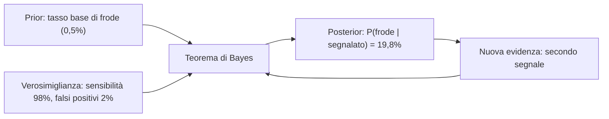

## Il filtro antifrode che bloccava i clienti onesti

Scenario costruito con numeri di esempio: un portale di e-commerce italiano introduce un modello antifrode con prestazioni che sul report sembrano eccellenti. Il modello segnala il 98% delle frodi vere, cioè ha una sensibilità del 98%, e segnala per errore il 2% degli ordini onesti, quindi ha un tasso di falsi positivi del 2%. Il responsabile vendite blocca automaticamente tutto ciò che viene segnalato. Dopo una settimana arrivano al supporto centinaia di proteste di clienti che non hanno commesso nessuna frode.

Il paradosso è solo apparente. Le frodi reali sono lo 0,5% degli ordini, quindi su 100.000 ordini ce ne sono 500, e il modello ne segnala 490. Ma ci sono anche 99.500 ordini onesti, e il 2% di essi, cioè 1.990, viene segnalato. Su 2.480 ordini bloccati, solo 490 sono frodi: appena il 19,8%. Per ogni cliente che commette una frode, quattro clienti onesti vengono fermati.

> **Idea chiave:** la probabilità che un segnale indichi la causa dipende dalla forza del segnale e dalla frequenza di partenza della causa; un test accurato su un evento raro produce soprattutto falsi allarmi.

Il teorema di Bayes è la formula che combina i due ingredienti. Questa lezione la deriva da definizioni di probabilità condizionata, la applica al caso del filtro antifrode con calcolo esplicito, mostra come aggiornare la stima quando arrivano più segnali in sequenza e introduce l'aggiornamento di un tasso di conversione con una distribuzione Beta.

## Probabilità condizionata e formula di Bayes

La probabilità condizionata di un evento $A$ dato $B$ è $P(A \mid B) = \dfrac{P(A \cap B)}{P(B)}$, definita quando $P(B) > 0$. Scrivendo la stessa probabilità congiunta in due modi, $P(A \cap B) = P(A \mid B)\,P(B) = P(B \mid A)\,P(A)$, si ottiene il teorema di Bayes:

$$P(A \mid B) = \frac{P(B \mid A)\,P(A)}{P(B)}.$$

Ogni termine ha un nome e un ruolo preciso. $P(A)$ è il prior, la credenza prima di osservare l'evidenza. $P(B \mid A)$ è la verosimiglianza, la probabilità di osservare l'evidenza se l'ipotesi è vera. $P(B)$ è l'evidenza e si calcola con la legge della probabilità totale, $P(B) = P(B \mid A)P(A) + P(B \mid \neg A)P(\neg A)$. $P(A \mid B)$ è il posterior, la credenza aggiornata.

L'errore concettuale più comune è scambiare $P(B \mid A)$ con $P(A \mid B)$. La sensibilità del filtro, $P(\text{segnalato} \mid \text{frode}) = 98\%$, risponde alla domanda "se un ordine è una frode, il modello lo vede?". La domanda che interessa a chi decide è l'opposta, $P(\text{frode} \mid \text{segnalato})$, "se il modello segnala un ordine, è davvero una frode?", e dipende anche dal prior.



Lo schema mette in evidenza la struttura ciclica: il posterior di oggi diventa il prior di domani, che è esattamente quello che accade quando si accumulano evidenze indipendenti nel tempo.

## Esempio svolto: la precisione del filtro antifrode

Riprendiamo i numeri e calcoliamo il posterior in due modi equivalenti, con le frequenze e con la formula.

**Passo 1, popolazione di 100.000 ordini.** Frodi: $100.000 \times 0{,}5\% = 500$ ordini. Ordini onesti: $100.000 - 500 = 99.500$.

**Passo 2, segnalazioni tra le frodi.** $500 \times 98\% = 490$ frodi segnalate e $500 - 490 = 10$ frodi non viste.

**Passo 3, segnalazioni tra gli onesti.** $99.500 \times 2\% = 1.990$ ordini onesti segnalati.

**Passo 4, posterior.** Gli ordini segnalati sono $490 + 1.990 = 2.480$, quindi $P(\text{frode} \mid \text{segnalato}) = 490/2.480 \approx 19{,}8\%$. Con la formula si ottiene lo stesso risultato: $P(\text{segnalato}) = 0{,}98 \times 0{,}005 + 0{,}02 \times 0{,}995 = 0{,}0049 + 0{,}0199 = 0{,}0248$ e il posterior è $0{,}0049/0{,}0248 \approx 0{,}198$.

**Passo 5, costi.** Supponiamo che ogni frode non bloccata costi 120 euro e che ogni ordine onesto bloccato faccia perdere 45 euro di margine. Bloccare tutto ciò che viene segnalato evita $490 \times 120 = 58.800$ euro di frodi, ma costa $1.990 \times 45 = 89.550$ euro di margine perso: il saldo è $58.800 - 89.550 = -30.750$ euro. Con le sole prestazioni di sensibilità e falsi positivi il filtro sembrava un successo, ma al prior reale e a questi costi la regola "blocca tutto" è in perdita.

La lezione per chi costruisce modelli è che sensibilità e tasso di falsi positivi non bastano per decidere: servono il tasso base e i costi degli errori. Un modello con falsi positivi dello 0,2% invece del 2% avrebbe prodotto $99.500 \times 0{,}2\% = 199$ falsi allarmi e una precisione di $490/689 \approx 71\%$. Ridurre i falsi positivi è spesso più utile che aumentare la sensibilità, quando l'evento è raro.

## Aggiornare con più evidenze: il metodo degli odds

Quando le evidenze arrivano una dopo l'altra conviene lavorare con gli odds, il rapporto tra probabilità a favore e contro: $\text{odds} = p/(1-p)$. Il teorema di Bayes diventa moltiplicativo: odds a posteriori uguale odds a priori per rapporto di verosimiglianza, dove il rapporto di verosimiglianza è $\mathrm{LR} = \dfrac{P(\text{segnale} \mid \text{frode})}{P(\text{segnale} \mid \text{onesto})}$.

Dopo il primo segnale gli odds sono $490/1.990 \approx 0{,}246$. Aggiungiamo un secondo segnale: l'indirizzo di spedizione è in un paese diverso da quello di fatturazione. Supponiamo che compaia nel 60% delle frodi e nel 3% degli ordini onesti. Il rapporto di verosimiglianza è $0{,}60/0{,}03 = 20$. Gli odds a posteriori sono $0{,}246 \times 20 \approx 4{,}92$ e la probabilità è $4{,}92/(1 + 4{,}92) \approx 83{,}1\%$. Sul campione di 100.000 ordini si ha $490 \times 0{,}60 = 294$ frodi con entrambi i segnali e $1.990 \times 0{,}03 \approx 60$ ordini onesti con entrambi, quindi $294/(294 + 60) \approx 83\%$, in accordo.

Bloccare solo gli ordini con entrambi i segnali evita circa $294 \times 120 = 35.280$ euro di frodi e costa circa $60 \times 45 = 2.700$ euro di margine, per un saldo di circa $+32.580$ euro. La stessa informazione, usata nel modo corretto, trasforma la regola da perdita a guadagno. L'ipotesi che regge il calcolo è l'indipendenza condizionale dei due segnali dato lo stato frode o onesto: se i due segnali sono correlati tra loro anche dentro lo stesso stato, moltiplicare i rapporti conta due volte la stessa informazione e il posterior risulta troppo ottimista.

## Aggiornare un tasso con prior Beta

Il teorema di Bayes si applica anche a parametri continui, come un tasso di conversione $\theta$. La distribuzione Beta$(a, b)$ è definita su $[0, 1]$ e ha media $a/(a+b)$. Con dati binomiali, $k$ conversioni su $n$ visite, il posterior è ancora una Beta: $\text{Beta}(a + k,\; b + n - k)$. Si dice che la Beta è coniugata della binomiale, e l'aggiornamento si riduce a una somma.

Supponiamo di ricavare dallo storico un prior Beta$(2, 38)$, con media $2/40 = 5\%$, che corrisponde a una credenza equivalente a circa 40 visite osservate. Una nuova campagna produce 12 conversioni su 150 visite, il che equivale a un tasso osservato di 8%. Il posterior è Beta$(2 + 12,\; 38 + 138) = $ Beta$(14, 176)$, con media $14/190 \approx 7{,}4\%$. La stima si colloca tra il 5% del prior e l'8% dei dati, più vicina ai dati perché 150 visite pesano più delle 40 equivalenti del prior. Con 1.500 visite e 120 conversioni il posterior sarebbe Beta$(122, 1.418)$ con media 7,9%, quasi coincidente con la frequenza osservata: più dati rendono il prior irrilevante.

## Aggiornamento in Python

Il frammento replica i calcoli di questa lezione, dal filtro antifrode al tasso di conversione.

```python
# Teorema di Bayes: precisione di un filtro antifrode e aggiornamento sequenziale
prev, recall, fpr = 0.005, 0.98, 0.02

# probabilità che un ordine segnalato sia davvero una frode
p_flag = recall * prev + fpr * (1 - prev)
post = recall * prev / p_flag
print("P(segnalato):", round(p_flag, 5), " P(frode | segnalato):", round(post, 4))

# aggiornamento con un secondo segnale, in termini di odds (indipendenza condizionale)
lr = 0.60 / 0.03                       # rapporto di verosimiglianza = 20
odds = post / (1 - post) * lr
post2 = odds / (1 + odds)
print("odds:", round(post / (1 - post), 4), "-> P dopo secondo segnale:", round(post2, 4))

# conteggi su 100.000 ordini
n = 100_000
frodi = n * prev; oneste = n - frodi
print("frodi:", frodi, " segnalate:", frodi * recall, " oneste segnalate:", oneste * fpr)

# aggiornamento beta-binomiale: prior Beta(2, 38), 12 conversioni su 150 visite
a, b = 2, 38
a1, b1 = a + 12, b + (150 - 12)
print("prior media:", a / (a + b), " posterior media:", round(a1 / (a1 + b1), 4), (a1, b1))
```

L'esecuzione stampa 0,0248 e 0,1976 per la prima parte, 0,2462 e 0,8312 per gli odds, 500, 490 e 1.990 per i conteggi e 0,05 e 0,0737 con parametri $(14, 176)$ per l'aggiornamento Beta. In produzione gli stessi passaggi si scrivono in SQL con `COUNT` condizionali per stimare sensibilità, falsi positivi e prior su un periodo storico, e il calcolo del posterior può restare in Python.

## Tre errori nel ragionamento bayesiano

### Ignorare il tasso base e guardare solo la forza del segnale

Il sintomo è la frase "il modello ha il 98% di accuratezza, quindi se segnala è quasi certamente una frode". Sembra ragionevole perché 98 è un numero alto e perché le persone leggono la sensibilità come precisione. Il tasso base dello 0,5% rende rari i veri positivi rispetto ai falsi, e il posterior scende al 19,8%. Si corregge calcolando sempre la matrice di confusione sul tasso base reale di produzione e riportando la precisione accanto alla sensibilità.

### Trattare segnali correlati come indipendenti

Il sintomo è un punteggio che sale a 99% appena si aggiungono variabili tra loro vicine, per esempio dispositivo nuovo, browser nuovo e indirizzo IP nuovo, che spesso compaiono insieme per lo stesso motivo innocuo, un cliente che cambia telefono. Moltiplicare i rapporti di verosimiglianza conta più volte la stessa evidenza. Si corregge stimando il rapporto di verosimiglianza della combinazione di segnali sui dati, oppure usando un modello che apprende i pesi congiunti, come la regressione logistica.

### Usare un prior arbitrario al posto dei dati storici

Il sintomo è un posterior che cambia radicalmente a seconda di chi ha scelto il prior. Un prior Beta$(1, 1)$ uniforme dà peso nullo allo storico e un prior molto concentrato, come Beta$(200, 3.800)$, ignora quasi del tutto una campagna da 150 visite. La correzione è stimare il prior dallo storico di campagne simili, esplicitarne l'equivalente in osservazioni (qui 40 visite) e verificare la sensibilità della conclusione facendo variare il prior in un intervallo plausibile.

## Il caso difficile dei prior che cambiano nel tempo

Il tasso base non è una costante. Se durante una promozione il tasso di frode sale dallo 0,5% all'1,5%, la precisione del filtro cambia anche se il modello è identico. Con sensibilità 98% e falsi positivi 2%, il posterior diventa $\dfrac{0{,}98 \times 0{,}015}{0{,}98 \times 0{,}015 + 0{,}02 \times 0{,}985} = \dfrac{0{,}0147}{0{,}0147 + 0{,}0197} \approx 42{,}7\%$. Lo stesso segnale, a parità di modello, passa da una precisione del 19,8% a una del 42,7%.

Questo significa che una soglia di blocco calibrata in un periodo calmo può diventare troppo permissiva in un periodo di attacco e troppo severa quando il tasso torna normale. La pratica corretta è monitorare il tasso base con una finestra mobile, ricalcolare la precisione attesa a ogni cambio di regime e prevedere due soglie: una per l'azione automatica, con precisione alta, e una per la revisione manuale, con precisione più bassa ma costo di errore contenuto. Anche il costo relativo degli errori entra nel calcolo: una soglia è ragionevole quando il costo atteso di bloccare un ordine, uguale al costo del falso positivo per la probabilità di onestà, è inferiore al costo atteso di lasciarlo passare.

## Verifica sul ragionamento bayesiano

1. Una malattia colpisce l'1% di una popolazione. Un test ha sensibilità 90% e falsi positivi 5%. Qual è la probabilità di avere la malattia dopo un test positivo?

<details>
<summary>Mostra risposta</summary>

$P(\text{positivo}) = 0{,}90 \times 0{,}01 + 0{,}05 \times 0{,}99 = 0{,}009 + 0{,}0495 = 0{,}0585$. Il posterior è $0{,}009/0{,}0585 \approx 15{,}4\%$. Il test è accurato ma la malattia è rara, quindi la maggior parte dei positivi sono falsi.

</details>

2. Nel filtro antifrode, perché dimezzare il tasso di falsi positivi dal 2% all'1% aumenta molto la precisione?

<details>
<summary>Mostra risposta</summary>

I falsi allarmi passano da 1.990 a circa 995 su 100.000 ordini, mentre le frodi segnalate restano 490. La precisione sale da $490/2.480 \approx 19{,}8\%$ a $490/1.485 \approx 33{,}0\%$, perché i falsi positivi, che dominano il denominatore, sono proporzionali al numero molto più grande di ordini onesti.

</details>

3. Gli odds a priori di un evento sono 0,25 e un segnale ha rapporto di verosimiglianza 8. Qual è la probabilità a posteriori?

<details>
<summary>Mostra risposta</summary>

Gli odds a posteriori sono $0{,}25 \times 8 = 2$ e la probabilità è $2/(1 + 2) \approx 66{,}7\%$.

</details>

4. Un prior Beta(2, 38) riceve 24 conversioni su 300 visite. Qual è la media del posterior?

<details>
<summary>Mostra risposta</summary>

Il posterior è Beta$(2 + 24,\; 38 + 276) = $ Beta$(26, 314)$ e la media è $26/340 \approx 7{,}6\%$, molto vicina al tasso osservato dell'8%.

</details>
