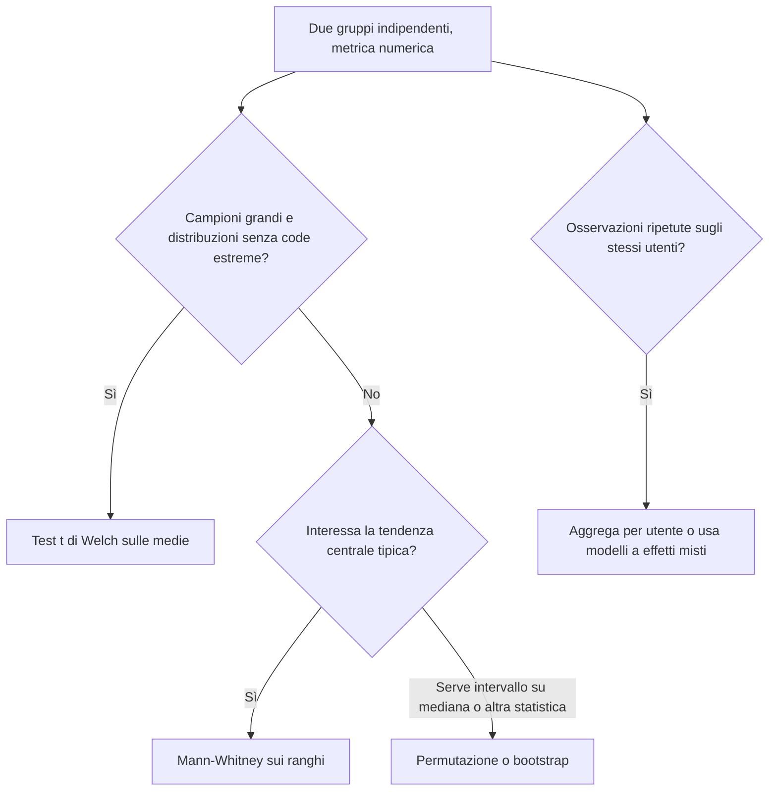

## Il t-test che non vedeva il team più veloce

Scenario costruito con numeri di esempio: un'azienda SaaS italiana confronta il tempo di risoluzione dei ticket tra due team di assistenza, otto ticket per team, misurati in ore. Il team A risolve i ticket in 30, 34, 38, 42, 46, 50, 54 e 58 ore. Il team B in 12, 14, 16, 18, 20, 22, 24 e 400 ore: sette ticket rapidissimi e uno rimasto bloccato per oltre sedici giorni in attesa di un cliente. Il responsabile lancia un t-test e ottiene un p-value di 0,66, quindi "nessuna differenza dimostrata".

Il risultato è tecnicamente corretto e praticamente fuorviante. Il team B è più veloce in sette confronti su otto: tutti i suoi ticket ordinari sono più rapidi di qualsiasi ticket del team A, e la sua mediana è 19 ore contro 44. Il t-test non ha visto la differenza perché la media di B è gonfiata dal ticket da 400 ore (65,75 ore contro 44,0 di A) e, soprattutto, perché quel ticket moltiplica la varianza stimata di B.

> **Idea chiave:** un test statistico risponde a una domanda precisa sulla statistica che confronta, e se la statistica è la media il test eredita tutta la sensibilità della media ai valori estremi; prima di scegliere il test bisogna scegliere che cosa si vuole confrontare.

Un test d'ipotesi non è un rituale che trasforma dati in un sì o un no. È un argomento per assurdo con quattro mosse: si assume che non ci sia differenza, si sceglie una statistica che misuri la differenza, si calcola quanto sarebbe raro osservare una differenza così grande se l'ipotesi fosse vera e si decide in base a una soglia fissata prima. La lezione parte da questa logica, calcola due test completi sugli stessi sedici ticket e discute gli errori che portano a conclusioni sbagliate in entrambe le direzioni.

## La logica del test: ipotesi, statistica, p-value e soglia

Si parte da due ipotesi. L'ipotesi nulla $H_0$ afferma che non c'è differenza, per esempio che le mediane o le medie dei due team coincidano. L'ipotesi alternativa $H_1$ afferma che c'è. Si sceglie una statistica test $T$ che riassume i dati in un numero e di cui si conosce la distribuzione sotto $H_0$. Il p-value è la probabilità, sotto $H_0$, di ottenere un valore della statistica almeno estremo come quello osservato.

Il p-value non è la probabilità che $H_0$ sia vera e non è la probabilità di aver sbagliato. Un p-value di 0,01 significa: se non ci fosse differenza, un risultato così estremo si presenterebbe una volta su cento. La decisione si prende confrontando il p-value con il livello di significatività $\alpha$, fissato prima di vedere i dati. Ogni decisione può sbagliare in due modi.

| Realtà \ Decisione | Non rifiuto $H_0$ | Rifiuto $H_0$ |
| --- | --- | --- |
| $H_0$ vera (nessun effetto) | decisione corretta | errore di Tipo I (falso positivo), probabilità $\alpha$ |
| $H_0$ falsa (effetto reale) | errore di Tipo II (falso negativo), probabilità $\beta$ | decisione corretta, potenza $1 - \beta$ |

Il livello $\alpha$ si sceglie in base al costo relativo dei due errori. Se lanciare una modifica inutile costa poco e perdere un miglioramento reale costa molto, si può accettare $\alpha = 0{,}10$. Se un falso positivo comporta un cambio di prezzi o un costo di migrazione, conviene $\alpha = 0{,}01$. La convenzione di 0,05 è un'abitudine, non una legge. La potenza dipende dalla dimensione dell'effetto, dalla variabilità dei dati e dal numero di osservazioni: con otto ticket per gruppo e una variabilità enorme, un test t ha una potenza minima, e un risultato non significativo dice poco.

## Parametrico o non parametrico: la domanda da farsi

I test parametrici, come il t-test, assumono una forma per la distribuzione dei dati o delle medie. Quelli non parametrici lavorano sui ranghi o sulla ricombinazione dei dati e fanno assunzioni più deboli. Non sono "test per dati sbagliati": sono test per una domanda diversa, spesso più vicina a quella del business.



Il test t di Welch confronta le medie senza assumere varianze uguali: $t = \dfrac{\bar{x}_B - \bar{x}_A}{\sqrt{s_B^2/n_B + s_A^2/n_A}}$. Funziona bene quando le medie campionarie sono approssimativamente normali, cioè con campioni grandi o dati poco asimmetrici. Il test di Mann-Whitney ordina tutte le osservazioni insieme, assegna i ranghi e misura se un gruppo ha sistematicamente ranghi più alti. Risponde alla domanda "un ticket scelto a caso nel gruppo B è più veloce di uno scelto a caso nel gruppo A?" e non è influenzato dall'entità degli estremi, solo dalla loro posizione nell'ordinamento.

## Esempio svolto: il test di Welch sui sedici ticket

**Passo 1, medie.** $\bar{x}_A = 352/8 = 44{,}0$ ore e $\bar{x}_B = 526/8 = 65{,}75$ ore. La differenza è $65{,}75 - 44{,}0 = 21{,}75$ ore.

**Passo 2, varianze campionarie.** Per A gli scarti dalla media sono $-14, -10, -6, -2, 2, 6, 10, 14$, con somma dei quadrati $196 + 100 + 36 + 4 + 4 + 36 + 100 + 196 = 672$ e $s_A^2 = 672/7 = 96{,}0$. Per B gli scarti sono $-53{,}75, -51{,}75, -49{,}75, -47{,}75, -45{,}75, -43{,}75, -41{,}75$ e $+334{,}25$, con somma dei quadrati $127.795{,}5$ e $s_B^2 = 127.795{,}5/7 = 18.256{,}5$, cioè $s_B \approx 135{,}1$ ore. Il ticket da 400 ore contribuisce con $111.723$ dei $127.795$ del totale, circa l'87%.

**Passo 3, errore standard.** $\sqrt{18.256{,}5/8 + 96{,}0/8} = \sqrt{2.282{,}06 + 12{,}0} = \sqrt{2.294{,}06} \approx 47{,}9$ ore.

**Passo 4, statistica.** $t = 21{,}75/47{,}9 \approx 0{,}45$, con circa 7 gradi di libertà secondo l'approssimazione di Welch.

**Passo 5, decisione.** Il p-value bilaterale è circa 0,66, ben sopra qualsiasi soglia ragionevole. Il test non rifiuta $H_0$, e nemmeno il segno è quello atteso: la media di B è più alta.

La varianza di B è 190 volte quella di A, e questo spiega tutto. Il denominatore del t-test è dominato dal ticket anomalo, quindi anche una differenza di 21,75 ore nelle medie vale appena 0,45 errori standard. Un dettaglio importante: se si togliesse l'ordine anomalo dopo aver guardato i dati, il test di Welch sui sette ticket di B darebbe $t \approx -6{,}6$ con $p \approx 0{,}0001$, un risultato opposto. Eliminare un dato perché cambia la conclusione è una pratica scorretta, e la scelta di trattare i casi anomali va definita prima, con un criterio operativo (per esempio, ticket in attesa del cliente esclusi dal tempo di risoluzione).

## Esempio svolto: Mann-Whitney sugli stessi dati

**Passo 1, ranghi.** Si ordinano le sedici osservazioni insieme. I sette ticket di B tra 12 e 24 ore occupano i ranghi da 1 a 7, i ticket di A tra 30 e 58 ore occupano i ranghi da 8 a 15 e il ticket da 400 ore ha il rango 16.

**Passo 2, somme dei ranghi.** Il gruppo B ha $1 + 2 + \dots + 7 + 16 = 28 + 16 = 44$. Il gruppo A ha $8 + 9 + \dots + 15 = 92$. Il controllo è $44 + 92 = 136 = 16 \times 17/2$.

**Passo 3, statistica U.** $U_B = R_B - n_B(n_B + 1)/2 = 44 - 36 = 8$ e $U_A = 92 - 36 = 56$, con $U_A + U_B = 64 = n_A n_B$. $U_B = 8$ conta le coppie in cui un ticket di B è più lento di uno di A: è soltanto il ticket da 400 ore, che batte tutti gli 8 di A.

**Passo 4, p-value esatto.** Con 8 osservazioni per gruppo esistono $\binom{16}{8} = 12.870$ assegnazioni dei ranghi ai due gruppi, tutte equiprobabili sotto $H_0$. Le assegnazioni con $U \le 8$ sono 67, e per il test bilaterale si raddoppia: $134/12.870 \approx 0{,}0104$.

**Passo 5, decisione.** Con $\alpha = 0{,}05$ si rifiuta $H_0$: il team B tende a risolvere più velocemente. Lo stesso dato che con il t-test dava $p = 0{,}66$ dà qui $p \approx 0{,}01$, perché il test sui ranghi limita il ticket da 400 ore a un unico rango, il sedicesimo, indipendentemente dal fatto che valga 100 o 10.000 ore.

Il confronto non dice che Mann-Whitney sia migliore in assoluto. Dice che i due test rispondono a domande diverse. Se il costo aziendale è proporzionale alle ore totali di lavoro, la domanda sulla media ha senso e il ticket da 400 ore conta eccome. Se la domanda riguarda l'esperienza tipica del cliente, il test sui ranghi è più adatto, ed è la scelta naturale per tempi di risposta e metriche con code lunghe.

## Lo stesso confronto in Python

Il codice seguente calcola i tre test sugli stessi dati: Welch, Mann-Whitney esatto e un test di permutazione sulla differenza tra mediane.

```python
# Test t di Welch, Mann-Whitney e test di permutazione sui tempi di risoluzione (ore)
import numpy as np
from scipy import stats

team_a = np.array([30, 34, 38, 42, 46, 50, 54, 58], dtype=float)
team_b = np.array([12, 14, 16, 18, 20, 22, 24, 400], dtype=float)

print("medie:", team_a.mean(), team_b.mean(), " mediane:", np.median(team_a), np.median(team_b))

# Welch: non assume varianze uguali
t, p = stats.ttest_ind(team_b, team_a, equal_var=False)
print("Welch t:", round(t, 3), " p:", round(p, 3))

# Mann-Whitney: test sui ranghi, p esatto per campioni piccoli
u, p_u = stats.mannwhitneyu(team_b, team_a, alternative="two-sided", method="exact")
print("U (team B):", u, " p esatto:", round(p_u, 4))

# test di permutazione sulla differenza di mediane
rng = np.random.default_rng(42)
osservata = np.median(team_a) - np.median(team_b)
pool = np.concatenate([team_a, team_b])
cont = 0
n_perm = 20000
for _ in range(n_perm):
    rng.shuffle(pool)
    if abs(np.median(pool[:8]) - np.median(pool[8:])) >= abs(osservata):
        cont += 1
print("differenza mediane:", osservata, " p permutazione:", round((cont + 1) / (n_perm + 1), 4))
```

L'output riporta $t = 0{,}454$ con $p = 0{,}663$, $U = 8$ con $p = 0{,}0104$ e una differenza tra le mediane di 25 ore con $p \approx 0{,}033$ per la permutazione. Il valore della permutazione dipende dal seme casuale ma resta intorno a 0,03. La permutazione ha il vantaggio di funzionare con qualsiasi statistica, mediana compresa, perché costruisce la distribuzione sotto $H_0$ rimescolando le etichette dei gruppi.

## Tre errori nell'uso dei test d'ipotesi

### Usare il test t classico assumendo varianze uguali

Il sintomo è un p-value troppo ottimista o troppo pessimista quando i gruppi hanno dimensioni o dispersioni molto diverse. Il test t di Student calcola una varianza comune, e se il gruppo più piccolo è anche il più variabile la varianza comune sottostima l'incertezza. Si evita usando per default la versione di Welch, che non assume varianze uguali e perde poco quando le varianze sono in realtà uguali.

### Applicare test per dati normali su campioni piccoli con code lunghe

Il sintomo è una conclusione che cambia eliminando o aggiungendo un solo record, come nel confronto dei due team. Su otto osservazioni il teorema del limite centrale non protegge: la media campionaria eredita la forma asimmetrica dei dati. Si corregge guardando prima la distribuzione, con istogramma e diagramma quantile-quantile, e scegliendo un test sui ranghi o una permutazione quando c'è asimmetria marcata, oppure una trasformazione logaritmica se la metrica è di tipo moltiplicativo.

### Eseguire decine di test e riportare solo quello significativo

Il sintomo è un cruscotto con venti confronti segmentati in cui uno risulta significativo a $p = 0{,}03$ e diventa il titolo del report. Con venti test indipendenti e tutte le ipotesi nulle vere, la probabilità di almeno un falso positivo è $1 - 0{,}95^{20} \approx 64\%$. Si corregge dichiarando prima i confronti, adottando una correzione per test multipli (con Bonferroni la soglia per venti test diventa $0{,}05/20 = 0{,}0025$, oppure il controllo del tasso di false scoperte per analisi esplorative) e trattando i risultati non pre-registrati come ipotesi da verificare su dati nuovi.

## Il caso difficile delle osservazioni non indipendenti

I test visti finora assumono osservazioni indipendenti. Nei dati aziendali la violazione è frequente: più ticket dello stesso cliente, più sessioni dello stesso utente, più ordini dello stesso negozio. Supponiamo che i venti ticket di un confronto provengano da cinque clienti, quattro ticket ciascuno, e che i ticket dello stesso cliente siano correlati con coefficiente intraclasse $\rho = 0{,}5$. L'effetto di disegno è $1 + (m - 1)\rho = 1 + 3 \times 0{,}5 = 2{,}5$ e la numerosità efficace è $20/2{,}5 = 8$. Il test che tratta i venti ticket come indipendenti usa un errore standard più piccolo del dovuto di un fattore $\sqrt{2{,}5} \approx 1{,}6$ e rifiuta $H_0$ molto più spesso di quanto dichiari.

La correzione consiste nel cambiare l'unità di analisi: aggregare per cliente (una media o una mediana per cliente) e confrontare i valori aggregati, oppure usare un modello con effetti casuali per cliente. Il numero di unità indipendenti, non il numero di righe, determina la potenza del test. Un controllo semplice è chiedersi, per ogni confronto, quale sia l'unità su cui si vuole generalizzare la conclusione e se la tabella contiene una riga per unità.

## Verifica sulla logica dei test

1. Un test ha $\alpha = 0{,}05$ e restituisce $p = 0{,}04$. Che cosa significa e che cosa non significa?

<details>
<summary>Mostra risposta</summary>

Significa che, se $H_0$ fosse vera, un risultato estremo almeno quanto quello osservato si avrebbe nel 4% dei casi: si rifiuta $H_0$ al livello 5%. Non significa che $H_0$ ha il 4% di probabilità di essere vera, né che l'effetto è grande o importante per il business.

</details>

2. Un team di prodotto esegue 20 test indipendenti, tutti con ipotesi nulla vera, a $\alpha = 0{,}05$. Qual è la probabilità di almeno un risultato significativo e quale soglia usa Bonferroni?

<details>
<summary>Mostra risposta</summary>

$1 - 0{,}95^{20} \approx 0{,}64$, cioè il 64%. Bonferroni divide la soglia per il numero di test, $0{,}05/20 = 0{,}0025$, in modo da mantenere al 5% la probabilità complessiva di almeno un falso positivo.

</details>

3. Nel confronto dei due team la statistica $U_B$ vale 8 con $n_A = n_B = 8$. Quanto vale $U_A$ e perché la somma è fissa?

<details>
<summary>Mostra risposta</summary>

$U_A = n_A n_B - U_B = 64 - 8 = 56$. La somma è fissa perché ogni coppia (un ticket di A, uno di B) è contata esattamente una volta, a favore dell'uno o dell'altro gruppo.

</details>

4. Hai 600 sessioni provenienti da 150 utenti e vuoi confrontare due versioni di una pagina. Quale errore evitare e quale unità di analisi scegliere?

<details>
<summary>Mostra risposta</summary>

L'errore è trattare le 600 sessioni come indipendenti, perché sessioni dello stesso utente sono correlate e il test sarebbe troppo ottimista. Conviene aggregare per utente (150 unità) o usare un modello con effetto casuale per utente, in modo che la numerosità riflessa nel test corrisponda alle unità realmente indipendenti.

</details>
