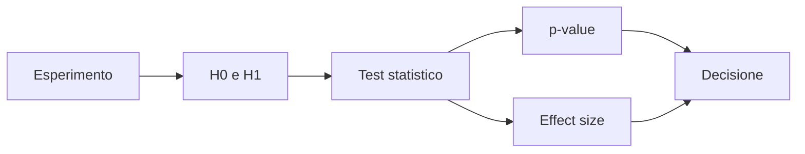

import { Aside } from '@astrojs/starlight/components'

Un A/B test mostra `+4.2%` di uplift. La domanda vera non e' "e' positivo?", ma "e' abbastanza forte da non essere solo caso, e abbastanza utile da meritare azione?".

## Mappa mentale



## Logica minima del test d'ipotesi

- `H0`: nessuna differenza reale
- `H1`: esiste una differenza

Poi calcoli una statistica di test e un p-value.

### La sequenza corretta

Il flusso sano e':

1. definisci prima la domanda
2. scegli la metrica
3. scegli il test coerente con i dati
4. leggi insieme significativita' ed entita' dell'effetto

## Esempio: confronto di due medie

```python
import numpy as np
from scipy.stats import ttest_ind

control = np.array([31, 29, 35, 33, 30, 28, 34, 32])
variant = np.array([34, 36, 32, 38, 35, 33, 37, 36])

stat, p_value = ttest_ind(control, variant, equal_var=False)
print(round(stat, 3), round(p_value, 4))
```

Se `p < 0.05`, i dati sono poco compatibili con l'ipotesi nulla.

## Ma il p-value da solo non basta

Devi leggere anche:

- dimensione dell'effetto
- sample size
- impatto business
- robustezza del disegno sperimentale

```python
effect_size = variant.mean() - control.mean()
relative_lift = effect_size / control.mean()

print(round(effect_size, 2), round(relative_lift, 4))
```

## Test su proporzioni: conversion rate

```python
from statsmodels.stats.proportion import proportions_ztest

conversions = np.array([128, 147])
visitors = np.array([4000, 4020])

z_stat, p_value = proportions_ztest(conversions, visitors)
print(round(z_stat, 3), round(p_value, 4))
```

Questo e' molto piu' vicino al lavoro quotidiano su landing, email e funnel.

## Quando usare un test non parametrico

Se i dati sono piccoli, molto asimmetrici o pieni di outlier, i test parametrici possono essere fragili.

### Mann-Whitney U

```python
from scipy.stats import mannwhitneyu

control = np.array([8, 9, 9, 10, 11, 12, 40])
variant = np.array([10, 11, 12, 13, 13, 14, 15])

stat, p_value = mannwhitneyu(control, variant, alternative="two-sided")
print(stat, round(p_value, 4))
```

Utile quando vuoi confrontare distribuzioni senza assumere normalita' forte.

## Parametrico o non parametrico?

Regola pratica:

- dati abbastanza stabili, campione ragionevole, assunzioni plausibili: test parametrico
- dati piccoli, asimmetrici, con outlier o code strane: test non parametrico

Non perche' uno sia "piu' avanzato" dell'altro, ma perche' la robustezza cambia.

## Errori classici negli esperimenti

### Peeking

Guardare il test ogni giorno e fermarsi appena `p < 0.05` aumenta i falsi positivi.

### Multiple testing

Se testi 20 varianti e scegli la prima significativa, stai quasi certamente sopravvalutando il segnale.

### Significativo ma irrilevante

Con campioni enormi puoi trovare differenze minuscole ma inutili.

<Aside type="caution">
Un test puo' essere statisticamente significativo e allo stesso tempo irrilevante per il business. La decisione richiede entrambe le letture.
</Aside>

## Template rapido di interpretazione

Quando leggi un test, chiediti:

1. l'effetto e' statisticamente distinguibile dal caso?
2. l'effetto e' abbastanza grande da cambiare una decisione?
3. il campione e il disegno sono credibili?
4. ci sono test multipli o stopping rule scorrette?

## Esempio avanzato con statsmodels e mini dataset reale

Quando analizzi molte feature insieme, il rischio non e' solo il p-value. E' il falso positivo ripetuto decine di volte. Con il dataset `breast_cancer` puoi confrontare piu' variabili tra classi reali e poi correggere i p-value con FDR.

```python
from sklearn.datasets import load_breast_cancer
from scipy.stats import ttest_ind
from statsmodels.stats.multitest import multipletests
import pandas as pd

data = load_breast_cancer(as_frame=True)
df = data.frame

features = ["mean radius", "mean texture", "mean perimeter", "mean area"]
p_values = []

for feature in features:
    malignant = df.loc[df["target"] == 0, feature]
    benign = df.loc[df["target"] == 1, feature]
    _, p_value = ttest_ind(malignant, benign, equal_var=False)
    p_values.append(p_value)

result = pd.DataFrame({
    "feature": features,
    "raw_p_value": p_values,
    "adjusted_p_value": multipletests(p_values, method="fdr_bh")[1],
})

print(result.round(8))
```

Questo e' il passaggio che separa un'analisi impressionistica da una lettura piu' difendibile quando il numero di confronti cresce.

## Output atteso

La tabella finale dovrebbe contenere:

- metrica controllo
- metrica variante
- effect size
- p-value
- decisione finale

## Riepilogo operativo

- Il test d'ipotesi e' un filtro contro conclusioni affrettate.
- Il p-value non e' la probabilita' che `H0` sia vera.
- I test non parametrici servono quando i dati reali rompono le ipotesi classiche.

## Mini esercizio

Confronta due gruppi di `time_on_site`, uno con forte outlier e uno senza. Esegui sia `ttest_ind` sia `mannwhitneyu`. In quali casi le conclusioni cambiano?
