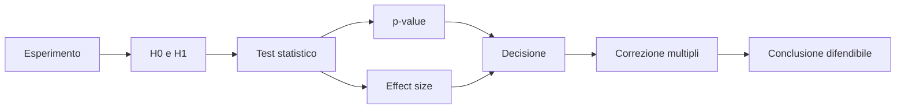

import { Aside } from '@astrojs/starlight/components'

Nel 2012, Facebook condusse oltre 1000 A/B test in parallelo. Senza capire come funziona un test d'ipotesi — e i suoi limiti — quei 1000 test avrebbero prodotto decine di falsi positivi che portano a decisioni sbagliate. L'industria tech chiama questo problema "A/B test pollution": un inquinamento sistematico del processo decisionale causato non dalla mancanza di dati, ma dalla mancanza di rigore statistico nell'interpretarli.

Un A/B test mostra `+4.2%` di uplift. La domanda vera non è "è positivo?", ma "è abbastanza forte da non essere solo caso, e abbastanza utile da meritare azione?". Questa lezione ti fornisce gli strumenti per rispondere con precisione.

## Mappa mentale



## Logica del test d'ipotesi

Ogni test statistico è costruito intorno a una struttura logica precisa, spesso fraintesa nella pratica. Prima di toccare il codice, è essenziale capire cosa stiamo effettivamente chiedendo ai dati.

### H0 e H1: il burden of proof

Il test d'ipotesi funziona come un processo penale. Nel sistema anglosassone, la presunzione è l'innocenza: l'imputato è innocente fino a prova contraria. L'accusa deve fornire prove sufficienti per "beyond reasonable doubt". Se le prove sono deboli, l'imputato viene assolto — non perché sia provato innocente, ma perché non si è raggiunta la soglia probatoria.

Nella statistica:

- **H0 (ipotesi nulla)**: la "presunzione di innocenza". Nessuna differenza reale esiste tra controllo e variante. L'effetto osservato è attribuibile al caso.
- **H1 (ipotesi alternativa)**: la "tesi dell'accusa". Esiste una differenza reale. Il trattamento ha un effetto.

Il test statistico non prova che H1 sia vera. Calcola quanto i dati osservati siano incompatibili con H0. Se l'incompatibilità supera una soglia predefinita, rifiutiamo H0 — non perché H1 sia dimostrata, ma perché H0 diventa difficile da sostenere.

Questa distinzione è cruciale: **un test statistico non dimostra nulla, filtra il rumore**.

### La sequenza corretta

L'ordine in cui si eseguono le decisioni determina la validità dell'analisi. Il flusso corretto è:

1. Definisci la domanda business prima di raccogliere i dati
2. Scegli la metrica primaria e il criterio di successo (es. `p < 0.05`, effect size minimo rilevante)
3. Calcola il sample size necessario per la potenza desiderata
4. Raccogli i dati senza guardare i risultati intermedi
5. Esegui il test a fine raccolta
6. Leggi insieme significatività statistica ed entità dell'effetto
7. Prendi la decisione business

Ogni deviazione da questa sequenza — in particolare i passi 3, 4 e 5 — introduce distorsioni che rendono i risultati inaffidabili.

## Il p-value in dettaglio

Il p-value è la statistica più citata e più fraintesa di tutta la statistica applicata. Prima di usarlo, occorre capire esattamente cosa misura e cosa non misura.

### Definizione corretta

Il p-value è la probabilità di osservare un risultato pari o più estremo di quello ottenuto, **assumendo che H0 sia vera**.

In formula: `P(dati ≥ osservati | H0 vera)`

Nota il condizionamento: stiamo chiedendo "se il mondo fosse descritto da H0, quanto spesso vedremmo dati come questi?". Se la risposta è "raramente" (p piccolo), i nostri dati sono incompatibili con H0. Se la risposta è "abbastanza spesso" (p grande), i dati sono compatibili con H0 — ma H0 non è confermata, semplicemente non è stata falsificata.

### Le tre interpretazioni sbagliate più comuni

**Errore 1: "p = 0.03 significa che c'è il 3% di probabilità che il risultato sia dovuto al caso."**

Sbagliato. Il p-value non è la probabilità che H0 sia vera. Per calcolare quella, occorrono informazioni sulla probabilità a priori di H0 (approccio bayesiano). Il p-value condiziona su H0 come già vera, non calcola la probabilità che lo sia.

**Errore 2: "p < 0.05 significa che l'effetto è reale e importante."**

Sbagliato su entrambi i fronti. Con campioni molto grandi, differenze di 0.001% sul conversion rate producono p-value estremamente bassi pur essendo irrilevanti per il business. La significatività statistica non implica significatività pratica.

**Errore 3: "p = 0.06 significa che il test è fallito."**

Sbagliato. Il p-value è continuo, non binario. Una soglia come 0.05 è una convenzione storica (introdotta da Fisher nel 1925), non una legge della natura. Un p = 0.06 con un effect size di 8% e un sample size di 500 merita riflessione, non dismissione automatica.

### Cosa il p-value NON dice

| Cosa NON dice il p-value | Cosa dice invece |
|---|---|
| Probabilità che H0 sia vera | Compatibilità dei dati con H0 |
| Importanza o rilevanza dell'effetto | Presenza di segnale distinguibile dal rumore |
| Replicabilità del risultato | Compatibilità con questo campione specifico |
| Conferma di H1 | Falsificazione insufficiente di H0 |

<Aside type="caution">
Un p-value di 0.001 non significa che la variante è tre volte "più significativa" di una con p = 0.003. Il p-value non è una misura dell'effetto, è una misura della compatibilità con il rumore casuale. Per misurare l'effetto, usa Cohen's d, odds ratio, o la differenza assoluta nelle metriche business.
</Aside>

## Errore di Tipo I e Tipo II

Ogni decisione statistica può sbagliare in due modi distinti. Capire il trade-off tra questi due tipi di errore è fondamentale per progettare esperimenti corretti.

### La tabella degli errori

|  | H0 vera (nessun effetto reale) | H0 falsa (effetto reale esiste) |
|---|---|---|
| **Rifiutiamo H0** (test significativo) | **Errore Tipo I** (Falso Positivo) | Decisione corretta (Vero Positivo) |
| **Non rifiutiamo H0** (test non significativo) | Decisione corretta (Vero Negativo) | **Errore Tipo II** (Falso Negativo) |

**Errore di Tipo I (α)**: dichiari che l'effetto esiste quando non esiste. Lanci una feature che non funziona. Perdi tempo di sviluppo su una falsa promessa.

**Errore di Tipo II (β)**: dichiari che l'effetto non esiste quando invece esiste. Scatti una opportunità reale. Non lanci una feature che avrebbe funzionato.

### Il trade-off α vs β

α e β sono inversamente correlati per una dimensione campionaria fissa. Se abbassi la soglia α (es. da 0.05 a 0.01) per ridurre i falsi positivi, aumenti automaticamente la probabilità di perdere effetti reali (falsi negativi).

L'unico modo per ridurre entrambi simultaneamente è **aumentare il sample size**.

### Potenza statistica

La **potenza del test** è definita come `1 - β`: la probabilità di rilevare un effetto reale quando esiste. Convenzionalmente, si punta a una potenza dell'80% (β = 0.20).

Il calcolo del sample size necessario dipende da:
- L'effect size minimo che vuoi rilevare (minimum detectable effect, MDE)
- Il livello α scelto (tipicamente 0.05)
- La potenza desiderata (tipicamente 0.80)

```python
from statsmodels.stats.power import TTestIndPower

analysis = TTestIndPower()

# Calcola il sample size per rilevare un effect size di Cohen's d = 0.3
# con alpha = 0.05 e potenza = 0.80
sample_size = analysis.solve_power(
    effect_size=0.3,
    alpha=0.05,
    power=0.80,
    alternative='two-sided'
)

print(f"Sample size per gruppo necessario: {round(sample_size)}")
# Output: circa 176 per gruppo
```

Se hai meno osservazioni di quelle necessarie, il tuo test è "underpowered": anche se l'effetto esiste, hai poca probabilità di rilevarlo.

## t-test a due campioni

Il t-test a due campioni è lo strumento più comune per confrontare le medie di due gruppi indipendenti. Prima di applicarlo, occorre verificarne le assunzioni.

### Assunzioni del t-test

**Normalità**: i dati in ciascun gruppo devono seguire approssimativamente una distribuzione normale. Per campioni grandi (n > 30 per gruppo), il Teorema Centrale del Limite garantisce che la media campionaria sia approssimativamente normale anche se i dati originali non lo sono. Per campioni piccoli, è necessario verificare con un test di normalità (Shapiro-Wilk) o un Q-Q plot.

**Indipendenza**: le osservazioni devono essere indipendenti sia all'interno di ogni gruppo sia tra i due gruppi. Violazioni tipiche: utenti che appaiono in entrambi i gruppi, effetti di spillover tra variante e controllo.

**Varianze uguali o diverse**: il t-test di Student classico assume varianze uguali. Il **t-test di Welch** (versione robusta) non fa questa assunzione ed è preferibile nella maggior parte dei casi. In scipy, si usa `equal_var=False`.

### Esempio A/B test completo

```python
import numpy as np
from scipy.stats import ttest_ind, shapiro
import pandas as pd

np.random.seed(42)

# Simulazione: tempo medio per completare un checkout
# Controllo: media 45s, variante: media 41s
control_time = np.random.normal(loc=45, scale=12, size=200)
variant_time = np.random.normal(loc=41, scale=11, size=200)

# 1. Verifica normalità (Shapiro-Wilk)
stat_c, p_norm_c = shapiro(control_time)
stat_v, p_norm_v = shapiro(variant_time)

print(f"Shapiro-Wilk controllo: p = {p_norm_c:.4f}")
print(f"Shapiro-Wilk variante: p = {p_norm_v:.4f}")
# p > 0.05 => assunzione di normalità plausibile

# 2. t-test di Welch (equal_var=False è la scelta sicura)
stat, p_value = ttest_ind(control_time, variant_time, equal_var=False)

# 3. Effect size (Cohen's d)
pooled_std = np.sqrt((control_time.std()**2 + variant_time.std()**2) / 2)
cohens_d = (control_time.mean() - variant_time.mean()) / pooled_std

# 4. Riepilogo
results = pd.DataFrame({
    "Metrica": ["Media controllo", "Media variante", "Differenza assoluta",
                "Differenza relativa", "t-statistic", "p-value", "Cohen's d"],
    "Valore": [
        f"{control_time.mean():.2f}s",
        f"{variant_time.mean():.2f}s",
        f"{control_time.mean() - variant_time.mean():.2f}s",
        f"{(control_time.mean() - variant_time.mean()) / control_time.mean() * 100:.1f}%",
        f"{stat:.3f}",
        f"{p_value:.4f}",
        f"{cohens_d:.3f}"
    ]
})

print(results.to_string(index=False))
```

Un Cohen's d di 0.2 è considerato "piccolo", 0.5 "medio", 0.8 "grande". Un effetto statisticamente significativo con d = 0.05 è probabilmente irrilevante per il business, anche con un p-value di 0.001.

## Test per proporzioni

Nella pratica del marketing e dell'analisi prodotto, la metrica più comune non è una media continua ma un **tasso di conversione**: una proporzione. Il confronto tra due conversion rate richiede strumenti diversi dal t-test.

### Z-test per conversion rate

```python
from statsmodels.stats.proportion import proportions_ztest
import numpy as np

# Esempio: landing page A vs landing page B
# Gruppo A: 128 conversioni su 4000 visitatori (3.2%)
# Gruppo B: 147 conversioni su 4020 visitatori (3.66%)

conversions = np.array([128, 147])
visitors = np.array([4000, 4020])

z_stat, p_value = proportions_ztest(conversions, visitors)

rate_a = conversions[0] / visitors[0]
rate_b = conversions[1] / visitors[1]
lift = (rate_b - rate_a) / rate_a

print(f"Conversion rate A: {rate_a:.3%}")
print(f"Conversion rate B: {rate_b:.3%}")
print(f"Lift relativo: {lift:.1%}")
print(f"z-statistic: {z_stat:.3f}")
print(f"p-value: {p_value:.4f}")
```

Lo z-test per proporzioni è appropriato quando i campioni sono sufficientemente grandi (regola empirica: almeno 5 successi e 5 insuccessi per gruppo).

### Chi-quadro per distribuzioni categoriche

Quando vuoi confrontare distribuzioni su più categorie (es. distribuzione del piano tariffario tra utenti europei e americani), il test del chi-quadro è lo strumento corretto.

```python
from scipy.stats import chi2_contingency
import numpy as np

# Distribuzione piani tariffari: Free, Pro, Enterprise
# Confronto tra segmento EMEA vs NA
observed = np.array([
    [520, 180, 45],   # EMEA: Free, Pro, Enterprise
    [310, 210, 80],   # NA: Free, Pro, Enterprise
])

chi2, p, dof, expected = chi2_contingency(observed)

print(f"Chi-quadro: {chi2:.3f}")
print(f"Gradi di libertà: {dof}")
print(f"p-value: {p:.4f}")
print(f"\nFrequenze attese (sotto H0):\n{expected.round(1)}")
```

Il chi-quadro misura quanto le frequenze osservate si discostano da quelle attese sotto H0 (indipendenza tra le variabili). Un p basso indica che la distribuzione dei piani tariffari è statisticamente diversa tra i due segmenti.

<Aside type="tip">
Per campioni piccoli (celle con frequenza attesa inferiore a 5), usa il test esatto di Fisher al posto del chi-quadro. In Python: `scipy.stats.fisher_exact` per tabelle 2x2.
</Aside>

## Test non parametrici

I test parametrici come il t-test assumono che i dati seguano una distribuzione normale. Nella realtà dei dati business, questa assunzione è spesso violata: il revenue per utente ha tipicamente una distribuzione fortemente asimmetrica con una lunga coda destra (pochi utenti generano una parte sproporzionata del fatturato). I tempi di sessione, i valori dell'ordine, le metriche di engagement raramente seguono una curva a campana.

I test non parametrici non fanno assunzioni sulla forma della distribuzione: lavorano sui **ranghi** delle osservazioni anziché sui valori assoluti, rendendoli robusti agli outlier e alle distribuzioni asimmetriche.

### Mann-Whitney U: il t-test dei ranghi

Il Mann-Whitney U test (anche detto Wilcoxon rank-sum test) verifica se i valori di un gruppo tendano a essere sistematicamente più alti dell'altro, senza assumere normalità.

```python
import numpy as np
from scipy.stats import mannwhitneyu, ttest_ind

np.random.seed(123)

# Revenue per utente: distribuzione log-normale (tipica nel mondo reale)
# Controllo: mediana ~20€, variante: mediana ~23€
control_rev = np.random.lognormal(mean=3.0, sigma=1.2, size=200)
variant_rev = np.random.lognormal(mean=3.15, sigma=1.2, size=200)

# Inserisci qualche outlier realistico (whale users)
control_rev = np.append(control_rev, [500, 800, 1200])
variant_rev = np.append(variant_rev, [450, 750])

print("=== Statistiche descrittive ===")
print(f"Controllo - Media: {control_rev.mean():.1f}€, Mediana: {np.median(control_rev):.1f}€")
print(f"Variante  - Media: {variant_rev.mean():.1f}€, Mediana: {np.median(variant_rev):.1f}€")

# t-test (sensibile agli outlier)
t_stat, t_p = ttest_ind(control_rev, variant_rev, equal_var=False)

# Mann-Whitney U (robusto agli outlier)
u_stat, u_p = mannwhitneyu(control_rev, variant_rev, alternative='two-sided')

print(f"\n=== Confronto tra test ===")
print(f"t-test:          t = {t_stat:.3f}, p = {t_p:.4f}")
print(f"Mann-Whitney U:  U = {u_stat:.0f}, p = {u_p:.4f}")
```

In presenza di outlier significativi (whale users con revenue di 10x la mediana), il t-test può dare risultati instabili perché la media è molto sensibile ai valori estremi. Il Mann-Whitney lavora sui ranghi e ignora quanto estremi siano i valori: sa solo che 800€ è "più alto" di 50€, non di quanto.

### Wilcoxon signed-rank: dati appaiati

Quando le osservazioni nei due gruppi sono **appaiate** (stesso utente prima e dopo un trattamento, stesso negozio in periodi diversi), si usa il test di Wilcoxon signed-rank.

```python
from scipy.stats import wilcoxon

# Revenue stesso campione di negozi: mese prima vs mese dopo una campagna
before = np.array([1200, 980, 1450, 820, 1100, 760, 1300, 1050])
after  = np.array([1350, 1020, 1480, 790, 1250, 810, 1420, 1180])

stat, p = wilcoxon(before, after)
print(f"Wilcoxon signed-rank: statistic = {stat}, p = {p:.4f}")
```

### Kruskal-Wallis: confronto di 3+ gruppi (non parametrico)

Quando vuoi confrontare più di due gruppi senza assumere normalità, Kruskal-Wallis è l'equivalente non parametrico dell'ANOVA.

```python
from scipy.stats import kruskal

# NPS score per tre regioni geografiche
north = np.array([7, 8, 6, 9, 7, 8, 5, 8, 9, 7])
center = np.array([6, 7, 5, 7, 6, 8, 7, 6, 5, 7])
south = np.array([5, 6, 4, 7, 5, 6, 4, 5, 6, 5])

stat, p = kruskal(north, center, south)
print(f"Kruskal-Wallis: H = {stat:.3f}, p = {p:.4f}")
```

Se Kruskal-Wallis è significativo, indica che almeno un gruppo è diverso dagli altri. Per sapere quali gruppi differiscono, si eseguono test post-hoc a coppie con correzione per confronti multipli.

## ANOVA: confronto di 3+ gruppi parametrico

Quando vuoi confrontare le medie di tre o più gruppi e le assunzioni di normalità e omoschedasticità sono plausibili, l'ANOVA (Analysis of Variance) è lo strumento corretto.

### Perché non fare t-test multipli

Se hai tre gruppi (A, B, C) e fai tre t-test separati (A vs B, A vs C, B vs C), ogni test ha un α = 0.05. La probabilità di ottenere almeno un falso positivo sui tre test è:

`P(almeno un FP) = 1 - (1 - 0.05)^3 = 1 - 0.857 = 14.3%`

Stai operando non al 5% di tasso di falsi positivi, ma al 14.3%. Con 10 gruppi e 45 confronti a coppie, la probabilità di almeno un falso positivo supera il 90%. Questo è esattamente il problema che l'ANOVA risolve.

```python
from scipy.stats import f_oneway
from statsmodels.stats.multicomp import pairwise_tukeyhsd
import numpy as np
import pandas as pd

np.random.seed(42)

# Tre varianti di onboarding: media sessioni nel primo mese
group_a = np.random.normal(loc=8.2, scale=2.1, size=80)   # Onboarding A
group_b = np.random.normal(loc=9.1, scale=2.0, size=80)   # Onboarding B
group_c = np.random.normal(loc=8.0, scale=2.3, size=80)   # Onboarding C (controllo)

# ANOVA a una via
f_stat, p_value = f_oneway(group_a, group_b, group_c)
print(f"ANOVA: F = {f_stat:.3f}, p = {p_value:.4f}")

# Se l'ANOVA è significativa, post-hoc di Tukey per sapere QUALI gruppi differiscono
if p_value < 0.05:
    all_data = np.concatenate([group_a, group_b, group_c])
    labels = ['A'] * len(group_a) + ['B'] * len(group_b) + ['C'] * len(group_c)

    tukey = pairwise_tukeyhsd(all_data, labels, alpha=0.05)
    print("\nTest post-hoc di Tukey:")
    print(tukey.summary())
```

L'ANOVA risponde a "c'è una differenza tra i gruppi?". Il test di Tukey risponde a "quali coppie di gruppi differiscono?", controllando automaticamente per i confronti multipli.

## Multiple testing problem

Il problema dei test multipli è la causa principale dell'A/B test pollution che abbiamo menzionato nell'introduzione. È uno dei problemi più sottovalutati nell'analisi dati applicata.

### La matematica del falso positivo ripetuto

Con un livello di significatività α = 0.05, ogni singolo test ha un 5% di probabilità di produrre un falso positivo. Se esegui k test indipendenti, la probabilità di ottenere almeno un falso positivo è:

`P(almeno un FP) = 1 - (1 - α)^k`

| Numero di test | P(almeno un falso positivo) |
|---|---|
| 1 | 5.0% |
| 5 | 22.6% |
| 10 | 40.1% |
| 20 | 64.2% |
| 50 | 92.3% |
| 100 | 99.4% |

Con 20 test al 5%, c'è una probabilità del 64% di trovare almeno un "risultato significativo" che è puro rumore. Questo è esattamente il scenario delle campagne di ottimizzazione con molte varianti testate simultaneamente.

### Correzione di Bonferroni

La correzione più semplice: dividi α per il numero di test k.

`α_corretto = α / k`

Per 20 test: `α_corretto = 0.05 / 20 = 0.0025`

È conservativa (riduce la potenza) ma controlla il FWER (Family-Wise Error Rate): la probabilità di fare anche un solo errore di Tipo I sull'intera famiglia di test.

### FDR: Benjamini-Hochberg

La correzione di Bonferroni è troppo conservativa quando il numero di test è elevato. Il metodo di Benjamini-Hochberg (BH) controlla invece il **False Discovery Rate**: la proporzione attesa di falsi positivi tra i test dichiarati significativi. È più potente di Bonferroni mantenendo un controllo ragionevole sugli errori.

```python
from sklearn.datasets import load_breast_cancer
from scipy.stats import ttest_ind
from statsmodels.stats.multitest import multipletests
import pandas as pd

data = load_breast_cancer(as_frame=True)
df = data.frame

features = ["mean radius", "mean texture", "mean perimeter", "mean area",
            "mean smoothness", "mean compactness", "mean concavity",
            "mean concave points", "mean symmetry", "mean fractal dimension"]

p_values = []
effect_sizes = []

for feature in features:
    malignant = df.loc[df["target"] == 0, feature]
    benign = df.loc[df["target"] == 1, feature]
    _, p_value = ttest_ind(malignant, benign, equal_var=False)
    p_values.append(p_value)

    pooled_std = ((malignant.std()**2 + benign.std()**2) / 2) ** 0.5
    d = abs(malignant.mean() - benign.mean()) / pooled_std
    effect_sizes.append(round(d, 3))

# Bonferroni
_, p_bonf, _, _ = multipletests(p_values, method="bonferroni")

# Benjamini-Hochberg
_, p_bh, _, _ = multipletests(p_values, method="fdr_bh")

result = pd.DataFrame({
    "feature": features,
    "p_raw": [round(p, 6) for p in p_values],
    "p_bonferroni": [round(p, 6) for p in p_bonf],
    "p_BH": [round(p, 6) for p in p_bh],
    "cohen_d": effect_sizes,
    "sig_raw": ["*" if p < 0.05 else "" for p in p_values],
    "sig_BH": ["*" if p < 0.05 else "" for p in p_bh],
})

print(result.to_string(index=False))
```

Questo è il passaggio che separa un'analisi impressionistica da una lettura difendibile quando il numero di confronti cresce.

<Aside type="caution">
Il multiple testing problem non vale solo per i test statistici formali. Se esplori un dataset con 50 variabili cercando correlazioni con la variabile target, stai implicitamente "testando" 50 ipotesi. Trovare una correlazione interessante in questo processo è molto probabilmente un artefatto del data dredging, non un segnale reale.
</Aside>

## Test sequenziali e peeking problem

Il **peeking problem** è un'altra forma di A/B test pollution, forse la più comune nelle organizzazioni che misurano i KPI in real-time.

### Come il peeking gonfia i falsi positivi

Immagina di eseguire un A/B test con un piano di raccolta dati per 2 settimane. Ogni giorno controlli il dashboard. Appena vedi `p < 0.05`, fermi il test e dichiari la variante vincitrice.

Questo comportamento — tecnicamente chiamato "optional stopping" — viola un'assunzione fondamentale del test d'ipotesi: la dimensione campionaria deve essere fissata prima dell'esperimento e non condizionata dai risultati intermedi.

La ragione è intuitiva: il p-value fluttua nel tempo. Anche quando H0 è vera (nessun effetto reale), il p-value attraverserà casualmente la soglia 0.05 con una probabilità molto più alta del 5% se lo osservi continuamente.

```python
import numpy as np
import matplotlib.pyplot as plt

np.random.seed(0)

n_simulations = 1000
n_obs = 200
alpha = 0.05

false_positive_peeking = 0
false_positive_correct = 0

for _ in range(n_simulations):
    # Nessun effetto reale: entrambi i gruppi hanno la stessa media
    group_a = np.random.normal(0, 1, n_obs)
    group_b = np.random.normal(0, 1, n_obs)

    # Peeking: controlla dopo ogni 10 osservazioni
    stopped_early = False
    for i in range(10, n_obs + 1, 10):
        from scipy.stats import ttest_ind
        _, p = ttest_ind(group_a[:i], group_b[:i], equal_var=False)
        if p < alpha:
            false_positive_peeking += 1
            stopped_early = True
            break

    # Test corretto: solo a fine raccolta
    _, p_final = ttest_ind(group_a, group_b, equal_var=False)
    if p_final < alpha:
        false_positive_correct += 1

print(f"Falsi positivi con peeking: {false_positive_peeking/n_simulations:.1%}")
print(f"Falsi positivi senza peeking: {false_positive_correct/n_simulations:.1%}")
# Output atteso: ~25-30% con peeking vs ~5% senza
```

### Test sequenziali: la soluzione

I **test sequenziali** (Sequential Probability Ratio Test, SPRT; o metodi Bayesiani) sono progettati per essere esaminati continuamente senza gonfiare il tasso di falsi positivi. Librerie come `statsmodels` e `scipy` offrono implementazioni di base; piattaforme come Optimizely e VWO le usano internamente.

L'alternativa pratica — se non usi un framework di test sequenziale — è semplice: **definisci a priori la data di fine del test e non guardare i risultati fino ad allora**.

## Tabella di selezione del test

Quale test usare? La scelta dipende dalla natura dei dati, dal numero di gruppi e dalle assunzioni sulla distribuzione.

| Tipo di dato | N. gruppi | Assunzione normalità | Test raccomandato |
|---|---|---|---|
| Continuo (es. tempo, revenue) | 2 indipendenti | Sì | t-test di Welch |
| Continuo | 2 indipendenti | No (o outlier forti) | Mann-Whitney U |
| Continuo | 2 appaiati | Sì | t-test appaiato |
| Continuo | 2 appaiati | No | Wilcoxon signed-rank |
| Continuo | 3+ indipendenti | Sì | ANOVA + Tukey post-hoc |
| Continuo | 3+ indipendenti | No | Kruskal-Wallis + Dunn post-hoc |
| Proporzione binaria | 2 | N/A (campioni grandi) | Z-test per proporzioni |
| Categorica (tabella di contingenza) | 2+ | N/A | Chi-quadro (o Fisher esatto) |
| Multipli test simultanei | N/A | N/A | + Correzione BH o Bonferroni |

La regola pratica rimane: dati abbastanza stabili, campione ragionevole, assunzioni plausibili → test parametrico. Dati piccoli, asimmetrici, con outlier o code strane → test non parametrico. Non perché uno sia "più avanzato" dell'altro, ma perché la robustezza cambia.

## Riepilogo operativo

Il test d'ipotesi è un filtro contro conclusioni affrettate, non una macchina per produrre certezze. I punti chiave da portare nella pratica quotidiana:

**Sul p-value**: non è la probabilità che H0 sia vera, non misura l'importanza dell'effetto, non garantisce la replicabilità. È solo una misura di compatibilità tra i dati e H0.

**Sul tipo di errore**: scegli α e β in base al costo asimmetrico degli errori nel contesto business. Lanciare una feature inefficace (Tipo I) e perdere una feature efficace (Tipo II) hanno conseguenze diverse.

**Sul test giusto**: scegli in base alla natura dei dati (continuo, proporzione, categorico), al numero di gruppi e alle assunzioni sulla distribuzione — non in base a quale test "funziona meglio" sui tuoi dati (quello è p-hacking).

**Sul multiple testing**: se stai testando più ipotesi contemporaneamente, applica sempre una correzione. Bonferroni è conservativa ma semplice. Benjamini-Hochberg è più potente per molti test.

**Sul peeking**: fissa il sample size prima di iniziare, fissa la data di fine, non guardare i risultati intermedi se non usi un test sequenziale progettato per questo.

**Sull'effect size**: leggi sempre il p-value insieme all'effetto pratico. Un conversion rate che migliora dello 0.01% non merita investimento, anche con p = 0.0001 e 100k utenti nel test.

## Mini esercizio

Confronta due gruppi di `time_on_site`, uno con forte outlier e uno senza. Esegui sia `ttest_ind` sia `mannwhitneyu`. In quali casi le conclusioni cambiano? Aggiungi poi un terzo gruppo e ripeti l'analisi con ANOVA e Kruskal-Wallis. Infine, simula il peeking problem: genera dati senza effetto reale e conta quante volte un'analisi quotidiana produce un falso positivo rispetto a un'analisi a fine raccolta.
