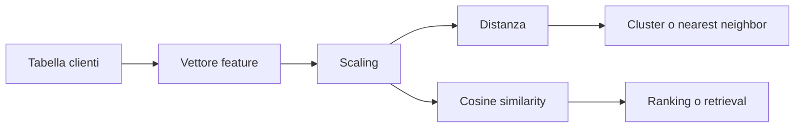

import { Aside } from '@astrojs/starlight/components'

Un team CRM vuole capire quali clienti assomigliano davvero ai top spender. Guardare solo una colonna non basta: servono piu' variabili lette insieme. Qui entra in gioco il vettore.

## Mappa mentale



## Perche' i vettori contano in analytics

Ogni riga con piu' feature numeriche puo' essere letta come un vettore:

- comportamento cliente
- metriche di una campagna
- profilo di un prodotto
- embedding testuale o semantico

Quando impari a leggere distanza, direzione e norma, inizi a capire come funzionano ranking, clustering, recommendation e anomaly detection.

## Da tabella a vettore

Immagina un cliente descritto da tre metriche:

```text
x = [sessioni_30g, ordini_30g, spesa_media]
```

Se due clienti hanno vettori simili, il loro comportamento e' simile anche se i valori assoluti cambiano.

### Come leggere davvero un vettore

Un vettore non e' solo una lista di numeri. E' una posizione in uno spazio costruito dalle feature che scegli. Se cambi le feature, cambi anche il significato della vicinanza.

In pratica:

- due vettori vicini descrivono profili simili
- un vettore con norma alta descrive una presenza numerica piu' forte
- un vettore con stessa direzione ma scala maggiore racconta un comportamento simile ma piu' intenso

### Norma e distanza

La norma euclidea misura la "lunghezza" del vettore:

```text
||x|| = sqrt(x1^2 + x2^2 + ... + xn^2)
```

La distanza euclidea tra due clienti `x` e `y` misura quanto sono lontani:

```text
d(x, y) = sqrt((x1-y1)^2 + ... + (xn-yn)^2)
```

```python
import numpy as np

client_a = np.array([12, 3, 48.0])
client_b = np.array([10, 4, 44.0])

distance = np.linalg.norm(client_a - client_b)
norm_a = np.linalg.norm(client_a)

print(distance)
print(norm_a)
```

## Perche' la scala rovina i risultati

Se `spesa_media` vale decine di euro e `ordini_30g` vale numeri piccoli, la distanza verra' dominata dalla spesa. Per questo quasi sempre standardizzi le feature prima di confrontarle.

```python
import pandas as pd

df = pd.DataFrame({
    "sessions_30d": [8, 12, 25, 40],
    "orders_30d": [1, 3, 4, 7],
    "avg_order_value": [35, 48, 52, 130],
})

scaled = (df - df.mean()) / df.std(ddof=0)
print(scaled.round(2))
```

<Aside type="caution">
Confrontare vettori non scalati e' uno degli errori piu' comuni in analisi multivariata. La feature con valori piu' grandi domina il risultato anche quando non e' la piu' importante.
</Aside>

## Prodotto scalare e cosine similarity

Il prodotto scalare:

```text
x dot y = x1y1 + x2y2 + ... + xnyn
```

serve per misurare allineamento tra due vettori. Da qui nasce la cosine similarity:

```text
cos(x, y) = (x dot y) / (||x|| ||y||)
```

Se il valore e' vicino a 1, i due profili puntano nella stessa direzione anche se hanno magnitudine diversa.

```python
def cosine_similarity(x, y):
    return np.dot(x, y) / (np.linalg.norm(x) * np.linalg.norm(y))

campaign_a = np.array([0.45, 0.30, 0.25])  # search, social, email
campaign_b = np.array([0.40, 0.35, 0.25])

print(round(cosine_similarity(campaign_a, campaign_b), 4))
```

## Caso business: trovare clienti simili ai top spender

```python
customers = pd.DataFrame({
    "user_id": [101, 102, 103, 104],
    "sessions_30d": [18, 11, 30, 28],
    "orders_30d": [4, 2, 5, 5],
    "avg_order_value": [72, 41, 95, 88],
})

target = np.array([30, 5, 90])
features = customers[["sessions_30d", "orders_30d", "avg_order_value"]].to_numpy()

customers["similarity_to_target"] = [
    cosine_similarity(row, target) for row in features
]

print(customers.sort_values("similarity_to_target", ascending=False))
```

Questo pattern serve per:

- lookalike analysis
- matching tra utenti e prodotti
- ranking di contenuti simili
- retrieval su embedding numerici

## Come scegliere la metrica giusta

Usa la distanza euclidea quando conta la distanza assoluta tra livelli numerici. Usa la cosine similarity quando ti interessa il profilo relativo piu' della magnitudine.

Esempio pratico:

- due clienti con stessa composizione di spesa ma volumi molto diversi: cosine alta, distanza anche alta
- due clienti con stessa spesa totale ma mix di comportamento diverso: distanza magari moderata, cosine piu' bassa

## Esempio avanzato con mini dataset reale

Se vuoi trasformare questa intuizione in un notebook serio, puoi usare il dataset `wine` di scikit-learn. Qui ogni riga e' un vino descritto da molte feature chimiche. L'obiettivo non e' classificare subito, ma trovare osservazioni simili a un profilo di riferimento.

```python
from sklearn.datasets import load_wine
from sklearn.metrics.pairwise import cosine_similarity
from sklearn.preprocessing import StandardScaler
import pandas as pd

wine = load_wine(as_frame=True)
X = wine.frame.drop(columns=["target"])

scaler = StandardScaler()
X_scaled = scaler.fit_transform(X)

reference = X_scaled[wine.target == 0].mean(axis=0, keepdims=True)
scores = cosine_similarity(X_scaled, reference).ravel()

ranking = (
    pd.DataFrame({
        "wine_class": wine.target,
        "cosine_to_class_0_profile": scores,
    })
    .sort_values("cosine_to_class_0_profile", ascending=False)
    .head(10)
)

print(ranking)
```

Qui stai facendo la stessa operazione che useresti su clienti, prodotti o creativita': costruisci un vettore medio target e cerchi chi gli assomiglia di piu'. E' un ponte diretto verso recommendation, lookalike e retrieval.

## Errori comuni

### Distanza senza standardizzazione

Se una feature ha scala molto diversa, la metrica perde significato.

### Confondere distanza e similarita'

Distanza piccola significa vicinanza. Similarita' alta significa allineamento. Non sono la stessa cosa.

### Usare cosine similarity quando la magnitudine conta

Se vuoi distinguere clienti "simili ma molto piu' grandi", la sola cosine non basta.

## Output atteso

Le tabelle prodotte da questo tipo di analisi hanno di solito:

- id entita'
- feature normalizzate
- distanza o similarita'
- rank finale

Sono perfette per una top table, una matrice similarita' o un clustering successivo.

## Riepilogo operativo

- Un vettore e' un modo compatto per leggere piu' metriche insieme.
- La norma misura magnitudine, la distanza misura vicinanza, la cosine misura allineamento.
- Prima di confrontare vettori, controlla sempre la scala delle feature.

## Mini esercizio

Costruisci un vettore cliente con `sessions_30d`, `orders_30d`, `days_since_last_order` e confronta 5 clienti con cosine similarity. Chi assomiglia di piu' al profilo "high intent"?
