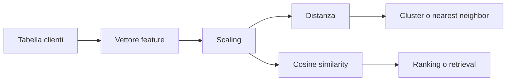

import { Aside } from '@astrojs/starlight/components'

Un team CRM vuole capire quali clienti assomigliano davvero ai top spender. Guardare solo una colonna non basta: servono piu' variabili lette insieme. Qui entra in gioco il vettore.

## Mappa mentale



## Perche' i vettori contano in analytics

Ogni riga con piu' feature numeriche puo' essere letta come un vettore:

- comportamento cliente
- metriche di una campagna
- profilo di un prodotto
- embedding testuale o semantico

Quando impari a leggere distanza, direzione e norma, inizi a capire come funzionano ranking, clustering, recommendation e anomaly detection.

## Da tabella a vettore

Immagina un cliente descritto da tre metriche:

```text
x = [sessioni_30g, ordini_30g, spesa_media]
```

Se due clienti hanno vettori simili, il loro comportamento e' simile anche se i valori assoluti cambiano.

### Come leggere davvero un vettore

Un vettore non e' solo una lista di numeri. E' una posizione in uno spazio costruito dalle feature che scegli. Se cambi le feature, cambi anche il significato della vicinanza.

In pratica:

- due vettori vicini descrivono profili simili
- un vettore con norma alta descrive una presenza numerica piu' forte
- un vettore con stessa direzione ma scala maggiore racconta un comportamento simile ma piu' intenso

### Norma e distanza

La norma euclidea misura la "lunghezza" del vettore:

```text
||x|| = sqrt(x1^2 + x2^2 + ... + xn^2)
```

La distanza euclidea tra due clienti `x` e `y` misura quanto sono lontani:

```text
d(x, y) = sqrt((x1-y1)^2 + ... + (xn-yn)^2)
```

```python
import numpy as np

client_a = np.array([12, 3, 48.0])
client_b = np.array([10, 4, 44.0])

distance = np.linalg.norm(client_a - client_b)
norm_a = np.linalg.norm(client_a)

print(distance)
print(norm_a)
```

## Perche' la scala rovina i risultati

Se `spesa_media` vale decine di euro e `ordini_30g` vale numeri piccoli, la distanza verra' dominata dalla spesa. Per questo quasi sempre standardizzi le feature prima di confrontarle.

```python
import pandas as pd

df = pd.DataFrame({
    "sessions_30d": [8, 12, 25, 40],
    "orders_30d": [1, 3, 4, 7],
    "avg_order_value": [35, 48, 52, 130],
})

scaled = (df - df.mean()) / df.std(ddof=0)
print(scaled.round(2))
```

<Aside type="caution">
Confrontare vettori non scalati e' uno degli errori piu' comuni in analisi multivariata. La feature con valori piu' grandi domina il risultato anche quando non e' la piu' importante.
</Aside>

## Prodotto scalare e cosine similarity

Il prodotto scalare:

```text
x dot y = x1y1 + x2y2 + ... + xnyn
```

serve per misurare allineamento tra due vettori. Da qui nasce la cosine similarity:

```text
cos(x, y) = (x dot y) / (||x|| ||y||)
```

Se il valore e' vicino a 1, i due profili puntano nella stessa direzione anche se hanno magnitudine diversa.

```python
def cosine_similarity(x, y):
    return np.dot(x, y) / (np.linalg.norm(x) * np.linalg.norm(y))

campaign_a = np.array([0.45, 0.30, 0.25])  # search, social, email
campaign_b = np.array([0.40, 0.35, 0.25])

print(round(cosine_similarity(campaign_a, campaign_b), 4))
```

## Caso business: trovare clienti simili ai top spender

```python
customers = pd.DataFrame({
    "user_id": [101, 102, 103, 104],
    "sessions_30d": [18, 11, 30, 28],
    "orders_30d": [4, 2, 5, 5],
    "avg_order_value": [72, 41, 95, 88],
})

target = np.array([30, 5, 90])
features = customers[["sessions_30d", "orders_30d", "avg_order_value"]].to_numpy()

customers["similarity_to_target"] = [
    cosine_similarity(row, target) for row in features
]

print(customers.sort_values("similarity_to_target", ascending=False))
```

Questo pattern serve per:

- lookalike analysis
- matching tra utenti e prodotti
- ranking di contenuti simili
- retrieval su embedding numerici

## Come scegliere la metrica giusta

Usa la distanza euclidea quando conta la distanza assoluta tra livelli numerici. Usa la cosine similarity quando ti interessa il profilo relativo piu' della magnitudine.

Esempio pratico:

- due clienti con stessa composizione di spesa ma volumi molto diversi: cosine alta, distanza anche alta
- due clienti con stessa spesa totale ma mix di comportamento diverso: distanza magari moderata, cosine piu' bassa

## Esempio avanzato con mini dataset reale

Se vuoi trasformare questa intuizione in un notebook serio, puoi usare il dataset `wine` di scikit-learn. Qui ogni riga e' un vino descritto da molte feature chimiche. L'obiettivo non e' classificare subito, ma trovare osservazioni simili a un profilo di riferimento.

```python
from sklearn.datasets import load_wine
from sklearn.metrics.pairwise import cosine_similarity
from sklearn.preprocessing import StandardScaler
import pandas as pd

wine = load_wine(as_frame=True)
X = wine.frame.drop(columns=["target"])

scaler = StandardScaler()
X_scaled = scaler.fit_transform(X)

reference = X_scaled[wine.target == 0].mean(axis=0, keepdims=True)
scores = cosine_similarity(X_scaled, reference).ravel()

ranking = (
    pd.DataFrame({
        "wine_class": wine.target,
        "cosine_to_class_0_profile": scores,
    })
    .sort_values("cosine_to_class_0_profile", ascending=False)
    .head(10)
)

print(ranking)
```

Qui stai facendo la stessa operazione che useresti su clienti, prodotti o creativita': costruisci un vettore medio target e cerchi chi gli assomiglia di piu'. E' un ponte diretto verso recommendation, lookalike e retrieval.

## Spazi vettoriali in analytics

Nella pratica di analytics, lavorare con due o tre feature e' l'eccezione. Il caso tipico e' molto piu' ricco: un utente e-commerce puo' essere descritto da cinquanta variabili comportamentali — frequenza di visita per categoria, tasso di conversione per canale, valore ordine medio per fascia oraria, propensione ai resi, giorni dall'ultimo acquisto, e cosi' via. Un prodotto in un catalogo retail puo' avere cento attributi: prezzo, margine, stock, rating medio, numero di recensioni, categoria, brand, colore, peso, popolarita' per citta'.

Ogni entita' diventa un punto in uno spazio ad alta dimensionalita'. Questo spazio ha proprieta' controintuitive rispetto alla nostra esperienza geometrica in due o tre dimensioni, ma la logica di base rimane: la vicinanza tra punti indica somiglianza tra entita'.

Perche' questo conta in pratica? Perche' tutti i sistemi di recommendation, segmentazione automatica, anomaly detection e search semantica lavorano esattamente su questi spazi. Quando Netflix trova film simili, quando Amazon suggerisce prodotti "comprati spesso insieme", quando Google ordina i risultati di una query, il meccanismo sottostante e' sempre lo stesso: costruire vettori e misurare distanze o similarita' in uno spazio multidimensionale.

### La maledizione della dimensionalita'

Aumentare le dimensioni porta un problema tecnico noto come "maledizione della dimensionalita'": in spazi ad alta dimensione, tutti i punti tendono a essere equidistanti tra loro. Questo rende le distanze metriche meno informative.

La risposta pratica e' duplice. Prima di tutto, si standardizzano le feature per evitare che variabili con scale diverse dominino il calcolo. In secondo luogo, si riducono le dimensioni con tecniche come PCA o embedding appresi da modelli. In questo modo si comprimono cinquanta feature in dieci direzioni principali che catturano la maggior parte della varianza.

```python
import numpy as np
from sklearn.decomposition import PCA
from sklearn.preprocessing import StandardScaler

# Simula 200 utenti con 50 feature comportamentali
rng = np.random.default_rng(42)
X_users = rng.standard_normal((200, 50))

# Standardizza
scaler = StandardScaler()
X_scaled = scaler.fit_transform(X_users)

# Riduci a 10 dimensioni principali
pca = PCA(n_components=10)
X_reduced = pca.fit_transform(X_scaled)

varianza_spiegata = pca.explained_variance_ratio_.sum()
print(f"Varianza spiegata con 10 componenti: {varianza_spiegata:.1%}")
```

Lavorare in dieci dimensioni anziche' cinquanta rende i calcoli di similarita' molto piu' robusti e veloci, senza perdere troppa informazione.

## Norma L1, L2 e L-infinito

Fino a questo punto abbiamo usato quasi sempre la norma euclidea, chiamata norma L2. Ma esistono altre norme che misurano la "lunghezza" di un vettore in modo diverso, e ciascuna ha usi specifici in analytics.

### Norma L1 — Manhattan

La norma L1 somma i valori assoluti delle componenti:

```text
||x||_1 = |x1| + |x2| + ... + |xn|
```

Si chiama anche norma di Manhattan, perche' misura la distanza come se si dovesse camminare su una griglia di strade ortogonali: non si puo' tagliare in diagonale, si devono percorrere i blocchi. Due punti separati da 3 blocchi in orizzontale e 4 in verticale hanno distanza L1 pari a 7, non 5 come con Pitagora.

La norma L1 e' utile quando i vettori sono sparsi, cioe' hanno molti zeri e pochi valori non-zero. In questi casi la L2 tende a enfatizzare le componenti grandi, mentre la L1 distribuisce il peso in modo piu' uniforme.

### Norma L-infinito

La norma L-infinito prende il massimo valore assoluto tra tutte le componenti:

```text
||x||_inf = max(|x1|, |x2|, ..., |xn|)
```

E' utile in contesti dove vuoi limitare il valore massimo che una singola feature puo' raggiungere. In security analytics, per esempio, si usa per rilevare outlier in cui una sola dimensione schizza fuori scala.

### Confronto pratico

```python
import numpy as np

x = np.array([3.0, -4.0, 1.0, -2.0])

l1 = np.linalg.norm(x, ord=1)   # 10.0
l2 = np.linalg.norm(x, ord=2)   # 5.477...
linf = np.linalg.norm(x, ord=np.inf)  # 4.0

print(f"L1 (Manhattan): {l1:.3f}")
print(f"L2 (Euclidea):  {l2:.3f}")
print(f"L-inf (Cheb.):  {linf:.3f}")
```

### Quando usare quale norma

**Usa L2** quando le feature sono dense, continue e bilanciate. E' lo standard per clustering K-means, regressione e la maggior parte dei modelli.

**Usa L1** quando lavori con dati sparsi come bag-of-words, conteggi di eventi rari, o vettori binari di attributi prodotto. La distanza L1 penalizza meno le differenze su molte dimensioni contemporaneamente, risultando piu' robusta in questi contesti.

**Usa L-infinito** raramente in analytics tipico. Trova uso in problemi di ottimizzazione dove si vuole minimizzare il massimo errore, oppure in sistemi di rilevamento anomalie dove si monitora la peggiore deviazione su qualsiasi feature.

<Aside type="tip">
In feature engineering, la scelta della norma per normalizzare i vettori deve essere coerente con la metrica che poi usi per confrontarli. Se calcoli cosine similarity, normalizza in L2. Se usi distanza di Manhattan come metrica, considera di normalizzare in L1.
</Aside>

## Distanza di Manhattan vs distanza euclidea

La distanza euclidea e' la linea retta tra due punti. La distanza di Manhattan e' il percorso lungo gli assi, senza diagonali. La differenza non e' solo geometrica: ha implicazioni pratiche concrete su quali profili vengono considerati simili.

```text
Distanza euclidea:  d_E(x,y) = sqrt(sum((xi - yi)^2))
Distanza Manhattan: d_M(x,y) = sum(|xi - yi|)
```

### Il caso dei dati sparsi in e-commerce

Considera un catalogo con 500 categorie di prodotto. Ogni cliente ha un vettore con il numero di acquisti per categoria. La maggior parte dei clienti ha acquistato in 5-10 categorie al massimo, quindi il vettore e' sparso: centinaia di zeri e pochi valori positivi.

Con la distanza euclidea, le molte dimensioni a zero si ignorano a vicenda, e la distanza viene determinata quasi interamente dalle categorie dove uno dei due clienti ha valori alti. Con la distanza di Manhattan, ogni categoria contribuisce proporzionalmente alla propria differenza assoluta, distribuendo il peso in modo piu' equo.

```python
import numpy as np
from scipy.spatial.distance import euclidean, cityblock

# Due clienti con vettore spars: 20 categorie, acquisti in 3-4 ciascuno
rng = np.random.default_rng(7)
a = np.zeros(20)
b = np.zeros(20)
a[[2, 7, 15]] = [3, 1, 2]
b[[2, 9, 15]] = [2, 4, 2]

d_euc = euclidean(a, b)
d_man = cityblock(a, b)

print(f"Distanza euclidea: {d_euc:.3f}")
print(f"Distanza Manhattan: {d_man:.3f}")
```

In questo esempio i due clienti condividono le categorie 2 e 15 con acquisti simili. La differenza sta nella categoria 7 (solo A) e 9 (solo B). La distanza di Manhattan cattura meglio questa differenza di pattern, mentre la euclidea soffre della dominanza del valore piu' alto (4 in categoria 9).

### Regola pratica

Usa la distanza euclidea per feature continue e dense come metriche di comportamento aggregato, KPI normalizzati o segnali audio. Usa la distanza di Manhattan per vettori sparsi come conteggi di eventi, frequenze per categoria, o qualunque rappresentazione dove la maggior parte delle componenti e' zero.

## Embedding e vettori semantici

Fino ad ora abbiamo costruito vettori partendo da feature numeriche esplicite: sessioni, ordini, spesa media. Ma esiste un'altra classe di vettori, molto piu' potente, che non viene costruita a mano ma appresa da un modello: gli embedding.

Un embedding e' una rappresentazione vettoriale densa e a bassa dimensionalita' appresa da dati. I modelli di linguaggio imparano che la parola "re" meno "uomo" piu' "donna" da' un vettore vicino a "regina". Un sistema di recommendation impara che il prodotto "maglietta bianca taglia M" ha un embedding simile a "polo bianca taglia M" perche' gli stessi utenti li acquistano spesso insieme.

### Perche' la cosine similarity e' lo standard per gli embedding

Quando lavori con embedding di testo o di prodotti, la cosine similarity e' quasi sempre la metrica corretta. Il motivo e' geometrico: gli embedding vengono addestrati in modo che la direzione del vettore nello spazio catturi il significato semantico, mentre la magnitudine tende ad essere meno informativa e dipende da fattori tecnici come la frequenza nel corpus di addestramento.

Due frasi con lo stesso significato ma espresse in modo diverso ("il cliente ha cancellato l'ordine" e "l'utente ha annullato l'acquisto") avranno embedding con direzione simile ma magnitudine potenzialmente diversa. La cosine similarity cattura questa somiglianza semantica; la distanza euclidea sarebbe meno affidabile.

### Embedding di prodotti: un esempio concreto

```python
import numpy as np
from sklearn.metrics.pairwise import cosine_similarity

# Embeddings simulati per 6 prodotti (ridotti a 8 dim per leggibilita')
# In produzione sarebbero 128, 256 o 768 dimensioni
prodotti = {
    "maglietta_bianca_m":  np.array([0.8, 0.6, 0.1, 0.2, 0.7, 0.3, 0.5, 0.4]),
    "polo_bianca_m":       np.array([0.7, 0.5, 0.2, 0.3, 0.6, 0.4, 0.5, 0.3]),
    "jeans_slim_32":       np.array([0.1, 0.2, 0.9, 0.8, 0.2, 0.7, 0.1, 0.6]),
    "pantaloni_chino_32":  np.array([0.2, 0.1, 0.8, 0.7, 0.3, 0.6, 0.2, 0.5]),
    "scarpe_running_43":   np.array([0.3, 0.1, 0.2, 0.1, 0.8, 0.9, 0.4, 0.7]),
    "sneaker_casual_43":   np.array([0.2, 0.2, 0.3, 0.2, 0.7, 0.8, 0.3, 0.6]),
}

nomi = list(prodotti.keys())
matrice = np.array(list(prodotti.values()))

# Normalizza L2 prima di cosine (buona pratica con embedding)
norma = np.linalg.norm(matrice, axis=1, keepdims=True)
matrice_norm = matrice / norma

# Calcola matrice similarita'
sim_matrix = cosine_similarity(matrice_norm)

# Trova i 2 prodotti piu' simili alla maglietta bianca
idx_target = nomi.index("maglietta_bianca_m")
similarita' = sim_matrix[idx_target]

ranking = sorted(
    [(nomi[i], round(float(similarita'[i]), 4)) for i in range(len(nomi)) if i != idx_target],
    key=lambda x: x[1],
    reverse=True
)

print("Prodotti piu' simili a maglietta_bianca_m:")
for nome, score in ranking:
    print(f"  {nome}: {score}")
```

Output atteso:
```text
Prodotti piu' simili a maglietta_bianca_m:
  polo_bianca_m: 0.9981
  sneaker_casual_43: 0.8234
  scarpe_running_43: 0.8012
  pantaloni_chino_32: 0.6123
  jeans_slim_32: 0.5934
```

La polo bianca in taglia M emerge come prodotto piu' simile, il che ha senso semanticamente. In un sistema reale, questi embedding a 8 dimensioni sarebbero sostituiti da vettori a 128 o piu' dimensioni appresi da milioni di interazioni utente-prodotto.

### Il caso Spotify Discover Weekly

Spotify ha costruito il sistema Discover Weekly usando, tra l'altro, vettori di feature audio estratti dai brani. Ogni brano viene descritto da un vettore a 128 dimensioni che codifica caratteristiche spettrali come tempo, timbro, energia, valenza emotiva e struttura ritmica.

Il processo e' il seguente: si estrae il vettore audio per ogni brano nella playlist settimanale di un utente, si calcola un vettore medio che rappresenta il "gusto" dell'utente, e si cercano i brani del catalogo con cosine similarity piu' alta rispetto a quel vettore medio.

Il risultato: nel 2015, quando Discover Weekly e' stato lanciato, aveva gia' 1,7 miliardi di stream al mese dopo poche settimane. La cosine similarity su vettori audio ad alta dimensionalita' era il cuore del sistema.

<Aside type="note">
La scelta di 128 dimensioni per i vettori audio di Spotify non e' casuale: e' il risultato di un bilanciamento tra capacita' di rappresentazione e costo computazionale. Piu' dimensioni significano migliore rappresentazione ma piu' memoria e calcolo per le operazioni di ricerca.
</Aside>

## Sistema di recommendation completo: top-5 prodotti simili

Mettiamo insieme tutti i concetti per costruire un sistema di recommendation funzionante. L'input e' un catalogo prodotti con feature numeriche; l'output sono i cinque prodotti piu' simili a un prodotto di riferimento.

```python
import numpy as np
import pandas as pd
from sklearn.preprocessing import StandardScaler
from sklearn.metrics.pairwise import cosine_similarity

# Catalogo: 10 prodotti con 6 feature numeriche
# (prezzo, margine%, rating, n_recensioni, giorni_stock, peso_g)
catalogo = pd.DataFrame({
    "product_id": [f"P{i:03d}" for i in range(1, 11)],
    "name": [
        "Maglietta bianca M", "Polo bianca M", "T-shirt nera L",
        "Jeans slim 32", "Pantaloni chino 32", "Shorts estivi M",
        "Scarpe running 43", "Sneaker casual 43", "Stivali invernali 43",
        "Sandali estate 41"
    ],
    "prezzo": [19.9, 29.9, 17.9, 59.9, 49.9, 24.9, 89.9, 69.9, 129.9, 39.9],
    "margine_pct": [55, 60, 52, 45, 48, 58, 40, 42, 35, 50],
    "rating": [4.2, 4.5, 3.9, 4.3, 4.1, 3.8, 4.6, 4.4, 4.0, 3.7],
    "n_recensioni": [1200, 340, 890, 2300, 1100, 450, 560, 980, 230, 310],
    "giorni_stock": [45, 30, 60, 90, 75, 20, 15, 25, 120, 40],
    "peso_g": [180, 220, 160, 800, 700, 200, 320, 400, 950, 280],
})

feature_cols = ["prezzo", "margine_pct", "rating", "n_recensioni", "giorni_stock", "peso_g"]

# 1. Standardizza le feature
scaler = StandardScaler()
X = scaler.fit_transform(catalogo[feature_cols])

# 2. Normalizza L2 per cosine similarity (opzionale ma buona pratica)
norma = np.linalg.norm(X, axis=1, keepdims=True)
X_norm = X / np.where(norma == 0, 1, norma)

# 3. Prodotto di riferimento: P001 Maglietta bianca M (indice 0)
idx_ref = 0
vettore_ref = X_norm[[idx_ref]]

# 4. Calcola similarita' con tutti i prodotti
scores = cosine_similarity(X_norm, vettore_ref).ravel()

# 5. Costruisci ranking (escludi il prodotto stesso)
risultati = catalogo[["product_id", "name"]].copy()
risultati["cosine_similarity"] = scores.round(4)
top5 = (
    risultati[risultati.index != idx_ref]
    .sort_values("cosine_similarity", ascending=False)
    .head(5)
    .reset_index(drop=True)
)

top5.index += 1  # ranking da 1
print(f"Top 5 prodotti simili a: {catalogo.loc[idx_ref, 'name']}\n")
print(top5.to_string())
```

Output atteso:
```text
Top 5 prodotti simili a: Maglietta bianca M

   product_id              name  cosine_similarity
1        P002        Polo bianca M             0.9723
2        P003      T-shirt nera L             0.9418
3        P006    Shorts estivi M             0.8812
4        P004       Jeans slim 32             0.6234
5        P005  Pantaloni chino 32             0.5981
```

Questo schema e' direttamente applicabile a un catalogo reale: sostituisci le sei feature manuali con embedding appresi, aggiungi filtri di business (stesso brand, stessa stagione, stock disponibile) e hai la struttura di un motore di recommendation per e-commerce.

## Proiezione e similarity search

La proiezione di un vettore su un sottospazio e' un'operazione fondamentale che appare in molti contesti analytics: dalla riduzione dimensionale alla ricerca per similarita' approssimata.

### Proiezione su un vettore unitario

Dato un vettore `x` e una direzione unitaria `u` (con norma 1), la proiezione scalare di `x` su `u` e':

```text
proj_u(x) = x · u = ||x|| * cos(theta)
```

dove `theta` e' l'angolo tra i due vettori. Questo numero misura "quanto" del vettore `x` punta nella direzione `u`.

```python
import numpy as np

# Direzione principale estratta da PCA (vettore unitario)
u = np.array([0.6, 0.8])  # norma 1
u = u / np.linalg.norm(u)  # assicura norma unitaria

# Due clienti
x1 = np.array([3.0, 4.0])
x2 = np.array([5.0, 1.0])

proj1 = np.dot(x1, u)  # proiezione scalare
proj2 = np.dot(x2, u)

print(f"Proiezione cliente 1 su u: {proj1:.3f}")
print(f"Proiezione cliente 2 su u: {proj2:.3f}")
```

### Il legame con PCA

La PCA (Principal Component Analysis) trova le direzioni nello spazio delle feature lungo cui i dati variano di piu'. Ogni componente principale e' un vettore unitario, e proiettare i dati su queste direzioni e' esattamente l'operazione che ti permette di ridurre da 50 a 10 dimensioni senza perdere troppa informazione.

Questa e' la ragione per cui le operazioni vettoriali di questa lezione sono fondamentali per capire la riduzione dimensionale: PCA, t-SNE e UMAP lavorano tutte su proiezioni e distanze in spazi ad alta dimensionalita'.

### Locality-Sensitive Hashing come similarity search approssimata

Un'idea avanzata ma pratica: invece di calcolare la similarita' esatta con tutti i vettori del catalogo, puoi usare proiezioni casuali per raggruppare vettori simili in bucket. Questa tecnica si chiama Locality-Sensitive Hashing (LSH) ed e' alla base di sistemi come FAISS e Annoy.

L'intuizione e' semplice: proietta ogni vettore su un insieme di direzioni casuali unitarie. I vettori con alta cosine similarity avranno segni simili in queste proiezioni, e quindi cadranno negli stessi bucket. Cercare i vicini approssimati diventa cercare nello stesso bucket invece di scorrere tutto il catalogo.

## Normalizzazione L2

La normalizzazione L2 di un vettore consiste nel dividerlo per la propria norma euclidea, ottenendo un vettore di lunghezza unitaria:

```text
x_norm = x / ||x||
```

Dopo la normalizzazione, tutti i vettori si trovano sulla superficie di una ipersfera unitaria. La cosine similarity tra due vettori normalizzati L2 diventa equivalente al loro prodotto scalare:

```text
cos(x_norm, y_norm) = x_norm · y_norm
```

Questo e' molto conveniente computazionalmente.

### Quando la normalizzazione L2 e' obbligatoria

Prima di calcolare la cosine similarity, la normalizzazione L2 non e' strettamente obbligatoria (la formula divide gia' per le norme), ma normalizzare prima velocizza i calcoli perche' il prodotto scalare tra vettori pre-normalizzati e' direttamente la cosine similarity. In sistemi che devono confrontare milioni di vettori, questo risparmio e' significativo.

Con gli embedding, la normalizzazione L2 e' quasi sempre necessaria: i modelli di linguaggio e i sistemi di recommendation producono embedding con norme variabili, e senza normalizzazione la magnitudine influenzerebbe i risultati.

```python
import numpy as np
from sklearn.preprocessing import normalize

X = np.array([
    [3.0, 4.0, 0.0],
    [1.0, 0.0, 2.0],
    [6.0, 8.0, 0.0],  # stesso angolo del primo, doppia magnitudine
])

X_norm = normalize(X, norm='l2')

print("Prima della normalizzazione:")
print(X)
print("\nDopo la normalizzazione L2:")
print(X_norm.round(4))

# Il primo e il terzo vettore hanno la stessa direzione
# Dopo normalizzazione sono identici
print(f"\nCosine sim tra riga 0 e riga 2 PRIMA: {np.dot(X[0], X[2])/(np.linalg.norm(X[0])*np.linalg.norm(X[2])):.4f}")
print(f"Dot product tra riga 0 e riga 2 DOPO: {np.dot(X_norm[0], X_norm[2]):.4f}")
```

### Quando la normalizzazione L2 e' dannosa

La normalizzazione L2 elimina l'informazione sulla magnitudine. Questo e' un problema se la magnitudine e' semanticamente rilevante.

Esempio: in un modello di churn, un cliente con 100 sessioni e un cliente con 3 sessioni negli ultimi 30 giorni hanno magnitudini molto diverse. Se normalizzi L2, potresti perdere questo segnale di engagement. In questi casi, standardizza invece con z-score (sottrai media, dividi per deviazione standard) per preservare le differenze relative pur eliminando l'effetto scala.

<Aside type="caution">
Non normalizzare L2 quando la magnitudine del vettore porta informazione di business. Usa la normalizzazione L2 principalmente prima di operazioni di cosine similarity su embedding, dove la direzione e' il segnale e la magnitudine e' un artefatto del training.
</Aside>

## Errori comuni

### Distanza senza standardizzazione

Se una feature ha scala molto diversa, la metrica perde significato.

### Confondere distanza e similarita'

Distanza piccola significa vicinanza. Similarita' alta significa allineamento. Non sono la stessa cosa.

### Usare cosine similarity quando la magnitudine conta

Se vuoi distinguere clienti "simili ma molto piu' grandi", la sola cosine non basta.

### Normalizzare quando non serve

Normalizzare L2 prima di calcolare la distanza euclidea non ha senso: stai proiettando tutti i vettori sulla sfera unitaria, perdendo l'informazione sulla distanza effettiva.

## Nearest neighbor in pratica

Il pattern "dato un vettore di query, trova i K piu' simili nel catalogo" e' uno dei piu' frequenti in analytics avanzata. Si chiama K-Nearest Neighbor (KNN) o, in contesti di information retrieval, similarity search.

### Brute force: quando va bene

Per cataloghi piccoli (fino a qualche decina di migliaia di vettori) il calcolo esatto e' perfettamente praticabile. Si calcola la similarita' con tutti gli elementi e si prende il top-K.

```python
import numpy as np
from sklearn.metrics.pairwise import cosine_similarity

def top_k_similar(query_vec, catalog_matrix, k=5):
    """
    Restituisce gli indici e i punteggi dei K elementi piu' simili.
    catalog_matrix: shape (n_items, n_dims), gia' normalizzata L2
    query_vec: shape (1, n_dims), gia' normalizzato L2
    """
    scores = cosine_similarity(query_vec.reshape(1, -1), catalog_matrix).ravel()
    top_k_idx = np.argsort(scores)[::-1][:k]
    return list(zip(top_k_idx, scores[top_k_idx]))

# Esempio: 5000 prodotti, 128 feature (embedding)
rng = np.random.default_rng(99)
catalogo_emb = rng.standard_normal((5000, 128))

# Normalizza L2 tutto il catalogo una volta sola
norme = np.linalg.norm(catalogo_emb, axis=1, keepdims=True)
catalogo_norm = catalogo_emb / norme

# Query: un nuovo prodotto
query = rng.standard_normal(128)
query = query / np.linalg.norm(query)

risultati = top_k_similar(query, catalogo_norm, k=5)
for idx, score in risultati:
    print(f"Prodotto {idx}: cosine similarity = {score:.4f}")
```

Il costo computazionale e' O(n * d) dove n e' il numero di elementi nel catalogo e d e' il numero di dimensioni. Per n=5000 e d=128, sono 640.000 operazioni moltiplicazione — trascurabili su hardware moderno.

### FAISS e Annoy: quando il catalogo e' grande

Quando il catalogo supera il milione di elementi, il brute force diventa lento. Qui entrano le librerie di approximate nearest neighbor (ANN):

**FAISS** (Facebook AI Similarity Search) e' la libreria piu' usata in produzione. Indicizza i vettori usando tecniche come IVF (Inverted File Index) e HNSW (Hierarchical Navigable Small World graph). Permette di cercare i 10 piu' simili tra 100 milioni di vettori in meno di un millisecondo su GPU.

**Annoy** (Approximate Nearest Neighbors Oh Yeah, sviluppata da Spotify) usa alberi di proiezione casuale. E' piu' semplice da usare, ottima per casi d'uso read-heavy come sistemi di recommendation che non aggiornano spesso il catalogo.

```python
# Esempio concettuale con FAISS (richiede pip install faiss-cpu)
# Non eseguibile direttamente senza installazione, ma mostra il pattern

# import faiss
#
# d = 128  # dimensioni embedding
# n = 1_000_000  # elementi nel catalogo
#
# # Costruisci indice
# index = faiss.IndexFlatIP(d)  # Inner Product = cosine per vettori normalizzati
# index.add(catalogo_normalizzato.astype(np.float32))
#
# # Ricerca: top 5 simili per ogni query
# k = 5
# scores, indices = index.search(query_batch.astype(np.float32), k)
```

Il guadagno e' enorme: da ore a secondi per dataset da milioni di elementi.

### Similarity search in database analitici

Per chi lavora con BigQuery o ClickHouse, e' possibile calcolare cosine similarity direttamente in SQL senza estrarre i dati:

**BigQuery** (con ML.DISTANCE):
```sql
-- BigQuery: cosine similarity tra un prodotto target e tutto il catalogo
SELECT
  product_id,
  ML.DISTANCE(embedding_target, embedding_catalog, 'COSINE') AS cosine_dist
FROM
  `progetto.dataset.product_embeddings`
ORDER BY
  cosine_dist ASC  -- distanza cosine = 1 - cosine similarity
LIMIT 10
```

**ClickHouse** (con funzione cosineDistance):
```sql
-- ClickHouse: top 10 prodotti simili
SELECT
  product_id,
  cosineDistance(embedding, (SELECT embedding FROM products WHERE id = 'P001')) AS dist
FROM products
ORDER BY dist ASC
LIMIT 10
```

Eseguire la similarity search nel database evita di trasferire milioni di vettori alla macchina Python, e su ClickHouse la query scala orizzontalmente su tutto il cluster. Per volumi sotto il milione di righe e vettori a 256 dimensioni, questa e' spesso la soluzione piu' semplice e pragmatica.

<Aside type="tip">
Per sistemi di recommendation in produzione, la pipeline tipica e': genera embedding con un modello offline, caricali in BigQuery o ClickHouse, esegui la similarity search in SQL per batch notturni, e salva i risultati pre-calcolati in una tabella di output consultata in real-time dall'applicazione.
</Aside>

## Output atteso

Le tabelle prodotte da questo tipo di analisi hanno di solito:

- id entita'
- feature normalizzate
- distanza o similarita'
- rank finale

Sono perfette per una top table, una matrice similarita' o un clustering successivo.

## Riepilogo operativo

- Un vettore e' una rappresentazione compatta di un'entita' in uno spazio multidimensionale. Cambiando le feature, cambi la geometria dello spazio e il significato della vicinanza.

- Le norme L1, L2 e L-infinito misurano la "lunghezza" di un vettore in modo diverso. L2 e' lo standard per dati densi e continui; L1 e' preferibile per dati sparsi come conteggi per categoria o bag-of-words.

- La distanza di Manhattan (L1) e quella euclidea (L2) danno risultati diversi su dati sparsi: la prima distribuisce il peso su piu' dimensioni, la seconda enfatizza le componenti grandi.

- Gli embedding sono vettori appresi da modelli, non costruiti a mano. Catturano significato semantico nella direzione del vettore, non nella magnitudine. Per questo la cosine similarity e' la metrica standard per testo e recommendation.

- Normalizza L2 prima di cosine similarity su embedding; usa z-score standardization quando la magnitudine ha significato di business.

- Per K-nearest neighbor: brute force per cataloghi sotto 100K elementi, FAISS o Annoy per milioni di vettori. Per analisi batch, considera di eseguire la similarity search direttamente in BigQuery o ClickHouse.

- Prima di confrontare qualunque vettore, controlla sempre la scala delle feature. Un vettore non standardizzato distorce tutte le metriche di distanza e similarita'.

## Mini esercizio

Costruisci un piccolo sistema di recommendation usando il dataset `load_wine` di scikit-learn come proxy di un catalogo prodotti:

1. Carica il dataset e standardizza le feature con `StandardScaler`.
2. Normalizza L2 ogni riga con `sklearn.preprocessing.normalize`.
3. Scegli un vino di riferimento (per esempio l'indice 42) e calcola la cosine similarity con tutti gli altri usando `sklearn.metrics.pairwise.cosine_similarity`.
4. Stampa i 5 vini piu' simili con il loro punteggio e la loro classe.
5. Verifica: i 5 vini piu' simili appartengono quasi tutti alla stessa classe del vino di riferimento? Se si', il sistema funziona correttamente — la cosine similarity su feature standardizzate riesce a raggruppare vini dello stesso tipo.

Bonus: prova a calcolare anche la distanza euclidea e la distanza di Manhattan per lo stesso vino di riferimento. I top-5 cambiano? In che modo? Rifletti su quali feature stanno guidando la differenza.
