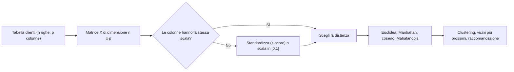

## Il cluster di clienti che parlava solo di scontrino

Scenario costruito con numeri di esempio: un e-commerce italiano vuole raggruppare i clienti in base a tre colonne, la spesa annua in euro, il numero di ordini all'anno e il numero di resi. Il data analyst lancia un k-means sulla tabella così com'è e ottiene tre gruppi ordinati con precisione quasi geometrica: basso, medio e alto scontrino. I responsabili CRM guardano i gruppi e non trovano nulla di utile, perché dentro il gruppo "medio" convivono chi ordina 18 volte l'anno e chi ordina due volte.

Il problema non sta nell'algoritmo. La spesa varia da 300 a 4.000 euro, mentre gli ordini variano da 2 a 18 e i resi da 0 a 2. Quando due clienti si confrontano con la distanza euclidea, la differenza di 900 euro pesa come 900 unità e la differenza di 16 ordini pesa come 16 unità: il comportamento d'acquisto scompare dal calcolo, schiacciato da una colonna che usa semplicemente numeri più grandi.

> **Idea chiave:** una distanza non misura la somiglianza tra clienti, misura la somiglianza tra numeri; se le colonne hanno scale diverse, la colonna con i valori più grandi decide da sola chi è vicino a chi.

Prima di scegliere un algoritmo conviene allora fissare il linguaggio geometrico. Ogni riga della tabella diventa un punto, ogni colonna diventa un asse, e le domande "chi è simile a chi" e "quali clienti formano un gruppo" diventano domande su lunghezze e angoli. Con questo linguaggio si capisce perché la standardizzazione non è un dettaglio tecnico ma una decisione che cambia il risultato dell'analisi.

## Righe come punti, colonne come coordinate

Una tabella con $n$ clienti e $p$ feature è una matrice $X$ di dimensione $n \times p$. La riga $i$ è il vettore $\mathbf{x}_i = (x_{i1}, x_{i2}, \dots, x_{ip})$, cioè un punto nello spazio a $p$ dimensioni. Con tre colonne lo spazio si può ancora immaginare come una stanza: un asse per la spesa, uno per gli ordini, uno per i resi. Con cinquanta colonne non si può disegnare, ma le formule restano identiche, ed è proprio questo il vantaggio dell'algebra lineare.

Un vettore ha due proprietà che interessano subito. La prima è la lunghezza, detta norma: dice quanto il punto è lontano dall'origine. La seconda è la direzione: dice verso quale combinazione di feature il punto è orientato. Un cliente che compra poco e uno che compra molto nelle stesse proporzioni hanno lunghezze diverse ma direzione quasi uguale, e questa distinzione tornerà nella lezione sulla similarità.

| Oggetto | Dimensione | Che cosa rappresenta nel dataset clienti |
| --- | --- | --- |
| Vettore riga $\mathbf{x}_i$ | $1 \times p$ | un cliente descritto da $p$ feature |
| Vettore colonna $\mathbf{c}_j$ | $n \times 1$ | una feature osservata su tutti i clienti |
| Matrice $X$ | $n \times p$ | l'intera tabella delle feature |
| Matrice $X^\top X$ | $p \times p$ | prodotti incrociati tra feature, base della covarianza |
| Matrice $X X^\top$ | $n \times n$ | prodotti scalari tra clienti, base delle similarità |

Le due matrici prodotto sono quelle che compaiono più spesso nei calcoli di similarità e di covarianza, e per questo conviene saperne a memoria le dimensioni.



Il diagramma riassume l'ordine delle decisioni: la scala viene prima della distanza e la distanza viene prima dell'algoritmo. Invertire questo ordine è l'errore più frequente nei progetti di segmentazione, perché gli algoritmi restituiscono sempre un risultato e quindi non segnalano mai che le fondamenta erano sbagliate.

## Norma, prodotto scalare e angolo

La norma euclidea di un vettore $\mathbf{x} = (x_1, \dots, x_p)$ è la radice della somma dei quadrati delle sue componenti:

$$\lVert \mathbf{x} \rVert_2 = \sqrt{x_1^2 + x_2^2 + \dots + x_p^2}$$

È il teorema di Pitagora esteso a $p$ dimensioni. La distanza tra due clienti è la norma della loro differenza, $d(\mathbf{x}, \mathbf{y}) = \lVert \mathbf{x} - \mathbf{y} \rVert_2$, e questo spiega subito dove nasce il problema dello scontrino: ogni componente della differenza viene elevata al quadrato, quindi una colonna con differenze da centinaia di unità domina una colonna con differenze da pochi punti.

Il prodotto scalare di due vettori somma i prodotti delle componenti corrispondenti:

$$\mathbf{x} \cdot \mathbf{y} = \sum_{j=1}^{p} x_j y_j = \lVert \mathbf{x} \rVert \, \lVert \mathbf{y} \rVert \cos\theta$$

La seconda uguaglianza collega un'operazione aritmetica a un'informazione geometrica, l'angolo $\theta$ tra i due vettori. Da qui si ricava la similarità coseno, $\cos\theta = \dfrac{\mathbf{x} \cdot \mathbf{y}}{\lVert \mathbf{x} \rVert \, \lVert \mathbf{y} \rVert}$, che vale 1 per vettori con la stessa direzione, 0 per vettori ortogonali e $-1$ per direzioni opposte. Se le feature sono conteggi non negativi, il coseno resta tra 0 e 1. Il coseno ignora la lunghezza dei vettori, quindi risponde alla domanda "hanno le stesse proporzioni" e non alla domanda "hanno gli stessi volumi".

Un caso particolare molto usato è la norma di Manhattan, $\lVert \mathbf{x} \rVert_1 = \sum_j \lvert x_j \rvert$, che somma i valori assoluti invece dei quadrati. Pesa le differenze in modo lineare e quindi reagisce meno agli scarti grandi su una singola colonna.

## Quattro distanze e la domanda a cui rispondono

Un analista sceglie la distanza prima di scegliere l'algoritmo. Non esiste una distanza giusta in assoluto. Ogni scelta codifica un'ipotesi su che cosa significhi "vicino" per il problema di business, e la tabella seguente aiuta a collegare la domanda alla formula.

| Distanza | Formula | Domanda a cui risponde | Punto debole |
| --- | --- | --- | --- |
| Euclidea | $\sqrt{\sum_j (x_j - y_j)^2}$ | Quanto sono diversi i valori assoluti? | Domina la colonna con la scala maggiore |
| Manhattan | $\sum_j \lvert x_j - y_j \rvert$ | Quanto differiscono in totale, senza enfatizzare un solo scarto? | Dipende comunque dalle scale |
| Coseno (come distanza $1-\cos\theta$) | $1 - \dfrac{\mathbf{x}\cdot\mathbf{y}}{\lVert \mathbf{x} \rVert \lVert \mathbf{y} \rVert}$ | Hanno le stesse proporzioni, a prescindere dal volume? | Vettori nulli non sono confrontabili |
| Mahalanobis | $\sqrt{(\mathbf{x}-\mathbf{y})^\top \Sigma^{-1} (\mathbf{x}-\mathbf{y})}$ | Quanto sono lontani tenendo conto della correlazione tra feature? | Richiede $\Sigma$ invertibile e stimata su abbastanza righe |

La distanza di Mahalanobis merita una nota a parte. Se due colonne sono molto correlate, per esempio ordini e spesa, la distanza euclidea conta due volte quasi la stessa informazione. Mahalanobis divide per la matrice di covarianza $\Sigma$ e rimuove questa duplicazione, oltre a rendere la distanza indipendente dalle unità di misura. Il prezzo è che $\Sigma$ va stimata e invertita: con poche righe e molte colonne la stima diventa instabile.

## Esempio svolto: cinque clienti prima e dopo la standardizzazione

Prendiamo cinque clienti con feature (spesa annua in euro, ordini all'anno, resi). Sono numeri di esempio, scelti per rendere visibile il fenomeno.

| Cliente | Spesa (euro) | Ordini | Resi |
| --- | ---: | ---: | ---: |
| A | 1.200 | 18 | 1 |
| B | 1.250 | 2 | 0 |
| C | 300 | 17 | 1 |
| D | 4.000 | 6 | 2 |
| E | 800 | 10 | 1 |

La tabella è piccola di proposito, perché ogni passaggio si può rifare con una calcolatrice.

**Passo 1, distanza grezza tra A e B.** Le differenze sono $1.200 - 1.250 = -50$ euro, $18 - 2 = 16$ ordini e $1 - 0 = 1$ reso. La somma dei quadrati vale $2.500 + 256 + 1 = 2.757$ e la radice è circa 52,5.

**Passo 2, distanza grezza tra A e C.** Le differenze sono $900$ euro, $1$ ordine e $0$ resi: $810.000 + 1 + 0 = 810.001$, radice circa 900,0.

Secondo la distanza grezza, A è vicinissimo a B (52,5) e lontanissimo da C (900,0). Eppure A ordina 18 volte l'anno e B due volte, mentre C ordina 17 volte: sul comportamento A somiglia a C, non a B.

**Passo 3, medie e deviazioni standard campionarie.** La spesa ha media $(1.200 + 1.250 + 300 + 4.000 + 800)/5 = 1.510$ euro e deviazione standard campionaria circa 1.443,3 euro. Gli ordini hanno media $(18 + 2 + 17 + 6 + 10)/5 = 10,6$ e deviazione standard circa 6,91. I resi hanno media $(1+0+1+2+1)/5 = 1$ e deviazione standard $\sqrt{(0+1+0+1+0)/4} = \sqrt{0{,}5} \approx 0{,}707$.

**Passo 4, punteggi standardizzati** $z = (x - \bar{x})/s$.

Ogni cella è lo scarto dalla media espresso in deviazioni standard, quindi i numeri delle tre colonne diventano finalmente confrontabili:

| Cliente | $z$ spesa | $z$ ordini | $z$ resi |
| --- | ---: | ---: | ---: |
| A | $-0{,}215$ | $1{,}070$ | $0{,}000$ |
| B | $-0{,}180$ | $-1{,}244$ | $-1{,}414$ |
| C | $-0{,}838$ | $0{,}926$ | $0{,}000$ |
| D | $1{,}725$ | $-0{,}665$ | $1{,}414$ |
| E | $-0{,}492$ | $-0{,}087$ | $0{,}000$ |

Ora si ripete il calcolo delle distanze sui punteggi standardizzati.

**Passo 5, distanze ricalcolate.** Tra A e B le differenze sono circa $-0{,}035$, $2{,}314$ e $1{,}414$, con somma dei quadrati $0{,}001 + 5{,}355 + 2{,}000 = 7{,}357$ e distanza circa 2,71. Tra A e C le differenze sono $0{,}623$, $0{,}144$ e $0$, con somma dei quadrati $0{,}388 + 0{,}021 = 0{,}409$ e distanza circa 0,64. Il risultato è chiaro. Dopo la standardizzazione il rapporto si è ribaltato: A dista 2,71 da B e solo 0,64 da C. La riga di A non è cambiata, è cambiato il metro con cui la si confronta, e i cluster costruiti sui dati standardizzati separano chi ordina spesso da chi ordina di rado, che è la distinzione interessante per il CRM.

## Lo stesso calcolo in numpy

Su una tabella reale non si calcola a mano. Il frammento seguente riproduce l'esempio con numpy e mette a confronto distanza grezza e standardizzata.

```python
# Standardizzazione z-score e distanza euclidea su cinque clienti
import numpy as np

# colonne: spesa annua (euro), ordini all'anno, resi
X = np.array([
    [1200, 18, 1],
    [1250,  2, 0],
    [ 300, 17, 1],
    [4000,  6, 2],
    [ 800, 10, 1],
], dtype=float)

# ddof=1: deviazione standard campionaria, coerente con il calcolo a mano
Z = (X - X.mean(axis=0)) / X.std(axis=0, ddof=1)

def dist(M, i, j):
    return np.linalg.norm(M[i] - M[j])

# indici: A=0, B=1, C=2
print("grezza    A-B:", round(dist(X, 0, 1), 1), " A-C:", round(dist(X, 0, 2), 1))
print("z-score   A-B:", round(dist(Z, 0, 1), 2), " A-C:", round(dist(Z, 0, 2), 2))

# matrice n x n dei prodotti scalari tra clienti (base delle similarità coseno)
G = Z @ Z.T
print(G.shape)  # (5, 5)
```

L'output atteso è 52,5 e 900,0 per le distanze grezze, 2,71 e 0,64 per quelle standardizzate, e una forma $(5, 5)$ per la matrice $G = Z Z^\top$. Con scikit-learn lo stesso passaggio è `StandardScaler().fit_transform(X)`, ma conviene saperlo scrivere a mano almeno una volta, perché `ddof` cambia leggermente i risultati e i valori devono combaciare con quelli di chi usa un altro strumento.

## Tre trappole nella geometria dei dati tabellari

### Calcolare distanze su colonne con unità di misura diverse

Il sintomo è un clustering che riproduce quasi esattamente l'ordinamento di una sola colonna, tipicamente quella monetaria. Succede perché l'algoritmo non conosce il significato delle colonne: vede solo numeri, e i numeri più grandi producono scarti quadratici più grandi. Si corregge standardizzando ogni colonna con media e deviazione standard stimate sul solo training set, oppure scalando in $[0, 1]$, e controllando a posteriori che la correlazione tra i cluster e ciascuna feature non sia vicina a 1 per una sola di esse.

### Dimenticare i valori mancanti e gli zeri strutturali nelle matrici sparse

Nelle matrici cliente per prodotto lo zero può voler dire "non ha comprato" oppure "il prodotto non era disponibile nel suo paese". Trattarli allo stesso modo avvicina artificialmente i clienti che condividono solo assenze. Sembra ragionevole perché lo zero è un numero valido e le formule girano senza errori. La correzione consiste nel decidere per ogni colonna se l'assenza è informativa, nel distinguere `NULL` da 0 a monte e, per le matrici molto sparse, nel preferire il coseno, che considera solo le coordinate in cui almeno un vettore è diverso da zero nel prodotto scalare.

### Confondere righe e colonne nelle operazioni con la trasposta

Il sintomo è un errore di dimensioni, nei casi fortunati, oppure una matrice quadrata della dimensione sbagliata, nei casi sfortunati. Con $X$ di dimensione $5 \times 3$, il prodotto $X^\top X$ è $3 \times 3$ e descrive le relazioni tra feature, mentre $X X^\top$ è $5 \times 5$ e descrive le relazioni tra clienti. Scambiarli significa rispondere a una domanda diversa da quella posta. Si evita scrivendo le dimensioni accanto a ogni operazione e verificando con `assert` sulla `shape` prima di procedere.

## Quando gli outlier schiacciano la standardizzazione

La standardizzazione ha un punto debole: media e deviazione standard sono sensibili ai valori estremi. Aggiungiamo ai cinque clienti un sesto con 60.000 euro di spesa, per esempio un acquisto aziendale una tantum. La media della spesa sale a circa 11.258 euro e la deviazione standard a circa 23.913 euro. Il cliente A ottiene $z = (1.200 - 11.258)/23.913 \approx -0{,}42$ e il cliente D, che spende 4.000 euro, ottiene circa $-0{,}30$. Tutti i clienti ordinari occupano ora una fascia larga appena 0,12 unità sull'asse della spesa, e quella colonna smette di distinguerli, mentre ordini e resi continuano a variare su scale di ordine uno.

La soluzione è una standardizzazione robusta. Si sottrae la mediana, 1.225 euro, e si divide per la deviazione assoluta mediana moltiplicata per 1,4826, cioè circa $1{,}4826 \times 675 \approx 1.000{,}8$ euro. Con questo metro A vale circa $-0{,}02$, D vale circa $2{,}77$ e il cliente anomalo vale circa 58,7: gli ordinari restano distinguibili e l'outlier resta visibile come outlier. Una alternativa è applicare prima una trasformazione logaritmica alla spesa, scelta ragionevole quando la distribuzione è asimmetrica a destra. In ogni caso la regola pratica è ispezionare la distribuzione di ogni colonna prima di decidere come scalarla, perché una scala sbagliata altera il risultato più di qualsiasi iperparametro.

## Verifica sulle tue feature

1. Due clienti hanno vettori $(10, 20)$ e $(100, 200)$ in (ordini, spesa in euro). Qual è la loro similarità coseno e che cosa dice del confronto?

<details>
<summary>Mostra risposta</summary>

Il secondo vettore è dieci volte il primo, quindi $\cos\theta = \dfrac{10\cdot 100 + 20 \cdot 200}{\sqrt{500}\,\sqrt{50.000}} = \dfrac{5.000}{5.000} = 1$. Hanno esattamente le stesse proporzioni, anche se i volumi differiscono di un fattore 10; la distanza euclidea, invece, è grande ($\sqrt{90^2 + 180^2} \approx 201$).

</details>

2. Perché dopo la standardizzazione, nell'esempio dei cinque clienti, A risulta più vicino a C che a B, mentre prima accadeva il contrario?

<details>
<summary>Mostra risposta</summary>

Prima la spesa, espressa in centinaia di euro, dominava la distanza: A e B differiscono di soli 50 euro, A e C di 900. Dopo la standardizzazione ogni colonna ha deviazione standard 1, quindi la grande differenza negli ordini (18 contro 2) pesa quanto la differenza di spesa, e A e C, che ordinano entrambi molto spesso, risultano vicini.

</details>

3. Hai una matrice $X$ di dimensione $1.000 \times 12$ (clienti per feature). Che dimensione hanno $X^\top X$ e $X X^\top$ e quale delle due usi per misurare la somiglianza tra clienti?

<details>
<summary>Mostra risposta</summary>

$X^\top X$ è $12 \times 12$ e riguarda le relazioni tra feature; $X X^\top$ è $1.000 \times 1.000$ e contiene i prodotti scalari tra coppie di clienti. Per la somiglianza tra clienti serve la seconda, di norma dopo aver standardizzato le colonne.

</details>

4. Una feature di spesa contiene un solo cliente da 60.000 euro in un campione dove tutti gli altri spendono meno di 4.000 euro. Che cosa fa lo z-score classico e quale alternativa adotti?

<details>
<summary>Mostra risposta</summary>

Media e deviazione standard vengono gonfiate dall'outlier, quindi i clienti ordinari ottengono z-score quasi identici e la colonna perde potere discriminante. Un'alternativa è lo scaling robusto con mediana e deviazione assoluta mediana, eventualmente dopo una trasformazione logaritmica della spesa.

</details>
