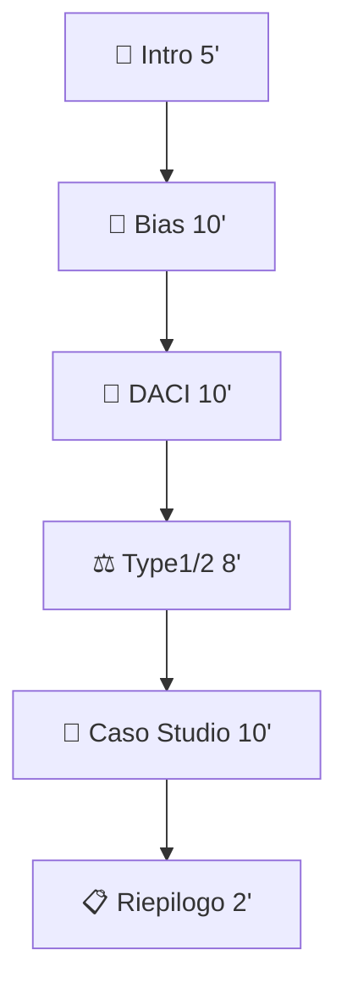
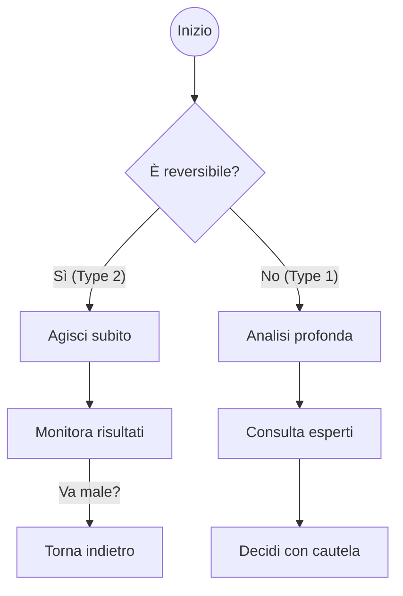

## Decision Making con i Dati — Lezione Completa

Il fine ultimo dell'analisi dati non è produrre dashboard colorate o report di 100 pagine. Il fine ultimo è prendere **decisioni migliori, più velocemente**. Eppure, anche nelle aziende più avanzate, le decisioni critiche vengono spesso prese sulla base di intuizioni, bias cognitivi o gerarchie, usando i dati solo a posteriori per giustificare scelte già fatte.

### Obiettivi di Apprendimento

Al termine di questa lezione, lo studente sarà in grado di:
1.  Riconoscere ed evitare i bias cognitivi comuni che distorcono l'interpretazione dei dati.
2.  Applicare il framework **DACI** per chiarire i ruoli decisionali in un team.
3.  Distinguere tra decisioni **Type 1** (irreversibili) e **Type 2** (reversibili) secondo il modello Amazon.
4.  Strutturare un processo decisionale data-driven in 6 step.
5.  Documentare le decisioni per favorire l'apprendimento organizzativo (Decision Log).

### Timeline della Lezione

| Fase | Argomento | Durata |
|------|-----------|--------|
| 1 | Introduzione: Perché decidiamo male? | 5 min |
| 2 | Teoria: I Bias Cognitivi nell'Analisi | 10 min |
| 3 | Framework: DACI e Ruoli Decisionali | 10 min |
| 4 | Strategia: Type 1 vs Type 2 Decisions | 8 min |
| 5 | Esercizi: Caso Studio Decisionale | 10 min |
| 6 | Riepilogo e Domande | 2 min |
| **Totale** | | **45 min** |

### Fase 1 — Introduzione: Perché decidiamo male? (5 min)

Il cervello umano non è evoluto per analizzare fogli Excel con migliaia di righe. È evoluto per prendere decisioni rapide basate su euristiche (scorciatoie mentali) per sopravvivere nella savana. Nel business moderno, queste euristiche spesso ci portano fuori strada.

*   **L'illusione della certezza:** Cerchiamo dati che confermino la nostra tesi al 100%. Spoiler: non esistono.
*   **L'analisi paralisi:** Continuiamo a cercare dati per paura di sbagliare, ritardando la decisione fino a quando diventa irrilevante.
*   **L'effetto HiPPO:** (Highest Paid Person's Opinion). Se non ci sono dati, vince l'opinione del capo. Se ci sono dati, vincono i dati (idealmente).

### Fase 2 — Teoria: I Bias Cognitivi nell'Analisi (10 min)

Prima di guardare i numeri, dobbiamo "debuggare" il nostro cervello. Ecco i 4 nemici principali del decision making razionale:

1.  **Confirmation Bias (Bias di Conferma)**
    *   *Cos'è:* Tendiamo a cercare, interpretare e ricordare solo le informazioni che confermano le nostre convinzioni preesistenti.
    *   *Esempio:* Un manager è convinto che la campagna TV funzioni. Ignora i dati sul calo del traffico web e si focalizza sull'unico grafico che mostra un aumento delle brand search.
    *   *Antidoto:* Cerca attivamente dati che *smentiscano* la tua ipotesi ("Avvocato del diavolo").

2.  **Survivorship Bias (Bias di Sopravvivenza)**
    *   *Cos'è:* Ci concentriamo sugli elementi che hanno superato una selezione e ignoriamo quelli che sono stati eliminati.
    *   *Esempio:* "Steve Jobs ha lasciato l'università ed è diventato miliardario, quindi l'università è inutile." Ignoriamo le migliaia che hanno lasciato e fallito.
    *   *Antidoto:* Chiediti: "Quali dati mancano? Chi non è in questo dataset?"

3.  **Sunk Cost Fallacy (Fallacia dei Costi Irrecuperabili)**
    *   *Cos'è:* Continuiamo a investire in un progetto fallimentare solo perché abbiamo già speso molto tempo/soldi.
    *   *Esempio:* "Abbiamo già speso 100k€ su questo software, dobbiamo finirlo anche se non serve più."
    *   *Antidoto:* Valuta la decisione come se partissi da zero oggi. I soldi spesi sono andati.

4.  **Anchoring (Ancoraggio)**
    *   *Cos'è:* Ci fissiamo sulla prima informazione ricevuta (l'ancora) e valutiamo tutto rispetto a quella.
    *   *Esempio:* Se il primo preventivo è 10.000€, un secondo da 8.000€ sembra economico, anche se il valore reale è 2.000€.
    *   *Antidoto:* Genera la tua stima indipendente prima di ascoltare gli altri.

### Fase 3 — Framework: DACI e Ruoli Decisionali (10 min)

La confusione su "chi decide cosa" è la causa #1 di riunioni improduttive. Il framework **DACI** (o RAPID) chiarisce i ruoli per ogni decisione importante.

| Ruolo | Significato | Responsabilità |
| :--- | :--- | :--- |
| **D - Driver** | Il "Project Manager" della decisione. | Guida il processo, raccoglie i dati, convoca le riunioni, si assicura che si arrivi a una conclusione. Non necessariamente decide. |
| **A - Approver** | L'unico decisore finale. | Ha l'ultima parola. Se il progetto fallisce, è sua responsabilità. Deve essere UNA sola persona. |
| **C - Contributors** | Gli esperti consultati. | Forniscono dati, analisi e raccomandazioni. Il loro parere pesa, ma non hanno potere di veto. |
| **I - Informed** | Chi deve sapere. | Vengono informati *dopo* che la decisione è presa. Non partecipano alle discussioni. |

*Esempio:*
*   Decisione: "Cambiare il prezzo del prodotto SaaS".
*   **Driver:** Product Manager.
*   **Approver:** CEO.
*   **Contributor:** CFO (impatto finanziario), Head of Sales (feedback clienti), CTO (fattibilità tecnica).
*   **Informed:** Tutto il team Sales e Supporto (per aggiornare i listini).

### Fase 4 — Strategia: Type 1 vs Type 2 Decisions (8 min)

Jeff Bezos, nella lettera agli azionisti di Amazon del 1997, ha introdotto una distinzione cruciale per la velocità decisionale.

**Decisioni Type 1 (One-way doors)**
*   Sono decisioni consequenziali e irreversibili (o quasi).
*   Se attraversi la porta e non ti piace ciò che vedi, non puoi tornare indietro.
*   *Esempio:* Vendere l'azienda, cambiare completamente il modello di business, licenziare metà del team.
*   *Metodo:* Richiedono analisi approfondita, consenso, tempo e cautela. Qui i dati devono essere solidi.

**Decisioni Type 2 (Two-way doors)**
*   Sono decisioni reversibili.
*   Se sbagli, puoi tornare indietro (roll-back).
*   *Esempio:* Lanciare una nuova feature, cambiare il colore del pulsante, testare un nuovo canale marketing.
*   *Metodo:* Devono essere prese velocemente da individui o piccoli gruppi. "Done is better than perfect". Se sbagli, impari e correggi.

*Errore comune:* Trattare le decisioni Type 2 come se fossero Type 1, paralizzando l'azienda.

### Fase 5 — Esercizi: Caso Studio Decisionale (10 min)

**Scenario:** Sei il Data Analyst di una catena di caffetterie. Il Marketing vuole lanciare un programma fedeltà tramite app.

**1. Applicare il DACI**
*   Chi dovrebbe essere il Driver? (Probabilmente il Marketing Manager).
*   Chi l'Approver? (CEO o Direttore Commerciale).
*   Chi i Contributors? (Tu per i dati, IT per l'app, Store Manager per l'operatività).

**2. Type 1 o Type 2?**
*   È reversibile? Lanciare un programma fedeltà è costoso e difficile da togliere senza far arrabbiare i clienti.
*   *Conclusione:* Tende verso il **Type 1**. Richiede analisi preventiva (costi/benefici, stima adesione).
*   *Strategia:* Possiamo trasformarla in Type 2? Sì, facendo un "Pilot" in soli 5 negozi per 3 mesi. Se non funziona, si chiude il pilot (reversibile).

**3. Bias Check**
*   Il Marketing dice: "Tutti i concorrenti lo fanno!" (Bandwagon Effect / Social Proof).
*   Tu chiedi: "Quali dati abbiamo che i *nostri* clienti lo vogliono?".

### Fase 6 — Riepilogo e Domande (2 min)

1.  **Consapevolezza.** Riconosci i bias prima che influenzino l'analisi.
2.  **Chiarezza.** Chi decide? Usa il DACI.
3.  **Velocità.** Se è reversibile (Type 2), decidi oggi.
4.  **Documentazione.** Tieni traccia delle decisioni prese e del *perché* (Decision Log) per imparare in futuro.

### Domande di Verifica

1.  Spiega la differenza tra "Confirmation Bias" e "Anchoring" con un esempio pratico.
2.  Nel modello DACI, perché è critico che l'Approver sia una sola persona?
3.  Qual è la strategia consigliata da Bezos per le decisioni "Type 2"?
4.  Come un "Pilot" o un "A/B Test" può trasformare una decisione Type 1 in una Type 2?
5.  Cos'è il "Sunk Cost Fallacy" e come influisce sui progetti IT fallimentari?

### Riferimenti Bibliografici

-   Daniel Kahneman, "Thinking, Fast and Slow", Farrar, Straus and Giroux, 2011.
-   Chip Heath & Dan Heath, "Decisive: How to Make Better Choices in Life and Work", Crown Business, 2013.
-   Annie Duke, "Thinking in Bets: Making Smarter Decisions When You Don't Have All the Facts", Portfolio, 2018.
