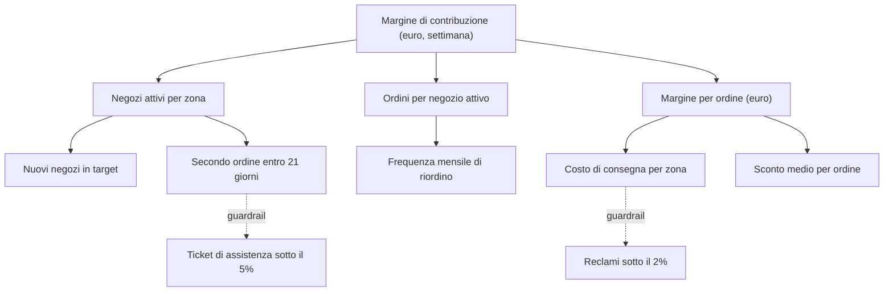

Un servizio di consegne urbane per negozi e ristoranti guarda ogni lunedì la stessa dashboard: download dell'app in crescita, ordini lordi in crescita, iscritti totali in crescita. Tutte le frecce sono verdi, eppure la cassa scende da tre trimestri. Quello che segue è uno scenario costruito con numeri di esempio, pensato per ripercorrere in un'unica lezione tutti i mattoni del modulo: metrica obiettivo, KPI tree, guardrail, coorti e baseline.

> **Idea chiave:** Rifare un sistema metrico non vuol dire aggiungere grafici alla vecchia dashboard, ma sostituire gli indicatori di volume con una metrica che includa il costo di servire il cliente, e poi ricalcolare lo storico con le nuove definizioni.

## La dashboard verde e il conto economico rosso

Il punto di partenza è un trimestre di tredici settimane. La dashboard riporta `24.000` ordini lordi, in crescita del `+18%` sul trimestre precedente, e un numero di download che segue la stessa pendenza. Nessuno dei due indicatori contiene il costo di una consegna. Il responsabile marketing viene valutato sugli iscritti, il responsabile operations sul tempo di consegna, la direzione sugli ordini: tre numeri diversi, nessuno che risponda alla domanda "ogni ordine in più ci lascia soldi in cassa o ce li toglie".

Per rispondere bisogna scendere di un livello e guardare la singola consegna. Una consegna porta un ricavo (la commissione pagata dal negozio), ma genera anche costi variabili: il rider, l'eventuale sconto del codice promozionale, il tempo di assistenza se qualcosa va storto. Quello che resta si chiama margine di contribuzione, ed è la quantità che deve coprire i costi fissi. Se questa differenza è negativa per una parte consistente degli ordini, crescere di volume peggiora il bilancio.

Il laboratorio procede in quattro passaggi. Prima si sceglie e si scrive la metrica obiettivo. Poi la si scompone in un KPI tree dove ogni ramo ha un responsabile e una guardrail. Quindi si ricalcola il trimestre per zona, con aritmetica esplicita. Infine si traduce il risultato in decisioni e in un calendario di revisione. Il confronto fra vecchio e nuovo sistema è riassunto in questa tabella, che useremo come riferimento per tutta la lezione.

| Area | Vecchia metrica | Nuova definizione | Guardrail |
|---|---|---|---|
| Obiettivo | Ordini lordi totali | Margine di contribuzione settimanale in euro | Reclami sotto il 2% degli ordini |
| Acquisizione | Download dell'app | Negozi in zona target con primo ordine valido | Payback del CAC sotto i 4 mesi |
| Attivazione | Utenti registrati | Quota di negozi con secondo ordine entro 21 giorni | Ticket di assistenza sotto il 5% degli ordini |
| Retention | Media ordini mensili | Quota di negozi della coorte attivi al mese 3 | Churn mensile sotto il 4% |

## Scegliere la metrica obiettivo e scriverla per intero

La metrica obiettivo proposta è il margine di contribuzione settimanale generato da ordini completati senza reclami. Una frase così è ancora uno slogan: per diventare una metrica deve rispondere a cinque domande, e nel progetto conviene scriverle per iscritto prima di toccare una query.

L'unità è l'euro, calcolato per ordine come `commissione − costo di consegna − sconto − costo di assistenza` e poi sommato. Il denominatore, quando serve una versione normalizzata, è l'ordine completato, non l'ordine creato: un ordine annullato non porta ricavo ma ha spesso già consumato tempo di un rider. La finestra è la settimana di calendario, con il lunedì come primo giorno, perché la domanda di consegne ha un ciclo settimanale forte e confrontare finestre di sette giorni sfasate produce falsi movimenti. Le esclusioni sono dichiarate: ordini di test, ordini interni, rimborsi integrali. Il responsabile, infine, è uno solo, perché una metrica con due proprietari non ha proprietario.

La ragione per cui si sceglie il margine e non il volume è strutturale. Il volume è una grandezza che si può far crescere comprando ordini, e infatti il codice sconto fa esattamente questo. Il margine invece penalizza chi compra ordini in perdita, quindi allinea i reparti alla stessa realtà economica. Il prezzo da pagare è che il margine è più lento e più rumoroso del volume, ed è per questo che accanto alla metrica obiettivo servono dei driver veloci, che il team possa muovere nel corso della settimana.

## Il KPI tree: driver, guardrail e responsabili

Il margine trimestrale si scompone in un prodotto di tre fattori, per ciascuna zona: il numero di negozi attivi, il numero di ordini che ogni negozio attivo genera nel periodo, il margine medio per ordine. Ogni fattore ha un responsabile naturale. I negozi attivi dipendono da acquisizione e attivazione, gli ordini per negozio dal prodotto e dalla frequenza di riordino, il margine per ordine dalle operations e dal pricing.



Le guardrail sono metriche che non si vogliono sacrificare mentre si spinge sul driver. Se si chiede alle operations di ridurre il costo di consegna, la scorciatoia più facile è allungare i tempi o saltare i controlli, e la guardrail sui reclami serve a rendere visibile questa scorciatoia. Se si chiede al marketing di portare più negozi in zona target, la guardrail sul payback del CAC impedisce di comprarli a qualunque prezzo. Ogni ramo del tree dovrebbe avere sia una baseline (il valore storico ricalcolato) sia una soglia di allerta scritta, altrimenti la guardrail resta una dichiarazione di intenti.

## Ricalcolare il trimestre passo per passo

Il ricalcolo parte dal dato grezzo: per ogni consegna del trimestre servono zona, commissione, costo di consegna, sconto e stato. Si aggrega prima per zona. Nel nostro scenario il centro città raccoglie `14.400` ordini e la periferia `9.600`, per un totale di `24.000` ordini, e la periferia pesa quindi il `40%` del volume (`9.600 / 24.000 = 0,40`). Il centro ha `480` negozi attivi e la periferia `320`; ciascun negozio genera in media `30` ordini nel trimestre in entrambe le zone, e infatti `480 × 30 = 14.400` e `320 × 30 = 9.600`.

Il margine per ordine si calcola con la formula della sezione precedente. Nel centro la commissione media è `4,50 €`, il costo di consegna `3,20 €` e lo sconto medio `0,30 €`: `4,50 − 3,20 − 0,30 = 1,00 €` per ordine. In periferia la commissione è la stessa, `4,50 €`, ma il costo di consegna sale a `5,10 €` per le distanze e lo sconto medio a `1,50 €` per il codice di benvenuto usato in massa: `4,50 − 5,10 − 1,50 = −2,10 €` per ordine.

Moltiplicando per i volumi si ottiene il margine di zona. Centro: `14.400 × 1,00 € = 14.400 €`. Periferia: `9.600 × (−2,10 €) = −20.160 €`. Il totale è `14.400 − 20.160 = −5.760 €`: il trimestre che la dashboard descriveva come il migliore di sempre ha perso `5.760 €` di margine di contribuzione, prima ancora dei costi fissi. La tabella riassume il calcolo.

| Zona | Negozi attivi | Ordini | Margine per ordine | Margine di zona |
|---|---|---|---|---|
| Centro | 480 | 14.400 | 1,00 € | 14.400 € |
| Periferia | 320 | 9.600 | −2,10 € | −20.160 € |
| Totale | 800 | 24.000 | −0,24 € | −5.760 € |

Il margine medio per ordine del totale è `−5.760 / 24.000 = −0,24 €`, un numero che da solo nasconderebbe tutto: sembra un problema marginale e invece è la somma di una zona sana e di una zona che brucia due euro a ogni consegna. Questo è il motivo per cui la metrica va sempre letta scomposta per il segmento che guida la decisione.

Lo stesso ricalcolo sul fronte dell'attivazione completa il quadro. Dei `400` nuovi negozi del centro, `320` hanno fatto un secondo ordine entro ventuno giorni: `320 / 400 = 80%`. In periferia i nuovi negozi sono `200` e solo `24` hanno riordinato: `24 / 200 = 12%`. Sull'insieme, `344 / 600 = 57,3%`. La periferia non è solo meno profittevole per ordine: i clienti acquisiti con lo sconto non tornano, quindi lo sconto compra un ordine singolo e non una relazione.

## Lo stesso calcolo in Python

Quando il calcolo passa dal foglio di carta al dato reale, conviene scriverlo come funzione, in modo che la stessa definizione serva per ogni settimana e per ogni zona. Lo script che segue riproduce il ricalcolo del trimestre con i numeri dello scenario; in produzione la lista `zone` verrebbe sostituita da una query sulla tabella delle consegne.

```python
# Ricalcolo del margine di contribuzione per zona (numeri di esempio)
zone = [
    {"nome": "centro",   "negozi": 480, "ordini_per_negozio": 30,
     "commissione": 4.50, "costo_consegna": 3.20, "sconto": 0.30},
    {"nome": "periferia", "negozi": 320, "ordini_per_negozio": 30,
     "commissione": 4.50, "costo_consegna": 5.10, "sconto": 1.50},
]

def margine_per_ordine(z):
    # commissione meno costi variabili per singola consegna
    return z["commissione"] - z["costo_consegna"] - z["sconto"]

totale_ordini = 0
totale_margine = 0.0
for z in zone:
    ordini = z["negozi"] * z["ordini_per_negozio"]
    margine = ordini * margine_per_ordine(z)
    totale_ordini += ordini
    totale_margine += margine
    print(f'{z["nome"]}: {ordini} ordini, margine {margine:,.0f} euro')

print(f"totale: {totale_ordini} ordini, margine {totale_margine:,.0f} euro")
print(f"margine medio per ordine: {totale_margine / totale_ordini:.2f} euro")
```

L'output atteso è `14.400 €` per il centro, `−20.160 €` per la periferia e `−5.760 €` in totale, con un margine medio di `−0,24 €` per ordine. Se il tuo ricalcolo su dati veri non riproduce la somma dei segmenti con quella del totale, c'è un problema di definizione, per esempio ordini senza zona assegnata, e va risolto prima di discutere qualsiasi decisione.

## Cosa cambia nelle decisioni e come gestire il periodo ponte

Con la scomposizione sul tavolo la decisione diventa quasi meccanica. I codici sconto in periferia vengono spenti, e il budget commerciale liberato viene riallocato sui quartieri ad alta densità. Come ipotesi di lavoro, supponiamo che dopo otto settimane la periferia scenda a `2.000` ordini per trimestre, con margine di `−0,60 €` perché lo sconto è sparito ma il costo di consegna resta, cioè `2.000 × (−0,60) = −1.200 €`. Il centro, rafforzato dal budget, cresce a `15.600` ordini a `1,00 €`, quindi `15.600 €`. Il margine totale proiettato è `15.600 − 1.200 = 14.400 €`, contro i `−5.760 €` di partenza, un miglioramento di `20.160 €`. Gli ordini lordi scendono da `24.000` a `17.600`, cioè del `26,7%`: il volume cala, e proprio questa scelta il vecchio cruscotto non avrebbe mai permesso di scegliere.

Il passaggio più delicato è umano, non tecnico. Se i commerciali hanno ancora un premio legato agli iscritti lordi, il nuovo cruscotto verrà letto come un attacco. La soluzione pragmatica è un periodo ponte di un trimestre in cui i due sistemi convivono nelle riunioni ma con le vecchie metriche etichettate come "in dismissione" e una data di spegnimento precisa. Nel trimestre successivo gli obiettivi ufficiali passano alla nuova definizione. A regime bastano un controllo di quindici minuti ogni lunedì su driver e guardrail e un'ora a fine mese sulla matrice delle coorti.

## Tre errori che fanno fallire un rifacimento metrico

Il lavoro tecnico è la parte facile. Quasi sempre il progetto si inceppa in uno di questi tre punti.

### Lasciare accese le vecchie metriche accanto alle nuove

Il sintomo è una riunione in cui ogni reparto cita il numero che lo fa apparire meglio: marketing gli iscritti, direzione il margine. Succede perché spegnere un indicatore sembra un gesto ostile e tenerlo "per continuità" sembra prudente. La correzione è archiviare le vecchie metriche con una data di dismissione scritta e visibile, e non mostrarle più nella dashboard principale dopo il periodo ponte.

### Cambiare le definizioni senza ricalcolare lo storico

Il sintomo è un cruscotto nuovo che parte da zero e non permette di dire se la settimana corrente sia buona o cattiva. Succede perché ricalcolare novanta giorni di dati costa lavoro e sembra rimandabile. Si risolve ricalcolando almeno un trimestre con le nuove formule, come nell'esempio sopra: quel ricalcolo fornisce la baseline e, spesso, la scoperta che giustifica l'intero progetto.

### Tagliare i costi senza guardrail di qualità

Il sintomo compare quando, scoperto il margine negativo, l'azienda taglia assistenza o alza i prezzi di colpo e la retention crolla. Succede perché il margine è l'unico numero guardato. La correzione sta nelle guardrail su reclami, ticket e tenuta delle coorti al terzo mese, che restano visibili accanto al margine e fermano una riduzione dei costi quando danneggia il cliente.

## Controllo finale del progetto

Prima di dichiarare chiuso il rifacimento e archiviare la vecchia dashboard, rispondi a queste domande sul tuo caso.

1. Nel trimestre ricalcolato un segmento ha `5.000` ordini a `−1,80 €` per ordine e un altro `12.000` ordini a `+0,90 €`: il margine totale è positivo o negativo?

<details>
<summary>Mostra risposta</summary>

Il primo segmento vale `5.000 × (−1,80) = −9.000 €`, il secondo `12.000 × 0,90 = 10.800 €`. Il totale è `+1.800 €`, positivo ma fragile: la media per ordine è `1.800 / 17.000 ≈ 0,11 €`, e basta un peggioramento del primo segmento per ribaltare il segno.

</details>

2. Perché la metrica obiettivo usa l'ordine completato come denominatore e non l'ordine creato?

<details>
<summary>Mostra risposta</summary>

Perché un ordine annullato non genera ricavo ma può aver già consumato costi, quindi dividerlo nel denominatore farebbe sembrare il margine per ordine migliore di quello reale. Il denominatore deve contare solo ciò che produce ricavo.

</details>

3. Un collega propone di tenere la vecchia metrica degli ordini lordi nella dashboard principale "per continuità". Quale rischio concreto porta e come lo gestisci?

<details>
<summary>Mostra risposta</summary>

Ogni reparto citerà il numero più favorevole e il nuovo framework non cambierà alcuna decisione. Si gestisce con un periodo ponte di un trimestre, la vecchia metrica etichettata come in dismissione e una data di spegnimento scritta.

</details>

4. Se spegnere i codici sconto in periferia fa scendere gli ordini lordi del `26,7%` ma porta il margine da `−5.760 €` a `+14.400 €`, il progetto è riuscito? Quale guardrail controlli prima di dirlo?

<details>
<summary>Mostra risposta</summary>

Sì sul margine, ma solo se le guardrail reggono: reclami sotto il `2%`, ticket sotto il `5%` e retention della coorte al mese 3. Il rischio è che il margine sia migliorato tagliando il servizio, e solo le guardrail permettono di escluderlo.

</details>
