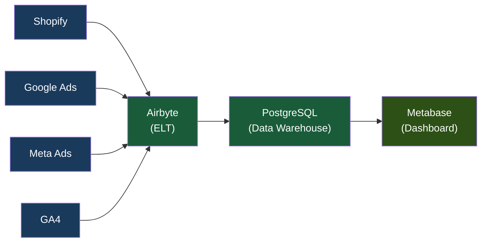

# Caso Studio: Da Fogli Excel a Dashboard Data-Driven

> **Scenario:** Un e-commerce italiano di prodotti artigianali (€3M fatturato, 15 dipendenti) vuole passare da decisioni "a sensazione" a un approccio strutturato basato sulle metriche.

## 1. La Situazione Iniziale

| Aspetto | Stato |
|:---|:---|
| **Dati** | Sparsi tra Shopify, Google Analytics, Excel, email |
| **Report** | Il marketing manager crea un Excel ogni lunedì (4 ore) |
| **Metriche** | Ognuno ha la propria definizione di "fatturato" |
| **Decisioni** | Basate sull'esperienza del fondatore |
| **Team dati** | Nessuno |

### I Problemi Concreti

```
❌ "Il fatturato di gennaio è €280K" (secondo Shopify)
❌ "No, è €265K" (secondo il commercialista — include i resi)
❌ "In realtà è €290K" (secondo il marketing — include ordini non pagati)
→ 3 numeri diversi = 0 fiducia nei dati
```

## 2. Step 1: Definire il Glossario delle Metriche (Settimana 1-2)

La prima azione è stata creare un **glossario condiviso** partendo dalle 10 metriche più importanti:

```python
glossario_metriche = {
    "revenue": {
        "name": "Fatturato Netto",
        "formula": "Vendite lorde - Resi - Sconti - IVA",
        "source": "Shopify Orders API (status: paid, fulfillment: fulfilled)",
        "owner": "CFO",
        "update_frequency": "daily",
        "note": "NON include ordini pending o cancelled"
    },
    "aov": {
        "name": "Average Order Value (AOV)",
        "formula": "Fatturato Netto / Numero Ordini Completati",
        "source": "Derivato da revenue",
        "owner": "Head of Marketing",
        "benchmark": "€75 (media settore artigianato online)"
    },
    "cac": {
        "name": "Customer Acquisition Cost",
        "formula": "(Spesa Ads + Spesa Content + Spesa Affiliate) / Nuovi Clienti",
        "source": "Meta Ads + Google Ads + Shopify",
        "owner": "Head of Marketing",
        "target": "< €35 (con LTV/CAC > 3x)"
    }
}
```

## 3. Step 2: Centralizzare i Dati (Settimana 2-4)



Il criterio di scelta: il tool piu' semplice che regge il volume attuale, con la possibilita' di evolvere in futuro senza buttare via tutto. Per un e-commerce da €3M, la complessita' di Snowflake o BigQuery sarebbe overhead puro.

Stack scelto (budget: €200/mese):

| Componente | Tool | Costo |
|:---|:---|:---|
| ELT | Airbyte (self-hosted) | €0 |
| Data Warehouse | PostgreSQL su DigitalOcean | €50/mese |
| Trasformazione | dbt Core | €0 |
| Dashboard | Metabase (self-hosted) | €0 |
| Hosting | DigitalOcean Droplet | €150/mese |

## 4. Step 3: La Prima Dashboard Executive (Settimana 3)

```sql
-- Query per la dashboard executive giornaliera
WITH daily AS (
    SELECT
        order_date,
        COUNT(*) AS orders,
        SUM(net_revenue) AS revenue,
        COUNT(DISTINCT customer_id) AS unique_customers,
        SUM(CASE WHEN is_new_customer THEN 1 ELSE 0 END) AS new_customers,
        AVG(net_revenue) AS aov
    FROM orders_clean
    WHERE order_date >= CURRENT_DATE - INTERVAL '30 days'
    GROUP BY order_date
)
SELECT
    order_date,
    orders,
    revenue,
    aov,
    new_customers,
    unique_customers - new_customers AS returning_customers,
    ROUND(new_customers * 100.0 / unique_customers, 1) AS new_customer_pct
FROM daily
ORDER BY order_date DESC;
```

**Impatto immediato:** Il CEO riceve i numeri ogni mattina alle 8:00 via Slack, aggiornati automaticamente. Le 4 ore settimanali del marketing manager sono liberate. Il primo commento del CEO alla prima mattina di ricezione automatica: "Non avevo mai visto i dati del giorno prima alle 8:00. Non sapevo che fosse possibile."

## 5. Step 4: Analisi che Genera Azioni (Mese 2-3)

### Scoperta #1: Il Paradosso della Spedizione Gratuita

```sql
-- Analisi: la soglia di spedizione gratuita funziona?
SELECT
    CASE
        WHEN order_total < 50 THEN '< €50'
        WHEN order_total BETWEEN 50 AND 69.99 THEN '€50-69'
        WHEN order_total BETWEEN 70 AND 79.99 THEN '€70-79 (vicino soglia)'
        WHEN order_total >= 80 THEN '≥ €80 (free shipping)'
    END AS order_bucket,
    COUNT(*) AS orders,
    AVG(order_total) AS avg_total,
    SUM(order_total) AS total_revenue,
    ROUND(COUNT(*) * 100.0 / SUM(COUNT(*)) OVER (), 1) AS pct_orders
FROM orders_clean
WHERE order_date >= CURRENT_DATE - INTERVAL '90 days'
GROUP BY 1
ORDER BY MIN(order_total);
```

**Risultato:**
| Bucket | Ordini | % | AOV |
|:---|:---:|:---:|:---:|
| < €50 | 1.200 | 35% | €32 |
| €50-69 | 890 | 26% | €58 |
| **€70-79** | **620** | **18%** | **€74** |
| ≥ €80 | 720 | 21% | €105 |

**Insight:** Il 18% degli ordini è tra €70-79, appena sotto la soglia di spedizione gratuita (€80). **Azione:** Abbassare la soglia a €70 o aggiungere un suggerimento "Aggiungi €X per la spedizione gratuita".

**Risultato dopo il test:** AOV aumentato del 8%, revenue +5%.

## 6. Risultati dopo 6 Mesi

| Metrica | Prima | Dopo 6 Mesi | Δ |
|:---|:---:|:---:|:---:|
| Tempo per report settimanale | 4 ore | 0 (automatico) | -100% |
| Versioni diverse del fatturato | 3 | 1 (single source of truth) | -67% |
| AOV | €68 | €78 | +15% |
| CAC | €42 | €35 | -17% |
| Decisioni basate su dati | ~20% | ~75% | +275% |

## 7. Step 5: Altre Analisi che Generano Azioni

### Scoperta #2: I Clienti di Ritorno Valgono il Triplo

```sql
-- Confronto LTV clienti nuovi vs ritorno
SELECT
    CASE
        WHEN order_count = 1 THEN 'Primo acquisto'
        WHEN order_count BETWEEN 2 AND 3 THEN '2-3 acquisti'
        ELSE '4+ acquisti (loyal)'
    END AS customer_segment,
    COUNT(DISTINCT customer_id) AS customers,
    AVG(lifetime_revenue) AS avg_ltv,
    AVG(avg_order_value) AS avg_aov
FROM customer_ltv_summary
GROUP BY 1
ORDER BY avg_ltv DESC;
```

**Risultato:** I clienti con 4+ acquisti hanno un LTV medio di €312, quasi 3 volte quello dei clienti con un solo acquisto (€108). Rappresentano solo il 14% della base clienti ma generano il 38% del fatturato.

**Azione:** lancio di un programma fedeltà semplice (email di compleanno + sconto riservato al terzo acquisto). Costo di implementazione: 2 ore di setup su Klaviyo. Nei 3 mesi successivi, il tasso di secondo acquisto entro 90 giorni e' salito dal 12% al 18%.

### Scoperta #3: I Giorni di Spedizione Impattano il NPS

Analisi qualitativa incrociata con i dati operativi: le recensioni negative (1-2 stelle) arrivavano quasi tutte da ordini con ritardo di spedizione superiore a 5 giorni. Il problema non era il prodotto: era un corriere specifico usato per le province del Sud.

```sql
SELECT
    shipping_carrier,
    region,
    AVG(delivery_days) AS avg_delivery_days,
    COUNT(*) AS orders,
    SUM(CASE WHEN review_score <= 2 THEN 1 ELSE 0 END) AS negative_reviews,
    ROUND(SUM(CASE WHEN review_score <= 2 THEN 1 ELSE 0 END) * 100.0 / COUNT(*), 1)
        AS negative_review_rate
FROM orders_with_reviews
WHERE review_score IS NOT NULL
GROUP BY shipping_carrier, region
ORDER BY negative_review_rate DESC;
```

**Risultato:** uno specifico corriere aveva un negative review rate del 34% nel Sud vs una media del 6% degli altri corrieri. **Azione:** sostituzione del corriere per quelle province. NPS complessivo da 28 a 41 in 2 mesi.

## 8. La Trasformazione del Processo Decisionale

Il cambio piu' importante non e' stato tecnico. E' stato nel modo in cui il fondatore e il team prendono decisioni.

**Prima del progetto:**
- "Abbassiamo i prezzi del 10%, vedremo se le vendite migliorano"
- "I clienti si lamentano della spedizione, dobbiamo fare qualcosa"
- "Gennaio e' sempre lento, non preoccupiamoci"

**Dopo 6 mesi:**
- "La retention cala dopo il 45° giorno. Qual e' la causa? Interroghiamo i clienti che se ne vanno in quella finestra temporale"
- "Il negative review rate del corriere X in quelle province e' al 34%. Cambiamo corriere e misuriamo l'effetto sul NPS nelle 8 settimane successive"
- "Il MAU di gennaio e' uguale a dicembre. E' normale per la nostra coorte storica?"

Questa differenza non si misura su un dashboard. Si misura sulla qualita' delle riunioni, sulla velocita' con cui si identificano i problemi reali, e sulla fiducia del team verso i propri dati.

## Riepilogo Operativo

- Il primo risultato concreto arriva spesso dal glossario e dalla chiarezza, non dalla tecnologia piu' avanzata.
- Dashboard, definizioni e workflow decisionali devono evolvere insieme per creare fiducia nei dati.
- I quick win servono a costruire consenso, ma vanno collegati a una base dati piu' solida.
- Il vero obiettivo del progetto non e' produrre report, ma migliorare la qualita' delle decisioni operative.
- Le analisi piu' preziose nascono incrociando dati operativi con comportamento clienti, non solo guardando i numeri aggregati.
- Ogni insight vale solo se si traduce in un'azione concreta con una data e un owner.

## Lezioni Apprese

1. **Inizia dal glossario**, non dalla tecnologia
2. **Quick wins prima** — la dashboard executive ha convinto tutti in 2 settimane
3. **Stack semplice** — non serve Snowflake per un e-commerce da €3M
4. **Le analisi devono finire con un'azione**, non con un grafico
5. **Documenta tutto** — tra 6 mesi nessuno ricordera' perche' una metrica e' calcolata cosi'
6. **Incrocia i dati** — i clienti di ritorno, il tasso di spedizione, il NPS: da soli dicono poco, insieme raccontano una storia
