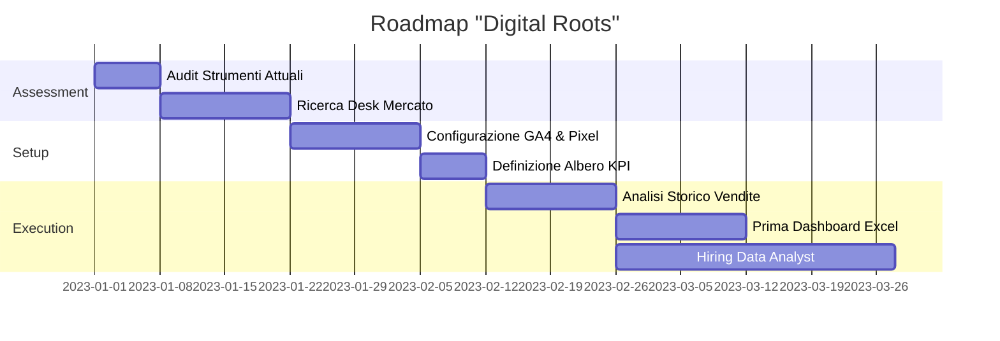
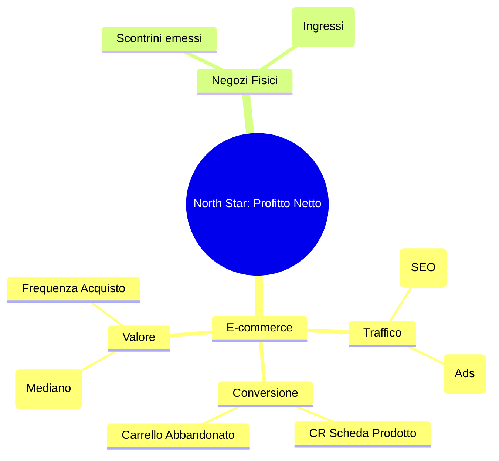

## Contesto Aziendale

**Azienda:** *GreenGarden S.r.l.* (nome fittizio)
**Settore:** Retail Giardinaggio & Arredo Esterno
**Canali:** 5 Negozi Fisici + E-commerce (lanciato da 6 mesi)
**Team Dati:** Nessuno (gestito dal Marketing Manager)

GreenGarden è un'istituzione locale. I negozi fisici vanno bene, ma l'e-commerce è un "buco nero" di costi. Il proprietario è scettico: "L'online non funziona per noi".
Il marketing spende €5.000/mese in ads, ma non sa dire quanti clienti portino. Si basano sui "Mi Piace" su Facebook come indicatore di successo.

### Dati Iniziali

| Metrica | Situazione Attuale | Obiettivo | Note |
| :--- | :--- | :--- | :--- |
| **Mindset** | "Abbiamo sempre fatto così" | "Cosa dicono i dati?" | Resistenza al cambiamento |
| **KPI Monitorati** | Fatturato Totale, Like Facebook | CAC, LTV, Tasso Conversione | Focus su Vanity Metrics |
| **Conoscenza Mercato** | Sensazione | Dati ISTAT/Trends | Manca ricerca oggettiva |
| **Analisi Statistica** | Nessuna (Media Semplice) | Mediana, Deviazione Standard | Errori di valutazione sui prezzi |

**Problema Principale:** Analfabetismo dei dati. L'azienda misura le cose sbagliate e prende decisioni basate su aneddoti ("Un cliente si è lamentato del prezzo") invece che su evidenze statistiche.

## Obiettivi del Progetto

Il progetto "Digital Roots" mira a costruire le fondamenta:

1.  **Definire i KPI corretti** distinguendo tra metriche di vanità e metriche azionabili.
2.  **Validare il potenziale di mercato** tramite una rigorosa Ricerca Desk, per capire se l'e-commerce ha senso.
3.  **Applicare la statistica di base** per pulire i dati di vendita da outlier e stagionalità.
4.  **Costruire il primo Data Team** definendo i ruoli chiave e la roadmap dei primi 90 giorni.

## Analisi e Strategia

### 1. Ricerca Desk & Validazione
Prima di investire ancora, guardiamo fuori.
*   **Google Trends:** Ricerca "Piante da interno" in crescita del 300% (trend post-Covid).
*   **Competitor:** Analisi dei bilanci dei competitor online (disponibili in Camera di Commercio).
*   **Insight:** Il mercato c'è, ma GreenGarden sta vendendo i prodotti sbagliati (arredo costoso) online, mentre la domanda è su piante piccole.

### 2. Metriche: Vanity vs Actionable
Sostituiremo i report attuali.
*   *Vanity:* "Visualizzazioni Pagina", "Like". -> Cestinati.
*   *Actionable:* "Costo per Vendita (CPA)", "Carrello Medio (AOV)", "Tasso di Reso".

### 3. Statistica: La trappola della Media
Il marketing riportava un Ordine Medio di €350.
Analizzando i dati grezzi, abbiamo scoperto che:
*   90% degli ordini sono < €50.
*   10% sono ordini B2B da €3.000 (paesaggisti).
*   **La Media (€350) mentiva.** La **Mediana (€45)** era il vero valore del cliente e-commerce tipico. Basare il prezzo delle ads su un carrello di €350 portava a spendere troppo (CPA €80), mandando in perdita il 90% degli ordini.

### Diagramma di Flusso: Processo Decisionale

```mermaid
flowchart TD
    A[Problema: "Vendiamo poco online"] --> B{Abbiamo Dati?}
    B -- No --> C[Ricerca Desk & Setup Tracking]
    B -- Si --> D[Analisi Statistica Descrittiva]
    D --> E{Media o Mediana?}
    E -- Outlier presenti --> F[Usa Mediana]
    E -- Distrib. Normale --> G[Usa Media]
    F --> H[Definizione KPI Actionable]
    G --> H
    H --> I[Decisione Strategica]
```

**Decisioni Chiave:**
*   **Separare B2B e B2C:** Trattare i paesaggisti come un canale separato con metriche separate.
*   **Roadmap 90 Giorni:** Mese 1: Setup Google Analytics. Mese 2: Dashboard Base. Mese 3: Assunzione Junior Data Analyst.

## Implementazione

### Timeline (Primi 90 Giorni)



### Dati Intermedi: La Scoperta della Stagionalità

Analizzando lo storico con una media mobile, è emerso che il "calo" di luglio non era un fallimento del marketing, ma un trend fisiologico del settore (-40% in tutta Italia).

| Mese | Fatturato Reale | Fatturato Destagionalizzato | Giudizio |
| :--- | :--- | :--- | :--- |
| Maggio | €50.000 | €45.000 | Buono |
| Giugno | €40.000 | €42.000 | Stabile |
| Luglio | €25.000 | €43.000 | **Ottimo** (nonostante il calo assoluto) |

**Problema Incontrato:** Il proprietario voleva tagliare il budget a luglio "perché non si vende".
**Soluzione:** Mostrando i dati destagionalizzati, abbiamo dimostrato che luglio stava performando *meglio* dell'anno precedente in termini relativi. Il budget è stato mantenuto per catturare la domanda residua.

## Risultati

### KPI Prima vs Dopo

| KPI | Prima (T0) | Dopo (T3) | Variazione |
| :--- | :--- | :--- | :--- |
| **Costo Acquisizione (CPA)** | €80 | €18 | -77% (Grazie al target giusto) |
| **Margine su Ads** | -€30 (Perdita) | +€12 (Profitto) | Da Rosso a Verde |
| **Tempo Decisionale** | 3 settimane | 2 giorni | Dashboard automatizzata |
| **Cultura** | "Secondo me" | "Guarda la dashboard" | Cambio Mindset |

### Analisi ROI

Costo Consulenza + Tooling: €15.000.
Risparmio su Budget Ads sprecato: €3.000/mese = €36.000/anno.
Incremento vendite (grazie a prezzi corretti): €50.000/anno.
**ROI Primo Anno:** > 400%

### Visualizzazione Gerarchia Metriche



## Lezioni Apprese

1.  **La statistica salva il budget:** Sapere la differenza tra Media e Mediana ci ha salvato dal fallimento sul pricing.
2.  **Guardare fuori (Desk Research):** Non serve reinventare la ruota. I dati sul mercato esistono già, basta cercarli.
3.  **Vanity Metrics sono droghe:** I "Like" danno gratificazione immediata ma non pagano gli stipendi. È stata dura disintossicare il team.
4.  **Quick Wins:** Aver mostrato un risparmio immediato sul budget Ads nel primo mese ha guadagnato la fiducia del proprietario per i mesi successivi.
5.  **Il contesto è Re:** Un numero da solo (€25.000 a luglio) non significa nulla senza il contesto (stagionalità).

## Domande di Discussione

1.  In quale situazione (oltre alla distribuzione del reddito/prezzo) la Media è preferibile alla Mediana?
2.  Come convinceresti un fondatore "vecchio stampo" che la sua intuizione, che ha funzionato per 30 anni, ora è sbagliata rispetto ai dati?
3.  Quali sono i limiti della Ricerca Desk e quando diventa indispensabile fare Ricerca Primaria (sondaggi, interviste)?
4.  Come definiresti una "North Star Metric" per un business che ha sia vendita online che offline con dinamiche diverse?
5.  Perché è importante definire la "Roadmap dei primi 90 giorni" invece di partire subito a costruire modelli complessi?

**Cosa faresti diversamente?**
*   *Se avessimo avuto storico:* Avrei applicato modelli di *Forecasting* più avanzati (es. Holt-Winters) per prevedere la stagionalità invece di usare medie mobili semplici.
*   *Se il budget fosse zero:* Avrei usato Google Sheets + Google Data Studio (Looker Studio) gratuiti invece di tool a pagamento per la dashboard.
