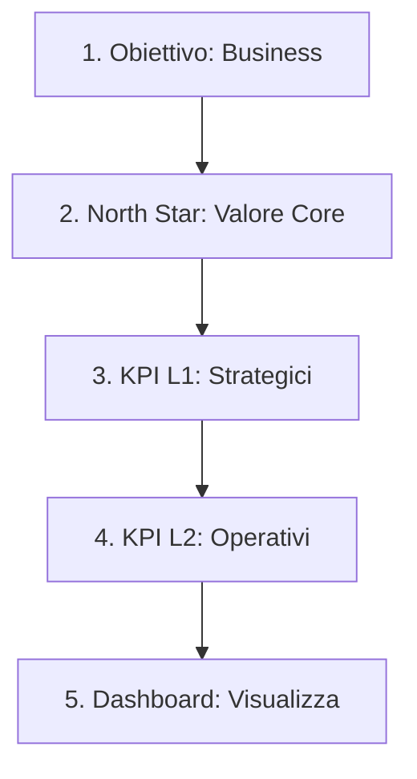

## Concetti Chiave

- **OKR (Objectives and Key Results)**: Framework strategico per allineare l'azienda. Objective (Dove vogliamo andare) + Key Results (Come misuriamo se ci siamo arrivati).
- **KPI (Key Performance Indicators)**: Metriche operative per monitorare la "salute" del business (es. Uptime, Churn).
- **North Star Metric**: L'unica metrica che meglio cattura il valore fondamentale che il prodotto offre al cliente (es. Spotify = Tempo di ascolto).
- **Vanity Metrics**: Numeri che gonfiano l'ego ma non il portafoglio (Like, Pageviews).
- **Actionable Metrics**: Numeri che ti dicono cosa fare (Conversion Rate, Retention).
- **Leading vs Lagging Indicators**:
    - *Leading*: Predicono il futuro (es. NPS, Traffico web).
    - *Lagging*: Raccontano il passato (es. Fatturato, Churn).
- **Correlazione vs Causalità**: Due eventi possono muoversi insieme (Correlazione) senza che uno causi l'altro. "Il gallo canta all'alba, ma non fa sorgere il sole".

## Statistica per Business

| Concetto | Definizione | Quando usarlo |
|----------|-------------|---------------|
| **Media (Mean)** | `Somma / N` | Distribuzioni normali (es. Altezza, Errori). Sensibile agli outlier. |
| **Mediana** | Il valore centrale (50% sopra, 50% sotto) | Distribuzioni asimmetriche (es. Stipendi, Prezzi Case). Robusta agli outlier. |
| **Deviazione Standard** | Misura di quanto i dati sono sparpagliati | Valutare il rischio o la volatilità. |
| **Outlier** | Dato anomalo molto distante dagli altri | Indagare sempre: è un errore o una scoperta? |
| **P-Value** | Probabilità che il risultato sia casuale | A/B Testing: cerchiamo p < 0.05 (Significatività 95%). |

## Framework e Modelli

### Framework OKR
Come scrivere obiettivi che funzionano.

> **Objective**: Diventare l'app n.1 per la produttività in Italia. (Ispirante, Qualitativo)
>
> **Key Results**:
> 1. Raggiungere 100k Utenti Attivi Mensili (MAU). (Quantitativo)
> 2. Ridurre il Churn mensile sotto il 3%. (Misurabile)
> 3. Ottenere 500 recensioni a 5 stelle. (Time-bound)

### Competitive Intelligence (Google Hacking)
Trovare informazioni nascoste sui competitor.

| Operatore | Esempio Query | Risultato |
|-----------|---------------|-----------|
| `site:` | `site:competitor.it "prezzo"` | Cerca solo dentro quel sito. |
| `filetype:` | `settore moda report 2024 filetype:pdf` | Trova solo documenti PDF (report, studi). |
| `intitle:` | `intitle:"marketing plan"` | La parola deve essere nel titolo della pagina. |
| `related:` | `related:competitor.it` | Trova siti simili a quello indicato. |

## Processo Step-by-Step: Definizione Metriche

1.  **Obiettivo Business**: Cosa vogliamo ottenere quest'anno? (es. Crescita profittevole).
2.  **North Star**: Qual è l'indicatore unico di valore? (es. Clienti che ordinano > 2 volte).
3.  **KPI Level 1**: Quali metriche muovono la North Star? (es. Nuovi Clienti, Retention).
4.  **KPI Level 2**: Quali metriche operative muovono i KPI L1? (es. CTR Ads, Tasso di conversione LP).
5.  **Dashboard**: Visualizza solo questi livelli. Tutto il resto è esplorazione.

## Errori da Evitare

-   ❌ **Misurare tutto** → ✅ "Se misuri tutto, non stai misurando niente". Focalizzati su 3-5 KPI.
-   ❌ **Usare la Media per gli Stipendi** → ✅ Usa la Mediana. Se Bill Gates entra nel bar, la media diventa milionaria, ma la gente è povera.
-   ❌ **Sandbagging (OKR)** → ✅ Mettere obiettivi troppo facili per raggiungerli al 100%. Gli OKR devono essere ambiziosi (target 70% successo).
-   ❌ **Confondere Output con Outcome** → ✅ *Output:* "Ho lanciato 3 feature". *Outcome:* "La retention è salita del 5%". Misura l'Outcome.
-   ❌ **Ignorare il Contesto** → ✅ "Il fatturato è raddoppiato!" (Ma hai speso il triplo in marketing). Guarda sempre l'efficienza (ROI/ROAS).

## Quick Reference

| Strumento | A cosa serve | Quando usarlo |
|-----------|--------------|---------------|
| **Google Trends** | Analisi di Mercato | Capire la stagionalità e l'interesse nel tempo. |
| **SimilarWeb** | Competitive Intel | Stimare il traffico e le fonti dei competitor. |
| **Meta Ads Library** | Creative Analysis | Spiare le pubblicità attive dei competitor (se sono attive da molto, funzionano). |
| **Wayback Machine** | Storia | Vedere come è cambiato il sito/prezzi del competitor nel tempo. |
| **AnswerThePublic** | Content Ideas | Vedere cosa cerca la gente ("Come...", "Perché...") su un tema. |
