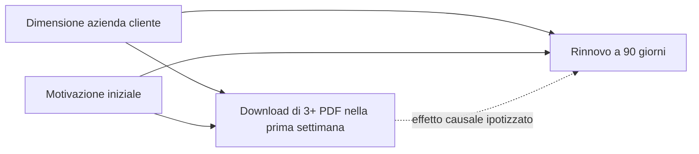

Una piattaforma di formazione aziendale in abbonamento nota che gli utenti che scaricano almeno tre report PDF nella prima settimana rinnovano quasi il doppio degli altri. La direzione trasforma il download in obiettivo trimestrale del team prodotto, e arrivano pop-up insistenti e invii automatici di report. I download triplicano, i rinnovi a novanta giorni restano dove erano. Il caso è uno scenario costruito, con numeri di esempio, e questa scheda serve a riconoscere in anticipo la trappola e a decidere quanta prova chiedere prima di muovere soldi.

> **Idea chiave:** Una correlazione storica dice che due numeri viaggiano insieme, non che muovere il primo sposti il secondo. Solo un confronto con baseline pulita o gruppo di controllo trasforma la correlazione in una leva.

## Che cosa può significare una correlazione tra due KPI

Quando due metriche si muovono insieme, i meccanismi possibili sono almeno tre, e il dato da solo non dice quale sia quello vero. Il primo è la causalità diretta: scaricare i report fa capire il valore del prodotto e quindi porta al rinnovo. Il secondo è la causalità inversa o l'autoselezione: i clienti già convinti, che rinnoverebbero comunque, esplorano di più il prodotto, quindi il download è un sintomo della convinzione e non la sua causa. Il terzo è il confondente: un fattore esterno, come la dimensione dell'azienda cliente, spinge entrambe le metriche.



Nel diagramma la freccia tratteggiata è l'unica che la direzione ha considerato, mentre le due frecce piene che partono da dimensione e motivazione sono quelle che producono la correlazione osservata. Per distinguere i tre casi non serve un modello sofisticato: serve scomporre il dato per segmento e, quando la decisione è costosa, fare un esperimento.

## Quanto spiega la dimensione cliente: una derivazione svolta

Prendiamo 2.000 nuovi utenti della piattaforma. Di questi, 500 hanno scaricato almeno tre PDF nella prima settimana e 1.500 no. Tra i 500 ci sono 260 rinnovi, tra i 1.500 ce ne sono 460. I tassi sono 260 / 500 = 52% contro 460 / 1.500 = 30,7%, con una differenza di 21,3 pp. Il rapporto è circa 1,7 volte: è la correlazione che la direzione ha letto come "il download raddoppia i rinnovi".

Ora aggiungiamo la dimensione dell'azienda. Le grandi imprese sono 800 utenti, le piccole 1.200. Tra le grandi, 400 hanno scaricato i PDF e 400 no; tra le piccole, 100 hanno scaricato e 1.100 no. Le grandi rinnovano al 60% sia tra chi scarica sia tra chi non scarica: 400 × 0,60 = 240 rinnovi in ciascun gruppo. Le piccole rinnovano al 20% in entrambi i gruppi: 100 × 0,20 = 20 rinnovi tra chi scarica e 1.100 × 0,20 = 220 tra chi non scarica.

Si verifica che i totali tornino. Rinnovi di chi scarica: 240 + 20 = 260, come sopra. Rinnovi di chi non scarica: 240 + 220 = 460, anche questo coerente. La differenza tra i due gruppi nasce quindi interamente dal mix: tra chi scarica l'80% è di grande impresa (400 / 500), mentre tra chi non scarica la quota è del 26,7% (400 / 1.500). Dentro ogni segmento l'effetto del download è esattamente 0 pp. Il numero che sembrava una leva era un'etichetta di grande azienda.

| Segmento | Gruppo | Utenti | Rinnovi | Tasso |
|---|---|---|---|---|
| Grandi | Scarica 3+ PDF | 400 | 240 | 60% |
| Grandi | Non scarica | 400 | 240 | 60% |
| Piccole | Scarica 3+ PDF | 100 | 20 | 20% |
| Piccole | Non scarica | 1.100 | 220 | 20% |
| Totale | Scarica 3+ PDF | 500 | 260 | 52% |
| Totale | Non scarica | 1.500 | 460 | 30,7% |

## La stessa verifica in Python

Il controllo per segmento va fatto con una routine ripetibile, perché la prima segmentazione ne suggerisce sempre una seconda. Lo script riproduce i numeri della tabella e confronta la differenza aggregata con quella dentro ciascun segmento.

```python
# Confronto aggregato vs per segmento (numeri di esempio)
righe = [
    # segmento, ha_scaricato, utenti, rinnovi
    ("grandi", True, 400, 240),
    ("grandi", False, 400, 240),
    ("piccole", True, 100, 20),
    ("piccole", False, 1100, 220),
]

def tasso(filtro):
    utenti = sum(r[2] for r in righe if filtro(r))
    rinnovi = sum(r[3] for r in righe if filtro(r))
    return rinnovi / utenti

# differenza aggregata, quella che ha letto la direzione
agg = tasso(lambda r: r[1]) - tasso(lambda r: not r[1])
print(f"aggregato: {agg * 100:.1f} pp")

# differenza dentro ogni segmento, a parita' di dimensione
for seg in ("grandi", "piccole"):
    d = tasso(lambda r: r[0] == seg and r[1]) - tasso(lambda r: r[0] == seg and not r[1])
    print(f"{seg}: {d * 100:.1f} pp")
```

L'output è 21,3 pp per l'aggregato e 0,0 pp per entrambi i segmenti. Quando le due letture divergono in questo modo, il segmento che hai scelto è un confondente, e l'obiettivo trimestrale sul download è un investimento senza leva.

## Quando una proxy metric è utile e quando si rompe

Una proxy metric è un indicatore veloce usato al posto di un risultato lento: l'attivazione a sette giorni al posto del rinnovo annuale, il numero di demo fissate al posto dei contratti chiusi. È legittima solo se tre condizioni sono verificate sui dati storici: la proxy precede il risultato nel tempo, la relazione regge dentro segmenti omogenei, e un esperimento controllato su una coorte limitata mostra che muovere la proxy muove anche il risultato.

Appena la proxy diventa un obiettivo premiato interviene la legge di Goodhart: una misura che diventa bersaglio smette di essere una buona misura, perché le persone trovano il modo più economico di far salire il numero. Per questo prima di adottare una proxy conviene scrivere accanto a essa il comportamento opportunistico che incentiva e la guardrail che lo intercetta.

| Proxy | Comportamento opportunistico | Guardrail utile |
|---|---|---|
| Download di PDF nella prima settimana | Pop-up e invii automatici che gonfiano il numero | Rinnovo a 90 giorni della coorte esposta |
| Demo fissate dal team commerciale | Appuntamenti con aziende fuori target | Contratti chiusi per demo |
| Tempo medio di risposta del supporto | Chiusura rapida dei ticket senza risolverli | Riaperture entro 7 giorni |

## Tre errori ricorrenti nella lettura dei KPI

### Leggere l'autoselezione come effetto del prodotto

Il sintomo è un comportamento osservato solo negli utenti migliori, che il team prova a replicare su tutti. Succede perché chi esplora funzioni avanzate nella prima settimana è spesso già convinto, e costringere un utente indeciso agli stessi clic non gli trasferisce la motivazione. Si evita confrontando utenti simili per intenzione iniziale e canale, oppure randomizzando l'esposizione.

### Ignorare il confondente esterno

Il sintomo è una correlazione che sparisce non appena si segmenta, come nel calcolo sopra. Succede perché un terzo fattore, la dimensione cliente, una campagna stagionale o l'ingresso di un segmento enterprise, muove entrambe le metriche. Si corregge segmentando prima di concludere e controllando che l'effetto resti dentro ogni segmento.

### Trasformare la proxy in obiettivo unico

Il sintomo è un numero che sale mentre il risultato finale resta fermo. Succede perché il premio punta sull'indicatore facile. Si evita accoppiando ogni proxy a una guardrail sul risultato di fondo e verificando la proxy ogni trimestre contro il risultato che dovrebbe anticipare.

## Quanta prova chiedere in base al costo della decisione

Pretendere un A/B test per ogni ritocco grafico è un freno, non rigore. Il livello di prova va calibrato su costo e reversibilità della scelta. Per un testo di un pulsante basta un confronto prima-dopo su una baseline pulita. Per un cambio di onboarding che tocca tutti i nuovi clienti serve un gruppo di controllo. Per un cambio di modello di prezzo, difficile da annullare, servono un test randomizzato e una guardrail sui ricavi.

Nel B2B a basso volume la randomizzazione spesso non è possibile. In quel caso si usano confronti prima-dopo su coorti comparabili, si controlla che nello stesso periodo non siano cambiate altre variabili commerciali e si affiancano cinque interviste ai clienti per verificare che il meccanismo ipotizzato corrisponda all'esperienza reale. Non è una prova causale piena, ma è molto meglio di una correlazione letta a occhio.

Un esempio pratico aiuta a fissare la scala. Un'azienda che vuole cambiare l'ordine delle voci di menu può confrontare due settimane consecutive, perché se il cambio non funziona si torna indietro in un'ora. Se invece vuole togliere un piano tariffario, nessun confronto prima-dopo basta, perché tra le due settimane possono cambiare stagione, campagne e mix di clienti, e il danno sui ricavi si scopre dopo mesi. La regola che ne deriva è semplice: più la scelta costa e meno è reversibile, più la prova deve somigliare a un esperimento controllato. Prima di aprire qualsiasi discussione sul risultato conviene scrivere per iscritto quale numero deve muoversi, di quanto e in quanto tempo, così che il verdetto non venga ritoccato a posteriori.

Dal punto di vista pratico, la verifica di una proxy si organizza in una sequenza ordinata. Si parte dall'ordine temporale, che costa un controllo sulle date e smaschera subito gli indicatori che sono effetti collaterali. Si passa poi alla stabilità tra segmenti, che richiede la scomposizione mostrata sopra. Solo se entrambi i controlli reggono ha senso investire in un esperimento su una coorte limitata, dove si prova ad aumentare la proxy in modo sano e si osserva se il risultato finale la segue. Questa sequenza è deliberatamente dal meno costoso al più costoso, perché la maggior parte delle proxy fragili cade già ai primi due passaggi e non arriva mai a consumare risorse di sviluppo.

## Controllo causale sui tuoi KPI

1. Un indicatore ha un tasso di rinnovo del 45% per chi usa una funzione e del 30% per chi non la usa. Dentro i segmenti piccolo e grande la differenza è di 0 pp. Che cosa concludi?

<details>
<summary>Mostra risposta</summary>

Che il segmento è il confondente: la funzione non ha effetto proprio, e il numero aggregato riflette solo il fatto che i clienti grandi la usano di più e rinnovano di più. Spingere la funzione non cambierà i rinnovi.

</details>

2. Perché le demo fissate sono una proxy rischiosa per un team commerciale premiato su quel numero?

<details>
<summary>Mostra risposta</summary>

Perché incentiva appuntamenti con aziende fuori target, facili da ottenere e inutili per il fatturato. Serve una guardrail come i contratti chiusi per demo.

</details>

3. Chiederesti un A/B test sia per cambiare il colore di un pulsante sia per cambiare il modello di prezzo, e perché?

<details>
<summary>Mostra risposta</summary>

Per il pulsante basta un confronto prima-dopo, perché la scelta è economica e reversibile. Per il prezzo serve un test con gruppo di controllo, perché la scelta tocca tutti i ricavi ed è difficile da annullare.

</details>

4. Un team vuole usare come proxy dei rinnovi il numero di accessi nella prima settimana. Quali due verifiche fai prima di adottarla?

<details>
<summary>Mostra risposta</summary>

Controlli che la relazione regga dentro segmenti omogenei per dimensione e canale, e che l'accesso preceda temporalmente il rinnovo. Poi, su una coorte limitata, provi ad aumentare gli accessi in modo sano e verifichi che il rinnovo si muova insieme.

</details>
