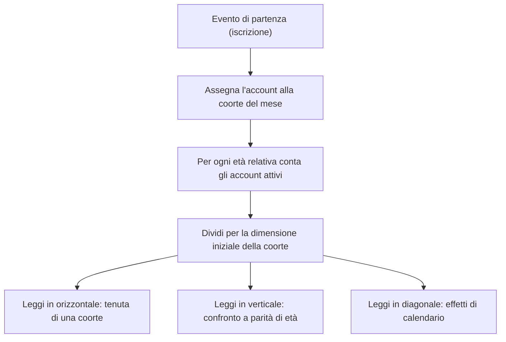

Un software gestionale per studi professionali mostra da dodici mesi un tasso di utilizzo medio del `65%`, e la direzione considera il numero un segno di stabilità. Questo è uno scenario costruito con numeri di esempio: il parco clienti conta `2.000` account, di cui `1.000` acquisiti prima dell'anno in corso e `1.000` entrati negli ultimi tre mesi. Quando l'analista separa i due gruppi, i clienti storici usano il prodotto all'`80%` (`800` account attivi) e le coorti recenti al `50%` (`500` account attivi). La media pesata `(800 + 500) / 2.000 = 65%` è corretta, ma descrive una popolazione che non esiste.

> **Idea chiave:** Un giudizio sulla tenuta del prodotto si dà solo confrontando gruppi omogenei alla stessa età dall'ingresso. La media aggregata mescola anzianità e canali diversi, e quindi nasconde sia i peggioramenti sia i miglioramenti.

## Una media stabile che nasconde due popolazioni

Il problema della media non è un errore di calcolo, è una domanda mal posta. "Quanti account usano il prodotto" ha una risposta diversa per chi è cliente da due anni e per chi è entrato tre settimane fa, perché i secondi sono ancora nella fase in cui molti abbandonano. Aggiungere ogni mese nuovi account abbassa la media senza che il prodotto sia cambiato, e allo stesso modo un mese di sole nuove acquisizioni forti può alzarla.

Per questo servono tre strumenti con tre ruoli distinti, che spesso vengono nominati insieme e confusi. La coorte raggruppa gli account in base a un evento di partenza e a una finestra temporale. Il segmento li divide in base a una caratteristica come canale, settore o dimensione. La baseline fissa il livello di riferimento rispetto al quale si misura una variazione. La tabella li mette a confronto.

| Strumento | Criterio | Domanda a cui risponde | Errore tipico se manca |
|---|---|---|---|
| Coorte | Data di iscrizione o primo evento | Il prodotto trattiene meglio o peggio nel tempo? | Media aggregata dominata dai clienti storici |
| Segmento | Canale, settore, piano, dimensione | Per quale profilo di cliente funziona meglio? | Effetto mix letto come calo di prodotto |
| Baseline | Media su settimane ordinarie comparabili | Questa variazione supera il rumore normale? | Reagire a oscillazioni casuali |
| Età relativa | Giorni o settimane dal giorno zero | Come si comportano due coorti alla settimana 1? | Confronto tra periodi di maturazione diversi |

## Come si costruisce la matrice di coorte

La matrice di coorte ha le coorti di ingresso sulle righe, dalla più vecchia in alto alla più recente in basso, e l'età relativa sulle colonne: settimana 0, settimana 1, settimana 4, settimana 8. La cella contiene la quota della coorte ancora attiva a quell'età. La regola che definisce la coorte deve essere stabile: se oggi si assegna un account alla coorte di marzo per la data di iscrizione e domani per la data del primo accesso, le righe non sono più confrontabili.



Ogni direzione di lettura risponde a una domanda diversa. In orizzontale si vede quanto in fretta una coorte perde account dopo il primo contatto. In verticale, lungo la stessa colonna, si confrontano coorti diverse alla stessa età: è qui che si capisce se i rilasci di prodotto stanno migliorando la tenuta. In diagonale compaiono gli eventi che colpiscono tutte le coorti nello stesso periodo, come un aggiornamento normativo o un disservizio. Ogni cella percentuale va accompagnata dalla dimensione assoluta della coorte, perché un `50%` su dieci account non pesa come un `50%` su mille.

Nel nostro scenario le tre coorti recenti hanno queste dimensioni e questi tassi di utilizzo alla settimana 1.

| Coorte | Account iniziali | Attivi a settimana 1 | Tasso |
|---|---|---|---|
| Gennaio | 400 | 282 | 70,5% |
| Febbraio | 350 | 243 | 69,4% |
| Marzo | 250 | 150 | 60,0% |

Marzo perde `9,4 pp` rispetto a febbraio. Il riflesso naturale è pensare a un peggioramento del prodotto o dell'onboarding, ma una decisione presa su questa riga sarebbe prematura: manca la scomposizione per canale.

## Quanto del calo è effetto mix: derivazione svolta

I dati per canale mostrano che l'acquisizione organica (passaparola e referral) ha un tasso alla settimana 1 del `78%`, e l'acquisizione da social a pagamento del `48%`, e che questi due tassi sono rimasti identici in tutti e tre i mesi. Cambia invece la composizione. A gennaio gli account organici sono `300` su `400`, cioè il `75%`. A febbraio sono `250` su `350`, il `71,4%`. A marzo, per effetto di una campagna social, sono `100` su `250`, il `40%`.

Si ricostruiscono gli attivi di marzo canale per canale. Organici: `100 × 0,78 = 78` account attivi. Social: `150 × 0,48 = 72` account attivi. Il totale è `78 + 72 = 150`, che su `250` dà il `60,0%` della tabella: il dato torna.

Ora la domanda controfattuale: quale tasso avrebbe avuto marzo con la composizione di febbraio? Con il `71,4%` di organici e il `28,6%` di social il tasso atteso è `0,714 × 78 + 0,286 × 48 = 55,7 + 13,7 = 69,4%`. Questo è esattamente il tasso di febbraio, come deve essere se i tassi di canale non sono cambiati. Quindi la differenza tra il `69,4%` atteso e il `60,0%` osservato, pari a `9,4 pp`, è interamente effetto mix. La variazione interna ai canali è `0 pp`: il prodotto non è peggiorato, è cambiato chi entra.

La decisione operativa cambia di conseguenza. Rivedere onboarding o prezzo non risolverebbe nulla, perché il problema, se esiste, è la qualità di un canale di acquisizione. Il passaggio da valutare è se il costo di un account social, che si attiva meno della metà delle volte, sia sostenibile rispetto al valore che genera.

## La baseline: media e fascia di oscillazione normale

Per capire se una variazione è rumore serve un riferimento. La baseline si costruisce su settimane ordinarie comparabili, almeno otto, evitando periodi anomali come il Black Friday o le chiusure di agosto. Prendiamo il tasso settimanale alla settimana 1 dei soli account organici in otto settimane pulite: `77, 79, 78, 78, 77, 79, 78, 78` per cento.

La somma è `624` e la media è `624 / 8 = 78,0%`. Gli scarti dalla media sono `−1, +1, 0, 0, −1, +1, 0, 0`, i cui quadrati sommano `4`. La varianza campionaria è `4 / 7 = 0,571` e la deviazione standard `0,76 pp`. Una fascia di oscillazione normale pari a media più o meno due deviazioni standard va da circa `76,5%` a `79,5%`.

Con questa fascia una lettura di `77%` in una settimana è rumore e non richiede alcuna azione, mentre una lettura di `74%` esce dalla fascia di circa `2,5 pp` e giustifica un'indagine, magari un bug tecnico o un rilascio. Senza baseline entrambe le letture sarebbero soltanto "un po' meno" e "un po' meno ancora".

## Replica in Python

Lo script riproduce la scomposizione mix per la coorte di marzo e la fascia della baseline. In produzione i conteggi arriverebbero da una query sulla tabella delle attività, raggruppata per coorte e canale.

```python
# Scomposizione effetto mix e baseline (numeri di esempio)
import statistics as st

tassi = {"organico": 0.78, "social": 0.48}   # costanti nei tre mesi
feb = {"organico": 250, "social": 100}
mar = {"organico": 100, "social": 150}

def tasso_coorte(comp):
    attivi = sum(comp[c] * tassi[c] for c in comp)
    return attivi / sum(comp.values())

print(f"febbraio: {tasso_coorte(feb) * 100:.1f}%")
print(f"marzo: {tasso_coorte(mar) * 100:.1f}%")

# effetto mix: marzo con la composizione di febbraio
quota_org_feb = feb["organico"] / sum(feb.values())
mar_con_mix_feb = {"organico": 250 * quota_org_feb, "social": 250 * (1 - quota_org_feb)}
print(f"marzo a mix di febbraio: {tasso_coorte(mar_con_mix_feb) * 100:.1f}%")

# baseline su otto settimane ordinarie
base = [77, 79, 78, 78, 77, 79, 78, 78]
media, sd = st.mean(base), st.stdev(base)
print(f"baseline: {media:.1f}%, fascia {media - 2 * sd:.1f} - {media + 2 * sd:.1f}")
```

Il risultato è `69,4%` per febbraio, `60,0%` per marzo, `69,4%` per marzo a mix di febbraio e una fascia di baseline tra `76,5%` e `79,5%`. Se i numeri su dati reali non tornano così, controlla prima la definizione di coorte e quella di attivo.

## Stagionalità italiana e cicli del B2B

Nel mercato italiano agosto, le festività natalizie e le scadenze fiscali trimestrali alterano il comportamento delle coorti, in particolare nel software gestionale. Una coorte entrata a fine luglio mostra quasi sempre un rallentamento alla seconda settimana perché gli studi dei clienti chiudono per ferie. Letto senza contesto, sembra un problema di onboarding.

Due difese pratiche. La prima è confrontare le coorti stagionali con le stesse settimane dell'anno precedente invece che con la coorte del mese prima. La seconda è definire l'attività su giorni lavorativi effettivi e non su giorni di calendario, così che una settimana di ferie non conti come settimana di abbandono. In entrambi i casi la baseline estiva va tenuta separata da quella ordinaria.

## Tre errori che falsano coorti e baseline

### Decidere su coorti giovani o piccole

Il sintomo è un cambio di prezzo o di onboarding deciso perché la coorte entrata tre giorni fa converte il `10%` sotto la media storica. Succede perché la coorte recente non ha ancora completato la finestra di maturazione e ha volumi bassi, quindi il dato oscilla molto. La correzione è monitorarla per bug evidenti e decidere solo su coorti mature con volume sufficiente.

### Scambiare un cambio di mix per un calo di prodotto

Il sintomo è la riga di marzo della tabella sopra: un calo di `9,4 pp` che porta a rivedere il prodotto. Succede perché la media aggregata non mostra la composizione. Si evita segmentando sempre la coorte per canale prima di cercare cause dentro il prodotto.

### Costruire la baseline su un periodo anomalo

Il sintomo è una baseline troppo alta o troppo bassa, per cui ogni settimana normale sembra un problema o un successo. Succede quando si usa la settimana di una promozione o quella di Ferragosto come riferimento. Si corregge scegliendo almeno otto settimane ordinarie e annotando le eccezioni.

## Verifica su coorti, segmenti e baseline

1. Una coorte di `200` account ha `130` attivi alla settimana 1, un'altra di `500` ne ha `310`. Quale ha la tenuta migliore e il confronto è affidabile?

<details>
<summary>Mostra risposta</summary>

La prima ha `130 / 200 = 65%`, la seconda `310 / 500 = 62%`. La prima è migliore di `3 pp`, ma la coorte più piccola ha un'incertezza maggiore, quindi il confronto va letto con prudenza e con la dimensione assoluta accanto.

</details>

2. Se i tassi di canale restano invariati e il tasso di coorte scende, che cosa è cambiato?

<details>
<summary>Mostra risposta</summary>

La composizione per canale, cioè il mix. Il prodotto non è peggiorato: è cambiato il peso dei canali con tasso più basso, e la scomposizione per canale lo conferma.

</details>

3. La baseline di un indicatore è `78,0%` con deviazione standard `0,76 pp`. Una settimana segna `77,4%`: intervieni?

<details>
<summary>Mostra risposta</summary>

No. La fascia normale è circa `76,5%` - `79,5%` e `77,4%` è dentro: è rumore. Reagire a letture del genere porta a modificare il prodotto per oscillazioni casuali.

</details>

4. Perché una coorte di fine luglio con un rallentamento alla seconda settimana non va letta come onboarding debole?

<details>
<summary>Mostra risposta</summary>

Perché in agosto gli uffici dei clienti chiudono per ferie e l'attività cala per stagionalità. Il confronto corretto è con le stesse settimane dell'anno precedente o con un'attività definita su giorni lavorativi.

</details>
