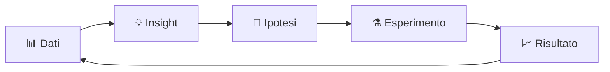

# Generazione di Idee Innovative

> **Obiettivo:** Imparare a trasformare i dati in ipotesi di crescita testabili, usando framework strutturati per la generazione di idee.

## 1. Il Problema: Dati Senza Idee = Paralisi

Avere i dati non basta. La sfida è trasformarli in **ipotesi azionabili**. Molte aziende cadono nella trappola dell'"analysis paralysis": analizzano tutto ma non provano nulla.

Il ciclo virtuoso è: **Dati → Insight → Ipotesi → Esperimento → Risultato → Nuovo dato**



## 2. Framework per la Generazione di Idee

### 2.1 Il Metodo HADI

Il ciclo **HADI** (Hypothesis → Action → Data → Insight) è il framework più usato nelle aziende data-driven:

| Fase | Domanda | Esempio |
|:---|:---|:---|
| **Hypothesis** | Cosa crediamo che succederà? | "Aggiungere social proof aumenterà le conversioni del 15%" |
| **Action** | Cosa facciamo per testarlo? | A/B test: pagina con vs senza recensioni |
| **Data** | Quali dati raccogliamo? | Conversion rate per variante, sample size |
| **Insight** | Cosa abbiamo imparato? | "Le recensioni aumentano del 12% — vicino alla nostra ipotesi" |

### 2.2 ICE Scoring

Per prioritizzare le idee, il framework **ICE** assegna un punteggio 1-10:

```python
def ice_score(impact: int, confidence: int, ease: int) -> float:
    """Calcola il punteggio ICE per prioritizzare le idee."""
    return (impact + confidence + ease) / 3

ideas = [
    {"name": "Aggiungere social proof", "impact": 8, "confidence": 7, "ease": 9},
    {"name": "Redesign checkout", "impact": 9, "confidence": 5, "ease": 3},
    {"name": "Email carrello abbandonato", "impact": 7, "confidence": 8, "ease": 8},
    {"name": "Programma referral", "impact": 9, "confidence": 4, "ease": 4},
]

for idea in sorted(ideas, key=lambda x: ice_score(x['impact'], x['confidence'], x['ease']), reverse=True):
    score = ice_score(idea['impact'], idea['confidence'], idea['ease'])
    print(f"ICE {score:.1f} | {idea['name']}")
```

Output:
```
ICE 8.0 | Aggiungere social proof
ICE 7.7 | Email carrello abbandonato
ICE 5.7 | Redesign checkout
ICE 5.7 | Programma referral
```

### 2.3 La Matrice Impatto/Sforzo

```
    Alto Impatto │
                 │  🏆 Big Bets        ⚡ Quick Wins
                 │  (Alta priorità)    (Parti da qui!)
    ─────────────┼──────────────────────────────────
                 │  🕳️ Sink Holes      📋 Fill-ins
                 │  (Evita)            (Se hai tempo)
    Basso Impatto│
                 └────────────────────────────────→
                   Alto Sforzo          Basso Sforzo
```

## 3. Sorgenti di Idee Basate sui Dati

### Dove Cercare Insight

| Fonte | Tipo di Idea | Esempio |
|:---|:---|:---|
| **Funnel analysis** | Ottimizzazione conversioni | "Il 40% abbandona al checkout → semplifica" |
| **Analisi di coorte** | Retention improvement | "Coorte social ha 2x retention → investi in community" |
| **Heatmaps** | UX/UI improvement | "Nessuno clicca il CTA → cambia posizione/colore" |
| **Customer support** | Pain points ricorrenti | "30% ticket su fatturazione → redesign la sezione" |
| **Competitor analysis** | Feature gap | "Competitor X ha chat live → valuta implementazione" |
| **Search data** | Content/SEO | "500 ricerche/mese per feature che non offriamo" |

```sql
-- Trovare idee dal funnel: dove perdiamo utenti?
SELECT 
    funnel_step,
    COUNT(*) AS users_entered,
    COUNT(*) - LEAD(COUNT(*)) OVER (ORDER BY step_order) AS users_lost,
    ROUND(
        (COUNT(*) - LEAD(COUNT(*)) OVER (ORDER BY step_order)) * 100.0 
        / COUNT(*), 1
    ) AS drop_off_pct
FROM funnel_events
WHERE event_date >= CURRENT_DATE - INTERVAL 30 DAY
GROUP BY funnel_step, step_order
ORDER BY step_order;
```

## 4. Template per Documentare le Idee

```python
idea_template = {
    "id": "IDEA-042",
    "title": "Aggiungere countdown timer al checkout",
    "hypothesis": "Un timer di scarsità aumenterà le conversioni del 10%",
    "ice_score": {"impact": 7, "confidence": 6, "ease": 9, "total": 7.3},
    "data_source": "Funnel analysis mostra 35% drop-off al checkout",
    "test_type": "A/B test",
    "primary_metric": "checkout_completion_rate",
    "guardrail_metric": "refund_rate",  # non deve peggiorare
    "estimated_duration": "2 settimane",
    "owner": "Product Team",
    "status": "backlog"
}
```

## 5. Errori Comuni nella Generazione di Idee

| Errore | Conseguenza | Soluzione |
|:---|:---|:---|
| Idee senza dati di supporto | Sprechi di tempo su intuizioni | Ogni idea deve citare un dato |
| Non definire la metrica di successo | Non sai se ha funzionato | Definisci KPI prima di iniziare |
| Testare troppe cose insieme | Non sai cosa ha causato il risultato | Una variabile alla volta |
| Scartare le idee fallite | Perdi l'apprendimento | Documenta OGNI esperimento |
| Solo idee incrementali | Mai breakthrough | Riserva il 20% a idee "moonshot" |

## Riepilogo

| Concetto | Takeaway |
|:---|:---|
| **Ciclo** | Dati → Insight → Ipotesi → Esperimento → Apprendimento |
| **HADI** | Framework per strutturare le ipotesi |
| **ICE** | Scoring per prioritizzare (Impact, Confidence, Ease) |
| **Fonti** | Funnel, coorti, heatmaps, support, competitor |
| **Documentazione** | Ogni idea va scritta con ipotesi, metrica e owner |

## Risorse

- **Libro:** *Hacking Growth* — Sean Ellis & Morgan Brown
- **Tool:** [GrowthHackers Experiments](https://growthhackers.com) per ispirazione
- **Framework:** North Star Metric + HADI Cycle
