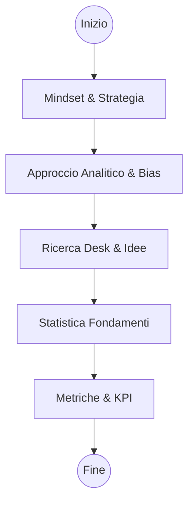

## Panoramica del Modulo

Prima di aprire qualsiasi tool, bisogna saper pensare come un analista. Il modulo **Metriche Fondamentali & Statistica** costruisce la cassetta degli attrezzi mentale necessaria per interpretare i dati correttamente.
Imparerai a distinguere tra causalità e correlazione, a riconoscere i bias che ingannano il cervello umano e a utilizzare la statistica descrittiva per sintetizzare fenomeni complessi. È il modulo "zero" che ogni professionista dei dati dovrebbe padroneggiare.

## Obiettivi di Apprendimento

Al termine di questo modulo sarai in grado di:

- **Riconoscere** i bias cognitivi più comuni (Confirmation Bias, Survivorship Bias) nell'analisi dati.
- **Formulare** ipotesi di business verificabili (Scientific Method).
- **Applicare** la statistica descrittiva (media, mediana, deviazione standard) per riassumere dataset.
- **Progettare** ricerche desk efficaci per trovare benchmark di mercato.
- **Distinguere** le metriche di input (Leading) da quelle di output (Lagging).
- **Strutturare** un processo di generazione idee per il growth hacking.

## Prerequisiti

- Matematica di base (percentuali, proporzioni).
- Nessuna conoscenza di programmazione richiesta.

## Percorso delle Lezioni

| N° | Lezione | Argomento Principale | Durata | Difficoltà |
| :-- | :--- | :--- | :--- | :--- |
| 1 | **Inizio di Successo** | Impostare un progetto dati per vincere | 30 min | ⭐ |
| 2 | **Approccio Analitico** | Decision Making e Bias Cognitivi | 45 min | ⭐⭐ |
| 3 | **Generazione Idee** | Brainstorming strutturato e priorità | 40 min | ⭐⭐ |
| 4 | **Ricerca Desk** | Trovare dati e benchmark affidabili | 35 min | ⭐ |
| 5 | **Statistica Fondamenti** | Media, Mediana e Distribuzioni | 50 min | ⭐⭐⭐ |
| 6 | **Metriche Fondamentali** | KPI, OKR e North Star Metric | 45 min | ⭐⭐ |

## Competenze Acquisite

**Competenze Analitiche:**
- Pensiero critico e scetticismo sano verso i dati.
- Capacità di lettura statistica (capire quando una media "mente").
- Formulazione di domande di business precise.

**Competenze Strategiche:**
- Definizione di KPI che guidano realmente il comportamento (Incentive Design).

## Tempo Stimato

- **Durata Totale:** Circa 4 ore.
- **Tempo Consigliato:** 1 settimana.

## Come Usare Questo Modulo

Non saltare la lezione di **Statistica**. Anche se pensi di saperla ("la media la sanno tutti"), scoprirai che nel business la media è spesso fuorviante e che la mediana o i percentili sono i tuoi veri amici.
Usa la lezione sui **Bias** come una checklist: ogni volta che fai un'analisi, chiediti "Sto cadendo nel bias di conferma?".
