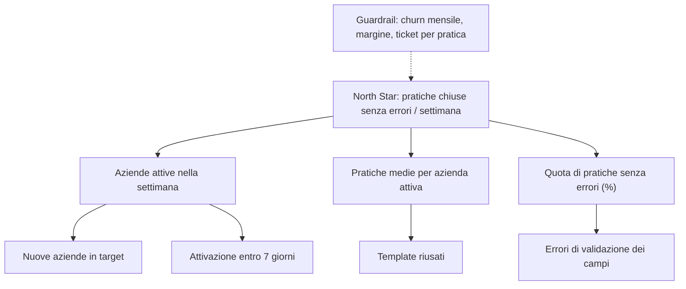

Una piattaforma italiana di firma e gestione documentale per aziende, venduta in abbonamento, sceglie come North Star "gli utenti registrati attivi al mese" (scenario costruito con numeri di esempio). Il contatore compare in ogni presentazione e in sei mesi cresce del 38%. Nello stesso periodo i rinnovi trimestrali scendono dal 91% all'84% e il supporto riceve il doppio dei ticket. Il team marketing, valutato sul contatore, ha comprato traffico gratuito da portali di modulistica: persone che si registrano per scaricare un modello, non aprono mai una pratica e non tornano. La metrica cresce perché misura la porta d'ingresso, non il valore consegnato.

> **Idea chiave:** una North Star Metric è il numero che conta il momento in cui il cliente ottiene davvero ciò per cui paga, e il KPI tree è la scomposizione che dice quale leva muovere per farlo crescere.

## Che cosa rende valida una North Star Metric

Una metrica obiettivo merita il nome di North Star quando supera tre prove. La prima è il valore per il cliente: deve contare un evento in cui il cliente riceve un beneficio osservabile, come una pratica firmata e archiviata senza errori, e non una visita, un'apertura email o una registrazione. La seconda è il legame con i ricavi futuri: se la metrica sale, rinnovi e upgrade devono seguire con un ritardo prevedibile, altrimenti stai ottimizzando un indicatore decorativo. La terza è l'influenza diretta: prodotto, operations e marketing devono poter spostare il numero con il lavoro della settimana, non con un evento esterno come una stagione favorevole.

Ne derivano due proprietà pratiche. Una metrica che non può scendere, come le registrazioni cumulate o i download totali, non rivela mai un problema, perché il totale storico non diminuisce nemmeno se tutti gli utenti abbandonano. Una metrica espressa come tasso su un denominatore che il team controlla, per esempio la percentuale di utenti attivi sul totale dei registrati, si può migliorare restringendo il denominatore senza aiutare nessun cliente. Meglio un conteggio di eventi di valore in una finestra fissa, per esempio le pratiche chiuse senza errori in una settimana, affiancato da guardrail che impediscono di gonfiarlo a scapito della qualità.

Per la piattaforma documentale la scelta ricade su "pratiche chiuse e firmate senza errori a settimana". Il cliente compra proprio questo: un documento che arriva alla firma valida senza rifacimenti. Il conteggio è osservabile nella tabella degli eventi di prodotto, sale quando un cliente usa di più o meglio il servizio e anticipa il rinnovo, perché un cliente che chiude molte pratiche pulite difficilmente cancella l'abbonamento.

| Candidata | Misura valore per il cliente | Può scendere | Anticipa i rinnovi | Verdetto |
|---|---|---|---|---|
| Utenti registrati cumulati | No, conta ingressi | No | Debole | Scartata |
| Utenti registrati attivi al mese | Solo se "attivo" significa login | Sì | Debole | Scartata |
| Aziende con almeno una pratica chiusa nel mese | Sì, ma ignora l'intensità d'uso | Sì | Media | Utile come driver |
| Pratiche chiuse senza errori a settimana | Sì | Sì | Forte | Scelta |

## Scomporre la metrica in un KPI tree

Una North Star da sola indica la direzione ma non dice cosa fare lunedì mattina. Il KPI tree traduce la metrica in un prodotto di driver, ciascuno affidato a un reparto. La scomposizione più utile è moltiplicativa, perché un prodotto permette di calcolare in modo esatto l'effetto di un miglioramento su un driver tenendo fermi gli altri. Per la piattaforma documentale le pratiche pulite settimanali si scrivono come aziende attive nella settimana, moltiplicate per le pratiche medie chiuse da ogni azienda attiva, moltiplicate per la quota di pratiche chiuse senza errori.



L'albero ha due livelli sotto la radice e un solo guardrail trasversale. Questa sobrietà è voluta: un albero con quaranta nodi non governa nulla, perché ogni responsabile trova il numero verde che giustifica il proprio lavoro. Tre o quattro driver principali bastano a coprire acquisizione, intensità d'uso e qualità, e il secondo livello serve solo a rendere attuabile il primo. Ogni nodo riceve un proprietario unico che conosce la formula, la baseline delle ultime otto settimane e la tabella di origine. Se l'attivazione dipende da marketing, prodotto e customer success senza un responsabile finale, quando scende nessuno si sente chiamato a correggerla.

Il vantaggio della forma moltiplicativa si vede quando un driver peggiora e un altro migliora. Il numero complessivo può restare invariato e il grafico della North Star apparire piatto, mentre sotto la superficie l'azienda sta perdendo qualità e compensando con volume. Leggere il livello dei driver, e non solo la radice, è ciò che rende visibile lo scambio.

## Esempio svolto: quale iniziativa muove di più la metrica

Il trimestre inizia con una baseline misurata sulle ultime otto settimane: `480 aziende attive` a settimana, `5,0 pratiche` chiuse in media da ogni azienda attiva e una quota di pratiche senza errori del `90%`. La North Star vale quindi 480 × 5,0 × 0,90 = 2.160 pratiche pulite a settimana (480 × 5,0 = 2.400 pratiche totali, 2.400 × 0,90 = 2.160).

Il team ha tre proposte, ciascuna rivolta a un solo driver e con un costo stimato di sviluppo e media. La proposta A punta a più aziende attive con un'iniziativa commerciale da `18.000 euro` e prevede di portare le aziende attive da 480 a 528, cioè +10%. La proposta B punta alla frequenza d'uso con un'iniziativa di template riutilizzabili da `6.000 euro` e prevede di portare le pratiche per azienda da 5,0 a 5,4, cioè +8%. La proposta C punta alla qualità con una validazione guidata dei campi da `4.000 euro` e prevede di portare la quota senza errori dal 90% al 94%.

Calcoliamo la North Star dopo ciascuna iniziativa, cambiando un solo driver per volta. Con A: 528 × 5,0 × 0,90 = 2.376 pratiche pulite, cioè +216 a settimana rispetto a 2.160. Con B: 480 × 5,4 × 0,90 = 2.332,8 pratiche pulite, cioè +172,8. Con C: 480 × 5,0 × 0,94 = 2.256 pratiche pulite, cioè +96.

L'effetto assoluto premia A, ma il confronto utile è il costo di ogni pratica pulita settimanale guadagnata. A costa 18.000 / 216 = 83,33 euro per ogni pratica settimanale in più. B costa 6.000 / 172,8 = 34,72 euro. C costa 4.000 / 96 = 41,67 euro. La proposta B risulta la più efficiente, più di due volte rispetto ad A, pur muovendo un solo driver per volta e senza richiedere nuovi clienti. La classifica per effetto assoluto e quella per costo unitario non coincidono: serve la seconda per decidere dove spendere il primo euro.

Resta da controllare il prezzo pagato. B potrebbe far salire le pratiche per azienda spingendo notifiche invasive, quindi si affianca il guardrail sui ticket per pratica, con soglia scritta prima a 0,12 ticket per pratica chiusa (baseline 0,10). Se dopo quattro settimane i ticket salgono oltre la soglia, la leva si ferma anche se la North Star è cresciuta.

## Dalla definizione alla query condivisa

Il motivo per cui le metriche derivano nel tempo è che ogni reparto le ricalcola a modo suo: uno esclude gli account interni, un altro li include, un terzo conta le pratiche alla data di creazione anziché alla data di chiusura. La difesa è una definizione unica, scritta come query sulla tabella degli eventi e versionata. Prima ancora di disegnare la dashboard, analisti e responsabili concordano finestra temporale, esclusioni e denominatore.

```sql
-- North Star e driver per settimana (ClickHouse): una sola fonte per tutti i reparti
SELECT
    toStartOfWeek(event_time) AS week,
    uniqExactIf(account_id, event_name = 'practice_signed') AS active_accounts,
    countIf(event_name = 'practice_signed') AS closed_practices,
    countIf(event_name = 'practice_signed' AND validation_errors = 0) AS clean_practices,
    round(closed_practices / active_accounts, 2) AS practices_per_account,
    round(100 * clean_practices / closed_practices, 1) AS clean_rate_pct
FROM product_events
WHERE is_internal = 0          -- esclusione concordata una volta per tutti
  AND event_time >= today() - 56
GROUP BY week
ORDER BY week;
```

La query restituisce in una sola riga per settimana la radice e i tre driver, così nessuno può citare un numero della radice senza che i driver siano visibili accanto. Per valutare una proposta prima di finanziarla basta replicare l'aritmetica dell'esempio svolto in poche righe di codice, utile anche per confrontare molte iniziative alla volta.

```python
# Confronto iniziative: effetto su North Star e costo per unità guadagnata
baseline = {"aziende": 480, "pratiche": 5.0, "qualita": 0.90}
proposte = {
    "A commerciale": ({"aziende": 528}, 18000),
    "B template": ({"pratiche": 5.4}, 6000),
    "C validazione": ({"qualita": 0.94}, 4000),
}

def north_star(d):
    return d["aziende"] * d["pratiche"] * d["qualita"]

base = north_star(baseline)  # 2160.0
for nome, (modifica, costo) in proposte.items():
    nuovo = north_star({**baseline, **modifica})
    guadagno = nuovo - base
    print(f"{nome}: +{guadagno:.1f} pratiche/sett, {costo / guadagno:.2f} euro per unita")
```

L'esecuzione stampa +216,0 e 83,33 per A, +172,8 e 34,72 per B, +96,0 e 41,67 per C, coerenti con il calcolo a mano. Ogni iniziativa entra in roadmap solo dopo aver compilato tre righe: quale nodo dell'albero intende muovere, quale baseline ha oggi e quale soglia minima giustifica il mantenimento della modifica. Il confronto tra proposte diventa allora una discussione su numeri condivisi e non su preferenze personali per una funzione grafica o per una campagna.

## Guardrail e proprietari: chi frena e chi risponde

Un KPI tree senza freni invita a spremere il driver più facile. Per ogni North Star servono almeno un guardrail economico, come il margine di contribuzione o il costo di supporto per pratica, e uno di qualità, come il churn mensile o il tasso di disdetta entro trenta giorni. Le soglie si scrivono prima di leggere i risultati, perché a posteriori ogni scostamento trova una giustificazione. La lezione successiva del modulo tratta guardrail e counter-metric nel dettaglio; qui basta fissare il principio che una metrica obiettivo e i suoi freni vivono nella stessa tabella e nello stesso report.

La responsabilità si assegna per nodo, non per riunione. Il responsabile dell'attivazione conosce la baseline a sette giorni, il responsabile della qualità conosce il tasso di errori di validazione e ciascuno propone interventi solo sul proprio nodo. Quando due reparti vogliono muovere lo stesso driver, si decide chi ne è proprietario e l'altro lavora come contributore su un'iniziativa dichiarata. Questa regola sembra burocratica finché un driver crolla e nessuno lo aveva in carico.

## Tre errori che svuotano il KPI tree

### Scegliere una metrica di vanità scollegata dal valore

Il sintomo è un grafico che sale sempre, anche nei mesi in cui i clienti se ne vanno. Succede perché le metriche cumulative e di traffico sono facili da misurare e piacciono nelle presentazioni, e perché nessuno ha mai chiesto che cosa deve fare il cliente perché il numero salga. Si corregge sostituendo il contatore con un conteggio di eventi di valore in una finestra mobile e verificando a posteriori che, nei trimestri passati, i valori alti abbiano preceduto rinnovi alti.

### Creare alberi con trenta rami impossibili da governare

Il sintomo è una dashboard con quaranta indicatori in cui ogni reparto cita solo quelli verdi. Succede perché aggiungere un nodo costa poco e toglierlo sembra un'ammissione di errore. Si corregge limitando l'albero a due livelli e a tre o quattro driver principali, e richiedendo che ogni nuovo nodo sostituisca uno esistente oppure dimostri di spiegare una variazione della radice che i nodi attuali non spiegano.

### Assegnare lo stesso driver a tre reparti senza un proprietario

Il sintomo è uno scaricabarile quando il driver scende: marketing indica il prodotto, il prodotto indica il supporto. Succede perché i driver reali attraversano più reparti e la collaborazione sembra una buona ragione per non nominare un responsabile. Si corregge scrivendo accanto a ogni nodo un nome e una formula, e usando gli altri reparti come contributori di iniziative dichiarate con soglia di successo.

## Aziende multi-prodotto e cicli di vendita lunghi

Quando la stessa azienda vende un modulo ad alto volume e basso margine e una suite enterprise con contratti annuali, un'unica North Star appiattisce realtà incompatibili. Contare allo stesso modo le pratiche del modulo di base e quelle della suite significa premiare il volume e penalizzare il segmento che porta più margine. La soluzione è tenere a livello di direzione una metrica finanziaria di sintesi, tipicamente il margine di contribuzione netto ricorrente, e costruire un KPI tree dedicato a ciascuna linea omogenea per clientela e margine.

Nei cicli lunghi, dove un contratto richiede mesi, l'evento di valore arriva troppo tardi per guidare le decisioni settimanali. Si affianca allora un indicatore anticipatore osservabile entro pochi giorni, come il numero di aziende che completano la prima pratica nei primi sette giorni dopo la firma del contratto, e si verifica storicamente che predica il valore tardivo. Il KPI tree va rivisto ogni sei mesi, perché il collo di bottiglia si sposta: un'azienda che ieri aveva un problema di acquisizione oggi può averne uno di attivazione, e un albero scritto per il problema vecchio spinge a investire nel posto sbagliato.

## Verifica sul tuo albero delle metriche

1. Nella tua azienda il contatore principale può scendere, e che cosa deve fare un cliente perché salga?

<details>
<summary>Mostra risposta</summary>

Se non può scendere, come le registrazioni cumulate, nasconde ogni abbandono e non è una North Star. Deve salire solo quando il cliente compie un'azione di valore, per esempio chiudere una pratica senza errori, e deve essere un conteggio in finestra fissa come le pratiche pulite a settimana.

</details>

2. Con 400 aziende attive, 6,0 pratiche per azienda e quota pulita dell'85%, quante pratiche pulite settimanali hai, e quanto guadagni portando la quota al 90% a parità degli altri driver?

<details>
<summary>Mostra risposta</summary>

Baseline: 400 × 6,0 × 0,85 = 2.040 pratiche pulite. Con quota 90%: 400 × 6,0 × 0,90 = 2.160 pratiche, quindi +120 pratiche a settimana. Se il lavoro costa 3.000 euro, il costo è 3.000 / 120 = 25 euro per ogni pratica settimanale guadagnata.

</details>

3. Due iniziative muovono lo stesso driver, una costa 10.000 euro per +50 unità e l'altra 6.000 euro per +40: quale scegli e perché il confronto per effetto assoluto è fuorviante?

<details>
<summary>Mostra risposta</summary>

La prima costa 10.000 / 50 = 200 euro per unità, la seconda 6.000 / 40 = 150 euro per unità. Scegli la seconda: l'effetto assoluto premia la prima, ma l'obiettivo è il costo di ogni unità guadagnata, e con lo stesso budget la seconda rende di più.

</details>

4. Perché la soglia di un guardrail va scritta prima di leggere i risultati e chi ha l'autorità di fermare l'iniziativa?

<details>
<summary>Mostra risposta</summary>

A posteriori ogni peggioramento trova una giustificazione, e la soglia diventa elastica. Scritta prima e firmata dal proprietario del nodo, trasforma lo scostamento in una decisione già presa. Il potere di fermare l'iniziativa va assegnato per nome prima del lancio, altrimenti nessuno si sente autorizzato a farlo.

</details>
