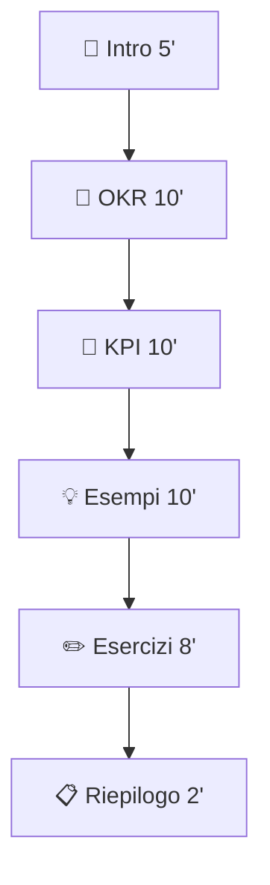
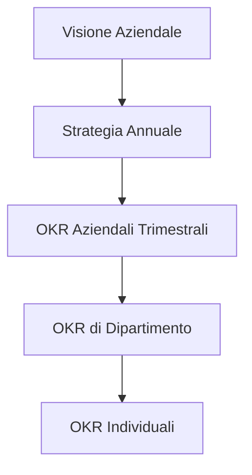
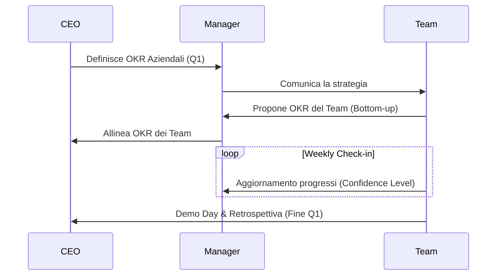

## OKR e KPI — Lezione Completa

La capacità di misurare il successo e allineare un'intera organizzazione verso obiettivi comuni è ciò che distingue le aziende che scalano da quelle che ristagnano. In questa lezione, esploreremo due dei framework più potenti per la gestione delle performance: gli OKR (Objectives and Key Results) e i KPI (Key Performance Indicators).

### Obiettivi di Apprendimento

Al termine di questa lezione, lo studente sarà in grado di:
1.  Distinguere chiaramente tra OKR (obiettivi strategici) e KPI (metriche operative).
2.  Definire OKR efficaci che siano ambiziosi ma raggiungibili.
3.  Selezionare i KPI corretti per monitorare la salute del business ed evitare le "Vanity Metrics".
4.  Implementare un ciclo di feedback trimestrale per la revisione degli obiettivi.
5.  Allineare gli obiettivi individuali con la strategia aziendale (Cascading).

### Timeline della Lezione

| Fase | Argomento | Durata |
|------|-----------|--------|
| 1 | Introduzione: Strategia vs Esecuzione | 5 min |
| 2 | Teoria: Il Framework OKR | 10 min |
| 3 | Teoria: I KPI e le Metriche | 10 min |
| 4 | Esempi Pratici: OKR vs KPI | 10 min |
| 5 | Esercizi Guidati: Scrittura OKR | 8 min |
| 6 | Riepilogo e Domande | 2 min |
| **Totale** | | **45 min** |

### Fase 1 — Introduzione: Strategia vs Esecuzione (5 min)

Molte aziende falliscono non perché manchino di idee, ma perché mancano di **focus**. Senza un sistema chiaro per definire cosa è importante, le risorse vengono disperse in mille direzioni.

La strategia è l'arte di dire "no" a mille buone idee per concentrarsi sull'unica idea vincente. Ma come si traduce questa strategia in azione quotidiana? Qui entrano in gioco gli OKR e i KPI.

Gli **OKR** sono il "GPS" che ti dice dove vuoi andare (l'Obiettivo) e se sei sulla strada giusta (i Risultati Chiave). Sono orientati al cambiamento e alla crescita.
I **KPI** sono il "cruscotto" dell'auto (tachimetro, livello benzina) che ti dice se il motore sta girando bene. Sono orientati alla stabilità e alla salute del business.

### Fase 2 — Teoria: Il Framework OKR (10 min)

Gli OKR (Objectives and Key Results) sono stati resi famosi da John Doerr in Intel e poi adottati da Google, LinkedIn, Spotify e molte altre tech company. Si compongono di due parti:

1.  **Objective (O):** *Cosa* vogliamo raggiungere?
    *   Deve essere **qualitativo**, **ispirante**, **concreto** e **orientato all'azione**.
    *   Esempio: "Diventare l'app di riferimento per la musica in streaming in Europa".

2.  **Key Results (KR):** *Come* misuriamo se ci siamo riusciti?
    *   Devono essere **quantitativi**, **misurabili**, **limitati nel tempo** (spesso trimestrali) e **difficili** (target stretch).
    *   Esempio: "Raggiungere 1 milione di utenti attivi mensili (MAU)".

**Caratteristiche degli OKR efficaci:**
*   **Ambiziosi:** Un buon OKR dovrebbe avere il 60-70% di probabilità di successo. Se li raggiungi sempre al 100%, sono troppo facili (sandbagging).
*   **Pubblici:** Tutti in azienda devono poter vedere gli OKR di tutti, dal CEO allo stagista, per garantire allineamento.
*   **Focalizzati:** Massimo 3-5 Obiettivi per ciclo, con 3-5 KR ciascuno.

### Fase 3 — Teoria: I KPI e le Metriche (10 min)

Mentre gli OKR guidano il cambiamento ("Vogliamo crescere del 50%"), i KPI (Key Performance Indicators) monitorano lo "status quo" o la salute operativa ("Il sito è online? I clienti pagano?").

Un KPI è una metrica che è stata eletta a "indicatore chiave". Non tutte le metriche sono KPI.
*   **Metrica:** Numero di visitatori al sito oggi.
*   **KPI:** Tasso di conversione dei visitatori in lead qualificati.

**La Stella Polare (North Star Metric)**
Ogni prodotto dovrebbe avere una *North Star Metric* che cattura il valore fondamentale che il prodotto offre al cliente.
*   **Spotify:** Tempo di ascolto (non numero di iscritti).
*   **Airbnb:** Notti prenotate.
*   **Facebook:** Utenti attivi giornalieri.

**Vanity Metrics vs Actionable Metrics**
Il pericolo più grande per un analista è concentrarsi sulle *Vanity Metrics*: numeri che ti fanno sentire bene ma non correlano con il successo del business.

| Vanity Metric | Actionable Metric | Perché? |
| :--- | :--- | :--- |
| **Page Views** | **Bounce Rate** / **Time on Page** | Le visualizzazioni non dicono se l'utente ha letto. |
| **Numero di iscritti** | **Utenti Attivi (DAU/MAU)** | Gli iscritti morti non pagano. |
| **Download App** | **Retention Rate** | Scaricare è facile, usare l'app è difficile. |
| **Like sui Social** | **Click-Through Rate (CTR)** | I like non pagano le bollette, i click portano traffico. |

### Fase 4 — Esempi Pratici e Casi Studio (10 min)

Analizziamo come una startup SaaS B2B potrebbe strutturare i propri OKR e KPI.

**Scenario:** "SaaS-Logistica", un software per la gestione dei magazzini.

#### Esempio 1: OKR per la Crescita (Growth Team)

**Objective:** Dominare il mercato delle PMI nel Nord Italia.
*   **KR 1:** Acquisire 50 nuovi clienti paganti dal Nord Italia entro il Q3.
*   **KR 2:** Aumentare il traffico organico al blog del 40% tramite SEO locale.
*   **KR 3:** Ridurre il Costo di Acquisizione Cliente (CAC) da 500€ a 350€.

#### Esempio 2: OKR per il Prodotto (Product Team)

**Objective:** Rendere l'esperienza utente "senza attrito" (frictionless).
*   **KR 1:** Ridurre il tempo medio di onboarding da 3 giorni a 4 ore.
*   **KR 2:** Aumentare il punteggio NPS (Net Promoter Score) da 30 a 50.
*   **KR 3:** Lanciare la nuova feature di "scansione barcode via mobile" con almeno 100 utenti attivi.

#### Confronto KPI

Contemporaneamente, l'azienda monitora i seguenti KPI di salute (Health Metrics):
*   **Uptime del server:** Deve essere > 99.9%. (Se scende, diventa un'emergenza, ma non è un OKR strategico "cambiare l'uptime" a meno che non sia disastroso).
*   **Churn Rate:** Tasso di abbandono mensile.
*   **Cash Flow:** Liquidità disponibile.

### Fase 5 — Esercizi Guidati (8 min)

**Esercizio 1: Trasformare un desiderio in OKR**
*   *Desiderio:* "Voglio che il nostro blog sia più popolare."
*   *Consegna:* Trasforma questo desiderio in un Objective e 3 Key Results misurabili.

**Esercizio 2: Identificare la Vanity Metric**
*   *Scenario:* Un e-commerce riporta: "Abbiamo 100.000 visitatori al mese e 50.000 iscritti alla newsletter!" Ma le vendite sono ferme.
*   *Consegna:* Quali metriche (KPI) dovrebbero guardare invece di visitatori e iscritti? Elencane almeno 3.

**Esercizio 3: Definire la North Star Metric**
*   *Scenario:* Stai lanciando un'app di meditazione in abbonamento.
*   *Consegna:* Qual è la tua North Star Metric? (Suggerimento: non è il fatturato).

### Fase 6 — Riepilogo e Domande (2 min)

Per chiudere, ricordiamo i punti fondamentali:

1.  **OKR = Cambiamento.** Usali per spingere l'azienda in una nuova direzione.
2.  **KPI = Salute.** Usali per assicurarti che l'azienda non stia "morendo" mentre corre.
3.  **Less is More.** Non avere più di 3-5 OKR. Se tutto è priorità, nulla è priorità.
4.  **Outcome, non Output.** Misura il risultato (es. "aumento soddisfazione"), non l'attività (es. "rilasciata nuova feature").
5.  **Trasparenza.** Condividi i numeri con tutti.

### Domande di Verifica

1.  Qual è la differenza principale tra un "Output" e un "Outcome" in un Key Result?
2.  Perché Google suggerisce che un raggiungimento del 70% di un OKR è considerato un successo?
3.  Cos'è una "Vanity Metric" e puoi farne un esempio nel contesto dei Social Media?
4.  Come si relazionano gli OKR aziendali con quelli individuali nel processo di "Cascading"?
5.  In che modo la "North Star Metric" differisce da un normale KPI di fatturato?

### Riferimenti Bibliografici

-   John Doerr, "Measure What Matters: How Google, Bono, and the Gates Foundation Rock the World with OKRs", Penguin, 2018.
-   Andrew Grove, "High Output Management", Vintage, 1995.
-   Alistair Croll & Benjamin Yoskovitz, "Lean Analytics: Use Data to Build a Better Startup Faster", O'Reilly Media, 2013.
