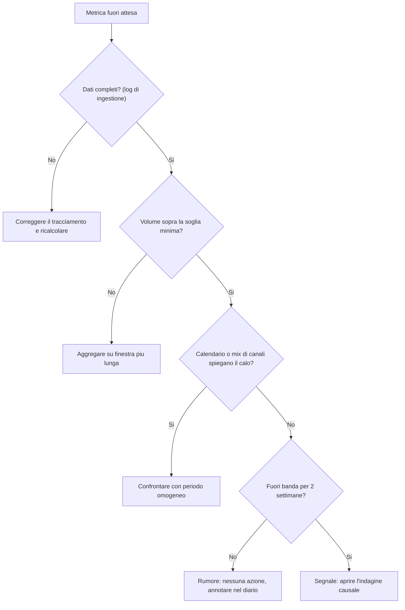

Un lunedì mattina le richieste di preventivo di un marketplace B2B italiano scendono del 18% rispetto al venerdì precedente (scenario costruito con numeri di esempio). La direzione convoca una riunione urgente, cambia i testi della pagina principale e alza le offerte pubblicitarie. Tre giorni dopo qualcuno si accorge che il lunedì era un ponte festivo regionale, che il giorno comparabile della settimana prima era normale e che la media mobile delle ultime otto settimane non si era mossa. Il costo della reazione, tra ore di lavoro e budget spostato, ha superato di molto il danno che si voleva evitare, perché il danno non esisteva.

> **Idea chiave:** ogni metrica oscilla per caso e per calendario; si interviene solo quando il movimento esce dalla banda normale, con volume sufficiente e persistenza, secondo una soglia scritta prima di aprire la dashboard.

## Che cosa significa variazione normale

Ogni processo aziendale ha una variabilità propria. Le richieste di preventivo dipendono dal giorno della settimana, dai cicli di fatturazione di fine mese, dalle ferie, dal meteo e, soprattutto, dal fatto che sono eventi discreti: anche con un mercato perfettamente stabile, il numero di richieste di un giorno non è mai identico a quello del giorno prima. Questa oscillazione casuale è il rumore. Il segnale è un cambiamento strutturale, come una modifica al prezzo, un bug nel modulo di contatto o l'ingresso di un concorrente, che sposta il livello medio e persiste.

Per separare i due servono quattro riferimenti. Primo, una baseline di almeno otto settimane ordinarie, da cui ricavare media e dispersione. Secondo, il volume assoluto: una percentuale calcolata su pochi eventi è instabile per costruzione. Terzo, il confronto omogeneo, cioè lo stesso giorno della settimana e un calendario comparabile. Quarto, una soglia di scostamento definita prima di leggere i dati, altrimenti la soglia si adatta al numero che si vuole giustificare.

| Fattore di controllo | Domanda diagnostica | Falso allarme tipico | Regola operativa |
|---|---|---|---|
| Banda storica (8 settimane) | Il valore esce dall'intervallo normale? | Calo del 12% dentro oscillazione tipica di 15% | Intervenire solo fuori banda |
| Volume assoluto | Quanti eventi compongono la percentuale? | Meno 50% passando da 8 a 4 ordini | Non reagire sotto una soglia minima di eventi |
| Calendario | C'è una festività, un ponte, una fine mese? | Calo del 25 aprile o a metà agosto | Confrontare con un periodo omogeneo |
| Persistenza | Il movimento dura più di un periodo? | Picco di 24 ore poi rientrato | Richiedere almeno 2 settimane o 3 giorni consecutivi |
| Tracciamento | I dati sono arrivati completi? | Ritardo di ingestione del tag | Controllare i log tecnici prima di indagare |

## Una procedura in cinque passi prima di agire

Il valore pratico della banda sta nell'ordine con cui si usano i controlli. Si parte dal più economico, il tracciamento, perché un buco di dati spiega moltissime anomalie e non richiede alcuna ipotesi sul business. Poi si controlla il volume, poi il calendario, poi il mix dei canali e solo alla fine si confronta il valore con la banda e con la persistenza. Se un controllo precedente spiega il movimento, gli altri non servono.



Questa sequenza è anche una difesa contro la tentazione di raccontare storie. La mente umana produce spiegazioni plausibili per qualsiasi numero: se martedì le vendite salgono si loda il post del lunedì, se mercoledì scendono si incolpa il meteo. Un protocollo scritto impedisce di scegliere la storia più comoda e obbliga a escludere prima le cause banali.

## Esempio svolto: la banda su otto settimane e il lunedì del ponte

Riprendiamo il marketplace. Le richieste di preventivo settimanali delle ultime otto settimane ordinarie sono: 212, 198, 225, 207, 219, 201, 214, 204. La somma è 212 + 198 + 225 + 207 + 219 + 201 + 214 + 204 = 1.680 richieste, quindi la media è 1.680 / 8 = 210 richieste a settimana.

Per misurare la dispersione calcoliamo gli scarti dalla media: +2, -12, +15, -3, +9, -9, +4, -6. I quadrati sono 4, 144, 225, 9, 81, 81, 16, 36 e la loro somma vale 596. La varianza campionaria è 596 / 7 = 85,14 e la deviazione standard è circa 9,23 richieste. Fissiamo la banda di oscillazione normale a due deviazioni standard dalla media: 210 ± 2 × 9,23 = 210 ± 18,5, cioè da 191,5 a 228,5 richieste a settimana. Questa regola è scritta prima di leggere le settimane nuove.

Le settimane successive danno 196, 184 e 181 richieste. La prima, 196, è sotto la media del 6,7% (14 / 210) ma dentro la banda: rumore. La seconda, 184, è fuori banda, con un calo del 12,4% (26 / 210). La terza, 181, è di nuovo fuori banda, con un calo del 13,8%. Due settimane consecutive fuori banda soddisfano la regola di persistenza: da questo punto si apre un'indagine, e il candidato da escludere per primo è un cambio di mix o un guasto del modulo di contatto.

Ora il lunedì dell'allarme. Con una media storica di 36,6 richieste nei lunedì ordinari, il lunedì del ponte registra 30 richieste, il 18% in meno (30 / 36,6 = 0,82). Per eventi di conteggio la variabilità attesa è circa la radice della media: √36,6 = 6,05 richieste. Lo scarto osservato è 36,6 - 30 = 6,6 richieste, cioè 6,6 / 6,05 = 1,09 deviazioni standard. Uno scarto di circa una deviazione standard capita in quasi un terzo dei giorni per solo effetto del caso: il calo del 18% è rumore, ed è per di più confuso dal ponte festivo. La percentuale era spettacolare, il numero assoluto era banale.

## La stessa regola in SQL e Python

La banda si calcola in automatico, così nessuno la rifà a mano con criteri diversi ogni settimana. La query seguente, scritta in ClickHouse, calcola per ogni settimana la media e la deviazione standard delle otto settimane precedenti, esclusa quella corrente, e segnala se il valore esce dalla banda.

```sql
-- Banda di oscillazione a 2 deviazioni standard sulle 8 settimane precedenti
WITH weekly AS (
    SELECT toStartOfWeek(day) AS week, sum(leads_count) AS leads
    FROM daily_leads
    WHERE day >= today() - 140
    GROUP BY week
)
SELECT
    week,
    leads,
    round(avg(leads) OVER w, 1) AS baseline_8w,
    round(stddevSamp(leads) OVER w, 1) AS sd_8w,
    leads < baseline_8w - 2 * sd_8w AS sotto_banda,
    leads > baseline_8w + 2 * sd_8w AS sopra_banda
FROM weekly
WINDOW w AS (ORDER BY week ROWS BETWEEN 8 PRECEDING AND 1 PRECEDING)
ORDER BY week;
```

La verifica a mano dell'esempio si replica in poche righe di Python, utile per tarare la soglia su dati storici.

```python
import statistics as st

storico = [212, 198, 225, 207, 219, 201, 214, 204]
media = st.mean(storico)           # 210
sd = st.stdev(storico)             # 9.23, deviazione standard campionaria
banda = (media - 2 * sd, media + 2 * sd)
print(f"banda: {banda[0]:.1f} - {banda[1]:.1f}")

for settimana in [196, 184, 181]:
    fuori = settimana < banda[0] or settimana > banda[1]
    print(settimana, "fuori banda" if fuori else "dentro banda")
```

La seconda parte importante riguarda la scelta di quante deviazioni usare. Con due deviazioni standard, in una serie stabile circa una settimana su venti esce dalla banda per puro caso; richiedere due settimane consecutive abbassa molto la probabilità di un falso allarme, a costo di reagire con una settimana di ritardo. Il compromesso va deciso in base al danno: per un guasto del pagamento si accetta una soglia più sensibile, per un testo di una pagina si accetta di aspettare.

## Volume, calendario e mix: i tre controlli che spiegano quasi tutto

Il volume governa la rumorosità. Poiché la deviazione attesa di un conteggio è circa la sua radice, la variazione percentuale tipica è 1 diviso la radice del volume: con 36 richieste è circa 17%, con 3.600 richieste è circa 1,7%. Lo stesso scostamento in punti percentuali ha quindi un significato opposto a seconda della scala, e un team che confronta indicatori con volumi diversi con la stessa soglia percentuale reagirà troppo ai piccoli e troppo poco ai grandi.

Il calendario produce movimenti prevedibili che non hanno nulla a che vedere con il prodotto. Nel B2B italiano il sabato e la domenica sono bassi, la settimana di Ferragosto è quasi vuota, il 25 aprile e il primo maggio ricadono in settimane accorciate e a fine mese le aziende chiudono i budget. Si confrontano quindi giorni omogenei e, per le festività mobili, si annota nel diario degli eventi la data di ogni ponte.

Il mix descrive chi entra nel sistema. Se in una settimana parte una campagna con traffico ampio e poco qualificato, il tasso di conversione complessivo scende anche se ciascun canale converte come prima: è l'effetto di composizione, non un peggioramento. Prima di attribuire un calo al prodotto, la metrica va spezzata per canale e per segmento e si controlla se ogni parte è stabile e cambia solo il peso relativo.

## Tre errori che generano falsi allarmi continui

### Guardare grafici con l'asse verticale tagliato

Il sintomo è una curva che sembra crollare quando il valore passa dal 3,2% al 3,1%. Succede perché molti strumenti scelgono l'asse minimo per riempire lo spazio, e l'occhio legge la pendenza e non i numeri. Si corregge fissando l'asse a zero per i conteggi, scrivendo sempre il valore assoluto accanto alla variazione e disegnando la banda normale come fascia grigia nel grafico, in modo che l'oscillazione tipica sia visibile.

### Confrontare giorni o periodi non omogenei

Il sintomo è un lunedì paragonato alla domenica o una settimana di quattro giorni lavorativi paragonata a una di cinque. Succede perché il confronto con il periodo immediatamente precedente è il più comodo da calcolare. Si corregge confrontando lo stesso giorno della settimana, la stessa settimana dell'anno precedente quando esiste un ciclo annuale e, nelle settimane con festività, normalizzando per giorno lavorativo.

### Cercare una causa per ogni oscillazione

Il sintomo è una riunione dedicata a spiegare un movimento che rientra nella banda. Succede perché una spiegazione dà sollievo e la parola "caso" appare una resa. Si corregge accettando che una quota di variabilità non ha una causa nominabile, fissando in anticipo quanti scostamenti dentro banda meritano indagine, cioè nessuno, e tenendo un registro: se un movimento dentro banda si ripete per due settimane diventa un candidato segnale.

## Piccoli volumi nel B2B: quando le percentuali non servono

Molte aziende B2B italiane lavorano con venti o trenta richieste qualificate al mese e dieci contratti chiusi a trimestre. Con numeri così piccoli le percentuali settimanali oscillano tra meno quaranta e più sessanta per cento per il solo effetto del caso, e una soglia percentuale non ha alcun valore. In questi contesti si abbandona il monitoraggio giornaliero della metrica finale e si usano due strumenti: una media mobile a otto settimane da affiancare al dato corrente e un indicatore anticipatore a volume più alto, come le aziende che completano un passaggio chiave del flusso oppure i tempi medi di risposta commerciale.

Un registro degli eventi interni ed esterni accanto ai grafici fa risparmiare molte ipotesi. Campagne promozionali, modifiche ai prezzi, rilasci tecnici e chiusure stagionali dei clienti si scrivono con la data. Tra tre mesi, quando qualcuno chiederà perché una curva è cambiata in una certa settimana, la risposta sarà già annotata, e la discussione partirà dai fatti e non dalla memoria selettiva dei reparti.

## Verifica sui tuoi falsi allarmi

1. Una serie settimanale ha media 120 richieste e deviazione standard 8: l'ultima settimana vale 100, è un segnale con banda a due deviazioni standard?

<details>
<summary>Mostra risposta</summary>

La banda è 120 ± 16, cioè da 104 a 136. Il valore 100 è sotto il limite inferiore, quindi è fuori banda, con un calo di 20 richieste, pari al 16,7%. Per la regola di persistenza va confermato dalla settimana successiva prima di aprire un'indagine, controllando intanto tracciamento, calendario e mix.

</details>

2. Un giorno registra 16 ordini contro una media di 25: quante deviazioni standard di Poisson dista, e che decisione prendi?

<details>
<summary>Mostra risposta</summary>

Lo scarto è 25 - 16 = 9 ordini, la deviazione attesa è √25 = 5, quindi lo scarto vale 9 / 5 = 1,8 deviazioni standard. È vicino al limite a due ma ancora dentro: si osserva il giorno successivo senza intervenire, perché il calo del 36% su un volume così piccolo è compatibile con il caso.

</details>

3. Il tasso di conversione complessivo scende dal 3,4% al 3,0% ma ogni canale converte come prima: da dove viene il calo?

<details>
<summary>Mostra risposta</summary>

Da un cambio di mix: è salita la quota di traffico dai canali a bassa conversione, per esempio dopo una campagna ampia. Non è un peggioramento del prodotto. Lo si verifica spezzando la metrica per canale e controllando che i tassi interni siano stabili mentre cambiano i pesi.

</details>

4. Perché la soglia di segnale va scritta prima di aprire la dashboard?

<details>
<summary>Mostra risposta</summary>

Perché a posteriori ogni scostamento può essere interpretato come rilevante o irrilevante a seconda della storia che si vuole raccontare. Una soglia scritta in anticipo trasforma la lettura in una regola verificabile e rende confrontabili le decisioni di settimane diverse.

</details>
