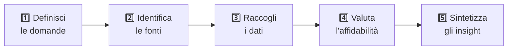

# Ricerca Desk (Desk Research)

> **Obiettivo:** Imparare a raccogliere e analizzare dati già esistenti (fonti secondarie) per prendere decisioni informate prima di investire in ricerche primarie costose.

## 1. Cos'è la Desk Research

La **Desk Research** (ricerca a tavolino) consiste nell'analizzare dati e informazioni **già disponibili** — report di settore, statistiche pubbliche, articoli accademici, dati dei competitor — per rispondere a domande di business senza dover condurre interviste, sondaggi o esperimenti.

### Quando Usarla

| Fase del Progetto | Uso della Desk Research |
|:---|:---|
| **Pre-lancio** | Dimensionamento del mercato (TAM/SAM/SOM) |
| **Analisi competitiva** | Benchmark su pricing, feature, posizionamento |
| **Strategia marketing** | Trend di settore, comportamento del consumatore |
| **Business case** | Dati a supporto di investimenti o nuove feature |
| **Validazione** | Confronto dei propri dati interni con benchmark esterni |

## 2. Fonti Secondarie: La Mappa Completa

### Fonti Gratuite

| Fonte | Tipo di Dati | URL |
|:---|:---|:---|
| **Google Trends** | Trend di ricerca nel tempo | trends.google.com |
| **Statista (free tier)** | Statistiche di mercato | statista.com |
| **ISTAT** | Dati demografici e economici Italia | istat.it |
| **Eurostat** | Dati EU su economia, popolazione | ec.europa.eu/eurostat |
| **SimilarWeb (free)** | Traffico web dei competitor | similarweb.com |
| **Crunchbase** | Funding e dati sulle startup | crunchbase.com |
| **Google Scholar** | Paper accademici | scholar.google.com |
| **SEMrush (free tier)** | Keyword e traffico organico | semrush.com |

### Fonti a Pagamento (Premium)

| Fonte | Specializzazione | Prezzo Indicativo |
|:---|:---|:---|
| **Gartner** | Tecnologia e IT | €15K-50K/anno |
| **McKinsey Global Institute** | Strategia e trend macro | Report singoli €500-2K |
| **CB Insights** | Startup e venture capital | €5K-15K/anno |
| **Nielsen** | Consumi e media | Custom |
| **eMarketer/Insider Intelligence** | Digital marketing | €3K-10K/anno |

## 3. Metodologia: Il Processo in 5 Step



### Step 1: Definisci le Domande di Ricerca

```python
# Template per strutturare la ricerca
research_brief = {
    "project": "Lancio app fitness B2C in Italia",
    "questions": [
        "Qual è la dimensione del mercato fitness digitale in Italia?",
        "Chi sono i top 5 competitor e come si posizionano?",
        "Qual è il pricing medio delle app fitness?",
        "Quali sono i trend di crescita del settore?",
        "Qual è il CAC benchmark per app fitness?"
    ],
    "deadline": "2026-03-01",
    "output_format": "Executive summary + appendice dati"
}
```

### Step 2: Identifica le Fonti

Per ogni domanda, trova almeno **2-3 fonti indipendenti** (triangolazione):

```python
# Mappatura domande → fonti
source_mapping = {
    "dimensione_mercato": [
        {"source": "Statista", "type": "report", "reliability": "alta"},
        {"source": "App Annie / data.ai", "type": "dati app store", "reliability": "alta"},
        {"source": "Allied Market Research", "type": "report", "reliability": "media"}
    ],
    "competitor_analysis": [
        {"source": "SimilarWeb", "type": "traffico web", "reliability": "media"},
        {"source": "App Store / Play Store", "type": "download e rating", "reliability": "alta"},
        {"source": "LinkedIn", "type": "dimensione team", "reliability": "media"}
    ],
    "pricing_benchmark": [
        {"source": "Competitor websites", "type": "pricing page", "reliability": "alta"},
        {"source": "App Store subscriptions", "type": "IAP pricing", "reliability": "alta"},
    ]
}
```

### Step 3-4: Raccogli e Valuta

```python
# Framework di valutazione dell'affidabilità delle fonti
def evaluate_source(source: dict) -> dict:
    """Valuta una fonte con il framework CRAAP."""
    criteria = {
        "Currency": "Quanto è recente? (< 2 anni = buono)",
        "Relevance": "È pertinente alla nostra domanda specifica?",
        "Authority": "Chi ha prodotto i dati? (università, azienda, blog?)",
        "Accuracy": "I dati sono supportati da metodologia chiara?",
        "Purpose": "L'autore ha un bias? (es. vendor che vende il proprio prodotto)"
    }
    
    score = sum([
        source.get('is_recent', 0),          # 0-2
        source.get('is_relevant', 0),         # 0-2
        source.get('authority_score', 0),     # 0-2
        source.get('has_methodology', 0),     # 0-2
        source.get('is_unbiased', 0)          # 0-2
    ])
    
    if score >= 8:   return {"reliability": "🟢 Alta", "action": "Usa come fonte primaria"}
    elif score >= 5: return {"reliability": "🟡 Media", "action": "Usa con triangolazione"}
    else:            return {"reliability": "🔴 Bassa", "action": "Scarta o verifica"}
```

### Step 5: Sintetizza gli Insight

```python
# Template di output per il report
executive_summary = {
    "market_size": {
        "tam": "€2.5B (fitness digitale Europa)",
        "sam": "€380M (Italia, app e wearable)",
        "som": "€15M (target: 25-45 anni, premium)",
        "growth_rate": "12% CAGR 2024-2028",
        "sources": ["Statista 2025", "Allied Market Research 2025"]
    },
    "competitive_landscape": {
        "leader": "MyFitnessPal (35% market share)",
        "challengers": ["Freeletics", "Fitbod", "Nike Training Club"],
        "gap_identified": "Nessun competitor ha focus su community italiana",
        "avg_pricing": "€9.99-14.99/mese"
    },
    "key_insights": [
        "Il 67% degli utenti abbandona entro 30 giorni",
        "La retention migliora del 40% con funzionalità social",
        "Il mercato italiano cresce del 18% vs 12% europeo"
    ],
    "recommendations": [
        "Posizionarsi nel segmento premium (€12.99/mese)",
        "Focus su community e social features per la retention",
        "Lancio in Q3 per intercettare il 'settembre effect'"
    ]
}
```

## 4. Desk Research vs Ricerca Primaria

| Criterio | Desk Research | Ricerca Primaria |
|:---|:---|:---|
| **Costo** | Basso (€0-5K) | Alto (€10K-100K+) |
| **Tempo** | 1-2 settimane | 1-3 mesi |
| **Specificità** | Dati generali di mercato | Dati specifici per il tuo caso |
| **Aggiornamento** | Dipende dalla fonte | Sempre attuale |
| **Affidabilità** | Varia per fonte | Alta (se ben disegnata) |
| **Quando usarla** | Prima fase, validazione | Dopo la desk, per approfondire |

> **Best practice:** Inizia **sempre** con la desk research. Ti eviterà di fare domande nelle interviste a cui avresti potuto rispondere con una ricerca Google.

## 5. Errori Comuni

| Errore | Conseguenza | Soluzione |
|:---|:---|:---|
| Usare una sola fonte | Bias di conferma | Triangolazione (min 2-3 fonti) |
| Dati vecchi (>3 anni) | Decisioni su realtà obsoleta | Verifica sempre la data di pubblicazione |
| Confondere TAM con mercato realistico | Sovrastimare l'opportunità | Calcola SAM e SOM realistici |
| Ignorare il bias dell'autore | Dati distorti | Applica il framework CRAAP |
| Non documentare le fonti | Impossibile verificare | Salva URL, data, estratto citato |

## Riepilogo

| Concetto | Takeaway |
|:---|:---|
| **Desk Research** | Analisi di dati esistenti per rispondere a domande di business |
| **Fonti** | Gratuite (Google Trends, ISTAT) + Premium (Gartner, Nielsen) |
| **Metodologia** | 5 step: Domande → Fonti → Raccolta → Valutazione → Sintesi |
| **CRAAP** | Framework per valutare l'affidabilità delle fonti |
| **Triangolazione** | Minimo 2-3 fonti indipendenti per ogni dato |
| **Ordine** | Desk research PRIMA della ricerca primaria |

## Risorse

- **Framework:** CRAAP Test — California State University
- **Tool:** [Google Trends](https://trends.google.com) per trend e stagionalità
- **Template:** Business Model Canvas per sintetizzare i risultati
- **Libro:** *Competitive Intelligence* — Larry Kahaner
