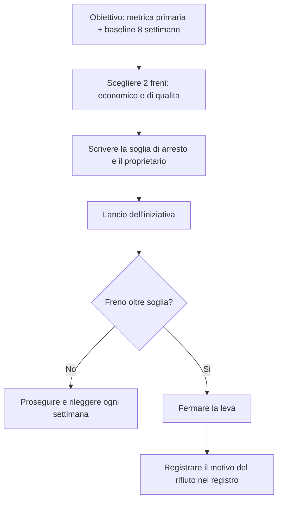

Il responsabile commerciale di un e-commerce B2B di forniture industriali riceve un premio legato soltanto al numero di ordini mensili (caso ricostruito con numeri di esempio). Per raggiungere l'obiettivo introduce uno sconto del 25% e la spedizione gratuita senza soglia minima. In due mesi gli ordini salgono del 40%, il grafico della metrica obiettivo è verde e il premio viene pagato. Nello stesso periodo i resi raddoppiano e il margine di contribuzione complessivo cade da 69.000 euro a 8.400 euro al mese. Nessuno ha violato un'istruzione: il sistema misurava il volume e il volume è cresciuto.

> **Idea chiave:** una metrica obiettivo senza freni viene ottimizzata a spese di tutto ciò che non misura; ogni obiettivo ha bisogno di almeno un controllo economico e uno di qualità con una soglia di arresto scritta prima del lancio.

## Counter-metric, guardrail e failure metric: tre freni diversi

Non tutti i controlli misurano la stessa cosa, e distinguerli evita report pieni di indicatori ridondanti. Una counter-metric bilancia la tensione naturale di un obiettivo: se spingi la velocità di evasione dei ticket, la counter-metric è la quota di ticket riaperti, perché risolvere in fretta e male fa salire le riaperture. Un guardrail protegge la salute generale del sistema, come margine, affidabilità tecnica o carico di assistenza, durante qualsiasi iniziativa e non solo per un obiettivo specifico. Una failure metric segnala un danno critico che impone l'arresto immediato, come errori di fatturazione o violazioni normative.

La distinzione ha conseguenze pratiche sull'azione prevista. Una counter-metric fuori soglia chiede di rivedere il processo prima di scalare. Un guardrail economico fuori soglia limita la leva, per esempio riducendo lo sconto. Una failure metric non si negozia: il rilascio si ferma e si indaga. Dichiarare in anticipo quale delle tre è in gioco evita di discutere, nel momento peggiore, se una violazione sia grave.

| Tipo di freno | Che cosa protegge | Esempio operativo | Azione oltre soglia |
|---|---|---|---|
| Counter-metric | Equilibrio diretto dell'obiettivo | Tasso di riapertura ticket contro velocità di risposta | Rivedere il processo prima di scalare |
| Guardrail economico | Redditività | Margine di contribuzione per ordine | Limitare sconti o alzare la soglia di spedizione gratuita |
| Guardrail di qualità | Fiducia del cliente | Tasso di disdetta entro 30 giorni | Correggere la promessa commerciale |
| Failure metric | Integrità tecnica o legale | Errori di fatturazione, risposta oltre 2 secondi | Arresto immediato del rilascio |

## La scheda del freno prima del lancio

Per ogni obiettivo trimestrale o esperimento si compila una scheda con quattro campi: la metrica primaria, la baseline delle ultime otto settimane, due freni (uno su margine o costo, uno su qualità o carico di supporto) e la soglia esatta di arresto con il nome di chi ha l'autorità di fermare. La scheda si firma prima di avviare l'iniziativa. È un documento breve ma cambia la natura della discussione successiva, perché lo scostamento non è più un'opinione da difendere bensì una condizione già concordata.



Un esempio nel contesto di crescita: se il team vuole aumentare le prove gratuite di un software, il guardrail economico può essere il costo di acquisizione per cliente pagante a sessanta giorni, e quello di qualità la percentuale di account che compie almeno due azioni reali nella prima settimana. Se le prove raddoppiano ma gli account attivi crollano della metà, il freno scatta e impedisce di spendere budget su traffico non qualificato.

## Esempio svolto: quanto è costata la crescita del 40%

Ricostruiamo l'economia dell'e-commerce prima e dopo la promozione. Prima: `1.000 ordini` al mese con valore medio di `200 euro`, costo della merce pari al 65% del prezzo cioè 130 euro per ordine, spedizione a carico del cliente e resi al 4% degli ordini, con un costo logistico di 25 euro per reso.

Il margine lordo per ordine, prima della promozione, è 200 - 130 = 70 euro. Il costo atteso dei resi per ordine è 4% × 25 = 1 euro. Il margine di contribuzione per ordine è quindi 70 - 1 = 69 euro, e il totale mensile è 1.000 × 69 = 69.000 euro.

Dopo: lo sconto del 25% porta il valore medio a 200 × 0,75 = 150 euro, mentre la merce costa ancora 130 euro, quindi il margine lordo scende a 150 - 130 = 20 euro per ordine. La spedizione gratuita costa 12 euro per ordine, e il margine scende a 20 - 12 = 8 euro. I resi raddoppiano all'8%, con costo atteso di 8% × 25 = 2 euro per ordine. Il margine di contribuzione per ordine è 8 - 2 = 6 euro. Con `1.400 ordini` (+40%) il totale mensile è 1.400 × 6 = 8.400 euro.

La differenza è 8.400 - 69.000 = -60.600 euro, una riduzione dell'87,8% (60.600 / 69.000 = 0,878), a fronte di un aumento del 40% degli ordini. Per tornare a 69.000 euro con 6 euro di margine per ordine servirebbero 69.000 / 6 = 11.500 ordini, cioè 11,5 volte il volume di partenza: un obiettivo irraggiungibile, perché nessuna promozione moltiplica per undici la domanda.

Con un guardrail scritto prima, per esempio "margine di contribuzione per ordine non inferiore a 55 euro e resi sotto il 5,5%", la promozione si sarebbe fermata alla prima lettura settimanale: 6 euro è molto sotto 55 e l'8% di resi supera 5,5%. Il registro avrebbe annotato il rifiuto, il prezzo rifiutato e la data, e il tentativo non sarebbe stato ripetuto sei mesi dopo da un altro reparto.

## Obiettivo e freni nella stessa query

Un report che mostra la crescita dei volumi senza il margine accanto è già un invito all'errore. La regola è mettere obiettivo e freni nella stessa query, in colonne adiacenti, così chiunque legga il guadagno vede nello stesso momento il prezzo pagato. La query in dialetto ClickHouse restituisce per settimana ordini, margine di contribuzione medio e tasso di reso, e segnala la violazione delle soglie scritte nella scheda.

```sql
-- Obiettivo (ordini) e freni (margine, resi) nella stessa tabella settimanale
SELECT
    toStartOfWeek(order_date) AS week,
    count() AS orders_count,
    round(avg(contribution_margin_eur), 2) AS avg_margin_eur,
    round(100 * countIf(is_returned = 1) / count(), 1) AS return_rate_pct,
    avg_margin_eur < 55 AS guardrail_margine_violato,   -- soglia scritta prima del lancio
    return_rate_pct > 5.5 AS guardrail_resi_violato
FROM orders
WHERE order_date >= today() - 56
GROUP BY week
ORDER BY week;
```

Il calcolo dell'esempio svolto si può replicare in poche righe per testare scenari prima del lancio, variando sconto, costo di spedizione e tasso di resi. Si ottengono due numeri che contano più del volume: il margine per ordine e il volume di pareggio.

```python
# Margine di contribuzione per ordine e volume di pareggio
def margine_ordine(prezzo, costo_merce, spedizione, tasso_resi, costo_reso):
    return prezzo - costo_merce - spedizione - tasso_resi * costo_reso

prima = margine_ordine(200, 130, 0, 0.04, 25)       # 69.0
dopo = margine_ordine(200 * 0.75, 130, 12, 0.08, 25)  # 6.0

totale_prima = 1000 * prima                          # 69000
totale_dopo = 1400 * dopo                            # 8400
pareggio = totale_prima / dopo                       # 11500 ordini
print(prima, dopo, totale_prima, totale_dopo, round(pareggio))
```

Il volume di pareggio è il test più veloce per capire se una leva ha senso: se per compensare il margine perso servono multipli impossibili del volume attuale, il guardrail non va nemmeno discusso.

## Segnali veloci e segnali lenti

I freni economici di lungo periodo, come il tasso di abbandono annuale, rilevano il danno con mesi di ritardo. Per un cambio introdotto questa settimana serve un segnale rapido osservabile entro sette o quattordici giorni, come i ticket di supporto aperti per ordine, gli errori di validazione o il tasso di reso anticipato. Ogni scheda del freno contiene quindi un controllo veloce, che permette di fermarsi presto, e uno lento, che conferma o smentisce l'effetto sul lungo periodo.

Nelle aziende più mature ogni guardrail critico è collegato a un avviso automatico settimanale. L'avviso non sostituisce il giudizio, ma evita di scoprire un problema a fine trimestre durante la chiusura contabile, quando il margine è già stato consumato e correggere costa molto di più.

## Tre errori comuni nell'impostare i freni

### Decidere le soglie dopo aver visto i numeri

Il sintomo è un esperimento che fa salire le vendite del 10% e peggiora i resi del 3%, dichiarato comunque un successo. Succede perché senza una soglia scritta ogni compromesso sembra accettabile e chi ha lanciato l'iniziativa ha interesse a leggerla bene. Si corregge fissando la tolleranza massima prima del lancio e conservandola nella scheda firmata dal proprietario dell'obiettivo e da chi ha il potere di fermarlo.

### Monitorare solo freni troppo lenti

Il sintomo è il danno scoperto dopo tre mesi, quando i clienti già se ne sono andati. Succede perché i freni lenti, come il churn annuale, sono i più rappresentativi del valore economico e quindi sembrano sufficienti. Si corregge affiancando a ogni freno lento un segnale rapido a sette giorni, per esempio i ticket per ordine, anche se meno preciso, perché la rapidità permette di fermarsi prima.

### Ignorare un guardrail rosso perché la metrica primaria è molto alta

Il sintomo è la frase "il margine è sceso ma abbiamo fatto il record di ricavi". Succede perché il record di ricavi si festeggia e il costo si spalma su più reparti. Si corregge stabilendo che un guardrail oltre soglia ferma l'iniziativa indipendentemente dal valore della primaria: se i freni sono facoltativi, l'organizzazione impara che non esistono.

## Quando un'eccezione ai freni è legittima

Esistono momenti in cui accettare un peggioramento temporaneo di un guardrail è una scelta consapevole, come l'ingresso in un nuovo mercato o una migrazione tecnica. La differenza tra una scelta strategica e un errore nascosto sta nella trasparenza e nella durata. L'eccezione si scrive come tale: quale guardrail, di quanto, per quanti giorni e con quale data di rientro obbligatoria. Se durante una migrazione i costi di assistenza possono salire del 20% per trenta giorni, lo si dichiara all'inizio e alla scadenza si ripristina la soglia ordinaria.

Esistono limiti che nessuna eccezione sposta. Una failure metric legata a sicurezza, fatturazione corretta o conformità normativa non si negozia, perché il danno non è una variazione di margine ma un'esposizione legale. Tenere un registro degli esperimenti fermati, compresi i casi in cui l'eccezione è stata concessa, costruisce una cultura in cui i team osano testare idee ambiziose proprio perché sanno che i freni proteggono l'equilibrio economico dell'impresa.

## Verifica sulla tua scheda dei freni

1. Un'iniziativa fa salire gli ordini del 30% e riduce il margine per ordine da 40 a 28 euro: il margine totale sale o scende?

<details>
<summary>Mostra risposta</summary>

Con 1.000 ordini iniziali il totale è 1.000 × 40 = 40.000 euro. Dopo: 1.300 × 28 = 36.400 euro, quindi il margine totale scende di 3.600 euro, il 9%, nonostante il volume cresca. Il volume di pareggio è 40.000 / 28 = 1.429 ordini, cioè +43%.

</details>

2. Il team misura la velocità di risposta del supporto: quale counter-metric affianchi e perché?

<details>
<summary>Mostra risposta</summary>

La quota di ticket riaperti o il tasso di soddisfazione dopo la chiusura. La velocità si può migliorare chiudendo in fretta ticket non risolti, e la counter-metric rende visibile questo scambio perché sale quando la qualità della risoluzione scende.

</details>

3. Perché ogni scheda del freno contiene un segnale rapido e uno lento?

<details>
<summary>Mostra risposta</summary>

Il segnale lento, come il churn a 90 giorni, è il più vicino al valore economico ma arriva tardi; il rapido, come i ticket per ordine a sette giorni, è meno preciso ma permette di fermarsi prima. Usarli insieme riduce sia il ritardo sia il rischio di fermare per un rumore.

</details>

4. Una promozione ha una guardrail fuori soglia per due settimane ma gli ordini crescono: continui o fermi, e che cosa registri?

<details>
<summary>Mostra risposta</summary>

Fermi la leva, perché la soglia è stata scritta per questo caso e vale indipendentemente dal volume. Nel registro annoti la promozione, il valore del guardrail, la soglia violata, la data e il prezzo rifiutato, così che un altro reparto non ripeta la scorciatoia.

</details>
