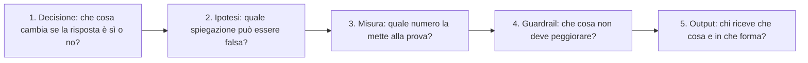

Scenario costruito, con numeri di esempio, ma molto vicino a quello che succede in qualunque azienda che vende online. Il direttore commerciale di un e-commerce di casalinghi scrive all'analista: gli ordini settimanali sono scesi da 10.000 a 8.800, un calo del 12%, e vuole sapere quali categorie di prodotto vanno male. L'analista, bravo con SQL, passa tre ore a costruire una classifica dei prodotti per variazione di vendite. Il report è pulito, corretto, ben formattato. Non serve a nulla, perché la caduta non dipende dai prodotti: dipende da un passaggio del pagamento su smartphone che da nove giorni si comporta in modo diverso.

L'errore non sta nella tecnica, sta nel punto di partenza. La richiesta del direttore conteneva già una spiegazione implicita (colpa dell'assortimento) e l'analista l'ha accettata senza metterla in discussione. Un analista forte fa un'altra cosa: scompone il problema fino a ciò che è certo, e ricostruisce da lì.

> **Idea chiave:** ragionare per primi principi significa separare ciò che hai misurato da ciò che stai supponendo, e continuare a scendere di livello finché la domanda diventa una cosa su cui puoi agire e che puoi verificare.

## Che cosa significa ragionare dai primi principi

Il metodo viene dalla filosofia e dalla fisica: invece di partire da analogie ("l'anno scorso era successa la stessa cosa") o da convenzioni ("per un calo di ordini si guardano le categorie"), si smonta il problema nei suoi elementi più semplici e indiscutibili e si risale da lì. Aristotele chiamava primi principi le premesse che non derivano da altre. In analisi dei dati le premesse indiscutibili sono pochissime: una definizione di metrica scritta con precisione, una tabella di eventi con una granularità nota, un confronto con una base di riferimento.

Per un analista questo si traduce in una disciplina concreta. Prima di calcolare qualunque cosa ti chiedi che decisione sta alle spalle della richiesta, quale numero la cambierebbe e che cosa dovrebbe succedere perché cambi. Se non sai rispondere, hai davanti un sintomo e non ancora una domanda.

La differenza tra ragionare per analogia e per primi principi si vede bene su una richiesta qualunque:

| Richiesta | Risposta per analogia | Risposta per primi principi |
| --- | --- | --- |
| "Gli ordini calano, guarda i prodotti" | Classifica dei prodotti per variazione | Ordini = sessioni × tasso di conversione: quale dei due fattori si è mosso? |
| "Il churn è salito, serve uno sconto" | Sconto a tutti gli utenti in scadenza | Chi è uscito in più, e che cosa è cambiato per loro? |
| "La campagna non ha funzionato" | Confronto con la campagna dell'anno scorso | Rispetto a quale gruppo che non l'ha ricevuta? |
| "Questo canale va bene" | Guarda i clic | Guarda il margine per cliente acquisito dopo i costi |

La colonna di destra è meno veloce da scrivere ma è la sola a produrre qualcosa che si può controllare.

## I cinque blocchi di un'analisi che regge

Dopo qualche anno di lavoro quasi tutti gli analisti convergono su una struttura mentale simile. Conviene darle un nome e usarla fin dall'inizio, perché ti costringe a mettere in ordine le cose nel momento in cui è più facile sbagliare, cioè quando la richiesta è appena arrivata.

La **decisione** è il blocco che quasi tutti saltano. Una domanda come "perché gli ordini sono calati" non è una decisione: lo diventa quando la scrivi come "se il calo dipende dal checkout, il team tecnico corregge il pagamento; se dipende dall'assortimento, il commerciale rivede il listino". Con la decisione scritta sai già quali risultati ti interessano e quali no.

L'**ipotesi** deve poter essere sbagliata. "C'è un problema sul mobile" va bene perché una scomposizione per dispositivo può smentirla; "qualcosa è cambiato nel comportamento degli utenti" non può essere smentita da nessun dato e quindi non guida nessuna analisi.

La **misura** è il numero che discrimina tra le ipotesi, e la sua definizione va scritta per intero: quale evento, quale finestra temporale, quale denominatore. Il **guardrail** è la metrica che non vuoi peggiorare mentre intervieni: correggere un problema di conversione aumentando i resi non è un successo. L'**output**, infine, è ciò che consegni: una tabella, una raccomandazione, un avviso a un team, con il livello di certezza dichiarato.

## Cinque Perché con un criterio di arresto

Le Cinque Perché sono una tecnica nata nella produzione industriale: davanti a un guasto si chiede perché è successo, poi perché è successa la causa trovata, e così via, finché si arriva a qualcosa su cui è possibile intervenire. Il numero cinque è indicativo. Il rischio opposto a fermarsi troppo presto è scendere all'infinito fino a risposte filosofiche ("perché gli utenti sono distratti"), quindi serve un criterio di arresto esplicito.

Il criterio che funziona in analisi è questo: ti fermi quando la causa trovata soddisfa tre condizioni insieme. Qualcuno ha il potere di intervenire, esiste un modo di verificare l'intervento con un dato, e scendere ancora non cambierebbe la decisione. Se manca anche una sola delle tre condizioni, il perché successivo è giustificato.

Nel caso dell'e-commerce la catena è breve. Perché gli ordini sono scesi? Perché il tasso di conversione è calato mentre le sessioni sono rimaste uguali. Perché è calato? Perché il calo è concentrato sul mobile. Perché sul mobile? Perché nove giorni fa è stata rilasciata una nuova versione del pagamento con verifica a due passaggi. Perché quella versione fa perdere ordini? Perché il reindirizzamento alla banca su schermi piccoli interrompe il flusso e molti utenti non tornano. Qui puoi fermarti: il team tecnico può intervenire, il tasso di completamento del pagamento è misurabile, e capire perché le persone non tornano non cambierebbe l'intervento immediato.

## Il caso del calo di ordini, svolto con i numeri

Riprendiamo il caso d'apertura con numeri di esempio e guardiamo come la scomposizione lo trasforma. Alla base c'è una identità: ordini = sessioni × tasso di conversione. Nella settimana di riferimento le sessioni erano 200.000 e la conversione 5,0%, quindi gli ordini erano 200.000 × 5,0% = 10.000. Nella settimana con il calo le sessioni sono ancora 200.000 e la conversione è 4,4%, quindi gli ordini sono 200.000 × 4,4% = 8.800. La differenza è 10.000 − 8.800 = 1.200 ordini, cioè il 12% di calo osservato. Il traffico non c'entra: tutta la variazione sta nella conversione, scesa di 0,6 pp.

Il secondo passo scompone la conversione per dispositivo. I numeri sono questi:

| Dispositivo | Sessioni | Conversione prima | Ordini prima | Conversione dopo | Ordini dopo | Variazione |
| --- | --- | --- | --- | --- | --- | --- |
| Mobile | 120.000 | 4,0% | 4.800 | 3,0% | 3.600 | −1.200 |
| Desktop | 80.000 | 6,5% | 5.200 | 6,5% | 5.200 | 0 |
| Totale | 200.000 | 5,0% | 10.000 | 4,4% | 8.800 | −1.200 |

I controlli tornano: 120.000 × 4,0% = 4.800 e 120.000 × 3,0% = 3.600 per il mobile; 80.000 × 6,5% = 5.200 per il desktop; la somma prima è 4.800 + 5.200 = 10.000 e dopo è 3.600 + 5.200 = 8.800. Il mobile spiega 1.200 ordini su 1.200, cioè il 100% del calo, mentre il desktop non si è mosso. La classifica dei prodotti dell'analista iniziale era quindi una risposta a una domanda non posta.

Il terzo passo traduce il calo in denaro per scegliere la priorità. Con un valore medio dell'ordine di 55 euro, gli ordini persi valgono 1.200 ordini × 55 euro = 66.000 euro a settimana. Un intervento che recupera anche solo metà della perdita vale 33.000 euro a settimana, e questo giustifica di fermare il lavoro sulle categorie e chiamare subito il team tecnico. Il guardrail da monitorare durante la correzione è la quota di pagamenti non autorizzati, perché semplificare il passaggio non deve aprire la porta a frodi.

## Tre errori comuni nel ragionamento analitico iniziale

### Descrivere con precisione senza spiegare

Il sintomo è un report ricco di grafici che dice che cosa è successo ma non perché, e il lettore resta con le stesse domande di prima. Succede perché descrivere è sicuro: i numeri sono corretti e nessuno può contestarli, mentre una spiegazione espone a una smentita. La correzione è obbligarti a chiudere ogni analisi con una frase del tipo "la variazione è dovuta a X, e lo verificherei con Y". Una descrizione accurata diventa una spiegazione verificabile solo quando indica che cosa la renderebbe falsa.

### Fermarsi alla prima causa plausibile

Il sintomo è una conclusione arrivata in venti minuti, coerente con ciò che il team già pensava. Succede perché la prima storia che si adatta ai dati riduce l'ansia di non sapere, e perché un dato aggregato è compatibile con molte storie. Nel caso sopra, "il listino è peggiorato" avrebbe spiegato il calo complessivo con la stessa eleganza della causa vera. La correzione è usare il criterio di arresto: finché non puoi dire chi interviene e come verifichi l'intervento, scendi di un livello.

### Scendere senza fine

Il sintomo opposto è un'analisi che non si chiude mai, in cui ogni risposta apre tre nuove domande e la consegna slitta. Succede quando non hai scritto la decisione all'inizio, quindi non sai quando hai abbastanza. La correzione è ricontrollare il primo blocco: se la risposta a un ulteriore perché non cambierebbe nessuna azione, quel perché non va fatto, per quanto sia interessante.

## Applicare il metodo prima di aprire il database

Il metodo rende il massimo se lo usi nei dieci minuti prima di scrivere una query, non dopo. Una routine pratica è prendere un foglio e riempire i cinque blocchi con una frase ciascuno, partendo dalla richiesta reale che hai ricevuto. Se uno dei blocchi non si riempie, hai trovato la domanda da fare al richiedente prima di cominciare.

Questo vale anche con gli esercizi del corso. Ogni volta che trovi un dataset di pratica, scrivi prima la decisione che il dataset dovrebbe supportare e l'ipotesi che vuoi mettere alla prova, e solo dopo apri lo strumento. Dopo qualche settimana la scrittura dei cinque blocchi diventa rapida e smette di essere un esercizio separato: la fai mentre ascolti la richiesta.

Un aiuto utile è tenere un piccolo registro delle ipotesi, con data, formulazione, misura usata ed esito. Rileggendolo a distanza di un mese vedi quali tipi di ipotesi confermi spesso (e forse stai scegliendo quelle comode) e quali smentisci. È l'allenamento più economico a disposizione per migliorare il giudizio.

## Quando la direzione chiede una risposta entro oggi

Il caso difficile è la richiesta urgente: la direzione deve decidere nel pomeriggio e non c'è tempo per scomporre nulla. Il metodo non si abbandona, si comprime. Dieci minuti bastano per scrivere la decisione e per fare la scomposizione più economica, quasi sempre per dispositivo, canale o coorte di ingresso, perché è lì che i cali si concentrano. Consegni poi la risposta con il suo grado di certezza: cosa sai, cosa stai supponendo, quale controllo manca.

Una consegna onesta in questo scenario somiglia a una frase come: "Il calo è concentrato sul mobile (1.200 ordini su 1.200); la causa più probabile è il nuovo pagamento; non ho ancora verificato i log di errore, lo faccio domattina". Contiene un fatto, un'ipotesi e un passo successivo, e permette alla direzione di decidere con le informazioni giuste invece che con una certezza apparente.

## Verifica sul ragionamento per primi principi

1. Un collega ti dice che i ricavi sono scesi del 9% e propone di cambiare il listino. Quali dei cinque blocchi devi riempire prima di accettare o respingere la proposta?

Mostra risposta

Parti dalla decisione: che cosa cambierebbe se la risposta fosse sì o no. Poi formula un'ipotesi che possa essere smentita, per esempio "il calo dipende dal prezzo", e scegli la misura che la mette alla prova, come ricavi scomposti in ordini per valore medio per segmento. Dichiara il guardrail (margine, resi) e l'output atteso. Finché non hai scritto la decisione, la proposta sul listino è solo una soluzione in cerca di problema.

2. Un sito ha 150.000 sessioni a conversione 4,0% prima e 150.000 sessioni a conversione 3,2% dopo. Quanti ordini si sono persi e dove guarderesti per primo?

Mostra risposta

Prima: 150.000 × 4,0% = 6.000 ordini. Dopo: 150.000 × 3,2% = 4.800 ordini. Differenza: 1.200 ordini persi. Le sessioni non sono cambiate, quindi il problema sta nella conversione: scomponila per dispositivo, canale e coorte per vedere dove si concentra il calo.

3. Con le Cinque Perché sei arrivato a "gli utenti non completano il pagamento perché il reindirizzamento alla banca fallisce su alcuni telefoni". Ti fermi o scendi ancora?

Mostra risposta

Controlla il criterio: il team tecnico può intervenire, l'intervento si verifica con il tasso di completamento del pagamento, e capire perché il reindirizzamento fallisce su quei telefoni potrebbe ancora cambiare la correzione (per esempio un problema di un solo browser). Se la causa è già abbastanza precisa per aprire un ticket con riproduzione, ti fermi; se non sai ancora su quali dispositivi fallisce, scendi di un livello.

4. Perché una classifica accurata dei prodotti per variazione di vendite può essere una risposta sbagliata a una richiesta di analisi?

Mostra risposta

Perché risponde a una domanda implicita nella richiesta (la colpa è dell'assortimento) senza averla verificata. Un report può essere esatto in ogni cifra e comunque irrilevante, se la variazione vera sta altrove. L'accuratezza descrive la qualità del calcolo, non la correttezza della domanda.

