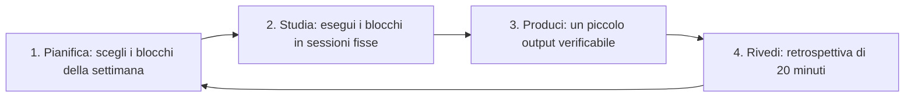

Caso ricostruito, con numeri di esempio. Chiara lavora in un ufficio acquisti e vuole passare a un ruolo di analisi dei dati. Si iscrive a un corso a metà gennaio, ci dedica sei ore la prima settimana, cinque la seconda, quattro la terza. Alla quarta settimana ne fa una, perché un cliente ha urgenza e la serata libera è sparita. Alla quinta non riapre il corso, e non per mancanza di impegno: non ha più un modo per capire se sta andando avanti. Ha letto molto, ma non saprebbe dire che cosa sa fare oggi che un mese fa non sapeva fare.

Il problema ha una forma precisa. La motivazione di partenza è alta, quella a lungo termine dipende dalla visibilità del progresso, e il progresso in un campo tecnico è invisibile se non lo misuri. Chi molla di solito non ha perso interesse: ha perso il segnale che il tempo investito produce qualcosa.

> **Idea chiave:** la motivazione nel lungo periodo si protegge con un piano che dice dove sei, che cosa conviene studiare per primo e quanto sei avanzato ogni settimana; la forza di volontà serve solo nei giorni in cui questi tre elementi mancano.

## Perché la motivazione cala e che cosa la sostiene

Le prime settimane di studio hanno un vantaggio sleale: tutto è nuovo, ogni concetto sembra un salto. Dopo un mese il terreno cambia. Gli argomenti diventano più difficili, il rapporto tra ore investite e sensazione di avanzamento peggiora, e la vita ordinaria riprende i suoi spazi. Questo calo è fisiologico e prevedibile, quindi si può progettare.

Tre fattori tengono insieme un percorso lungo. Il primo è la **direzione**: sapere perché stai studiando una cosa adesso e non un'altra. Il secondo è la **misura**: un modo concreto di vedere che il livello è salito. Il terzo è il **ritmo sostenibile**: un carico che puoi mantenere anche nelle settimane peggiori, perché la costanza batte l'intensità. Un piano di studio personale è il documento che mette in ordine questi tre elementi.

| Fattore | Che cosa manca quando si molla | Strumento della lezione |
| --- | --- | --- |
| Direzione | Si studia ciò che capita o ciò che piace, senza un ordine | Diagnostic iniziale e ROI ranking |
| Misura | Non si capisce se si sta migliorando | Punteggi da 1 a 5 ripetuti ogni quattro settimane |
| Ritmo | Un'ondata di ore seguita dal vuoto | Ciclo settimanale con carico minimo garantito |

## Il diagnostic iniziale: dove sei davvero

Il diagnostic è una fotografia onesta del punto di partenza, fatta una sola volta all'inizio e poi ripetuta a intervalli. Prendi cinque aree che coprono il lavoro di un analista e dai a ciascuna un punteggio da 1 a 5. Le aree usate in questa lezione sono SQL e interrogazione dei dati, statistica di base, visualizzazione, comunicazione dei risultati e strumenti di pipeline. Puoi cambiarle se il ruolo che vuoi raggiungere ne richiede altre, ma restano cinque, perché con troppe voci il quadro si diluisce.

I punteggi hanno un significato operativo. L'1 vuol dire che non sapresti da dove cominciare, il 3 che riesci a svolgere il compito con una guida o con un esempio sotto mano, il 5 che lo fai in autonomia e potresti insegnarlo. Per evitare l'autoindulgenza conviene associare a ogni punteggio una prova concreta: scrivere una join tra tre tabelle senza aiuto vale almeno 3 in SQL; spiegare a un collega perché un intervallo di confidenza non è una probabilità vale almeno 4 in statistica.

Il secondo ingrediente è il **livello obiettivo**, cioè il punteggio che ti serve per il ruolo che vuoi. Non per tutte le aree il bersaglio è lo stesso: un analista di prodotto ha bisogno di un 5 in SQL e può cavarsela con un 3 in pipeline. Qui useremo per semplicità un obiettivo di 4 in ogni area, e poi lo moduleremo con il peso di ciascuna.

## ROI priority ranking: gap per impatto

Con cinque aree e sei ore alla settimana non puoi studiare tutto insieme, quindi serve un criterio di priorità. Il ROI priority ranking è volutamente semplice: per ogni area calcoli il **gap**, cioè la distanza tra obiettivo e livello attuale, e lo moltiplichi per l'**impatto**, un punteggio da 1 a 5 che stima quanto quell'area pesa sul lavoro che vuoi fare. L'area con il prodotto più alto è quella dove un'ora di studio rende di più.

Prendiamo i numeri di Chiara. Il suo obiettivo è 4 in ogni area. Parte da questi livelli: SQL 2, statistica 1, visualizzazione 3, comunicazione 4, pipeline 2. I gap sono quindi 4 − 2 = 2 per SQL, 4 − 1 = 3 per statistica, 4 − 3 = 1 per visualizzazione, 4 − 4 = 0 per comunicazione e 4 − 2 = 2 per pipeline. Gli impatti, stimati guardando le offerte di lavoro che le interessano, sono 5 per SQL, 4 per statistica, 3 per visualizzazione, 2 per comunicazione e 3 per pipeline.

| Area | Livello | Gap | Impatto | ROI (gap × impatto) |
| --- | --- | --- | --- | --- |
| Statistica di base | 1 | 3 | 4 | 12 |
| SQL | 2 | 2 | 5 | 10 |
| Strumenti di pipeline | 2 | 2 | 3 | 6 |
| Visualizzazione | 3 | 1 | 3 | 3 |
| Comunicazione | 4 | 0 | 2 | 0 |

La classifica dice una cosa che l'istinto di Chiara non avrebbe detto: la statistica, che le sembrava la parte più noiosa, è la priorità numero uno, seguita da SQL. La comunicazione ha ROI zero e va lasciata stare per ora, perché è già al livello obiettivo. Senza il calcolo avrebbe continuato a studiare la visualizzazione, che è l'area più piacevole ma vale solo 3 punti su 31.

## Dai punteggi alle ore: il budget settimanale

Il ranking decide l'ordine, ma serve anche tradurlo in tempo. Il metodo più semplice distribuisce le ore in proporzione al ROI. Chiara dispone di 6 ore a settimana, cioè 360 minuti. Il ROI totale delle aree con punteggio positivo è 12 + 10 + 6 + 3 = 31. Le quote sono quindi: statistica 360 × 12 / 31 = 139 minuti, SQL 360 × 10 / 31 = 116 minuti, pipeline 360 × 6 / 31 = 70 minuti, visualizzazione 360 × 3 / 31 = 35 minuti. La somma è 139 + 116 + 70 + 35 = 360 minuti, quindi il budget torna a zero.

In pratica Chiara arrotonda a blocchi gestibili: due sessioni da 70 minuti per la statistica, due da 60 per SQL, una da 70 per le pipeline e una breve da 35 per la visualizzazione. Il dettaglio dei minuti non è sacro, ma il metodo evita due errori frequenti: dedicare lo stesso tempo a tutte le aree e dedicarlo a quelle che ti piacciono.

Il budget va rivisto ogni quattro settimane ripetendo il diagnostic. Se dopo un mese la statistica è salita da 1 a 3, il suo gap passa da 3 a 1 e il ROI da 12 a 4: la classifica cambia da sola e le ore si spostano senza che tu debba decidere nulla. Questo effetto è la parte più motivante del sistema, perché il progresso diventa un numero che puoi vedere muoversi.

## Il ciclo settimanale in quattro fasi

Un piano sulla carta non regge senza un ritmo che lo traduca in giorni. Il ciclo settimanale ha quattro fasi che si ripetono sempre nello stesso ordine.

Nella fase di pianificazione, di solito la domenica sera, assegni i blocchi a giorni e orari precisi. Un blocco scritto in un calendario ha una probabilità molto più alta di essere svolto di un'intenzione generica. Nella fase di studio rispetti i blocchi e, se una sessione salta, la sposti invece di cancellarla. Nella fase di produzione chiudi la settimana con qualcosa di concreto: una query che funziona, un grafico, una nota di sintesi. L'output è la prova del progresso e alimenta la retrospettiva.

La retrospettiva dura venti minuti e ha tre domande: che cosa ho completato rispetto al piano, che cosa mi ha bloccato, quale singolo aggiustamento provo la settimana prossima. Il vincolo di un solo aggiustamento è deliberato, perché cambiare cinque cose insieme non permette di capire quale abbia funzionato.

## Tre errori comuni che spengono la motivazione

### Pianificare per la settimana ideale

Il sintomo è un piano da dieci ore che regge due settimane e poi crolla, lasciando la sensazione di aver fallito. Succede perché si progetta guardando la settimana migliore invece di quella media. La correzione è dimensionare il piano sulla settimana più scomoda dell'ultimo mese e fissare un carico minimo garantito, per esempio 90 minuti, che mantieni anche quando tutto va storto. Il resto è bonus.

### Misurare le ore invece del livello

Il sintomo è un contatore di ore studiate che sale mentre la sensazione di competenza resta ferma. Succede perché le ore sono facili da contare e il livello no, ma le ore sono un costo e non un risultato. La correzione è ripetere il diagnostic ogni quattro settimane e confrontare i punteggi, accompagnandoli con un output concreto a settimana. Se le ore salgono e i punteggi no, il metodo di studio va cambiato, non il numero di ore.

### Studiare l'area preferita

Il sintomo è un'area su cui sei bravissimo e altre che restano al livello 1 senza che tu te ne accorga. Succede perché ciò che ti riesce bene dà gratificazione immediata. La correzione è lasciare che sia il ROI ranking a decidere, concedendoti una sessione breve di area preferita a settimana come premio, non come piano.

## Settimane di lavoro intenso senza azzerare il piano

Il caso difficile è la settimana in cui il lavoro prende tutto, come per Chiara alla quarta settimana. In quel momento il rischio non è saltare una sessione, che è normale, ma interpretare il salto come la fine del piano. La risposta è avere una versione minima già scritta: 90 minuti, un solo blocco, sull'area con il ROI più alto. Fare la versione minima mantiene viva l'abitudine e impedisce la rottura della catena.

Se la settimana di carico si prolunga, accorcia il ciclo invece di sospenderlo: una retrospettiva di dieci minuti il venerdì basta per segnare che cosa hai fatto e riprogrammare. Quando il carico cala, riprendi dal budget normale senza recuperare le ore perse, perché il recupero crea debito e il debito scoraggia.

## Verifica sul tuo piano di studio

1. Se i tuoi livelli sono SQL 3, statistica 2 e visualizzazione 4 con obiettivo 4 e impatti 5, 4 e 3, qual è l'area prioritaria?

Mostra risposta

I gap sono 4 − 3 = 1, 4 − 2 = 2 e 4 − 4 = 0. I ROI sono 1 × 5 = 5 per SQL, 2 × 4 = 8 per statistica e 0 × 3 = 0 per visualizzazione. La priorità è la statistica, con ROI 8.

2. Hai 4 ore alla settimana (240 minuti) e due aree con ROI 9 e 3. Quanti minuti assegni a ciascuna?

Mostra risposta

Il ROI totale è 9 + 3 = 12. La prima area riceve 240 × 9 / 12 = 180 minuti, la seconda 240 × 3 / 12 = 60 minuti. La somma è 180 + 60 = 240 minuti, quindi il budget è coerente.

3. Dopo quattro settimane la tua statistica passa da 1 a 3 con obiettivo 4 e impatto 4. Come cambia il ROI e che effetto ha sulle ore?

Mostra risposta

Il gap passa da 3 a 1 e il ROI da 3 × 4 = 12 a 1 × 4 = 4. L'area scende in classifica e la quota di ore diminuisce in proporzione, liberando tempo per le aree che sono rimaste indietro.

4. Perché la retrospettiva settimanale ammette un solo aggiustamento?

Mostra risposta

Perché con un solo cambiamento puoi attribuire il risultato della settimana successiva a quella modifica. Se ne cambi cinque insieme non sai quale abbia funzionato e rischi di rendere il piano instabile.

