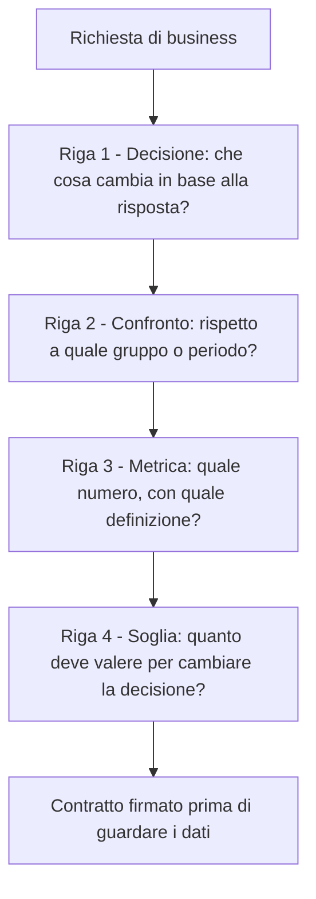

Scenario costruito, con numeri di esempio. La responsabile marketing di un negozio online di articoli per animali scrive all'analista: "Le newsletter funzionano?". Sono quattro parole e, se le prendi alla lettera, non hanno risposta. Funzionano per chi, rispetto a che cosa, misurate come, e quanto deve essere grande l'effetto perché ne valga la pena? L'analista che risponde subito con un grafico delle aperture consegna un dato vero e una risposta nulla, perché le aperture non dicono nulla sulle vendite e nessuno ha stabilito che cosa conti come successo.

La parte più difficile del lavoro analitico accade prima di toccare i dati: consiste nel trasformare una frase da riunione in una domanda con un confronto, una metrica e una soglia. Chi impara a farlo bene evita metà dei malintesi che portano analisi inutili.

> **Idea chiave:** una domanda analitica è completa solo quando contiene una decisione, un confronto, una metrica e una soglia fissata prima di vedere i risultati; senza la soglia, qualunque numero può essere interpretato a favore della tesi che si preferisce.

## Perché una richiesta di business non è ancora una domanda

Le richieste di business sono scritte nel linguaggio delle decisioni e delle sensazioni: funziona, va meglio, sta calando, conviene. Sono utili perché esprimono l'interesse reale, ma sono vuote dal punto di vista dei dati perché non indicano che cosa misurare né con che cosa confrontare. Tradurle non è una pedanteria: è il lavoro che separa l'analista dall'estrattore di numeri.

Il problema ha un risvolto psicologico poco evidente. Quando la soglia non è stabilita prima, il risultato viene giudicato dopo, e il giudizio dopo è sempre influenzato da ciò che si sperava di trovare. Se la conversione sale dello 0,2% si dirà che è un buon segnale; se fosse scesa si cercherebbe una spiegazione esterna. Una soglia scritta in anticipo toglie questa libertà e rende la risposta credibile anche per chi la riceve con scetticismo.

| Frase di business | Che cosa manca | Domanda analitica possibile |
| --- | --- | --- |
| "Le newsletter funzionano?" | Confronto, metrica, soglia | Gli iscritti che ricevono la newsletter acquistano di più, in termini di ordini per destinatario, rispetto a un gruppo che non la riceve, di almeno la soglia di pareggio? |
| "Il nuovo sito va meglio?" | Metrica e periodo | La conversione da sessione a ordine del nuovo sito supera quella del vecchio sul traffico dello stesso periodo? |
| "I clienti sono più fedeli" | Definizione di fedeltà | La quota di clienti con un secondo acquisto entro 90 giorni è salita rispetto alla coorte dell'anno scorso? |

## Il template delle quattro righe

Per rendere sistematica la traduzione conviene un modello fisso, da compilare per ogni richiesta, che si scrive in quattro righe e si condivide con chi ha fatto la domanda. Funziona come un piccolo contratto: se lo stakeholder lo approva, entrambe le parti sanno che cosa verrà consegnato.

La **decisione** dice a che cosa serve la risposta: continuare o sospendere le newsletter, spostare budget da un canale all'altro, rilasciare o ritirare una funzione. È l'ancora di tutta la domanda, perché se nessuna decisione dipende dal risultato la domanda non merita lavoro.

Il **confronto** stabilisce rispetto a che cosa si misura il cambiamento. Un numero isolato non significa niente: 2,5% di conversione è alto o basso? Dipende dal gruppo di controllo, dal periodo precedente o dal benchmark che scegli, e quella scelta va dichiarata in anticipo. La **metrica** richiede una definizione operativa: quale evento conta come acquisto, in quale finestra temporale, con quale denominatore. La **soglia**, infine, è l'effetto minimo che giustifica il cambio di decisione.

Un modo pratico di scriverlo è un blocco di citazione che resta all'inizio del documento di analisi:

> Decisione: continuare o sospendere le newsletter settimanali dal prossimo mese.
> Confronto: destinatari della newsletter contro un gruppo di controllo estratto a caso che non la riceve, stesse quattro settimane.
> Metrica: ordini per destinatario, conteggiando gli acquisti entro sette giorni dall'invio.
> Soglia: differenza di almeno 0,25 punti percentuali, pari al punto di pareggio economico.

## Come ricavare la soglia dal punto di pareggio

La soglia non deve essere un numero preso dal cielo. Il metodo più solido è ricavarla dall'economia della decisione: calcoli l'effetto minimo che copre il costo dell'intervento. Tutto ciò che sta sotto non vale la pena di essere mantenuto, e tutto ciò che sta sopra giustifica la scelta.

Riprendiamo il negozio di articoli per animali, con numeri di esempio. Ogni invio della newsletter costa 1.500 euro tra strumento di invio e lavoro di redazione, e ogni ordine genera in media 30 euro di margine. Il punto di pareggio in ordini è 1.500 euro / 30 euro = 50 ordini aggiuntivi per invio. Con 20.000 destinatari, 50 ordini corrispondono a 50 / 20.000 = 0,25%, cioè 0,25 punti percentuali di differenza nel tasso di acquisto. Questa è la soglia da scrivere nella quarta riga: sotto 0,25 pp la newsletter perde denaro, sopra ne guadagna.

Supponiamo ora di aver estratto a caso due gruppi da 20.000 contatti, uno che riceve la newsletter e uno di controllo che non la riceve. Il gruppo trattato produce 500 ordini, cioè 500 / 20.000 = 2,5%. Il gruppo di controllo produce 420 ordini, cioè 420 / 20.000 = 2,1%. La differenza è 2,5% − 2,1% = 0,4 pp, pari a 500 − 420 = 80 ordini aggiuntivi. Il margine generato è 80 × 30 euro = 2.400 euro, e sottratto il costo dell'invio otteniamo 2.400 euro − 1.500 euro = 900 euro di guadagno netto per invio.

Il risultato supera la soglia: 0,4 pp contro 0,25 pp richiesti. La decisione scritta nella prima riga, continuare, è quindi confermata. Va detto che una differenza di 80 ordini su 20.000 contatti ha una sua incertezza statistica che si quantifica con strumenti trattati più avanti nel corso; per ora basta notare che la domanda era stata costruita in modo da poter dare una risposta netta, cosa che la richiesta iniziale non permetteva.

## Esercitarsi sui dati con la stessa disciplina

Tutto questo si può allenare con dataset di pratica prima di incontrarlo sul lavoro. Quando scarichi un dataset pubblico o usi quello di un esercizio del corso, non cominciare dall'esplorazione libera: scrivi prima le quattro righe, scegli una decisione immaginaria plausibile e fissa la soglia. Solo dopo apri i dati. È un esercizio che costa cinque minuti e cambia il tipo di lavoro, perché ti abitua a guardare i numeri con una domanda precisa invece di cercare qualcosa di interessante.

Un esercizio utile è invertire il processo. Prendi un'analisi già fatta, per esempio un articolo o un report che riporta un risultato, e prova a ricostruire le quattro righe che l'autore avrebbe dovuto scrivere. Spesso scopri che la soglia manca, che il confronto è implicito o che la metrica cambia a metà documento. Imparare a vedere queste lacune negli altri è il modo più rapido per non farle tu.

Tieni una raccolta delle domande che hai scritto, con la decisione, la soglia e l'esito. Dopo un mese puoi rileggerla e controllare quanto spesso la soglia che avevi fissato era ragionevole e quanto spesso hai dovuto cambiarla a posteriori. Se ti capita di cambiarla spesso, è il segnale che stai ancora scegliendola guardando i dati.

## Tre errori comuni nel tradurre le richieste di business

### Fissare la soglia dopo aver visto il risultato

Il sintomo è una conclusione che sembra sempre coerente con i dati: l'effetto era piccolo ma "significativo per il nostro settore", oppure grande ma "non abbastanza per lo sforzo". Succede perché la mente razionalizza ciò che ha davanti, anche in buona fede. La correzione è scrivere la soglia nel contratto delle quattro righe, datarla e non modificarla; se per un buon motivo devi cambiarla, lo dichiari esplicitamente come revisione.

### Scegliere una metrica comoda invece di quella giusta

Il sintomo è un'analisi basata su aperture, clic o visualizzazioni quando la decisione riguarda il fatturato. Succede perché le metriche intermedie sono facili da estrarre e danno numeri alti. La correzione è risalire dalla decisione alla metrica più vicina al valore economico che puoi misurare, e usare le metriche intermedie solo per spiegare il meccanismo, non per giudicare l'esito.

### Confrontare gruppi che non sono confrontabili

Il sintomo è un effetto grande che sparisce quando si guarda meglio. Succede quando il gruppo trattato e quello di riferimento differiscono in qualcosa di rilevante: chi si iscrive alla newsletter è già più propenso a comprare di chi non la riceve. La correzione è definire il confronto in modo che i due gruppi siano simili in partenza, idealmente estraendoli a caso dalla stessa popolazione, come nell'esempio della newsletter.

## Quando lo stakeholder non sa indicare una soglia

Il caso difficile è la persona che risponde "non lo so, dimmi tu che cosa è rilevante". Non è un rifiuto di collaborare: spesso non ha mai tradotto la decisione in numeri. La via d'uscita è proporre tu un calcolo di pareggio e chiedere conferma sugli ingredienti, non sul risultato. Chiedi quanto costa l'intervento e quanto vale un'unità di risultato, come il margine per ordine, e ricava la soglia come nell'esempio sopra.

Se nemmeno questi dati sono disponibili, offri due o tre soglie alternative e chiedi quale delle conseguenze sia accettabile. Per esempio: "Se l'effetto fosse 0,1 pp continueresti? E se fosse 0,5 pp?". Le risposte a queste domande ipotetiche rivelano la soglia implicita. In ogni caso scrivi l'esito della conversazione nelle quattro righe e fallo confermare per iscritto: il contratto vale solo se è condiviso.

## Verifica sulla domanda analitica

1. Un responsabile ti chiede se il nuovo flusso di registrazione è migliore. Quali elementi mancano per trasformare la richiesta in una domanda analitica?

Mostra risposta

Mancano il confronto (migliore rispetto al flusso precedente nello stesso periodo, o rispetto a un gruppo che usa ancora il vecchio flusso), la metrica (per esempio la quota di visitatori che completano la registrazione entro la sessione) e la soglia (di quanti punti percentuali deve migliorare per giustificare il costo del rilascio). La decisione è presumibilmente tenere o ritirare il nuovo flusso.

2. Un'iniziativa costa 2.400 euro e ogni ordine aggiuntivo dà 40 euro di margine. Con 30.000 destinatari, qual è la soglia in punti percentuali?

Mostra risposta

Il punto di pareggio è 2.400 euro / 40 euro = 60 ordini aggiuntivi. Su 30.000 destinatari corrisponde a 60 / 30.000 = 0,2%, quindi la soglia è 0,2 pp di differenza nel tasso di acquisto.

3. Nel test, il gruppo trattato da 20.000 contatti ha 540 ordini e il controllo da 20.000 ne ha 480. Con soglia 0,25 pp, quale decisione prendi?

Mostra risposta

I tassi sono 540 / 20.000 = 2,7% e 480 / 20.000 = 2,4%, con differenza 0,3 pp. Il risultato supera la soglia di 0,25 pp, quindi la decisione è di continuare, tenendo presente l'incertezza statistica di una differenza di 60 ordini.

4. Perché fissare la soglia dopo aver visto i dati compromette la credibilità dell'analisi?

Mostra risposta

Perché lascia libertà di scegliere il valore che rende il risultato favorevole alla tesi preferita, anche senza malafede. Una soglia scritta prima, ricavata dall'economia della decisione, rende la risposta verificabile e difendibile davanti a chi è scettico.

