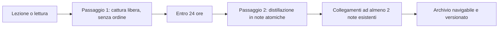

Caso ricostruito, con numeri di esempio. Marco segue una lezione online di novanta minuti sulle tecniche di segmentazione dei clienti e riempie quattordici pagine di appunti: frasi copiate dalle slide, schemi disegnati di corsa, tre link da guardare dopo. Due settimane più tardi, mentre prepara un'analisi, ricorda di aver sentito qualcosa di utile su come scegliere il numero di segmenti. Apre il quaderno, sfoglia, cerca nel computer, non lo trova. Finisce per rivedere metà della registrazione. Gli appunti c'erano, ma era come non averli.

Il problema non è la quantità di appunti, è la loro forma. Una pagina di trascrizione serve mentre ascolti, perché ti tiene attento, ma da sola non diventa memoria: per recuperare una cosa devi ricordare dove l'hai scritta, e di solito non lo ricordi.

> **Idea chiave:** un buon sistema di appunti si misura dal tempo che ti serve per ritrovare e riusare un'idea; per questo conviene scrivere poche note piccole, ciascuna su una sola idea, e collegarle tra loro invece di accumulare pagine lineari.

## Perché gli appunti lineari non si ritrovano

Gli appunti presi durante una lezione seguono l'ordine in cui l'insegnante parla, non l'ordine in cui ti serviranno. Quando devi usarli, cerchi per argomento: "come scelgo il numero di cluster" non coincide con la pagina 9 del quaderno di martedì. L'ordine cronologico va bene per l'ascolto e male per il recupero.

C'è poi il problema dell'elaborazione. Copiare una frase non richiede di averla capita, e la sensazione di aver lavorato dura finché non provi a rispiegarla. Il metodo di questa lezione affronta le due cose insieme: separa il momento della cattura, veloce e disordinato, da quello della distillazione, in cui riformuli con parole tue e colleghi l'idea alle altre. La distillazione è la parte in cui avviene l'apprendimento.

| Tipo di appunto | Quando si scrive | Pregio | Limite |
| --- | --- | --- | --- |
| Cattura libera | Durante la lezione | Veloce, non interrompe l'ascolto | Disordinata, difficile da ritrovare |
| Nota atomica | Entro 24 ore | Una sola idea, riformulata e collegata | Richiede 15-20 minuti di lavoro |
| Mappa di collegamento | Una volta a settimana | Mostra relazioni e lacune | Utile solo se le note sono già atomiche |

## La nota atomica e i suoi cinque blocchi

Una nota atomica contiene una sola idea e ha una struttura fissa, così che sia leggibile anche a distanza di mesi. Sono cinque blocchi brevi. Il **contesto** dice da dove viene l'idea e in quale problema serve, in una riga. L'**idea chiave** la enuncia con parole tue, in due o tre frasi: se non riesci a scriverla, non l'hai ancora capita. Il **framework** riporta il metodo o la regola operativa, per esempio i passaggi per scegliere il numero di segmenti. L'**esempio** ne mostra l'applicazione su un caso con numeri. La **prossima azione** dice dove userai l'idea o che cosa devi verificare.

Puoi tenerla come modello da copiare ogni volta, scritto in un blocco di citazione:

> Contesto: lezione sulla segmentazione dei clienti, serve quando devo raggruppare clienti per una campagna.
> Idea chiave: il numero di segmenti si sceglie in base alla decisione che ne dipende, non alla forma dei dati; se non posso trattare sei gruppi diversamente, sei segmenti sono inutili.
> Framework: elenco le azioni possibili, conto quanti trattamenti distinti posso permettermi, uso quel numero come tetto.
> Esempio: tre canali di contatto disponibili, quindi massimo tre segmenti; con sei segmenti due coppie riceverebbero la stessa comunicazione.
> Prossima azione: applicarlo alla segmentazione del progetto sui clienti del negozio.

Il vincolo di una sola idea per nota è il punto cruciale. Una nota che contiene tre idee non può essere collegata con precisione a nessuna di esse, e si finisce per cercarla senza sapere quale parte serve. Se mentre scrivi ti accorgi di toccare un secondo argomento, apri una seconda nota e collega le due.

## Il doppio passaggio entro ventiquattro ore

Il metodo funziona perché divide il lavoro in due tempi con regole diverse.

Nel primo passaggio catturi tutto ciò che sembra rilevante, senza preoccuparti della forma. Qui conta la velocità: se rallenti per scrivere bene, perdi quello che l'insegnante sta dicendo. Nel secondo passaggio, entro ventiquattro ore, rileggi la cattura mentre il ricordo è ancora fresco e la trasformi in note atomiche. La finestra di ventiquattro ore non è arbitraria: dopo un giorno la maggior parte dei dettagli è già sbiadita e rileggere gli appunti diventa un'operazione di decifrazione.

Ogni nota nuova deve collegarsi ad almeno due note esistenti. I collegamenti sono ciò che trasforma una raccolta di schede in una rete: quando cerchi un'idea, arrivi alle vicine, e spesso trovi connessioni che non avevi previsto. Se non trovi nessuna nota a cui collegarla, è un segnale che l'idea è nuova per te oppure che la nota è troppo specifica; in ogni caso ti obbliga a pensarla in relazione al resto.

## Quanto rende davvero: il conto dei minuti

Un sistema di appunti ha un costo e un ritorno, e conviene stimarli. Seguiamo Marco per un mese con numeri di esempio. Segue 8 lezioni e per ciascuna dedica 20 minuti alla distillazione: il costo è 8 × 20 min = 160 min. In cambio ottiene tre vantaggi misurabili.

Il primo è il tempo di ricerca. Prima impiegava in media 8 min per ritrovare un concetto negli appunti lineari; con le note atomiche e i collegamenti impiega 1,5 min. Nel mese cerca qualcosa 15 volte, quindi il risparmio è 15 × (8 min − 1,5 min) = 15 × 6,5 min = 97,5 min.

Il secondo è il tempo di riapprendimento evitato. In cinque occasioni, invece di riguardare una registrazione o un capitolo per circa 20 min, rilegge una nota di due minuti: il risparmio è 5 × (20 min − 2 min) = 5 × 18 min = 90 min. Sommando, il beneficio totale è 97,5 min + 90 min = 187,5 min, contro 160 min di costo, per un saldo positivo di 187,5 − 160 = 27,5 min già nel primo mese.

Il saldo è modesto all'inizio e cresce nei mesi successivi, perché il costo di distillazione resta costante mentre l'archivio si arricchisce e il numero di ricerche aumenta. Il vero ritorno arriva quando le note costituiscono una base su cui costruire analisi e relazioni senza ripartire ogni volta da zero. Un dato da non trascurare: se dopo due mesi il saldo resta negativo, il metodo non sta funzionando e la distillazione va riformulata.

## Versionare le note in Markdown e potare ogni settimana

Per un lavoro tecnico conviene scrivere le note in file Markdown, un file per nota, con un nome che descriva l'idea, per esempio `scelta-numero-segmenti.md`. Il formato è semplice, leggibile con qualunque editor e non dipende da un'applicazione specifica: tra dieci anni potrai ancora aprirlo. I collegamenti tra note si scrivono come riferimenti al nome del file, in modo che anche un semplice programma di ricerca testuale possa seguirli.

Mettere la cartella sotto controllo di versione con git dà tre vantaggi. Ottieni lo storico: puoi vedere come è cambiata un'idea e recuperare una versione precedente. Ottieni una copia di sicurezza su un archivio remoto. E ti abitui, usando messaggi di commit brevi come "aggiunta nota su scelta del numero di segmenti", a una disciplina che ritroverai nel lavoro con il codice e con i modelli di analisi.

Una volta a settimana, in quindici minuti, esegui la potatura. Cerchi le note orfane, cioè quelle senza alcun collegamento, e per ciascuna decidi: la colleghi a qualcosa, la fondi con una nota simile o la elimini. Se in un mese hai 40 note e 7 sono orfane, la quota è 7 / 40 = 17,5%: un valore sopra il 15% segnala che stai catturando più di quanto colleghi, e la correzione è rallentare la produzione di note e dedicare più tempo al secondo passaggio.

## Tre errori comuni nel prendere appunti tecnici

### Trascrivere invece di riformulare

Il sintomo è una nota che ricalca la slide, con le stesse parole e lo stesso ordine, e che a distanza di una settimana risulta incomprensibile. Succede perché copiare è meno faticoso che capire e dà una sensazione di completezza. La correzione è scrivere l'idea chiave senza guardare la fonte: se non ci riesci, hai scoperto una lacuna e puoi colmarla subito.

### Note troppo grandi

Il sintomo è un file di due pagine su un intero argomento, in cui trovare la parte che serve richiede di rileggere tutto. Succede perché è naturale mettere insieme ciò che appartiene allo stesso tema. La correzione è la regola di una sola idea per nota: spezza il file in note piccole e collegale con riferimenti.

### Accumulare senza potare

Il sintomo è un archivio di centinaia di note in cui la ricerca restituisce molti risultati e nessuno è quello giusto. Succede perché aggiungere è facile e togliere sembra uno spreco. La correzione è la potatura settimanale con una regola esplicita: una nota senza collegamenti da più di due settimane va collegata o eliminata.

## Quando le bozze arretrate si accumulano

Il caso difficile è la settimana in cui perdi il ritmo e ti ritrovi con cinque lezioni di cattura libera mai distillata. La tentazione è recuperare tutto in una sera, ma il risultato è una distillazione frettolosa che produce note scadenti. Meglio una triage in tre passi: ordina le catture per utilità prevista nelle prossime due settimane, distilla solo le prime due con il metodo completo, e per le altre scrivi una riga di riassunto e una data di scadenza dopo la quale la cattura viene archiviata senza essere trattata.

Archiviare senza distillare non è un fallimento: è un'ammissione onesta che non tutto ciò che catturi merita una nota. La regola delle ventiquattro ore resta l'obiettivo, ma un sistema che sopravvive alle settimane cattive è più utile di uno perfetto che si interrompe alla prima difficoltà.

## Verifica sul tuo sistema di appunti

1. Una nota contiene la definizione di mediana, un esempio sui salari e una critica alla media. Che cosa non va e come la correggi?

Mostra risposta

Contiene almeno due idee distinte, mediana e limiti della media, e viola la regola di una sola idea per nota. Spezzala in due note, una sulla mediana con il suo esempio e una sui limiti della media, e collega le due con un riferimento reciproco.

2. Nel mese hai 50 note e 9 sono orfane. Calcola la quota e decidi se intervenire.

Mostra risposta

La quota è 9 / 50 = 18%. È sopra la soglia di attenzione del 15%, quindi conviene intervenire: collega, fondi o elimina le 9 note e, nelle settimane successive, dedica più tempo al secondo passaggio rispetto alla cattura.

3. Distillare 6 lezioni costa 20 min ciascuna. Se risparmi 12 ricerche da 6,5 min e 4 riletture da 18 min, il saldo del mese è positivo?

Mostra risposta

Il costo è 6 × 20 min = 120 min. Il risparmio sulle ricerche è 12 × 6,5 min = 78 min, quello sulle riletture 4 × 18 min = 72 min, totale 78 + 72 = 150 min. Il saldo è 150 − 120 = 30 min, quindi positivo.

4. Perché la distillazione va fatta entro 24 ore dalla cattura?

Mostra risposta

Perché dopo un giorno molti dettagli sono già dimenticati e la rilettura diventa decifrazione di appunti poco chiari. Entro 24 ore ricordi ancora il contesto, riformuli con precisione e riesci a collegare l'idea alle note esistenti con poco sforzo.

