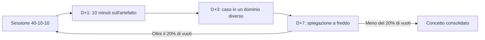

Un team di analytics engineering spende 4.200 euro l'anno in abbonamenti e certificazioni. Quando deve scrivere da zero una window function o un modello incrementale in dbt, però, apre tre schede di documentazione e copia il primo snippet che compila. Dopo sei settimane di studio serale i test a scelta multipla segnano nove risposte corrette su dieci, eppure davanti a un editor vuoto nessuno ricorda l'ordine delle clausole né i casi limite sui valori nulli. La causa non è la difficoltà del materiale né la scarsità di ore: è un metodo che misura la familiarità visiva invece della capacità di produrre.

## Quaranta ore di studio e zero righe scritte a memoria

Lo scenario è un caso ricostruito con numeri di esempio, modellato sui percorsi di formazione aziendale su SQL, dbt e architetture dati. Un analista dedica cinque ore a settimana per otto settimane alla lettura di dispense e alla visione di lezioni registrate. Prende appunti ordinati, evidenzia i passaggi chiave e supera i questionari di fine modulo al primo tentativo.

Alla nona settimana il responsabile gli chiede di progettare una tabella di retention settimanale per coorte di iscrizione, senza appunti, in venti minuti. L'analista riconosce tutti i termini del problema e sa che servono una data di prima attività e una differenza tra settimane, ma non riesce a impostare la struttura della query né a spiegare perché un join diretto produrrebbe conteggi duplicati. Ha investito quaranta ore e ha ottenuto una conoscenza che svanisce appena chiude la pagina del corso.

Gli esperimenti di Henry Roediger e Jeffrey Karpicke sul richiamo ([Roediger & Karpicke, 2006](https://doi.org/10.1111/j.1467-9280.2006.01693.x)) descrivono il fenomeno con precisione. Chi rilegge più volte un testo si giudica molto preparato a cinque minuti dalla lettura, ma una settimana dopo ha perso gran parte del contenuto. Chi sostituisce alcune riletture con sessioni di richiamo libero, senza il testo davanti, ricorda molto di più a distanza di una settimana. Nel lavoro tecnico l'illusione è ancora più forte, perché leggere una query già scritta attiva il riconoscimento della sintassi e dà la sensazione di saperla scrivere.

> **Idea chiave:** una competenza tecnica è acquisita quando sai ricostruirne il meccanismo a fonti chiuse e applicarlo a un dominio diverso a sette giorni di distanza. Riconoscere una soluzione che hai davanti è un'abilità diversa dal produrla.

## Cosa fissa una competenza tecnica nella memoria

Tre meccanismi governano il passaggio di un concetto tecnico dalla memoria di lavoro a una traccia stabile che puoi usare in produzione.

Il primo è la generazione, organizzata in una sessione 40-10-10. Nei primi quaranta minuti leggi il materiale eseguendo ogni passaggio e collegando il nuovo costrutto a un problema già incontrato. Nei dieci minuti successivi chiudi tutte le fonti e ricostruisci su un foglio bianco il funzionamento del meccanismo, le sue assunzioni e i casi in cui fallisce. Negli ultimi dieci produci un artefatto autonomo, come una scheda operativa o uno schema decisionale scritto con parole tue, che riassume la regola senza dipendere dal testo originale.

Il secondo è l'interruzione programmata della curva dell'oblio con i richiami D+1, D+3 e D+7. Hermann Ebbinghaus mostrò che la perdita di informazione è massima nelle prime ventiquattro ore e rallenta solo se la traccia viene riattivata prima di scendere sotto la soglia di recupero spontaneo. A un giorno dalla sessione (D+1) bastano dieci minuti sul tuo artefatto. A tre giorni (D+3) serve applicare il concetto a un caso con vincoli diversi. A sette giorni (D+7) devi rispiegare l'intero argomento da zero, senza alcun supporto visivo.

Il terzo è il trasferimento di contesto. Una regola memorizzata insieme all'esempio del corso resta chiusa in quell'esempio: se hai studiato il partizionamento temporale solo sugli ordini di un negozio online, faticherai a riconoscerne la necessità quando dovrai archiviare log di sessione o eventi di fatturazione. Cambiare dominio durante il richiamo D+3 ti costringe a estrarre l'invariante strutturale, cioè la parte della regola che non dipende dall'esempio.

Il diagramma mostra che il protocollo non è lineare. Il richiamo D+7 funziona da esame: se i vuoti restano sotto il venti percento dei punti previsti, il concetto esce dal calendario; se li supera, torna all'inizio con una nuova sessione 40-10-10 mirata sui punti mancanti.

## Tre abitudini che creano l'illusione di sapere

Il diario di studio che segue è tipico dei percorsi aziendali in cui la formazione non produce autonomia operativa. È compilato con numeri di esempio.

| Settimana | Attività registrata | Ore | Materiale prodotto | Esito verifica del venerdì |
| --- | --- | --- | --- | --- |
| Settimana 1 | Lettura modulo architetture e sottolineatura | 6 | Copia delle slide con evidenziatore | Incapace di disegnare il flusso senza appunti |
| Settimana 2 | Visione video a velocità doppia su dbt | 5 | Nessun documento scritto a mano | Confonde test di unicità e integrità referenziale |
| Settimana 3 | Rilettura appunti prima della revisione | 7 | Riassunto copiato dai paragrafi | Blocco davanti a un caso con dati tardivi |

In tre settimane il diario somma 6 + 5 + 7 = 18 ore di studio senza che nessuna verifica del venerdì sia superata. Ogni riga nasconde una delle abitudini seguenti.

### La rilettura sequenziale con appunti a specchio

Il sintomo è un quaderno ordinatissimo e una sensazione di fluidità mentre lo si compila. Sembra ragionevole perché mentre leggi il paragrafo e lo ricopi con minime variazioni tutto appare logico. Non funziona perché la copia a vista tiene l'informazione in memoria a breve termine per pochi secondi, senza richiedere alcuno sforzo di recupero. Una settimana dopo, davanti al problema reale, il testo non c'è più e la traccia, mai richiamata in autonomia, resta inaccessibile. La correzione è sostituire la copia con il richiamo: chiudi la pagina e scrivi ciò che ricordi, poi confronta.

### L'esecuzione guidata senza fasi a schermo chiuso

Il sintomo è la lezione aperta su metà schermo e il terminale sull'altra metà, con i comandi replicati uno dopo l'altro. Sembra pratica reale perché le mani digitano e il sistema restituisce un risultato valido. In realtà è un esercizio di trascrizione: ogni decisione su quale clausola usare o in quale ordine filtrare i dati è stata presa dallo schermo accanto, e la capacità diagnostica non viene allenata. La correzione è ripetere lo stesso esercizio a lezione chiusa, anche in forma ridotta, e consultare la fonte solo dopo aver provato.

### L'accumulo nel fine settimana senza richiami spaziati

Il sintomo è la domenica da sei ore con sei argomenti diversi, seguita da una settimana in cui nessuno dei sei è più accessibile. Sembra efficiente per chi lavora quaranta ore a settimana. Il problema è che il consolidamento richiede cicli di sonno alternati a riattivazioni distanziate: studiare sei argomenti in un pomeriggio fa sovrascrivere le tracce della prima ora con quelle della quarta. La correzione è distribuire le sei ore in sessioni più brevi in giorni diversi e bloccare in calendario i richiami fin dal primo giorno.

## Il protocollo 40-10-10 con registro di ritenzione

Per trasformare ogni ora di studio in capacità verificabile, applica questi quattro passi in ordine.

1. Dividi ogni ora in quaranta minuti di comprensione attiva, dieci di foglio bianco a schermo spento e dieci di scrittura dell'artefatto.
2. Sul foglio bianco segna ciò che hai ricostruito con certezza, ciò che ricordi in modo vago e i passaggi dimenticati, e calcola la quota di vuoti sul totale dei punti chiave.
3. Fissa nel calendario, il primo giorno, i tre richiami D+1, D+3 e D+7 con il titolo specifico del concetto.
4. Ripeti il ciclo 40-10-10 ogni volta che al richiamo D+7 la quota di punti mancanti o incerti supera il venti percento.

La scheda seguente mostra un registro compilato con numeri di esempio su due settimane.

| Concetto studiato | Foglio bianco a fine sessione | Richiamo D+1 | Richiamo D+3 (nuovo dominio) | Richiamo D+7 (a freddo) | Stato |
| --- | --- | --- | --- | --- | --- |
| Layering staging, intermediate, marts | 4 punti su 5, dubbio sui join in staging | Corretta la regola sui join grezzi | Applicato a fatturazione B2B | Spiegato in 8 minuti senza note | Consolidato |
| Retention per coorte settimanale | 2 punti su 5, omesse le settimane vuote | Riscritto lo schema del calendario | Errore su utenti multi-sessione | Ciclo ripetuto il venerdì | In consolidamento |
| Architettura a eventi e idempotenza | 5 punti su 5, nessun vuoto | Verificata l'identità anonima | Applicato a ticket di supporto | Spiegato con casi di esclusione | Consolidato |

Nella riga della retention il foglio bianco riporta 2 punti su 5, quindi 3 vuoti su 5, cioè 3 / 5 = 60%. Il valore supera di molto la soglia del 20%, e il concetto resta in consolidamento. Nella prima riga i vuoti sono 1 su 5, cioè 20%: è esattamente la soglia, il concetto passa ma il dubbio sui join va risolto al D+1.

## Quanto costa il protocollo rispetto al ristudio

L'obiezione più frequente è il tempo. I richiami sembrano ore sottratte allo studio di argomenti nuovi, e a prima vista lo sono. Il confronto corretto non è tra richiami e niente, ma tra richiami e ristudio. Prendiamo dieci concetti affrontati in un mese, con numeri di esempio.

1. Con lo studio tradizionale, a trenta giorni ne restano applicabili 2 su 10. I concetti da ristudiare sono 10 - 2 = 8.
2. Ristudiare un concetto da zero costa mediamente 1,5 ore. Il costo totale è 8 × 1,5 = 12 ore.
3. Con il protocollo, a trenta giorni ne restano applicabili 8 su 10, quindi i concetti da ristudiare sono 10 - 8 = 2, per 2 × 1,5 = 3 ore.
4. I richiami costano 10 minuti (D+1), 15 minuti (D+3) e 20 minuti (D+7), cioè 10 + 15 + 20 = 45 minuti per concetto. Su dieci concetti: 10 × 45 = 450 minuti, pari a 7,5 ore.
5. Costo totale del protocollo per i richiami e il ristudio: 7,5 + 3 = 10,5 ore, contro le 12 ore del metodo tradizionale.

Il risparmio in ore è modesto, 12 - 10,5 = 1,5 ore, ma la differenza vera è nel risultato: otto concetti disponibili contro due, a parità di ore spese. La conclusione è sensibile all'ipotesi sulla ritenzione. Se il protocollo portasse a 6 concetti su 10 invece di 8, il ristudio salirebbe a 4 × 1,5 = 6 ore e il totale a 7,5 + 6 = 13,5 ore, più del metodo tradizionale. Per questo il registro conta: ti dice se nel tuo caso la ritenzione resta davvero sopra il livello che rende il metodo conveniente.

Un artefatto ben scritto riduce anche il costo dei richiami. Una scheda di dieci righe si rilegge in pochi minuti e può avere questa forma.

> Concetto: join tra utenti e sessioni nella retention.
> Regola: prima di unire, riduci le sessioni a una riga per utente e settimana, altrimenti ogni utente moltiplica i conteggi.
> Caso limite: utenti con più sessioni nella stessa settimana e settimane senza attività.
> Controllo: la somma degli utenti per coorte deve eguagliare il totale degli iscritti.

La scheda è abbastanza breve da essere riletta senza fatica e abbastanza precisa da essere verificata. La riga "controllo" è la più utile: trasforma una regola in un test che puoi applicare a un risultato qualunque.

## Quando il ciclo completo e quando la lettura selettiva

Non tutto il materiale tecnico richiede lo stesso investimento di memoria. Applicare il protocollo a ogni pagina satura il calendario dei richiami e spinge ad abbandonarlo dopo due settimane. Esistono due modalità di lavoro distinte: lo studio per interiorizzazione, con richiami spaziati, e la consultazione di riferimento, orientata alla mappa.

Il criterio di scelta è netto. Usa il protocollo completo se il concetto è un principio architetturale o diagnostico che dovrai applicare al volo in una riunione o durante un incidente. Usa la lettura selettiva, con una mappa di riferimento, se si tratta di parametri di configurazione rari o di sintassi specifica che cercheresti comunque nella documentazione ufficiale.

La confusione frequente è invertire i due approcci. Molti cercano di memorizzare a forza l'elenco delle opzioni di un file di configurazione o i nomi di venti funzioni secondarie, e sprecano i richiami su dettagli che cambiano a ogni versione. Allo stesso tempo leggono in modo superficiale i principi di modellazione dei dati o di disegno sperimentale, convinti di averli capiti perché il discorso scorre. Il risultato è un calendario pieno di nozioni deperibili e scoperto proprio sui fondamenti. Il metodo non copre la progettazione di programmi di formazione per interi dipartimenti né la preparazione di esami basati su definizioni testuali, e i tempi 40-10-10 sono una misura di riferimento che può variare di qualche minuto con la densità della lezione.

## Controllo prima di chiudere una sessione di studio

1. Hai chiuso tutte le schede del browser e gli appunti prima di iniziare i dieci minuti di ricostruzione sul foglio bianco?

Mostra risposta

Se non l'hai fatto, la ricostruzione non misura ciò che ricordi ma ciò che riesci a rileggere. Ripeti il foglio bianco a fonti chiuse: è il passaggio che fa emergere i vuoti e che rende efficace tutto il resto.

2. Sul foglio bianco ricostruisci 3 punti chiave su 6. Qual è la quota di vuoti e come procedi?

Mostra risposta

I vuoti sono 6 - 3 = 3 su 6, cioè 50%. La quota supera il 20%, quindi il concetto non è consolidato: nell'artefatto dei dieci minuti finali riscrivi con particolare cura i 3 punti mancanti e li metti al centro del richiamo D+1.

3. Nei richiami D+1, D+3 e D+7 spendi 10, 15 e 20 minuti per concetto. Quanto tempo richiedono dodici concetti?

Mostra risposta

Per concetto: 10 + 15 + 20 = 45 minuti. Per dodici concetti: 12 × 45 = 540 minuti, pari a 9 ore. Conviene distribuirle nel mese e non concentrarle, perché i richiami funzionano solo se distanziati.

4. Devi imparare i parametri di configurazione di un servizio che usi due volte l'anno. Applichi il ciclo completo?

Mostra risposta

No. Sono dettagli rari, che cercheresti comunque nella documentazione ufficiale, quindi basta una nota di riferimento con la mappa di dove trovarli. I richiami vanno riservati ai principi che dovrai usare al volo, come il disegno di una tabella di retention o la logica di un modello incrementale.

