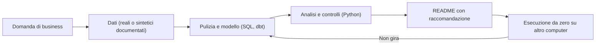

Due candidati si presentano a una selezione per un ruolo da junior analytics engineer a Milano. Hanno seguito gli stessi moduli e hanno le stesse competenze teoriche. Questo è uno scenario costruito, con numeri di esempio: il primo manda un curriculum con un elenco di attestati di completamento. Il secondo manda lo stesso curriculum e due link a repository pubblici, ciascuno con query SQL commentate, modelli dbt con test e un README che si chiude con una raccomandazione di business. Chi legge le candidature ha quaranta fascicoli sul tavolo e pochi minuti per ciascuno. Il primo viene scartato allo screening. Il secondo ottiene un colloquio tecnico, e in quel colloquio la prima domanda parte dal suo repository.

## Perché gli attestati non bastano a convincere chi seleziona

Un attestato dichiara che hai seguito un percorso. Non dice se sai usarlo su dati sporchi, con una scadenza, davanti a una domanda poco precisa. Chi seleziona lo sa, e lo considera un segnale debole proprio perché è facile da ottenere. Un repository con un progetto completo, invece, è una prova diretta: mostra come imposti un problema, come tratti i dati, come ragioni sui risultati e come comunichi la conclusione.

> **Idea chiave:** un singolo progetto riproducibile, con dati realistici e una raccomandazione di business, dimostra più di molti attestati di completamento, perché chi lo guarda può verificare il lavoro invece di fidarsi della dichiarazione.

La differenza è la stessa che separa conoscenza e competenza. La conoscenza è sapere come funziona una window function o un modello incrementale. La competenza è saperli applicare a una tabella piena di date mancanti e duplicati per rispondere a una domanda concreta entro un termine. La prima si dichiara, la seconda si dimostra. Tutto il resto di questa lezione riguarda come costruire la dimostrazione senza spendere mesi.

## Cosa cerca davvero chi apre il tuo repository

Chi apre un portfolio non legge tutto. Fa una scansione rapida alla ricerca di quattro segnali, e se ne trova tre in due minuti prosegue, altrimenti chiude. Conoscere i quattro segnali permette di progettare il progetto in modo che siano visibili subito.

| Elemento del portfolio | Cosa guarda chi seleziona | Errore tipico | Versione efficace |
| :--- | :--- | :--- | :--- |
| Problema iniziale | Capacità di collegare dati e business | "Analisi del dataset vendite" | "Ridurre il churn del terzo trimestre individuando due driver" |
| Stack tecnico | Padronanza di SQL, CTE, dbt, Python | Notebook disordinati e senza test | SQL leggibile, test sui modelli, struttura chiara delle cartelle |
| Output finale | Chiarezza per chi decide | Solo grafici, senza testo | Tabella sintetica più azione proposta e rischio residuo |
| Riproducibilità | Ordine e rigore ingegneristico | File mancanti, percorsi locali | Istruzioni per rieseguire da zero in meno di dieci minuti |

La prima riga è quella che pesa di più. Un titolo come "analisi del dataset" descrive un esercizio, mentre una domanda di business con un obiettivo misurabile descrive un lavoro. Cambiare la formulazione del problema non richiede nessuna competenza in più, ma cambia completamente il modo in cui il progetto viene letto: da compito scolastico a caso professionale.

## Un README da leggere in due minuti

Il README è la porta d'ingresso del progetto, e per molti lettori è anche l'unica parte che leggeranno. Deve rispondere a cinque domande nell'ordine in cui le pone un responsabile: quale problema stai risolvendo, con quali dati, con quale metodo, che cosa hai trovato, che cosa propone di fare. Una struttura fissa aiuta chi scrive a non dimenticare nulla e chi legge a trovare subito ciò che cerca.

> Problema: ridurre il churn del terzo trimestre su un servizio in abbonamento.
> Dati: tabella degli abbonamenti (ordini, piano, data di disdetta), 18.000 righe, estrazione sintetica documentata.
> Metodo: segmentazione per piano e canale, confronto con la media storica, modello dbt per il calcolo mensile.
> Risultato: il 75% dell'eccesso di churn si concentra nel piano base acquisito da una sola campagna.
> Raccomandazione: correggere l'onboarding di quel segmento prima di toccare i prezzi.

Il blocco mostra una scrittura densa e verificabile. Ogni riga contiene un fatto, e le ultime due righe sono quelle che interessano chi decide. Un lettore che si ferma al risultato e alla raccomandazione ha già capito il valore del lavoro, e chi vuole controllare il metodo trova i dettagli nel codice. Il README non spiega tutta l'analisi: indica dove guardare e che cosa concludere.

Un'abitudine utile è scrivere il README prima di chiudere il progetto, non dopo. Se non riesci a compilare la riga "raccomandazione", significa che l'analisi non è arrivata a una conclusione, e conviene tornare ai dati invece di lucidare la presentazione.

## Dimensionare il portfolio in ore e settimane

Un portfolio efficace non richiede decine di progetti. Tre progetti ben fatti, ciascuno su un tema diverso, coprono lo stack atteso e mostrano varietà. Il rischio non è produrne pochi, è non finirne nessuno. Per questo conviene stimare in anticipo il tempo di ciascun progetto, come si farebbe con un incarico di lavoro.

Il ciclo finale, dal controllo di esecuzione al modello, indica la tappa che molti saltano: provare a rieseguire tutto da zero. È la stessa verifica descritta nella lezione sulla riproducibilità, e fa la differenza tra un repository che si legge e uno che si usa.

Ecco una stima con numeri di esempio per un progetto, scomposta in fasi, seguita dal calcolo per l'intero portfolio.

1. Raccolta e preparazione dei dati: 6 ore.
2. Modello e query (SQL con CTE e window function, modello dbt con test): 8 ore.
3. Analisi e controlli in Python: 4 ore.
4. Scrittura del README e delle conclusioni: 4 ore.
5. Prova di esecuzione da zero e correzioni: 3 ore.
6. Totale per progetto: 6 + 8 + 4 + 4 + 3 = 25 ore.
7. Portfolio di tre progetti: 3 × 25 = 75 ore.
8. Durata a 6 ore a settimana: 75 / 6 = 12,5 settimane, quindi 13 settimane in calendario.

Il calcolo mostra due cose. La prima è che un portfolio serio è un impegno di circa tre mesi a ritmo moderato, non un fine settimana. La seconda è la distribuzione: README e prova di esecuzione pesano 4 + 3 = 7 ore su 25, cioè il 28% del tempo. Chi risparmia su queste due fasi, per concentrarsi sul codice, riduce il tempo solo del 28% ma toglie al progetto proprio le parti che chi seleziona guarda per prime.

Se hai solo 4 ore a settimana, il portfolio richiede 75 / 4 = 18,75 settimane, cioè 19. In quel caso conviene partire con un solo progetto completo, da 25 / 4 = 6,25 settimane, cioè 7, e candidarti con quello, invece di aspettare cinque mesi per averne tre.

## Costruire lo stack atteso passo dopo passo

Le aziende che assumono per ruoli junior nei dati cercano un nucleo di strumenti abbastanza stabile. SQL solido, con CTE e window function, è la base di tutto: lo si usa per ogni estrazione e ogni controllo. La modellazione con dbt mostra che sai organizzare le trasformazioni in modo testabile e documentato. Python serve per analisi statistiche e per visualizzazioni chiare. Git e una minima organizzazione del repository completano il quadro, perché permettono a un altro di vedere la storia del lavoro.

Non serve toccare tutti questi strumenti in ogni progetto. Il primo progetto può essere centrato su SQL e dbt, il secondo su Python e statistica, il terzo su una pipeline o su un cruscotto. L'importante è che ciascuno dimostri una capacità distinta e che nessuno resti a metà. Un progetto di cui hai finito il README ma non il modello vale meno di uno più semplice completo da capo a fondo.

Nella scelta dei dati conta il realismo. Dataset didattici usati migliaia di volte non dicono nulla di te, e mancano di quelle imperfezioni (date mancanti, duplicati, regole di business ambigue) in cui si vede il lavoro vero. Se non puoi usare dati aziendali, genera dati sintetici documentati, con le stesse anomalie che ti aspetteresti in un ambiente reale, e dichiara nel README che sono sintetici e come sono stati costruiti.

## Tre errori che rendono invisibile un buon progetto

Molti candidati investono settimane e poi presentano il lavoro in un modo che ne nasconde il valore.

### Ripetere sempre gli stessi dataset didattici

Il sintomo è un repository che chi seleziona ha già visto più volte, con le stesse variabili e le stesse conclusioni. Succede perché i dataset noti sono comodi, hanno tutorial pronti e non richiedono di costruire un problema. Il rimedio è partire da una domanda propria e, se serve, creare dati sintetici con anomalie volute, descrivendo nel README come le hai introdotte.

### Pubblicare un repository senza README o con codice non commentato

Il sintomo è un link aperto e chiuso in trenta secondi. Succede perché chi scrive il codice lo conosce a memoria e sottovaluta quanto sia opaco per un estraneo. La correzione è aprire il proprio repository in una finestra privata, senza contesto, e verificare se in due minuti si capisce che cosa risolve il progetto e che cosa conclude.

### Mostrare complessità tecnica senza impatto economico

Il sintomo è un elenco di dieci algoritmi senza nessuna cifra su ciò che il lavoro avrebbe cambiato. Succede perché la complessità sembra una prova di competenza. In realtà chi decide valuta il risultato: una query ben scritta che permette di recuperare 105 clienti a rischio o di evitare una spesa inutile dice molto di più di una pila di modelli. Ogni progetto dovrebbe chiudersi con una cifra o con una scelta concreta, anche stimata, e dichiarare le ipotesi su cui poggia.

## Se parti da un ruolo non tecnico

Chi lavora oggi nel marketing, nelle vendite o in amministrazione ha un vantaggio che i candidati puramente tecnici non hanno: conosce problemi reali dell'azienda. Sa quali decisioni si prendono, quali numeri vengono discussi in riunione e quali domande restano senza risposta. Il primo progetto può nascere proprio da lì, trasformando una domanda del proprio reparto in un'analisi riproducibile, con dati anonimizzati se necessario.

Un buon criterio per scegliere la domanda è confrontare tre candidate su tre aspetti: quanto è sentita nel reparto, quanto sono accessibili i dati e quanto è chiara la decisione che ne dipende. Una domanda molto sentita ma senza dati utilizzabili porta a un progetto bloccato, mentre una con buoni dati ma nessuna decisione collegata produce un esercizio senza conseguenze. La migliore è quella che soddisfa tutti e tre i criteri, anche se a prima vista sembra meno ambiziosa delle altre.

Chi arriva da un ruolo non tecnico dovrebbe inoltre curare la parte di comunicazione. Sa scrivere per un responsabile e sa quali obiezioni ci si può aspettare, e questa competenza, unita a un repository ordinato, è una combinazione rara tra i candidati junior.

## Controllo prima di candidarti

1. Il tuo progetto principale ha un titolo che formula una domanda di business o descrive soltanto un dataset?

Mostra risposta

Se descrive solo un dataset, riscrivilo come domanda con un obiettivo misurabile, per esempio "ridurre il churn del terzo trimestre individuando due driver". Il cambio non richiede nessuna competenza aggiuntiva ma modifica il modo in cui il progetto viene letto: da esercizio a caso professionale.

2. Un progetto ti richiede 7 ore di dati, 9 di modello, 5 di analisi, 4 di README e 3 di prova di esecuzione. Quante settimane servono per tre progetti a 6 ore settimanali?

Mostra risposta

Per progetto: 7 + 9 + 5 + 4 + 3 = 28 ore. Per tre progetti: 3 × 28 = 84 ore. A 6 ore a settimana: 84 / 6 = 14 settimane esatte.

3. Chi apre il tuo repository in una finestra privata riesce a capire in due minuti che cosa risolve il progetto?

Mostra risposta

Se la risposta è no, intervieni sul README: problema, dati, metodo, risultato e raccomandazione, uno per riga, nell'ordine in cui li legge un responsabile. Chiedi anche a una persona estranea al progetto di fare la prova e di dirti che cosa ha capito.

4. Hai un progetto con quattro modelli perfetti, ma senza raccomandazione finale. È pronto per essere mostrato?

Mostra risposta

No. Senza una conclusione o una scelta proposta, l'analisi non è arrivata alla parte che interessa a chi decide. Torna ai risultati, individua l'azione che ne deriva e scrivila con cifre o stime dichiarate, insieme alle ipotesi su cui si regge.

