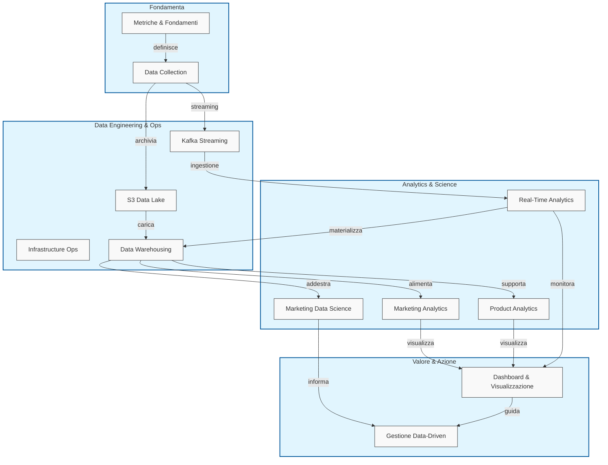
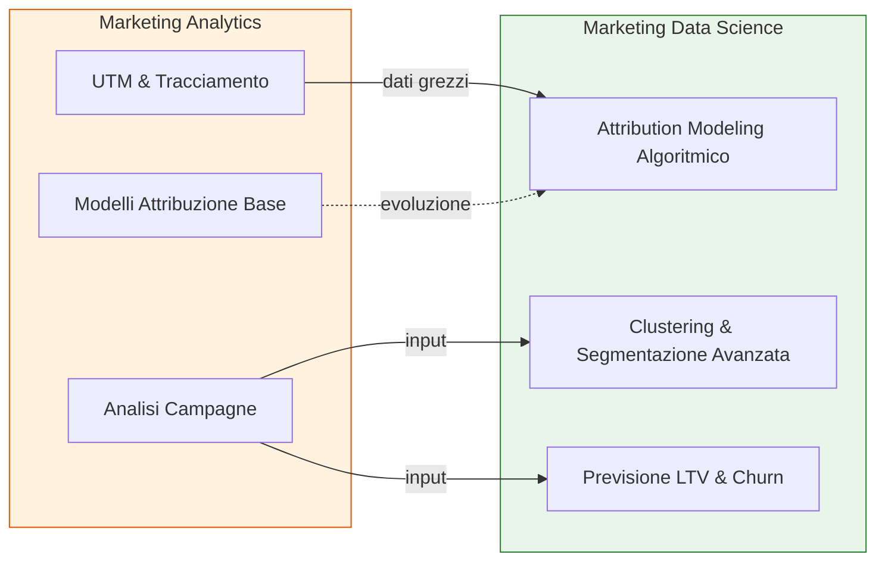
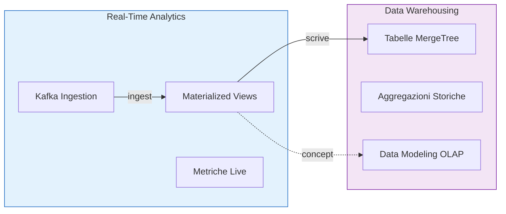
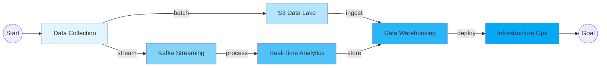
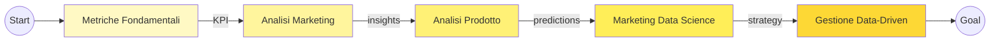
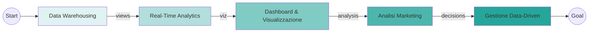

## Introduzione

Comprendere i singoli moduli di questo corso è fondamentale, ma il vero valore emerge quando si iniziano a vedere le connessioni tra di essi. Il data engineering non è isolato dall'analisi di marketing; le metriche di prodotto influenzano le strategie di business.

Queste mappe concettuali sono progettate per aiutarti a:
1.  **Navigare la complessità:** Vedere come ogni pezzo del puzzle si incastra nel quadro generale.
2.  **Identificare prerequisiti nascosti:** Capire quali concetti tecnici abilitano specifiche analisi di business.
3.  **Costruire percorsi di studio personalizzati:** Scegliere i moduli più rilevanti per il tuo ruolo attuale o futuro.

## Mappa Generale del Corso

Questa mappa mostra il flusso logico dei dati e della conoscenza attraverso l'intero curriculum, dalla raccolta del dato grezzo alla decisione strategica.

## Stack Tecnologico per Modulo

Ogni modulo si appoggia a specifiche tecnologie. Ecco una panoramica degli strumenti chiave che incontrerai.

| Area Tematica | Moduli | Tecnologie Chiave |
| :--- | :--- | :--- |
| **Infrastruttura** | Data Collection, S3 Data Lake, Kafka Streaming, Infrastructure Ops | AWS S3, Apache Kafka, Terraform, Docker, Kubernetes |
| **Data Warehousing** | Data Warehousing, Real-Time Analytics | ClickHouse, dbt, SQL, Materialized Views |
| **Analytics** | Marketing Analytics, Product Analytics, Marketing Data Science | Python (Pandas, Scikit-learn), Jupyter Notebooks, GA4 |
| **Visualizzazione** | Dashboard & Visualizzazione, Real-Time Analytics | Apache Superset, Grafana, Tableau |

## Connessioni Dettagliate

Esploriamo come alcuni moduli specifici si parlano tra loro.

### Marketing Analytics ↔ Marketing Data Science

Il modulo di *Marketing Analytics* copre le basi del tracciamento e dell'analisi delle performance passate. *Marketing Data Science* porta questi concetti al livello successivo con modelli predittivi e algoritmi avanzati.

*   **Relazione:** I dati puliti raccolti nel modulo Analytics sono il "carburante" per i modelli di Data Science.
*   **Esempio:** L'analisi delle campagne (Analytics) ti dice *cosa* è successo; il modello di attribuzione algoritmico (Data Science) ti dice *perché* e come allocare il budget futuro.

### Real-Time Analytics ↔ Data Warehousing

Mentre il Data Warehousing si concentra sullo stoccaggio storico e l'analisi OLAP, il Real-Time Analytics gestisce l'ingestione e l'aggregazione istantanea. Entrambi spesso convergono sulla stessa tecnologia: ClickHouse.

*   **Relazione:** Le *Materialized Views* (Real-Time) pre-calcolano i dati mentre arrivano, scrivendoli in tabelle ottimizzate (Warehousing) per query velocissime.
*   **Esempio:** Un evento "Add to Cart" entra via Kafka, viene aggregato da una Materialized View e salvato nel Data Warehouse per l'analisi storica e live.

## Concetti Trasversali

Alcuni concetti sono onnipresenti nel corso. Ecco dove li ritroverai e come evolvono.

| Concetto | Moduli Chiave | Evoluzione del Concetto |
| :--- | :--- | :--- |
| **ClickHouse** | Data Warehousing, Real-Time Analytics, S3 Data Lake | Inizia come motore OLAP per query veloci, diventa motore di stream processing, e infine layer di query su S3. |
| **Attribution** | Marketing Analytics, Marketing Data Science | Da modelli "Last Click" e basati su regole a modelli probabilistici e Markov Chains. |
| **Retention** | Analisi Prodotto, Marketing Data Science, Metriche Fondamentali | Da semplice KPI (Metriche) a curve di coorte (Prodotto) fino a modelli predittivi di Churn (Data Science). |
| **KPI & OKR** | Metriche Fondamentali, Gestione Data-Driven, Analisi Prodotto | Definiti strategicamente all'inizio, diventano metriche operative nei moduli di analisi e tornano come strumenti di governance nella gestione. |

## Percorsi Tematici

A seconda del tuo obiettivo professionale, puoi seguire percorsi diversi attraverso i moduli.

### Percorso Data Engineering
Focalizzato sulla costruzione dell'infrastruttura robusta e scalabile.

### Percorso Growth Hacker
Focalizzato sull'utilizzo dei dati per la crescita rapida e l'ottimizzazione.

### Percorso Analytics Engineer
Il ponte tra i dati grezzi e le decisioni di business.

