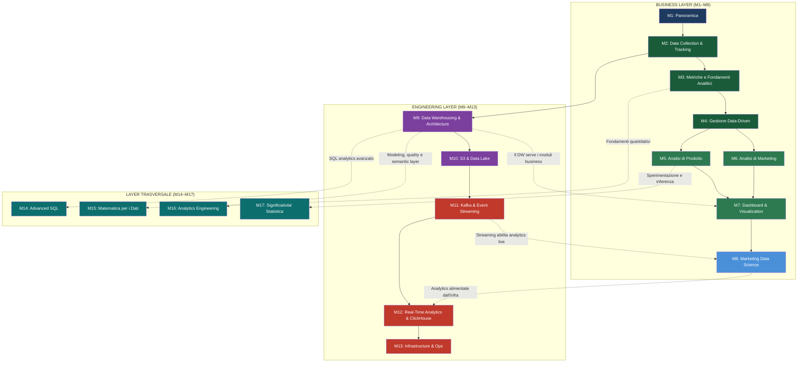
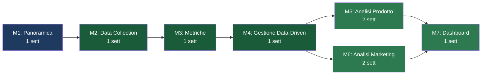
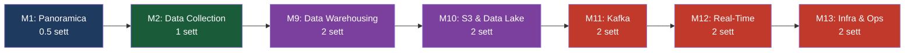
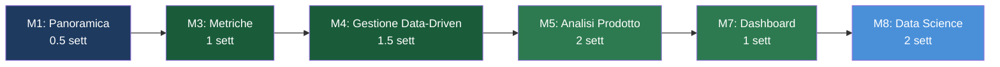
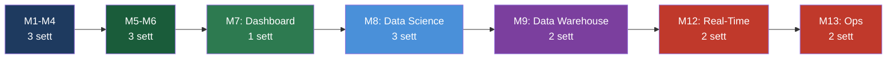

import { Aside, Steps, Tabs, TabItem } from '@astrojs/starlight/components'

Nel 1972 Joseph Novak, ricercatore a Cornell University, stava cercando di capire perché i suoi studenti di scienze dimenticavano quasi tutto dopo gli esami. Aveva insegnato loro le stesse lezioni, usato gli stessi libri. La differenza, scoprì, non era nel contenuto — era nella **struttura mentale** con cui gli studenti organizzavano l'informazione. Chi eccelleva non aveva più nozioni: aveva una mappa più ricca delle connessioni tra le nozioni. Novak chiamò questo strumento "concept map" e dimostrò che gli studenti che disegnavano esplicitamente queste mappe prima di studiare i dettagli ritenevano il 40% in più delle informazioni a distanza di tre mesi.

Lo stesso principio vale per il tuo percorso in questo corso. Puoi studiare ogni lezione in isolamento — e capirai SQL, Kafka, le coorti, gli embedding. Oppure puoi iniziare con la mappa: capire perché il modulo su Kafka esiste dopo quello su S3, perché la lezione sul JTBD precede quella sul tracking plan, perché la Marketing Data Science viene dopo l'analisi di marketing e non prima. Questa lezione è quella mappa.

## La Struttura del Corso: Due Layer Sovrapposti

Il corso è costruito su due layer distinti che si intersecano:

**Business Layer (Moduli 1–8):** La dimensione analitica e strategica. Risponde alla domanda "cosa misurare e perché". Include la strategia data-driven, la raccolta dei dati, le metriche fondamentali, l'analisi di prodotto e marketing, la visualizzazione e la data science applicata al marketing.

**Engineering Layer (Moduli 9–13):** La dimensione infrastrutturale. Risponde alla domanda "come costruire il sistema che rende possibile l'analisi". Include il data warehousing, i data lake su S3, lo streaming con Kafka, le analytics in tempo reale e l'ops/infrastruttura.

**Moduli Trasversali (M14–M17):** Competenze tecniche, quantitative e di modellazione che potenziano entrambi i layer. Advanced SQL (M14) approfondisce il linguaggio comune tra analisti e ingegneri; Matematica per i Dati (M15) fornisce i fondamenti quantitativi; Analytics Engineering (M16) crea il layer affidabile tra dati grezzi e metriche riusabili; Significativita' Statistica & A/B Testing (M17) aggiunge il rigore inferenziale che rende difendibili gli esperimenti.

La sequenza del corso non è arbitraria. Moduli 1–8 ti danno il "perché" e il "cosa" — senza capire perché un'analisi di coorte richiede dati di qualità, non capirai perché vale la pena costruire un data warehouse. I Moduli 9–13 ti danno il "come" tecnico per realizzare ciò che i moduli precedenti richiedono. I Moduli 14–17 approfondiscono le competenze trasversali che rendono più potente tutto il resto.

## I 17 Moduli: Cosa Impari e Perché in Quest'Ordine

<Tabs>
<TabItem label="Moduli 1–4 (Strategia & Fondamenti)">

**Modulo 1 — Panoramica del Corso**
Il modulo che stai leggendo. Fornisce la mappa mentale dell'intero percorso. Senza questa visione d'insieme, ogni lezione successiva rischia di sembrare un pezzo isolato senza un disegno complessivo.

**Modulo 2 — Data Collection & Tracking**
Il fondamento tecnico di tutto. Prima di analizzare qualsiasi dato, devi sapere come raccoglierlo correttamente. Questo modulo copre l'event tracking, la privacy (GDPR), le integrazioni con piattaforme esterne e il framework per progettare un tracking plan. Viene prima dei moduli analitici perché dati di scarsa qualità rendono inutili le analisi più sofisticate.

**Modulo 3 — Metriche e Fondamenti Analitici**
La grammatica del linguaggio dei dati. Copre la statistica per il business, le metriche fondamentali (CAC, LTV, churn, ARPU), l'approccio analitico e la ricerca desk. È il ponte tra la raccolta grezza dei dati e la capacità di trasformarli in decisioni.

**Modulo 4 — Gestione Data-Driven**
Come costruire un'organizzazione che usa i dati per decidere. Framework JTBD, ciclo di Deming, OKR, ricerca quantitativa e qualitativa, cultura data-driven. Viene dopo le metriche perché senza saper misurare non puoi gestire data-driven.

</TabItem>
<TabItem label="Moduli 5–8 (Analytics & Data Science)">

**Modulo 5 — Analisi di Prodotto**
Come analizzare e migliorare un prodotto digitale con i dati. Customer development, NPS, Product-Market Fit, analisi di coorte, A/B testing, onboarding, retention. Questi strumenti si applicano solo se hai già un sistema di raccolta dati (Mod 2) e sai cosa misurare (Mod 3).

**Modulo 6 — Analisi di Marketing**
Come misurare e ottimizzare le attività di marketing. Performance marketing, modelli di attribuzione, funnel e unit economics, SEO analytics, brand analytics, GA4 avanzato. Si sovrappone con il Mod 5 nella metodologia (entrambi usano coorti, A/B test) ma con focus su acquisition e canali.

**Modulo 7 — Dashboard & Data Visualization**
Come trasformare i dati in comunicazione. Dashboard strategiche, principi di visualizzazione, storytelling, SQL per analisti, Python per l'analisi. Viene dopo i moduli analitici perché per costruire una buona dashboard devi prima sapere cosa stai cercando di comunicare.

**Modulo 8 — Marketing Data Science**
Il livello più avanzato del business layer. Modelli di attribuzione multi-touch, retention modeling, cluster analysis, embeddings vettoriali, text generation, sperimentazione avanzata. Richiede tutti i moduli precedenti come prerequisito implicito.

</TabItem>
<TabItem label="Moduli 9–13 (Engineering)">

**Modulo 9 — Data Warehousing & Architecture**
Il fondamento dell'engineering layer. OLAP vs OLTP, data modeling, SQL avanzato, ClickHouse come columnar store, schema evolution. È il punto di partenza perché senza un data warehouse non si costruisce nulla di ciò che segue.

**Modulo 10 — S3 & Data Lake Architecture**
Come costruire uno strato di storage scalabile e economico. Object storage, formato Parquet, partitioning strategy, data lake design, integrazione con ClickHouse via S3. Viene dopo il data warehousing perché il data lake spesso alimenta il DW.

**Modulo 11 — Kafka & Event Streaming**
Apache Kafka come sistema nervoso per i dati in movimento. Producers, consumers, Schema Registry, Kafka Connect, pipeline real-time. Viene dopo S3 perché molte pipeline Kafka scaricano su S3 prima di caricare nel DW.

**Modulo 12 — Real-Time Analytics & ClickHouse**
Come analizzare i dati nel momento in cui arrivano. ClickHouse ottimizzazioni, materialized views, streaming analytics, CDC patterns, dashboard live. È la sintesi dei tre moduli precedenti applicata all'analisi in tempo reale.

**Modulo 13 — Infrastructure & Ops**
Come gestire, monitorare e mantenere in produzione tutto ciò che è stato costruito. CI/CD, cost management, monitoring & observability, Infrastructure as Code con Terraform, documentazione tecnica.

</TabItem>
<TabItem label="Moduli 14–17 (Trasversali)">

**Modulo 14 — Advanced SQL**
SQL non è solo SELECT e GROUP BY: questo modulo porta il linguaggio al livello che distingue un analista junior da uno senior. Window functions per retention e funnel, sessionizzazione, KPI table, pattern avanzati per analytics su ClickHouse. Richiede M9 come base, ma si applica a qualsiasi modulo analitico del corso.

**Modulo 15 — Matematica per l'Analisi Dati**
I fondamenti quantitativi che rendono possibile tutto il livello avanzato. Algebra lineare applicata (per embeddings e PCA), calcolo differenziale (per gradient descent e ottimizzazione), probabilità e inferenza bayesiana (per A/B testing e modelli predittivi). Non è un corso di matematica pura: ogni concetto è collegato esplicitamente a una lezione specifica del corso dove viene applicato.

**Modulo 16 — Analytics Engineering**
Il punto in cui modeling, qualità e metriche riusabili diventano infrastruttura decisionale. dbt, staging, marts, test, semantic layer, deploy e governance trasformano i dati martech in un sistema coerente, non in una collezione di query isolate.

**Modulo 17 — Significativita' Statistica & A/B Testing**
Il modulo che mette disciplina sugli esperimenti. Ipotesi, randomizzazione, A/A test, p-value, sample size, peeking e governance del testing completano il percorso tra analisi, prodotto e decisioni data-driven.

</TabItem>
</Tabs>

## Prerequisiti per Ogni Modulo

Questa tabella mostra cosa dovresti avere già studiato prima di affrontare ogni modulo. I prerequisiti "impliciti" sono concetti generali (non lezioni specifiche) che si assumono noti.

| Modulo | Prerequisiti espliciti | Prerequisiti impliciti |
|:---|:---|:---|
| **M1: Panoramica** | Nessuno | Nessuno |
| **M2: Data Collection** | M1 | Conoscenza base del web (cookie, HTTP, browser) |
| **M3: Metriche** | M2 | Matematica di base, percentuali, medie |
| **M4: Gestione Data-Driven** | M3 | Esperienza in un contesto aziendale |
| **M5: Analisi Prodotto** | M3, M4 | Utilizzo di un prodotto digitale (SaaS, app) |
| **M6: Analisi Marketing** | M3, M4 | Conoscenza base di advertising digitale |
| **M7: Dashboard & Viz** | M3, M5 o M6 | Capacità di leggere grafici e tabelle |
| **M8: Marketing Data Science** | M5, M6, M7 | Python base, statistica intermedia |
| **M9: Data Warehousing** | M2, M3 | SQL base (SELECT, GROUP BY, JOIN) |
| **M10: S3 & Data Lake** | M9 | Concetti di file system e storage |
| **M11: Kafka & Streaming** | M9, M10 | Linux base, concetti di rete |
| **M12: Real-Time Analytics** | M9, M11 | ClickHouse base (M9) |
| **M13: Infrastructure & Ops** | M9–M12 | Git, concetti di CI/CD |
| **M14: Advanced SQL** | M9 | SQL base (SELECT, GROUP BY, JOIN) |
| **M15: Matematica per i Dati** | M3 | Algebra di base, nozioni di statistica |
| **M16: Analytics Engineering** | M9, M10 | SQL intermedio, basi di warehouse e quality |
| **M17: Significativita' Statistica** | M3, M5 | Statistica di base, metriche e logica sperimentale |

<Aside type="tip">
Se hai già esperienza come developer o data engineer, puoi iniziare direttamente dal Modulo 9 saltando i prerequisiti impliciti. Se vieni dal marketing senza background tecnico, i Moduli 1–8 sono il tuo percorso naturale e M9–M17 possono essere affrontati successivamente o saltati in base al ruolo.
</Aside>

## Le Connessioni Cross-Modulari Più Importanti

Le lezioni più potenti del corso non sono quelle prese singolarmente, ma le connessioni tra di esse. Ecco le 12 connessioni più critiche da tenere a mente mentre studi:

| Da (lezione) | A (lezione) | Come si connettono |
|:---|:---|:---|
| **M4: JTBD & OKR** | **M2: Tracking Plan** | I Jobs to be Done definiscono quali comportamenti utente vale la pena tracciare. Senza capire il job, il tracking plan è un elenco di eventi arbitrari |
| **M2: Event Tracking** | **M11: Kafka Producers** | Gli eventi raccolti dal browser/app vengono inviati a Kafka prima di essere processati. La struttura dell'evento (schema) progettata in M2 deve essere compatibile con lo Schema Registry di M11 |
| **M9: Data Modeling** | **M5: Analisi di Coorte** | La qualità dell'analisi di coorte dipende direttamente da come la tabella `orders` e `users` è modellata nel DW. Un modello corretto rende la coorte una query di 10 righe; uno sbagliato la rende impossibile |
| **M3: Statistica** | **M5: A/B Testing** | I test statistici dell'A/B testing (chi-square, t-test, power analysis) sono applicazioni dirette dei fondamenti di M3. Chi salta M3 non riesce a interpretare correttamente i risultati |
| **M6: Unit Economics** | **M8: LTV Modeling** | Il calcolo del LTV in M8 (modelli BG/NBD, predittivi) usa il funnel unit economics di M6 come input. Il CAC calcolato in M6 è il denominatore del LTV/CAC ratio che M8 cerca di ottimizzare |
| **M11: Kafka Schema Registry** | **M9: Schema Evolution** | I contratti dati (schemas Avro/Protobuf) in Kafka devono essere compatibili con le migrazioni di schema nel DW. Chi non ha capito la schema evolution di M9 non riesce a mantenere la compatibilità in produzione |
| **M12: ClickHouse Real-Time** | **M7: Dashboard Live** | Le materialized views di ClickHouse (M12) alimentano direttamente le dashboard live costruite in M7. La performance delle dashboard dipende da come sono costruite le views |
| **M10: Parquet & S3** | **M12: ClickHouse** | ClickHouse può leggere dati direttamente da S3 in formato Parquet tramite la Table Engine S3. Il partitioning strategy di M10 determina la velocità delle query di M12 |
| **M4: Ciclo HADI** | **M5: A/B Testing** | Il ciclo HADI (Hypothesis → Action → Data → Insight) è il framework metodologico di cui l'A/B test è lo strumento esecutivo. HADI dice "cosa testare"; A/B test dice "come testarlo" |
| **M6: Modelli di Attribuzione** | **M8: Attribution ML** | M6 copre l'attribuzione rule-based (last-click, linear, time-decay). M8 la porta al livello successivo con modelli data-driven (Shapley value, LSTM). Il secondo non ha senso senza il primo |
| **M13: Monitoring** | **M12: Real-Time** | Le pipeline real-time (M12) senza monitoring (M13) sono cieche. Un CDC pattern che smette di funzionare alle 3 di notte deve essere rilevato prima che i business analyst trovino dati inconsistenti la mattina |
| **M2: Privacy & GDPR** | **M9: Data Governance** | Il consenso raccolto in M2 deve essere rispettato in tutti gli strati successivi: il DW in M9 deve poter eliminare dati su richiesta (right to erasure), e il data lake in M10 deve essere disegnato per supportare la retention policy |

## Percorsi Personalizzati per Ruolo

Non tutti devono seguire i 17 moduli nell'ordine sequenziale. In base al tuo ruolo attuale e obiettivo professionale, il percorso ottimale cambia.

<Tabs>
<TabItem label="Marketing Analyst">

**Obiettivo:** Saper analizzare dati di marketing, costruire dashboard, calcolare metriche e interpretare esperimenti — senza necessariamente costruire l'infrastruttura.

**Timeline consigliata: 8–10 settimane**

**Moduli opzionali:** M8 (Marketing Data Science) se vuoi avanzare verso ruoli di Senior Analyst o Data Scientist.

**Moduli da saltare (per ora):** M9–M13 (Engineering Layer) — utili per capire il contesto ma non necessari per il lavoro quotidiano. M14 (Advanced SQL) è consigliato per chi vuole padroneggiare le query complesse; M15 (Matematica) è opzionale salvo interesse per ML avanzato.

**Lezioni prioritarie:** `metriche-fondamentali`, `analisi-coorte`, `funnel-unit-economics`, `modelli-attribuzione`, `dashboard-strategiche`, `ab-testing`.

</TabItem>
<TabItem label="Data Engineer">

**Obiettivo:** Costruire e mantenere pipeline dati affidabili, scalabili e in tempo reale per team analytics.

**Timeline consigliata: 10–14 settimane**

**Moduli consigliati in parallelo:** M3 (Metriche) per capire cosa gli analisti hanno bisogno di misurare — fondamentale per progettare le giuste tabelle nel DW.

**Lezioni prioritarie:** `event-tracking`, `data-modeling`, `clickhouse`, `s3-fondamenti`, `kafka-fondamenti`, `kafka-clickhouse`, `cdc-pattern`, `iac-terraform`, `cicd`, `monitoring-observability`.

</TabItem>
<TabItem label="Product Manager / Growth">

**Obiettivo:** Usare i dati per prendere decisioni di prodotto, prioritizzare feature, misurare esperimenti e comunicare risultati agli stakeholder.

**Timeline consigliata: 6–8 settimane**

**Lezioni prioritarie:** `okr-e-kpi`, `framework-jtbd`, `ciclo-deming-hadi`, `analisi-coorte`, `ab-testing`, `product-market-fit`, `retention-framework`, `dashboard-strategiche`, `strategy`.

**Nota:** Il Product Manager non ha bisogno di scrivere SQL o Python, ma deve capire cosa è tecnicamente possibile e cosa richiede l'infrastruttura. Leggere (non necessariamente praticare) M9 e M11 amplia la capacità di dialog con i Data Engineer.

</TabItem>
<TabItem label="Marketing Data Scientist">

**Obiettivo:** Costruire modelli predittivi, sistemi di raccomandazione e analisi avanzate per il marketing.

**Timeline consigliata: 14–18 settimane**

**Lezioni prioritarie:** Tutto M8 (attribution, retention, cluster-analysis, embeddings, experimentation, python), più `analisi-coorte`, `ab-testing`, `statistica-fondamenti`, `clickhouse`, `clickhouse-ottimizzazione`.

</TabItem>
</Tabs>

## Mappa delle Competenze per Modulo

Questa tabella mostra le competenze specifiche che ogni modulo sviluppa, organizzate per area.

| Modulo | Competenze Tecniche | Competenze Analitiche | Competenze Strategiche |
|:---|:---|:---|:---|
| **M1: Panoramica** | — | Lettura di mappe concettuali | Visione sistemica del dato |
| **M2: Data Collection** | Event tracking, GTM, privacy, API | Audit del tracking plan | Framework per la raccolta strutturata |
| **M3: Metriche** | SQL base, Excel avanzato | Statistica descrittiva, percentili | KPI tree, North Star Metric |
| **M4: Data-Driven** | Survey design, SQL analisi | Interviste qualitative, ricerca quantitativa | OKR, JTBD, ciclo HADI, Deming |
| **M5: Prodotto** | Python per analisi, Mixpanel | Coorti, funnel, A/B test | PMF, NPS, prioritizzazione feature |
| **M6: Marketing** | GA4, UTM tracking | Attribution, media mix | Unit economics, brand equity |
| **M7: Viz & Dashboard** | SQL avanzato, Python, Metabase | Storytelling con dati | Dashboard design per stakeholder |
| **M8: Data Science** | Python ML, scikit-learn | Retention ML, cluster analysis | Strategie di personalizzazione |
| **M9: Data Warehouse** | SQL avanzato, ClickHouse | Data modeling, OLAP | Architettura dati scalabile |
| **M10: S3 & Data Lake** | Parquet, AWS S3/CLI | Partitioning, lifecycle policy | Architettura lambda/kappa |
| **M11: Kafka** | Kafka CLI, Schema Registry | Consumer group monitoring | Design di pipeline event-driven |
| **M12: Real-Time** | Materialized views, CDC | Query optimization ClickHouse | Architettura analytics in tempo reale |
| **M13: Ops** | Terraform, Docker, GitHub Actions | Cost analysis, observability | DevOps culture per data teams |
| **M14: Advanced SQL** | Window functions, sessionizzazione | Pattern avanzati per analytics | Colmare il gap analista-engineer |
| **M15: Matematica** | Algebra lineare, calcolo, probabilità | Inferenza bayesiana, distribuzioni | Rigore quantitativo nelle decisioni |

## Come Massimizzare l'Apprendimento: 5 Principi

La ricerca cognitiva (Ebbinghaus, 1885; Spitzer, 1939; Roediger & Karpicke, 2006) ha dimostrato che il modo in cui si studia è tanto importante quanto quanto si studia. Questi cinque principi si applicano specificamente a questo corso.

**1. La curva dell'oblio e le revisioni attive.** Herman Ebbinghaus scoprì nel 1885 che dimentichiamo il 50% di ciò che leggiamo entro un'ora e il 70% entro un giorno, salvo rinforzare l'apprendimento. Ogni modulo ha un Cheat Sheet finale: usalo per revisioni rapide di 10 minuti dopo 1 giorno, 1 settimana e 1 mese.

**2. Il testing effect.** Roediger e Karpicke (2006) hanno dimostrato che il semplice atto di ricordare informazioni senza guardarle le consolida in memoria molto più efficacemente che rileggere gli appunti. Dopo ogni lezione, chiudi il browser e prova a scrivere i tre concetti principali. Poi riapri e controlla.

**3. La pratica interleaved.** Alternare argomenti diversi (invece di studiare lo stesso tema per ore consecutive) migliora la retention a lungo termine fino al 30% (Kornell & Bjork, 2008). Non studiare 6 lezioni di Kafka di fila: intercala con una lezione di analytics dopo ogni 2 di engineering.

**4. Il caso studio come ancoraggio.** Ogni modulo ha un Caso Studio finale che mostra come i concetti del modulo si applicano in un contesto reale. Leggi il caso studio due volte: prima di studiare le lezioni (per avere un obiettivo) e dopo (per consolidare).

**5. Le connessioni cross-modulari come priorità.** I concetti isolati si dimenticano. I concetti connessi persistono. Ogni volta che inizi una nuova lezione, chiediti: "Come si connette a qualcosa che ho già studiato?" La tabella delle connessioni cross-modulari nella sezione precedente è uno strumento da rileggere una volta al mese.

<Aside type="tip">
**Il trucco del professional learning**: le aziende che usano il formato "70-20-10" per la formazione dei team ottengono i migliori risultati — 70% apprendimento dall'esperienza pratica (costruire qualcosa con ciò che hai imparato), 20% da colleghi e confronto (discussione, code review), 10% da formazione formale (le lezioni di questo corso). Il corso è l'input, non il risultato.
</Aside>

## Checklist di Completamento per Modulo

Usa queste checklist per valutare se hai davvero assimilato ogni modulo — non se hai letto le lezioni.

<Steps>

1. **Modulo 2 — Data Collection & Tracking:** sei pronto quando puoi progettare un tracking plan da zero per un'app mobile (evento di apertura, onboarding, prima azione chiave, acquisto), implementare il consent mode GDPR in un sito web, e spiegare la differenza tra server-side e client-side tracking.

2. **Modulo 3 — Metriche e Fondamenti:** sei pronto quando puoi calcolare CAC, LTV, churn rate e ARPU da una tabella di ordini grezza, applicare la media mobile a una serie temporale per rimuovere la stagionalità, e spiegare perché il p-value da solo non è sufficiente per valutare la significatività di un test.

3. **Modulo 4 — Gestione Data-Driven:** sei pronto quando puoi condurre un'intervista JTBD su un cliente reale e identificare il job principale, scrivere un OKR per il tuo team con 3 Key Result misurabili, e disegnare un ciclo HADI completo per un'ipotesi di crescita specifica.

4. **Modulo 5 — Analisi di Prodotto:** sei pronto quando puoi costruire una cohort retention table da una tabella di eventi SQL, disegnare il protocollo di un A/B test su una funzionalità di onboarding con la corretta sample size, e calcolare il D7 e D30 retention rate di un'app.

5. **Modulo 6 — Analisi di Marketing:** sei pronto quando puoi costruire un modello di attribuzione multi-touch in SQL, calcolare il ROAS e il CPA per canale da una tabella di spesa e conversioni, e spiegare la differenza tra brand awareness e direct response nel contesto delle metriche.

6. **Modulo 7 — Dashboard & Visualization:** sei pronto quando puoi costruire una dashboard executive in Metabase/Looker connessa a ClickHouse, scegliere il tipo di grafico giusto per ogni tipo di dato (composizione, distribuzione, confronto, relazione), e presentare un'analisi di retention a un pubblico non tecnico usando lo storytelling.

7. **Modulo 9 — Data Warehousing:** sei pronto quando puoi progettare uno schema a stella per un e-commerce, scrivere una query ClickHouse con window function per calcolare il rolling 7-day revenue, e spiegare la differenza tra un modello OLAP e OLTP.

8. **Modulo 10 — S3 & Data Lake:** sei pronto quando puoi progettare una partition strategy per una tabella di eventi (by date/hour vs. by user_id), convertire un CSV in Parquet e misurare il risparmio di storage, e disegnare l'architettura di un data lake con hot/warm/cold tiers.

9. **Modulo 11 — Kafka & Event Streaming:** sei pronto quando puoi configurare un topic Kafka con il numero corretto di partizioni per un throughput target, scrivere un Kafka Consumer in Python che deserializza messaggi Avro, e spiegare perché il replication factor 3 è lo standard per produzione.

10. **Modulo 12 — Real-Time Analytics:** sei pronto quando puoi creare una materialized view in ClickHouse che aggrega eventi in arrivo da Kafka in tempo reale, implementare un CDC pattern su un database PostgreSQL sorgente, e ottimizzare una query ClickHouse usando i profili di query e il system.query_log.

11. **Modulo 13 — Infrastructure & Ops:** sei pronto quando puoi scrivere una pipeline CI/CD con GitHub Actions che deploya automaticamente un aggiornamento schema su ClickHouse, costruire un dashboard di monitoring per una pipeline dati con alert su latenza e data freshness, e stimare il costo mensile di un'architettura ClickHouse + S3 + Kafka per 1 miliardo di eventi al giorno.

12. **Modulo 14 — Advanced SQL:** sei pronto quando puoi scrivere una query di retention con window functions senza cercare la sintassi, implementare la sessionizzazione di eventi con gap di 30 minuti in un'unica query, e costruire una KPI table che calcola CAC, LTV e churn in un singolo passaggio SQL.

13. **Modulo 15 — Matematica per i Dati:** sei pronto quando puoi spiegare cos'è il gradiente e perché la discesa del gradiente trova i parametri ottimali in un modello, calcolare la probabilità posteriore con il teorema di Bayes applicato a un A/B test, e descrivere come il prodotto scalare tra due vettori misura la similarità tra due utenti in un sistema di raccomandazione.

</Steps>

## Glossario delle Competenze del Corso

Queste sono le 22 competenze core che il corso sviluppa, organizzate dal livello più strategico al più tecnico. Non tutte sono necessarie per ogni ruolo — usa la tabella come riferimento per capire il tuo livello attuale e il target.

| # | Competenza | Livello (Base/Intermedio/Avanzato) | Moduli rilevanti |
|:---|:---|:---|:---|
| 1 | North Star Metric design | Intermedio | M3, M4 |
| 2 | OKR framework | Base | M4 |
| 3 | Tracking plan design | Intermedio | M2 |
| 4 | GDPR compliance per dati | Intermedio | M2, M9 |
| 5 | Statistica descrittiva | Base–Intermedio | M3 |
| 6 | A/B test design e analisi | Avanzato | M5, M8 |
| 7 | Cohort retention analysis | Intermedio | M5 |
| 8 | Attribution modeling | Avanzato | M6, M8 |
| 9 | SQL per analisi business | Intermedio–Avanzato | M3, M7, M9 |
| 10 | Python per data analysis | Intermedio | M7, M8 |
| 11 | Dashboard design | Intermedio | M7 |
| 12 | Machine learning per marketing | Avanzato | M8 |
| 13 | Data modeling (star schema) | Avanzato | M9 |
| 14 | ClickHouse query optimization | Avanzato | M9, M12 |
| 15 | Parquet e formati colonnari | Base–Intermedio | M10 |
| 16 | Data lake architecture | Avanzato | M10 |
| 17 | Apache Kafka operations | Avanzato | M11 |
| 18 | Real-time analytics patterns | Avanzato | M12 |
| 19 | Infrastructure as Code | Intermedio | M13 |
| 20 | Monitoring e observability | Intermedio | M13 |
| 21 | SQL avanzato per analytics | Avanzato | M14 |
| 22 | Probabilità e inferenza bayesiana | Avanzato | M15, M5, M8 |

<Aside type="note">
Questa mappa concettuale non è un documento statico — è uno strumento che diventa più utile man mano che procedi nel corso. Torna su questa lezione dopo aver completato ogni modulo: scoprirai connessioni che non erano visibili all'inizio. Le connessioni cross-modulari che sembrano astratte ora diventeranno concrete quando avrai il contesto delle lezioni successive.
</Aside>

La differenza tra chi usa i dati come supporto alle decisioni e chi li subisce come una lista di numeri in un report non è la quantità di dati disponibili. È la capacità di vedere le connessioni: tra un evento tracciato e una metrica, tra una metrica e una decisione, tra una decisione e un esperimento, tra un esperimento e un'architettura che lo rende possibile a scala. Questa mappa è il punto di partenza per costruire quella capacità.
## Riepilogo Operativo

- La mappa concettuale serve a collegare moduli diversi in un'unica logica di apprendimento.
- Tornare periodicamente su questa lezione aiuta a consolidare relazioni che all'inizio sembrano astratte.
- I dati diventano leva strategica quando sai vedere il filo che unisce raccolta, analisi, decisione e infrastruttura.
- Questa panoramica e' utile soprattutto come strumento di orientamento nel corso, non come lezione da leggere una sola volta.

