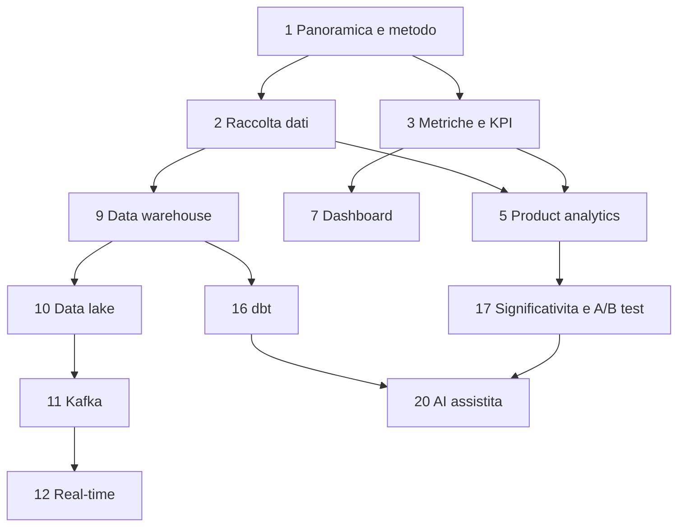

Una persona che lavora nel marketing di un'azienda di medie dimensioni apre il corso, vede ventun moduli e decide di partire dal più interessante: Kafka e lo streaming di eventi. Dopo tre lezioni si ferma. I termini sono chiari uno per uno, ma non capisce quale problema risolvano, perché nessuno le ha mai spiegato che cosa sia un evento di tracking, né come si misuri la qualità di un dato che arriva in tempo reale. Torna indietro, prova con le metriche, si perde tra i prerequisiti, e dopo due settimane smette. Questo è uno scenario costruito, con numeri di esempio, ma descrive bene che cosa accade quando un percorso lungo si affronta senza una mappa: il problema non è la difficoltà, è l'ordine.

## Perché un corso lungo ha bisogno di una mappa

Un elenco di moduli dice che cosa c'è, non dice in quale sequenza ha senso studiarlo né a che cosa serve ciascun pezzo. La mappa aggiunge due informazioni: le dipendenze tra argomenti e l'output professionale che ogni blocco ti permette di produrre. Con queste due informazioni la domanda "da dove parto" smette di essere una questione di gusto e diventa una scelta ragionata.

> **Idea chiave:** la mappa non serve a decidere cosa studiare oggi, serve a sapere quale problema di lavoro saprai risolvere dopo ogni blocco. Un modulo si sceglie per l'output che sblocca e per i prerequisiti che richiede, non per quanto suona attuale.

I ventuno moduli sono raggruppati in cinque fasi. Le fasi non sono compartimenti stagni: sono una progressione che rispecchia l'ordine in cui un problema reale si presenta in azienda. Prima si decide che cosa misurare e come raccogliere i dati, poi si costruiscono metriche e analisi, poi si organizza l'infrastruttura che le sostiene, poi si aggiunge il rigore statistico e infine si considerano ruoli, riflessione sul metodo e lavoro assistito dall'intelligenza artificiale.

## Le cinque fasi e i moduli che le compongono

La suddivisione che segue è quella più utile per orientarsi. Ogni riga indica i moduli, la capacità che sbloccano e il prodotto concreto che puoi mostrare a chi valuta il tuo lavoro.

| Fase | Moduli | Capacità sbloccata | Output professionale |
| :--- | :--- | :--- | :--- |
| 1. Metodo e raccolta | 1 Panoramica, 2 Raccolta dati, 3 Metriche | Formulare domande analitiche e raccogliere dati affidabili | Piano di tracking e albero dei KPI |
| 2. Decisione e prodotto | 4 Gestione data-driven, 5 Product analytics, 6 Marketing analytics, 7 Dashboard, 8 Marketing data science | Analizzare coorti, canali e comportamenti e comunicarli | Dashboard per la direzione con commento scritto |
| 3. Stack dati | 9 Data warehouse, 10 Data lake, 11 Kafka, 12 Real-time con ClickHouse, 13 Infrastruttura | Costruire pipeline scalabili e leggerne lo stato | Architettura descritta dal dato grezzo al report |
| 4. Ingegneria e rigore | 14 SQL avanzato, 15 Matematica, 16 dbt, 17 Significatività e A/B test | Scrivere modelli testati e distinguere effetto da rumore | Progetto dbt documentato ed esperimento valutato |
| 5. Ruoli, metodo e AI | 18 Direzioni dell'analitica, 19 Fondamenti filosofici dell'analisi dei dati, 20 AI assistita, 21 Agentic AI | Scegliere una direzione di carriera e usare l'AI con controllo | Flusso di lavoro assistito con verifiche esplicite |

La tabella va letta per colonne e non solo per righe. La colonna dell'output è quella che conta quando devi decidere se un modulo è per te: se il prodotto finale non ha nulla a che fare con il tuo lavoro attuale o con quello che vuoi fare, puoi rimandarlo senza rimpianti. La colonna delle capacità serve invece a verificare di cosa hai bisogno prima: chi vuole costruire un esperimento A/B nel modulo 17 si accorge che gli servono un tracking pulito (modulo 2) e una metrica ben definita (modulo 3).

## Le dipendenze tra moduli

Non tutti i moduli dipendono dagli altri allo stesso modo. Alcuni sono fondamenta su cui poggia quasi tutto, altri sono rami specializzati che si possono affrontare in ordine libero una volta superata la base comune. Il diagramma mostra le dipendenze principali, senza pretendere di elencarle tutte.

Il diagramma mostra due strade principali che partono entrambe dai moduli 1, 2 e 3. La strada dell'analisi porta da metriche e prodotto verso la sperimentazione. La strada dell'ingegneria porta dalla raccolta dati verso warehouse, lake e streaming. I due rami si ricongiungono nei moduli sull'intelligenza artificiale, che richiedono sia una buona definizione dei problemi sia dati organizzati in modo affidabile. Chi si muove su una sola strada deve comunque conoscere i primi tre moduli, perché è lì che si impara a formulare la domanda prima di scrivere una riga di codice.

## Costruire un percorso personale e stimarne la durata

Il corso si può percorrere per intero, ma la maggior parte delle persone ha un obiettivo più circoscritto. Una scheda di percorso breve, scritta prima di iniziare, evita di disperdere le settimane.

> Ruolo di arrivo: analista di prodotto in un'azienda software di medie dimensioni.
> Moduli scelti: 1, 2, 3, 5, 7, cioè metodo, raccolta dati, metriche, product analytics, dashboard.
> Output da produrre: albero dei KPI per un prodotto, analisi di retention per coorte, dashboard con commento scritto.
> Moduli rimandati: 9-13 (infrastruttura) e 20-21 (AI), da riprendere dopo il primo progetto reale.

Una scheda di questo tipo diventa utile quando la si traduce in settimane. Prendiamo numeri di esempio per i cinque moduli scelti: 8 lezioni nel modulo 1, 8 nel modulo 2, 6 nel modulo 3, 23 nel modulo 5 e 8 nel modulo 7. Ipotizziamo 20 minuti di lettura per lezione e un ritmo di 5 ore a settimana.

1. Numero di lezioni: 8 + 8 + 6 + 23 + 8 = 53 lezioni.
2. Tempo di sola lettura: 53 × 20 minuti = 1.060 minuti, pari a 17,67 ore.
3. La lettura non è tutto: esercizi, foglio bianco e richiami a distanza di giorni aggiungono tempo. Con un fattore 1,5 il tempo effettivo diventa 1.060 × 1,5 = 1.590 minuti, cioè 26,5 ore.
4. Durata in settimane: 26,5 ore / 5 ore a settimana = 5,3 settimane, quindi 6 settimane in calendario arrotondando per eccesso.
5. Verifica con un ritmo più basso: a 3 ore a settimana servirebbero 26,5 / 3 = 8,8 settimane, quindi 9.

Il risultato cambia la conversazione con te stesso. "Voglio fare il corso" è un'intenzione senza scadenza. "Voglio completare cinque moduli in sei settimane, a cinque ore settimanali, producendo tre artefatti" è un impegno con una data. Se dopo la seconda settimana ti accorgi di aver completato solo 8 lezioni invece delle 18 previste, hai un dato per correggere il piano: ridurre i moduli o aumentare le ore. Senza il calcolo, avresti scoperto il ritardo solo a fine corso.

## Tre errori frequenti nell'uso della mappa

Anche con la mappa sotto gli occhi esistono tre scelte che riducono molto il valore del percorso.

### Saltare metodo e metriche per andare subito agli strumenti

Il sintomo è una pipeline funzionante che risponde a una domanda che nessuno aveva posto: i dati arrivano, le tabelle si riempiono, ma nessuno sa cosa decidere con quei numeri. Succede perché gli strumenti sono concreti e attraenti, e il lavoro di definire una domanda sembra meno produttivo. La correzione è fissare un'unica domanda di business prima di aprire qualunque modulo tecnico, per esempio "quale quota degli iscritti torna entro sette giorni", e usare quella come filo di tutto lo studio.

### Leggere moduli interi senza produrre un artefatto

Il sintomo è la sensazione, dopo tre settimane, di aver letto molto e di non saper mostrare nulla. Succede perché la lettura dà un senso di progresso immediato, mentre produrre un artefatto richiede tempo e espone le lacune. La correzione è legare ogni modulo a un prodotto della colonna "output" della tabella e considerarlo completato soltanto quando il prodotto esiste, anche in forma imperfetta.

### Rimandare l'applicazione finché non si è studiato tutto

Il sintomo è un percorso senza fine, in cui ogni modulo suggerisce un altro modulo "da fare prima". Succede perché nessun elenco di prerequisiti è mai completo e la sensazione di non essere pronti non scompare con lo studio. La correzione è una regola semplice: dopo ogni fase, porta un concetto in un problema reale del tuo lavoro o di un progetto personale, anche piccolo, e fissa una data entro cui farlo.

## Se hai già esperienza in una parte del percorso

Chi lavora da anni con SQL o con Python non ha bisogno di rileggere le lezioni di base della propria area. Può scorrerle rapidamente, usando le domande finali come test: se riesce a rispondere senza esitazioni, passa oltre. Il tempo risparmiato va ai moduli dove il salto di livello è più netto, cioè architettura, sperimentazione, osservabilità dei dati e governance.

C'è una distinzione utile tra chi ha esperienza tecnica e chi ha esperienza di business. Il primo tende a saltare i moduli 3 e 4, quelli su metriche e decisioni, perché li considera ovvi, e poi scopre di avere difficoltà a spiegare a un responsabile perché un numero è affidabile. Il secondo tende a saltare l'infrastruttura, e poi non riesce a dialogare con chi mantiene le pipeline. In entrambi i casi la mappa suggerisce lo stesso rimedio: partire dalla fase in cui sei meno esperto, non da quella in cui ti senti più a tuo agio.

Un criterio pratico per scegliere è il confronto tra l'output dichiarato di un modulo e il tuo lavoro attuale. Se produci già un albero dei KPI e lo difendi in riunione, il modulo 3 lo puoi consultare a campione. Se non l'hai mai fatto, vale la pena di studiarlo per intero, qualunque sia il tuo ruolo. La mappa non sostituisce questo giudizio, lo rende più rapido e più esplicito.

## Come ricalibrare la mappa ogni mese

Un percorso scritto a settembre non regge fino a dicembre senza correzioni. Il lavoro cambia, emergono interessi nuovi, alcune ipotesi sul proprio ruolo si rivelano sbagliate. Una breve revisione mensile, di venti minuti, mantiene il percorso allineato. Si rilegge la scheda di percorso, si segna quali output sono stati effettivamente prodotti, si confronta il ritmo reale con quello ipotizzato e si decide se spostare un modulo in avanti o indietro.

La revisione serve soprattutto a evitare due derive opposte. Una è l'ostinazione: continuare un modulo solo perché era in programma, anche quando il lavoro ha preso un'altra direzione. L'altra è la dispersione: cambiare modulo ogni settimana perché ogni argomento nuovo sembra più urgente del precedente. Con una scheda scritta e un ritmo misurato, è più facile notare quale delle due deriva sta prendendo il sopravvento e correggerla prima che costi un mese.

## Verifica sull'orientamento nel corso

1. Hai deciso di lavorare sulla sperimentazione A/B del modulo 17. Quali moduli devi aver affrontato prima, e perché?

Mostra risposta

Almeno il modulo 2 sulla raccolta dati, perché un esperimento con tracking inaffidabile produce risultati non interpretabili, e il modulo 3 sulle metriche, perché serve una metrica di successo definita prima del test. Il modulo 5 sul product analytics è un buon complemento, perché mostra come leggere coorti e comportamenti degli utenti.

2. Il tuo percorso comprende 36 lezioni da 20 minuti, un fattore 1,5 per esercizi e richiami e un ritmo di 4 ore a settimana. In quante settimane lo completi?

Mostra risposta

Lettura: 36 × 20 = 720 minuti, cioè 12 ore. Tempo effettivo: 12 × 1,5 = 18 ore. Settimane: 18 / 4 = 4,5, quindi 5 settimane in calendario arrotondando per eccesso.

3. Dopo la seconda settimana di un percorso di 5 settimane hai completato 8 lezioni su 16 previste. Cosa indica il dato e come reagisci?

Mostra risposta

Sei al 50% del programma previsto per quel punto, quindi il percorso intero richiederebbe circa il doppio del tempo, cioè 10 settimane. Puoi aumentare le ore settimanali oppure ridurre i moduli, rimandando quelli meno legati all'output che ti interessa. L'importante è decidere subito, non a fine corso.

4. Sei un analista con cinque anni di SQL e nessuna esperienza di KPI tree. Da quale fase conviene partire?

Mostra risposta

Dalla fase 1, in particolare dal modulo 3 sulle metriche, perché è lì che si trova la tua lacuna. Le lezioni di SQL le puoi scorrere rapidamente come test, usando le domande finali per verificare di non avere punti deboli.

