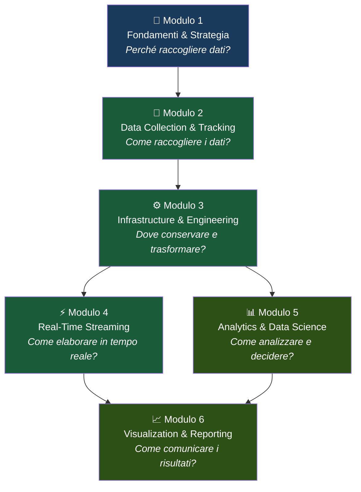
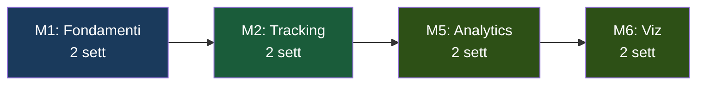
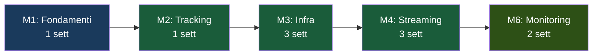
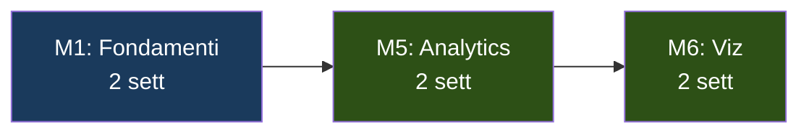

# Mappe Concettuali: La Visione d'Insieme

> **Obiettivo:** Capire come i 6 moduli del corso si interconnettono e costruire un percorso di apprendimento personalizzato.

## 1. L'Architettura del Corso

Il corso segue una struttura a **piramide**: ogni modulo costruisce sulle fondamenta del precedente.

## 2. Mappa delle Competenze per Modulo

| Modulo | Competenze Acquisite | Ruoli Target |
|:---|:---|:---|
| **M1: Fondamenti** | Strategia dati, OKR, metriche, JTBD | Tutti |
| **M2: Data Collection** | Tracking plan, event design, GDPR, GA4 | Marketing, Product |
| **M3: Infrastructure** | SQL, ClickHouse, data modeling, ETL, S3 | Data Engineer |
| **M4: Real-Time** | Kafka, streaming, CDC, monitoring | Data Engineer, SRE |
| **M5: Analytics** | Coorti, A/B test, ML, attribution, NPS | Data Analyst, Scientist |
| **M6: Visualization** | Dashboard, storytelling, Python, Metabase | Analyst, Manager |

## 3. Percorsi Personalizzati

### 🎯 Percorso "Marketing Analyst" (8 settimane)

Focus: Metriche → Tracking → Analisi di coorte, attribution → Dashboard e storytelling

### ⚙️ Percorso "Data Engineer" (10 settimane)

Focus: Tracking → SQL, ClickHouse, S3 → Kafka, CDC → Monitoring & Observability

### 📊 Percorso "Product Manager" (6 settimane)

Focus: OKR, JTBD, metriche → A/B test, retention, PMF → Dashboard per stakeholder

## 4. Connessioni tra Argomenti

Le lezioni non sono isolate. Ecco le connessioni più importanti:

| Da (Lezione) | A (Lezione) | Connessione |
|:---|:---|:---|
| OKR e KPI (M1) | Tracking Plan (M2) | I KPI definiscono *cosa* tracciare |
| Event Tracking (M2) | Kafka Producers (M4) | Gli eventi fluiscono nel sistema streaming |
| Data Modeling (M3) | Analisi di Coorte (M5) | Il modello dati determina le analisi possibili |
| ClickHouse (M3) | Dashboard Live (M6) | Il data warehouse alimenta le dashboard |
| A/B Testing (M5) | HADI Cycles (M5) | L'esperimento è il cuore del ciclo HADI |
| Schema Registry (M4) | Data Quality (M3) | I contratti dati garantiscono la qualità |

## 5. Checklist di Completamento

Usa questa checklist per tracciare il tuo progresso:

- [ ] **M1:** Sai definire OKR per il tuo team
- [ ] **M1:** Sai distinguere KPI da metriche da driver
- [ ] **M2:** Sai progettare un tracking plan da zero
- [ ] **M2:** Sai implementare il consent mode per GDPR
- [ ] **M3:** Sai scrivere query SQL per analisi di business
- [ ] **M3:** Sai progettare uno schema per ClickHouse
- [ ] **M4:** Sai configurare un topic Kafka con partitioning
- [ ] **M4:** Sai implementare una pipeline Kafka → ClickHouse
- [ ] **M5:** Sai disegnare ed eseguire un A/B test
- [ ] **M5:** Sai calcolare LTV, CAC e unit economics
- [ ] **M6:** Sai creare una dashboard executive
- [ ] **M6:** Sai raccontare i dati con lo storytelling

## Risorse

- Il [Learning Path completo](/course/learning-path/) con l'elenco di tutte le lezioni
- Ogni modulo ha un **Caso Studio** finale e un **Cheat Sheet** per il ripasso
