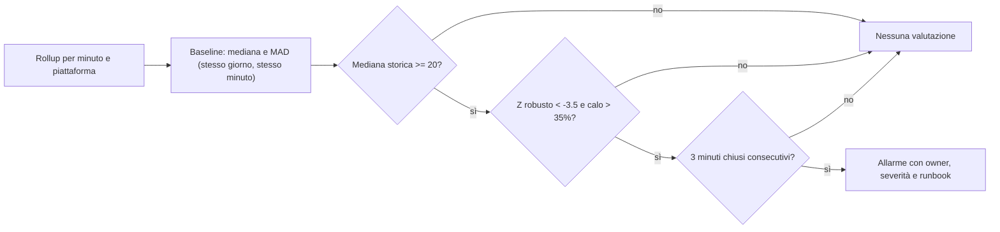

Un team di piattaforma configura un allarme che manda un messaggio su Slack e telefona al reperibile ogni volta che gli ordini scendono sotto i 50 al minuto. L'allarme suona tutte le notti alle due, quando la gente dorme. Poi una domenica pomeriggio il checkout su iOS si rompe per quattro ore e l'allarme resta zitto, perché il traffico totale non scende mai sotto i 55 ordini al minuto.

## Chiamate notturne e un guasto iOS di quattro ore

Il caso è uno scenario costruito, con numeri di esempio generati dal codice che trovi più sotto e rieseguibili in chDB, il motore ClickHouse in-process per Python. Un e-commerce registra circa 100 ordini al minuto nelle ore centrali e 12 ordini al minuto tra l'una e le cinque di notte. Il 40% degli ordini arriva da iOS, il 60% da web e Android.

Dopo un disservizio precedente un ingegnere aggiunge la regola `ordini_totali < 50`. Le conseguenze sono due, speculari.

Di notte il traffico fisiologico è 12 ordini al minuto, sotto la soglia, quindi la regola scatta ogni minuto dalle 01:00 alle 04:59: 240 notifiche a notte. Dopo quattro notti il team silenzia il canale. Due settimane dopo, domenica alle 15:00, un aggiornamento dell'app rompe il pulsante di conferma su iOS. Il volume atteso in quella fascia è 100 ordini al minuto, 40 da iOS e 60 dagli altri canali. Con iOS a zero restano 60 ordini al minuto, e 60 non è inferiore a 50: la regola non scatta mai.

> **Idea chiave:** un allarme su una serie con ciclo giornaliero deve confrontare il valore osservato con la stessa ora dello stesso giorno della settimana, per ogni segmento, e scattare solo se lo scostamento persiste per più minuti.

La perdita del caso costruito si calcola in fretta. iOS vale 40 ordini al minuto, il guasto dura 240 minuti: 40 × 240 = 9.600 ordini mancati. A un valore medio di 42 euro per ordine sono 9.600 × 42 = 403.200 euro, che nessun allarme ha segnalato. Il guasto lo scopre il servizio clienti il lunedì mattina.

## Perché una soglia fissa sbaglia due volte

La soglia statica commette due errori opposti con lo stesso parametro. Di notte è troppo alta rispetto al normale e produce falsi positivi. Di giorno è troppo bassa rispetto al normale, e un calo del 40% o del 50% resta sopra la soglia. Non è un problema di valore: nessun numero fisso può essere giusto per una serie che varia di un fattore otto nell'arco della giornata.

Il secondo errore nasce dall'aggregazione. Il totale mescola segmenti con comportamenti diversi, e un segmento che crolla viene coperto dagli altri. La scomposizione per piattaforma, per gateway di pagamento o per paese è la condizione per vedere il guasto.

| Aspetto | Soglia statica | Baseline stagionale per segmento |
|---|---|---|
| Riferimento | un numero fisso | mediana della stessa ora e stesso giorno |
| Di notte | allarme continuo | si adatta ai 12 ordini attesi |
| Guasto su un segmento | invisibile nel totale | visibile nel segmento |
| Outlier storici | non pertinente | neutralizzati da mediana e MAD |
| Rumore da piccoli numeri | alto | filtrato da volume minimo e persistenza |

Le soglie statiche hanno senso per invarianti dell'infrastruttura, come disco pieno al 90% o CPU oltre il 95% per quindici minuti. Per i volumi di business, che dipendono dal comportamento umano, servono baseline che conoscano il ciclo.

## Baseline stagionale, MAD e persistenza

Un rilevatore che cattura i guasti veri senza svegliare nessuno a vuoto si regge su tre meccanismi ([sintesi di Chandola, Banerjee e Kumar sul rilevamento di anomalie](https://doi.org/10.1145/1541880.1541882)).

Il primo è la baseline condizionata. Il traffico delle 03:00 del martedì non è confrontabile con quello delle 11:00 dello stesso giorno, ma lo è con le 03:00 degli ultimi martedì. Per ogni combinazione di giorno della settimana, minuto del giorno e segmento si calcola la distribuzione storica sulle ultime settimane. Il ciclo diventa un riferimento, e la serie un residuo.

Il secondo è la misura robusta dello scostamento. Media e deviazione standard si lasciano gonfiare da un Black Friday o da un incidente di venti minuti, e dopo l'evento la banda di tolleranza è così larga da non scattare più. La mediana $M$ e lo scarto assoluto mediano (MAD, median absolute deviation) restano stabili. Lo Z-score robusto è:

$$Z_{\text{rob}} = \frac{x_t - M}{1.4826 \cdot \operatorname{MAD}}, \qquad \operatorname{MAD} = \operatorname{median}\left(|x_i - M|\right)$$

Il fattore 1.4826 rende il MAD confrontabile con una deviazione standard per dati normali. A questo si aggiunge una guardia di volume: se la mediana storica è sotto una soglia, per esempio 20 eventi nella finestra, non si valuta il calo.

Il terzo è la persistenza. Un singolo minuto anomalo può dipendere da un ritardo di rete. Chiedere che la violazione si ripeta per tre minuti chiusi consecutivi abbatte i falsi positivi di ordini di grandezza, e il costo è un ritardo di rilevazione di tre minuti.



## Quanto rumore produce una finestra singola: il conto con Poisson

La persistenza non è un'abitudine, si calcola. Prendi un segmento piccolo che fa in media 2 ordini al minuto e modella gli arrivi con una distribuzione di Poisson. La probabilità di vedere zero ordini in un minuto è $e^{-2}$.

Passo uno: $e^{-2} = 0{,}1353$, cioè 13,5% per minuto. Passo due: in un'ora ci sono 60 minuti, quindi 60 × 0,1353 = 8,1 minuti con zero ordini, senza alcun guasto. Una regola «zero ordini in un minuto» suona otto volte all'ora.

Con persistenza su tre minuti consecutivi la probabilità diventa 0,1353³ = 0,00248, cioè 0,25% per finestra. Su 60 finestre l'ora fanno 60 × 0,00248 = 0,15 allarmi falsi all'ora, uno ogni 6,7 ore. La riduzione è 8,1 ÷ 0,15 = 54 volte. E se applichi anche la guardia di volume (mediana storica almeno 20), il segmento da 2 ordini al minuto non viene valutato affatto.

Il prezzo è il ritardo. Con il guasto iOS di 40 ordini al minuto, tre minuti di attesa significano 3 × 40 = 120 ordini e 120 × 42 = 5.040 euro persi prima dell'allarme. Sono l'1,25% dei 403.200 euro che si perderebbero in quattro ore. Quel costo si accetta, e va scritto nel documento di progetto come tempo di rilevazione di tre minuti.

## Tre errori nella configurazione degli allarmi

Il blocco seguente costruisce i dati sintetici del caso e applica la regola fragile. Le quattro settimane di storia sono al minuto, per due piattaforme, con un guasto di iOS che parte alle 15:00 del 15 novembre 2026, una domenica.

```sql
-- Tabella dei rollup per minuto e piattaforma.
CREATE TABLE ordini_minuto
(
    piattaforma LowCardinality(String),
    minuto DateTime('UTC'),
    ordini UInt32
)
ENGINE = MergeTree
ORDER BY (piattaforma, minuto);

-- 4 settimane di storia al minuto + la domenica del guasto fino alle 15:02, due piattaforme.
-- Notte (01-04): 12 ordini attesi; resto: 100. Quota iOS 40%, web 60%. Da 15:00 iOS crolla.
INSERT INTO ordini_minuto
SELECT
    p.1 AS piattaforma,
    m AS minuto,
    toUInt32(greatest(0,
        round((if(toHour(m) BETWEEN 1 AND 4, 12, 100)) * p.2)
        + (cityHash64(p.1, m) % 7) - 3
        - if(p.1 = 'ios' AND m >= toDateTime('2026-11-15 15:00:00', 'UTC'), 100, 0)
    )) AS ordini
FROM
(
    SELECT toDateTime('2026-10-18 00:00:00', 'UTC') + number * 60 AS m
    FROM numbers(28 * 1440 + 15 * 60 + 3)
)
ARRAY JOIN [('ios', 0.4), ('web', 0.6)] AS p;

-- 82.446 righe: 2 piattaforme x 41.223 minuti.
SELECT count() AS righe FROM ordini_minuto;

-- Regola fragile: totale sotto 50 per minuto. Risultato: 6.720 minuti in allarme, tutti di notte.
SELECT countIf(tot < 50) AS minuti_in_allarme, countIf(tot < 50 AND toHour(minuto) BETWEEN 1 AND 4) AS di_notte
FROM (SELECT minuto, sum(ordini) AS tot FROM ordini_minuto WHERE minuto < toDateTime('2026-11-15 00:00:00', 'UTC') GROUP BY minuto);

-- Il totale durante il guasto: 59, 57, 63 ordini, tutti sopra 50, nessun allarme.
SELECT minuto, sum(ordini) AS tot FROM ordini_minuto WHERE minuto >= toDateTime('2026-11-15 15:00:00', 'UTC') GROUP BY minuto ORDER BY minuto;
```

I minuti in allarme sono 6.720, cioè 28 notti × 240 minuti, e coincidono con tutti i minuti notturni. Durante il guasto il totale vale 59, 57 e 63 ordini al minuto: sempre sopra 50.

### Usare soglie fisse su metriche con ciclo giorno-notte

Sintomo: allarmi continui di notte e silenzio nel guasto reale. Sembra ragionevole perché la soglia nasce da un incidente passato e protegge da quel caso. Il rimedio è sostituire il numero con un confronto con la stessa ora degli stessi giorni della settimana, per segmento.

### Calcolare media e deviazione standard senza proteggersi dagli outlier

Sintomo: dopo una campagna promozionale l'allarme smette di scattare per settimane. Sembra la soluzione statistica corretta, `avg(ordini) - 3 * stddevPop(ordini)`, ma un solo giorno estremo nelle quattro settimane di storia moltiplica la deviazione standard e fa scendere il limite inferiore sotto zero. L'allarme non può più scattare. La correzione è usare mediana e MAD, che un evento isolato non sposta.

### Sparare al primo minuto anomalo senza persistenza né volume minimo

Sintomo: decine di notifiche su segmenti piccoli, ignorate dal team. Succede perché con pochi eventi la fluttuazione casuale è grande, come mostra il conto con Poisson: 8,1 minuti vuoti all'ora a 2 ordini al minuto. La correzione sono due condizioni insieme: persistenza su tre minuti e mediana storica minima prima di valutare un calo.

## La query di rilevazione su mediana, MAD e tre minuti

Il criterio di costruzione, in ordine:

1. Calcola la baseline per piattaforma, giorno della settimana e minuto del giorno, con `median` e MAD, escludendo il giorno corrente.
2. Imponi il volume minimo: mediana storica almeno 20 ordini.
3. Marca un minuto come anomalo se Z robusto è sotto -3,5 e il valore osservato è sotto il 65% della mediana.
4. Emetti l'allarme solo se i tre minuti chiusi più recenti sono tutti anomali.

```sql
-- Rilevazione: tre minuti chiusi consecutivi anomali rispetto alla stessa ora dei giorni passati.
-- "adesso" è fissato per rendere il risultato riproducibile; in produzione è toStartOfMinute(now()).
WITH
    toDateTime('2026-11-15 15:03:00', 'UTC') AS adesso,
    storico AS
    (
        SELECT piattaforma, toDayOfWeek(minuto) AS dow, toHour(minuto) * 60 + toMinute(minuto) AS mdg, ordini
        FROM ordini_minuto
        WHERE minuto < toStartOfDay(adesso)
    ),
    mediane AS
    (
        SELECT piattaforma, dow, mdg, median(ordini) AS mediana
        FROM storico GROUP BY piattaforma, dow, mdg
    ),
    mad AS
    (
        -- MAD = mediana degli scarti assoluti dalla mediana.
        SELECT s.piattaforma AS piattaforma, s.dow AS dow, s.mdg AS mdg, any(m.mediana) AS mediana, median(abs(s.ordini - m.mediana)) AS mad
        FROM storico AS s
        INNER JOIN mediane AS m ON s.piattaforma = m.piattaforma AND s.dow = m.dow AND s.mdg = m.mdg
        GROUP BY piattaforma, dow, mdg
    ),
    ultimi AS
    (
        SELECT
            o.piattaforma AS piattaforma,
            o.minuto AS minuto,
            o.ordini AS osservati,
            b.mediana AS attesi,
            (o.ordini - b.mediana) / greatest(1.4826 * b.mad, 1) AS z_robusto
        FROM ordini_minuto AS o
        INNER JOIN mad AS b ON o.piattaforma = b.piattaforma AND toDayOfWeek(o.minuto) = b.dow AND toHour(o.minuto) * 60 + toMinute(o.minuto) = b.mdg
        WHERE o.minuto >= adesso - INTERVAL 3 MINUTE AND o.minuto < adesso
    )
SELECT
    piattaforma,
    countIf(attesi >= 20 AND z_robusto < -3.5 AND osservati < attesi * 0.65) AS minuti_anomali_su_3,
    round(avg(osservati), 1) AS media_osservata,
    round(avg(attesi), 1) AS media_attesa,
    round(min(z_robusto), 1) AS peggior_z
FROM ultimi
GROUP BY piattaforma
HAVING minuti_anomali_su_3 = 3;
```

La query restituisce una sola riga, `ios`, con tre minuti anomali su tre, media osservata 0 contro una media attesa di circa 40 ordini e uno Z robusto peggiore di -43. La piattaforma `web`, che in quei tre minuti segue la propria baseline con Z tra -2 e 2,7, non compare. Alle due di notte `attesi` vale 12, il calo richiesto è sotto 7,8 ordini e un traffico normale non lo raggiunge: le telefonate notturne spariscono.

Il pavimento `greatest(1.4826 * mad, 1)` evita divisioni per zero quando la serie storica è molto stabile, e fissa a 1 ordine la dispersione minima. Senza di esso un MAD nullo produrrebbe Z infiniti.

## Severità, owner e rate limit

Una query che trova l'anomalia è metà del lavoro. L'altra metà decide chi viene svegliato e quante volte. La configurazione sta di solito nello strumento di alerting, ma le regole sono le stesse in qualunque strumento.

```yaml
# Regola di alerting per il calo di ordini per piattaforma.
alert: calo_ordini_piattaforma
expr_sql: query/anomalia_ordini_3m.sql        # la query della sezione precedente
every: 1m
severity:
  P1: "calo > 80% su una piattaforma per 3 minuti"   # chiamata al reperibile
  P2: "calo tra 35% e 80% per 3 minuti"              # messaggio sul canale, nessuna chiamata
owner: team-checkout-mobile
runbook: https://wiki.esempio.interno/runbook/calo-ordini-piattaforma
group_by: [piattaforma]                       # un solo incidente per piattaforma
repeat_interval: 30m                          # rate limit: un promemoria ogni 30 minuti
suppress_when:
  - calendario: dim_promo_events              # giorni di campagna con baseline scalata
payload: "{{piattaforma}}: {{media_osservata}} ordini/min contro {{media_attesa}} attesi"
```

Il raggruppamento per piattaforma ha un effetto che si calcola: un guasto che dura 240 minuti con una notifica ogni minuto produce 240 messaggi. Con `repeat_interval` di 30 minuti ne produce 240 ÷ 30 = 8, più il primo, cioè 9. Ogni messaggio dice quanto manca e rispetto a quale riferimento, per esempio «ios: 0 ordini al minuto contro 40 attesi per 3 minuti consecutivi». Questa frase è il vantaggio operativo di una regola trasparente.

La metrica per giudicare il sistema è la quota di avvisi azionabili: notifiche seguite da un incidente reale o da un'azione correttiva, diviso notifiche totali. Un sistema sano resta sopra l'80%. Un allarme a cui non corrisponde un'azione umana immediata è rumore che coprirà il prossimo incidente vero.

## Regole in SQL o modelli multivariati

Le famiglie sono due: regole statistiche in SQL (mediana stagionale, MAD, guardia di volume) e modelli non supervisionati o di forecasting come Isolation Forest, Prophet o autoencoder su più metriche.

Il criterio: **regola SQL con baseline stagionale per le metriche di business e di infrastruttura osservabili una per una (ordini, ricavi, latenza, tasso di errore per canale); modello multivariato solo quando l'anomalia non è visibile su nessuna metrica da sola ma emerge dalla combinazione di molte feature, come nelle frodi o negli attacchi bot distribuiti.**

Quando suona un allarme che dice solo `anomaly_score = 0.87`, il reperibile perde mezz'ora per capire quale metrica si è mossa e rispetto a quando. Con mediana e MAD il messaggio indica metrica, valore osservato e valore atteso. Per questo si parte dalla regola, e si passa a un modello solo con una ragione.

La soppressione nei giorni di campagna nota va gestita con una tabella di calendario, come `dim_promo_events`, che scala la baseline o sospende i controlli di eccesso di traffico mantenendo quelli sul tasso di errore. L'instradamento verso PagerDuty o Opsgenie dipende dallo strumento scelto e resta fuori da questo schema.

## Controllo prima di attivare un allarme

1. Un segmento fa in media 4 ordini al minuto. Una regola scatta con zero ordini in un minuto: quanti falsi positivi attendi in un'ora, e come li riduci?

<details>
<summary>Mostra risposta</summary>

Con Poisson, $e^{-4} = 0{,}0183$, cioè 1,8% per minuto. In un'ora sono 60 × 0,0183 = 1,1 falsi positivi. Con persistenza su tre minuti la probabilità diventa 0,0183³ = 0,0000061 per finestra, circa 0,0004 allarmi all'ora. In più la guardia di volume (mediana almeno 20) esclude del tutto un segmento da 4 ordini al minuto.

</details>

2. Perché la query di rilevazione esclude il giorno corrente dalla baseline e il minuto aperto dai tre minuti valutati?

<details>
<summary>Mostra risposta</summary>

Il giorno corrente contiene il guasto: includerlo sposta la mediana e il MAD verso i valori anomali e attenua l'allarme. Il minuto aperto è incompleto, perché a metà minuto ha contato solo una parte degli ordini e sembrerebbe un calo. Per questo la finestra valuta solo minuti chiusi, con `minuto < adesso`.

</details>

3. Il guasto iOS vale 40 ordini al minuto a 42 euro per ordine. Quanto costa rilevarlo dopo 3 minuti e quanto dopo 10?

<details>
<summary>Mostra risposta</summary>

Dopo 3 minuti: 3 × 40 × 42 = 5.040 euro. Dopo 10 minuti: 10 × 40 × 42 = 16.800 euro. La differenza è 11.760 euro: ogni minuto di ritardo costa 1.680 euro. Una persistenza più lunga riduce i falsi positivi ma ha un costo diretto sul guasto vero.

</details>

4. Quando passeresti da una regola SQL a un modello multivariato?

<details>
<summary>Mostra risposta</summary>

Solo quando nessuna metrica singola, scomposta per segmento, mostra l'anomalia, e questa emerge dalla combinazione di più feature, per esempio nelle frodi su comportamenti di account. Anche allora conviene accompagnare il punteggio con le feature che lo hanno determinato, altrimenti il reperibile non può agire.

</details>
