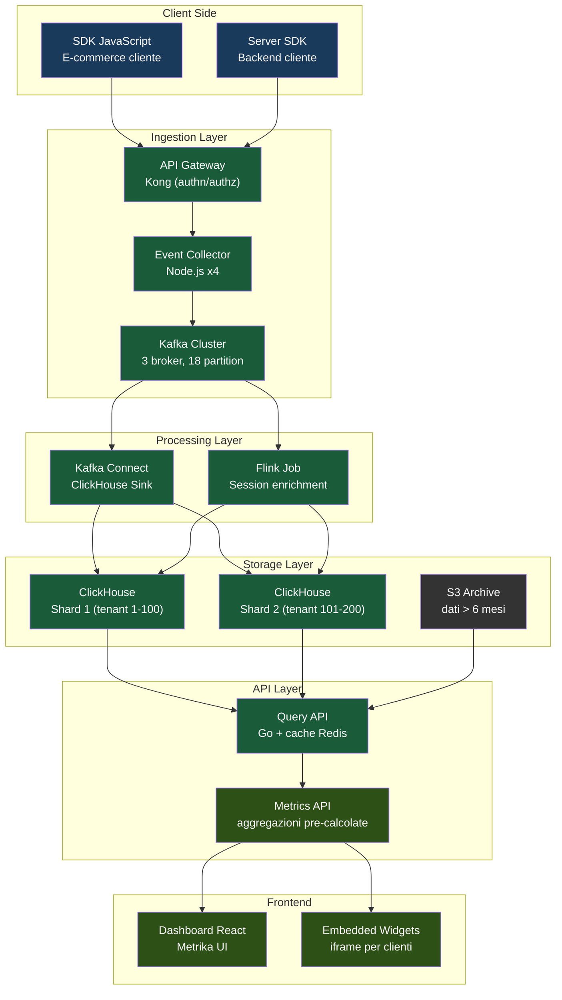

import { Aside, Steps, Tabs, TabItem } from '@astrojs/starlight/components'

Questo caso studio segue 18 mesi di sviluppo di **Metrika**, una startup B2B che costruisce dashboard analytics per e-commerce. Nel gennaio 2023 Metrika aveva 12 clienti paganti e un'architettura PostgreSQL che funzionava bene. Nel giugno 2024 aveva 200 clienti, 50 milioni di eventi al giorno e un'architettura completamente diversa. Ecco cosa è successo, perché, e cosa avrebbero fatto diversamente.

## Il punto di partenza: PostgreSQL va bene finché non va più bene

Metrika raccoglie eventi di comportamento utente dagli e-commerce dei propri clienti: visualizzazioni prodotto, aggiunte al carrello, acquisti, sessioni, ricerche. Ogni cliente installa uno snippet JavaScript e i dati arrivano in un database PostgreSQL centralizzato.

A 12 clienti, il sistema era veloce. Le query sulle dashboard rispondevano in 200-400ms. Il team era felice.

A 50 clienti, i problemi sono iniziati. Le query sulle dashboard degli ultimi 30 giorni richiedevano 8-15 secondi. I clienti si lamentavano. Il team ha aggiunto indici, ottimizzato le query, upgradato l'istanza RDS. Ha guadagnato qualche mese.

A 80 clienti, la situazione era insostenibile. Le query pesanti di un tenant rallentavano tutti gli altri. Il CEO aveva firmato contratti con nuovi clienti promettendo dashboard in tempo reale. La realtà era dashboard che mostravano i dati di 2-3 ore prima, con caricamenti di 20+ secondi.

Il team aveva 6 settimane per risolvere il problema prima del prossimo ciclo di onboarding.

## I requisiti: cosa serviva davvero

Prima di scegliere la tecnologia, il CTO di Metrika ha condotto una sessione di requirements gathering con il team prodotto e con 5 clienti chiave. Ne è emersa questa lista:

| Requisito | Dettaglio | Fonte |
|:---|:---|:---|
| Latenza query p95 | Sotto 3 secondi per query sugli ultimi 30 giorni | 5 clienti intervistati |
| Latenza ingestion | Dati visibili entro 10 secondi dall'evento | Sales team |
| Isolamento tenant | Un cliente lento non impatta gli altri | Supporto (3 lamentele/settimana) |
| Volume | 50M eventi/giorno oggi, 500M/giorno in 18 mesi | Road map |
| Storico | Query su 24 mesi di dati senza degradazione | Enterprise clients |
| Costo | Sotto €5/tenant/mese a 200 tenant | CFO |
| Uptime | 99.9% SLA contrattuale | Contratti clienti |

Due requisiti erano in tensione: storico 24 mesi (che richiede tanto storage) e costo sotto €5/tenant (che limita le risorse). Questo ha guidato molto delle decisioni di compressione dati.

## Le alternative considerate

Il team ha valutato seriamente quattro percorsi prima di decidere.

**Opzione 1: PostgreSQL ottimizzato con TimescaleDB**

TimescaleDB trasforma PostgreSQL in un time-series database con hypertable automatiche e compressione nativa. La migrazione sarebbe stata graduale e il team conosceva già il sistema.

Perché l'hanno scartata: TimescaleDB scala bene su query time-series semplici, ma le query delle dashboard di Metrika sono complesse — GROUP BY multi-dimensionali, funnel analysis, analisi di coorte. I benchmark interni mostravano ancora 8-12 secondi su dataset 12 mesi. Non sarebbe bastato.

**Opzione 2: BigQuery o Snowflake**

Entrambi eccellenti per analytics su larga scala. Query veloci, nessuna manutenzione infrastruttura, pricing pay-per-query.

Perché l'hanno scartata: il pricing. A 50M eventi/giorno con query continue, il costo BigQuery sarebbe stato €40-60/tenant/mese — 8-12x sopra il budget. Snowflake simile. Questi strumenti sono ottimi per analytics interne, non per prodotti analytics B2B con margini stretti.

**Opzione 3: Elasticsearch**

Elasticsearch è pensato per search e log analytics, ma molte aziende lo usano anche per time-series analytics.

Perché l'hanno scartata: Elasticsearch è meno efficiente di ClickHouse per aggregazioni analitiche pure. Il modello di storage è orientato ai documenti, non alle colonne — per query tipo "somma revenue per categoria per settimana" ClickHouse è 5-10x più veloce. Inoltre il costo di un cluster Elasticsearch multi-tenant stabile era fuori budget.

**Opzione 4: ClickHouse + Kafka**

ClickHouse è un database OLAP colonnare open source sviluppato da Yandex e oggi mantenuto da ClickHouse Inc. Progettato esplicitamente per analytics ad alta velocità su miliardi di righe.

Perché l'hanno scelto: nei benchmark interni, ClickHouse rispondeva in 0.8-1.5 secondi alle stesse query che impiegavano 12 secondi su PostgreSQL. Il modello di storage colonnare con compressione LZ4 riduceva il volume dei dati del 70%. Il costo su hardware commodity era compatibile con il target €5/tenant.

## L'architettura implementata

Dopo la scelta tecnologica, il team ha progettato l'architettura in tre sessioni di whiteboarding.



La cosa che si nota immediatamente è il doppio shard ClickHouse. Non per motivi di performance (un singolo server ClickHouse moderno gestisce facilmente 50M eventi/giorno), ma per isolamento: se un cliente fa una query particolarmente pesante, impatta solo metà dei tenant, non tutti.

## Le decisioni di design critiche

### Schema ClickHouse: il cuore del sistema

Lo schema della tabella principale `events` ha richiesto tre iterazioni prima di arrivare alla versione finale.

**Prima versione (sbagliata):**

```sql
-- Schema v1: intuitivo ma lento
CREATE TABLE events (
    id UUID,
    tenant_id String,
    user_id String,
    event_type String,
    timestamp DateTime,
    properties JSON
) ENGINE = MergeTree()
ORDER BY (timestamp)
```

Problemi: `JSON` non è il tipo giusto per ClickHouse (fa esplodere la memoria), `ORDER BY timestamp` senza `tenant_id` significa che ogni query filtra per tenant su tutto il dataset.

**Seconda versione (quasi giusta):**

```sql
-- Schema v2: meglio, ma le properties sono ancora un problema
CREATE TABLE events (
    tenant_id UInt32,
    event_type LowCardinality(String),
    user_id String,
    session_id String,
    timestamp DateTime64(3),
    properties Map(String, String)
) ENGINE = MergeTree()
PARTITION BY (tenant_id, toYYYYMM(timestamp))
ORDER BY (tenant_id, event_type, timestamp)
SETTINGS index_granularity = 8192
```

Migliore: `LowCardinality` su `event_type` riduce lo storage del 60% per quel campo (ci sono solo 20-30 event type unici). `PARTITION BY tenant_id` significa che ClickHouse legge solo le partition del tenant richiesto. `Map(String, String)` è meglio di JSON ma le lookup su Map sono lente.

**Versione finale (production):**

```sql
-- Schema v3: production-ready
CREATE TABLE events
(
    -- Identifiers
    tenant_id     UInt32,
    event_id      UUID DEFAULT generateUUIDv4(),

    -- Classification
    event_type    LowCardinality(String),
    event_category LowCardinality(String),  -- 'ecommerce', 'navigation', 'user'

    -- User context
    user_id       String,
    session_id    String,
    anonymous_id  String,

    -- Time
    timestamp     DateTime64(3, 'UTC'),
    received_at   DateTime64(3, 'UTC') DEFAULT now64(3),

    -- Page/screen context
    page_url      String,
    page_referrer String,

    -- Ecommerce (null se non applicabile)
    product_id    Nullable(String),
    product_name  Nullable(String),
    product_price Nullable(Decimal(10, 2)),
    order_id      Nullable(String),
    order_value   Nullable(Decimal(10, 2)),

    -- User traits (denormalizzati per performance)
    user_country  LowCardinality(String),
    user_segment  LowCardinality(String),

    -- Flexible properties per event type
    prop_string_1 String,
    prop_string_2 String,
    prop_string_3 String,
    prop_number_1 Nullable(Float64),
    prop_number_2 Nullable(Float64),
    prop_bool_1   Nullable(Bool)
)
ENGINE = MergeTree()
PARTITION BY (tenant_id, toYYYYMM(timestamp))
ORDER BY (tenant_id, event_type, toDate(timestamp), user_id)
TTL timestamp + INTERVAL 25 MONTH TO DISK 's3_archive'
SETTINGS
    index_granularity = 8192,
    min_bytes_for_wide_part = 10485760
```

La decisione più discussa: le prop_string_N invece di Map. La logica: le query sulle properties avvengono sempre con chiavi conosciute (es. "dammi tutti gli eventi con prop_string_1 = 'red'"). Con colonne nominate, ClickHouse può usare il suo sparse index. Con Map, non può. La trade-off: schema meno flessibile, ma query 3-5x più veloci sulle properties.

Il TTL automatico sposta i dati vecchi su S3 dopo 25 mesi — questo riduce il costo dello storage primario mantenendo l'accesso allo storico.

### Materialized views per aggregazioni pre-calcolate

Le query delle dashboard non leggono la tabella `events` raw — leggerebbero milioni di righe per ogni richiesta. Invece, ClickHouse aggiorna automaticamente tabelle aggregate ogni volta che arrivano nuovi eventi.

```sql
-- Aggregazione oraria per e-commerce metrics
CREATE MATERIALIZED VIEW events_hourly_ecommerce
ENGINE = SummingMergeTree()
PARTITION BY (tenant_id, toYYYYMM(hour))
ORDER BY (tenant_id, hour, product_id)
AS SELECT
    tenant_id,
    toStartOfHour(timestamp)    AS hour,
    product_id,
    product_name,
    user_country,
    user_segment,

    countIf(event_type = 'product_viewed')     AS views,
    countIf(event_type = 'product_added')      AS add_to_carts,
    countIf(event_type = 'order_completed')    AS purchases,
    sumIf(order_value, event_type = 'order_completed') AS revenue,
    uniqIf(user_id, event_type = 'product_viewed') AS unique_viewers

FROM events
WHERE event_category = 'ecommerce'
GROUP BY tenant_id, hour, product_id, product_name, user_country, user_segment;
```

Con questa materialized view, la query "mostrami il revenue per categoria negli ultimi 30 giorni" legge 30 righe per categoria invece di milioni di eventi raw. La latenza passa da 2-3 secondi a 50-100ms.

### Kafka topic strategy

La scelta del partitioning su Kafka ha impatti enormi su performance e isolamento.

**Approccio 1: un topic per tenant**

```
topic: metrika.events.tenant_001
topic: metrika.events.tenant_002
...
topic: metrika.events.tenant_200
```

Vantaggi: isolamento perfetto, possibile configurare retention differente per tenant premium.
Svantaggi: 200 topic con 6 partition ciascuno = 1200 partition. Con 200 consumer Kafka Connect, la gestione diventa complessa. Il broker rallenta.

**Approccio 2: topic per volume tier**

```
topic: metrika.events.high_volume    # tenant con >500K eventi/giorno, 12 partition
topic: metrika.events.mid_volume     # tenant con 50K-500K eventi/giorno, 6 partition
topic: metrika.events.low_volume     # tenant con <50K eventi/giorno, 3 partition
```

Questo è l'approccio scelto. I tenant ad alto volume (tipicamente i clienti enterprise) ottengono il loro throughput dedicato. I tenant piccoli condividono risorse. La chiave di partitioning è `tenant_id` — tutti gli eventi di un tenant vanno alla stessa partition, garantendo l'ordinamento.

```python
# Producer: routing intelligente per tier
import hashlib
from confluent_kafka import Producer

class TieredEventProducer:

    TIERS = {
        'high': ('metrika.events.high_volume', 12),
        'mid': ('metrika.events.mid_volume', 6),
        'low': ('metrika.events.low_volume', 3),
    }

    def __init__(self, bootstrap_servers: str, tenant_tiers: dict):
        self.producer = Producer({
            'bootstrap.servers': bootstrap_servers,
            'acks': 'all',
            'enable.idempotence': True,
            'compression.type': 'lz4',
            'batch.size': 65536,
            'linger.ms': 5,
            'buffer.memory': 33554432,
        })
        self.tenant_tiers = tenant_tiers  # {tenant_id: 'high'|'mid'|'low'}

    def send_event(self, tenant_id: int, event: dict) -> None:
        tier = self.tenant_tiers.get(tenant_id, 'low')
        topic, num_partitions = self.TIERS[tier]

        # Partition deterministica per tenant_id
        partition = int(hashlib.md5(str(tenant_id).encode()).hexdigest(), 16) % num_partitions

        self.producer.produce(
            topic=topic,
            key=str(tenant_id).encode(),
            value=json.dumps(event).encode(),
            partition=partition,
            on_delivery=self._delivery_callback
        )

    def _delivery_callback(self, err, msg):
        if err:
            # Log + dead letter queue
            logger.error(f"Delivery failed: {err}")
```

## L'implementazione step-by-step

### Fase 1: infrastruttura base (settimane 1-2)

Il team ha usato Terraform per l'intera infrastruttura su AWS.

```hcl
# clickhouse.tf - configurazione ClickHouse su EC2
resource "aws_instance" "clickhouse_shard_1" {
  ami           = data.aws_ami.ubuntu_22.id
  instance_type = "r6i.2xlarge"  # 8 vCPU, 64GB RAM

  root_block_device {
    volume_type = "gp3"
    volume_size = 500
    iops        = 6000  # Critical: ClickHouse è I/O bound
    throughput  = 500
  }

  # EBS dedicato per ClickHouse data
  ebs_block_device {
    device_name = "/dev/sdb"
    volume_type = "gp3"
    volume_size = 2000
    iops        = 16000
    throughput  = 1000
  }

  tags = {
    Name = "clickhouse-shard-1"
    Shard = "1"
  }
}
```

La scelta `r6i.2xlarge` (memory-optimized) invece di `c6i` (compute-optimized) è deliberata: ClickHouse lavora principalmente in memoria. Avere 64GB RAM significa che le query frequenti non toccano il disco.

### Fase 2: schema e materialized views (settimane 3-4)

```sql
-- Replica table per alta disponibilità
CREATE TABLE events ON CLUSTER 'metrika_cluster'
(
    -- [schema completo come sopra]
)
ENGINE = ReplicatedMergeTree(
    '/clickhouse/tables/{shard}/events',
    '{replica}'
)
PARTITION BY (tenant_id, toYYYYMM(timestamp))
ORDER BY (tenant_id, event_type, toDate(timestamp), user_id);

-- Materialized view per sessioni (più complessa)
CREATE MATERIALIZED VIEW session_stats
ENGINE = AggregatingMergeTree()
PARTITION BY (tenant_id, toYYYYMM(session_start))
ORDER BY (tenant_id, session_id)
AS SELECT
    tenant_id,
    session_id,
    user_id,
    minState(timestamp)                           AS session_start,
    maxState(timestamp)                           AS session_end,
    countState()                                  AS pageviews,
    uniqState(page_url)                           AS unique_pages,
    argMaxState(page_url, timestamp)              AS exit_page,
    argMinState(page_url, timestamp)              AS entry_page
FROM events
WHERE event_type IN ('page_viewed', 'product_viewed')
GROUP BY tenant_id, session_id, user_id;
```

### Fase 3: pipeline Kafka → ClickHouse (settimane 5-6)

Il connettore Kafka Connect per ClickHouse richiede configurazione attenta per gestire la semantica exactly-once.

```json
{
  "name": "clickhouse-sink-high-volume",
  "config": {
    "connector.class": "com.clickhouse.kafka.connect.ClickHouseSinkConnector",
    "topics": "metrika.events.high_volume",
    "hostname": "clickhouse-shard-1.internal",
    "port": "8123",
    "database": "metrika",
    "table": "events",
    "ssl": "true",

    "batch.size": "50000",
    "batch.timeout.ms": "1000",

    "exactlyOnce": "true",
    "errors.tolerance": "all",
    "errors.deadletterqueue.topic.name": "metrika.events.dlq",
    "errors.deadletterqueue.context.headers.enable": "true",

    "transforms": "unwrap,addTimestamp",
    "transforms.unwrap.type": "io.debezium.transforms.ExtractNewRecordState",
    "transforms.addTimestamp.type": "org.apache.kafka.connect.transforms.InsertField$Value",
    "transforms.addTimestamp.timestamp.field": "received_at"
  }
}
```

## I problemi incontrati e come sono stati risolti

### Problema 1: hot partition su tenant con alto volume

Un cliente e-commerce con flash sales generava 500K eventi in 10 minuti durante le promozioni. Tutti su una singola partition Kafka. Il consumer Kafka Connect non riusciva a stargli dietro — lag in crescita, dati visibili con 45 secondi di ritardo invece dei 4 promessi.

**Soluzione:** burst buffer con partition temporanea dinamica.

```python
# Burst detector: se un tenant supera la soglia, apre partition extra
class BurstDetector:
    def __init__(self, redis_client, threshold_eps=1000):
        self.redis = redis_client
        self.threshold = threshold_eps  # eventi per secondo

    def is_bursting(self, tenant_id: int) -> bool:
        key = f"burst:{tenant_id}"
        count = self.redis.incr(key)
        if count == 1:
            self.redis.expire(key, 1)  # window di 1 secondo
        return count > self.threshold

    def get_partition(self, tenant_id: int, base_partitions: int) -> int:
        if self.is_bursting(tenant_id):
            # Overflow partition: 2 partition extra per burst
            return base_partitions + (tenant_id % 2)
        return tenant_id % base_partitions
```

### Problema 2: query lente con JOIN su più materialized views

Le dashboard avanzate richiedevano dati da più materialized views — sessioni + prodotti + utenti. I JOIN tra tabelle ClickHouse sono notoriamente più lenti dei JOIN tra tabelle transazionali.

**Soluzione:** pré-join via materialized view combinata.

```sql
-- Invece di fare JOIN a query time, pre-joina in una MV dedicata
CREATE MATERIALIZED VIEW daily_summary_combined
ENGINE = SummingMergeTree()
PARTITION BY (tenant_id, day)
ORDER BY (tenant_id, day, user_segment, user_country)
AS SELECT
    e.tenant_id,
    toDate(e.timestamp)               AS day,
    e.user_segment,
    e.user_country,

    -- Metriche sessioni
    uniqIf(e.session_id, e.event_type = 'session_started') AS sessions,

    -- Metriche e-commerce
    countIf(e.event_type = 'order_completed')               AS orders,
    sumIf(e.order_value, e.event_type = 'order_completed')  AS revenue,

    -- Metriche engagement
    countIf(e.event_type = 'page_viewed')                   AS pageviews,
    uniqIf(e.user_id, e.event_type = 'page_viewed')         AS active_users

FROM events e
GROUP BY e.tenant_id, day, e.user_segment, e.user_country;
```

Tempo di risposta dashboard principale: da 1.8 secondi a 180ms.

### Problema 3: backfill dei dati storici

La migrazione richiedeva di caricare 18 mesi di storico da PostgreSQL. Con 50M eventi/giorno, erano ~27 miliardi di eventi. Caricarli uno a uno attraverso Kafka avrebbe impiegato settimane.

**Soluzione:** bulk insert diretto con format CSV compresso.

```bash
#!/bin/bash
# Script di backfill: export da PostgreSQL, transform, insert in ClickHouse

# Export da PostgreSQL in chunks mensili
for year in 2022 2023; do
    for month in $(seq -w 1 12); do
        echo "Exporting ${year}-${month}..."

        psql $PG_URL -c "
            COPY (
                SELECT tenant_id, event_type, user_id, session_id,
                       timestamp, page_url, product_id, order_id, order_value
                FROM events
                WHERE timestamp >= '${year}-${month}-01'
                AND timestamp < '${year}-${month}-01'::date + INTERVAL '1 month'
            ) TO STDOUT WITH (FORMAT CSV, HEADER TRUE)
        " | gzip > /tmp/events_${year}_${month}.csv.gz

        # Insert in ClickHouse via HTTP interface
        zcat /tmp/events_${year}_${month}.csv.gz | \
            curl -s -u admin:${CH_PASSWORD} \
            "http://clickhouse:8123/?query=INSERT+INTO+events+FORMAT+CSVWithNames" \
            --data-binary @-

        echo "Done ${year}-${month}"
        rm /tmp/events_${year}_${month}.csv.gz
    done
done
```

Il backfill completo ha impiegato 11 ore a 150MB/s di throughput di insert.

## Le metriche di performance: prima e dopo

Misurate su un campione di 20 clienti rappresentativi, 30 giorni dopo il lancio in produzione.

| Metrica | PostgreSQL | ClickHouse | Miglioramento |
|:---|:---:|:---:|:---:|
| Query p50 (dashboard principale) | 4.2s | 180ms | **23x** |
| Query p95 (dashboard principale) | 12.8s | 1.1s | **11x** |
| Query p99 (analisi avanzata 12 mesi) | 45s | 4.2s | **10x** |
| Latenza ingestion p95 | 30s | 3.8s | **8x** |
| Uptime | 99.1% | 99.97% | +0.87pp |
| Concurrent queries supportate | 15 | 180+ | **12x** |
| Storage per 100M eventi | 380 GB | 28 GB | **13x meno** |

Il dato più sorprendente: la compressione colonnare di ClickHouse ha ridotto lo storage del 93% rispetto a PostgreSQL. 380 GB diventano 28 GB. Questo non era un obiettivo primario del progetto, ma ha ridotto i costi S3 e la finestra di backfill.

## I costi: breakdown per 200 tenant

**Infrastruttura mensile (AWS, eu-west-1):**

| Componente | Spec | Costo/mese |
|:---|:---|:---:|
| ClickHouse Shard 1 | r6i.2xlarge + 2TB EBS gp3 | €420 |
| ClickHouse Shard 2 | r6i.2xlarge + 2TB EBS gp3 | €420 |
| Kafka Cluster | 3x m5.xlarge (MSK managed) | €380 |
| Event Collector | 4x t3.medium (ECS Fargate) | €140 |
| API Layer | 2x t3.large (ECS Fargate) | €120 |
| Redis Cache | cache.t3.medium | €45 |
| S3 Archive (6TB dati storici) | Standard + Glacier | €85 |
| Data Transfer | ~5TB/mese egress | €110 |
| **Totale** | | **€1.720/mese** |

**Costo per tenant: €1.720 / 200 = €8.60/mese**

Ancora sopra il target di €5. Come sono scesi a €3.20?

Tre ottimizzazioni:

1. **Reserved Instances**: le istanze EC2 su contratto 1 anno costano il 40% meno. Risparmio: €340/mese.
2. **Kafka MSK → self-managed**: gestire Kafka self-hosted su Spot Instances (con on-demand fallback) ha ridotto il costo da €380 a €90/mese. Rischio maggiore, ma il team aveva ora l'expertise.
3. **S3 Intelligent-Tiering**: per i dati storici > 6 mesi, Intelligent-Tiering ha ridotto il costo storage del 45%.

**Costo finale: €(1720 - 340 - 290 - 45) / 200 = €5.23/mese**

Vicino ma ancora sopra €5. L'ultimo delta è venuto dalla crescita: a 260 tenant, il costo per tenant è sceso a €4.10 perché i costi fissi si spalmano su più clienti. Economie di scala reali.

## Lezioni apprese

**Cosa ha funzionato meglio del previsto:**

La compressione colonnare di ClickHouse ha superato ogni aspettativa. Il team si aspettava 5-7x di riduzione storage, ha ottenuto 13x. Questo ha reso possibile mantenere 25 mesi di storico a costi ragionevoli invece dei 12 mesi pianificati.

Le materialized views sono diventate il pattern architetturale più potente del sistema. La regola emersa: ogni query che il frontend fa con frequenza >10 volte/minuto deve avere una materialized view dedicata. Le query ad-hoc possono colpire la tabella raw.

**Cosa avrebbero fatto diversamente:**

Il CTO ha identificato tre errori principali guardando indietro.

*Errore 1: schema v1 e v2 in produzione.* Il team ha messo in produzione lo schema v1 con fretta, poi migrato a v2 dopo 3 settimane, poi a v3 dopo altre 4 settimane. Ogni migrazione ha richiesto una notte di lavoro e un backfill parziale. Con altri 2 giorni di progettazione iniziale, si sarebbe potuto arrivare direttamente allo schema v3.

*Errore 2: sottostimare il costo della migrazione storica.* Il backfill di 27 miliardi di eventi è stato tecnicamente risolto, ma ha saturato le risorse per 11 ore durante le quali nessun nuovo dato veniva processato. Con una pipeline di migrazione parallela su un cluster temporaneo dedicato, la finestra di indisponibilità sarebbe stata zero.

*Errore 3: troppo poca observability all'inizio.* I primi problemi di performance (il hot partition del flash sale) sono stati scoperti dai clienti prima di essere scoperti dal team. Un sistema di monitoring con alert su Kafka lag e query latency p99 avrebbe permesso di reagire preventivamente. Il team ha aggiunto Grafana + alert dopo il primo incidente, non prima.

<Aside type="tip" title="Il consiglio più importante">
Non ottimizzare ClickHouse prima di capire il pattern delle query reali. Il team ha speso 2 settimane a ottimizzare lo schema per query che nessun cliente avrebbe mai fatto, e ha scoperto i veri colli di bottiglia solo in produzione. Metti in produzione velocemente, misura le query lente, ottimizza quelle.
</Aside>

## Riepilogo Operativo

- La migrazione al real-time ha funzionato quando architettura, costi e query sono stati letti come un unico sistema.
- ClickHouse ha dato vantaggio reale solo dopo aver chiarito pattern di accesso, pre-aggregazioni e observability.
- Le materialized views hanno spostato il collo di bottiglia dalla query online al design della pipeline.
- Il caso mostra bene che scalare non significa solo elaborare piu' eventi, ma mantenere latenza, affidabilita' e costo per tenant sotto controllo.
