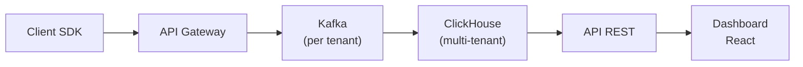

# Caso Studio — Real-Time Analytics

> **Scenario:** Un SaaS di e-commerce analytics deve fornire dashboard real-time ai propri clienti con latenza sotto 10 secondi.

## 1. Requisiti
| Requisito | Specifica |
|:---|:---|
| Clienti | 200 tenant |
| Volume | 50M eventi/giorno totali |
| Latenza query | p95 < 3 secondi |
| Latenza ingestion | < 10 secondi |

## 2. Soluzione


## 3. Ottimizzazione ClickHouse per Multi-Tenant
```sql
CREATE TABLE events (
    tenant_id UInt32,
    event_type LowCardinality(String),
    user_id String,
    timestamp DateTime64(3),
    properties Map(String, String)
) ENGINE = MergeTree()
PARTITION BY (tenant_id, toYYYYMM(timestamp))
ORDER BY (tenant_id, event_type, timestamp)
SETTINGS index_granularity = 8192;
```

## 4. Risultati
| Metrica | Target | Raggiunto |
|:---|:---:|:---:|
| Query p95 | meno di 3s | 1.8s |
| Ingestion latency | meno di 10s | 4s |
| Uptime | 99.9% | 99.97% |
| Costo per tenant | < €5/mese | €3.20/mese |
