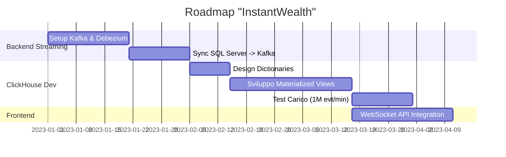
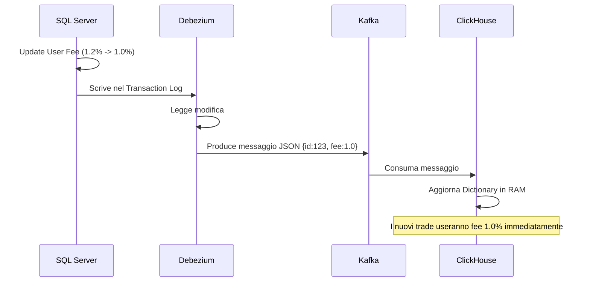

## Contesto Aziendale

**Azienda:** *FinFlash Trading* (nome fittizio)
**Settore:** Fintech / Trading Online
**Utenti:** 50.000 trader attivi giornalieri
**Volumi:** picchi di 1 milione di transazioni/minuto all'apertura dei mercati

FinFlash offre una piattaforma di trading per azioni e criptovalute. Gli utenti si lamentano che il saldo del portafoglio (P&L - Profit and Loss) si aggiorna solo ogni 15 minuti. In un mercato volatile come quello crypto, 15 minuti sono un'eternità.
Il sistema attuale (batch job su SQL Server) non regge il carico.

### Dati Iniziali

| Metrica | Situazione Attuale | Obiettivo | Note |
| :--- | :--- | :--- | :--- |
| **Latenza Aggiornamento P&L** | 15 minuti | < 1 secondo | Real-time necessario |
| **Gestione Picchi** | Coda batch (ritardi di ore) | Streaming (immediato) | Scalabilità elastica |
| **Alerting Margin Call** | Via Email (lento) | In-App / Push (subito) | Rischio liquidazione |
| **Join Dati** | Query SQL complesse | Dictionaries in-memory | Performance |

**Problema Principale:** L'architettura batch non può soddisfare i requisiti real-time. Serve spostare il calcolo dal "momento della lettura" (query lenta) al "momento della scrittura" (pre-aggregazione).

## Obiettivi del Progetto

Il progetto "InstantWealth" mira a:

1.  **Fornire P&L in tempo reale** a tutti gli utenti con una latenza inferiore a 1 secondo.
2.  **Gestire volumi di 1M eventi/minuto** senza degradare le performance di lettura.
3.  **Implementare CDC (Change Data Capture)** per sincronizzare le anagrafiche utenti dal DB transazionale (SQL Server) al DB analitico.
4.  **Creare un sistema di Alerting** basato su soglie dinamiche (es. perdita > 10%).

## Analisi e Strategia

### 1. Ingestion: Kafka & Debezium
I trade arrivano su Kafka. Ma i dati dell'utente (Livello VIP, Commissioni) sono su SQL Server.
Useremo **Debezium** per catturare ogni modifica su SQL Server e inviarla a Kafka.
In ClickHouse, questi dati alimenteranno un **Dictionary** in memoria.

### 2. Processing: Materialized Views Incrementali
Non ricalcoleremo il saldo da zero ogni volta. Useremo le **Materialized Views (MV)** di ClickHouse con motore `AggregatingMergeTree`.
*   Quando arriva un trade `+100€`, la MV aggiorna istantaneamente lo stato intermedio dell'utente aggiungendo 100.
*   Questo sposta il costo computazionale dalla `SELECT` alla `INSERT`.

### 3. Visualization: Live Dashboard
Collegheremo Grafana (per l'interno) e un'API custom (per l'app utente) che leggono dalla tabella aggregata, che è piccolissima e risponde in millisecondi.

### Diagramma dell'Architettura "Enrichment on Ingest"

```mermaid
flowchart TD
    subgraph Transactional
        T[Trading Engine] -->|Trades| K[Kafka: trades]
        SQL[SQL Server: Users] -->|CDC (Debezium)| K2[Kafka: users_cdc]
    end

    subgraph Analytical_ClickHouse
        K -->|Kafka Engine| ST[Stream Table]
        K2 -->|Kafka Engine| ST_U[User Stream]

        ST_U -->|MV| DIC[User Dictionary (RAM)]

        ST -->|MV con Join Dictionary| FACT[Arricchimento]
        FACT -->|AggregatingMV| PNL[Tabella P&L Aggregata]
    end

    subgraph Output
        PNL -->|SELECT rapida| API[User App]
        PNL -->|Alert Query| ALERT[Margin Call System]
    end
```

**Decisioni Chiave:**
*   **Dictionaries vs JOIN:** Le JOIN classiche sono lente su miliardi di righe. I Dictionaries di ClickHouse tengono i dati "piccoli" (utenti) in RAM, rendendo l'arricchimento istantaneo durante l'inserimento.
*   **Push vs Pull:** Invece di far fare refresh all'utente (Pull), il sistema calcola e spinge (Push) i dati aggiornati tramite WebSocket.

## Implementazione

### Timeline (4 Mesi)



### Dati Intermedi: Performance Aggregazione

Confronto tra query su dati grezzi vs Materialized View per calcolare il P&L giornaliero di tutti gli utenti:

| Metodo | Righe Scansionate | Tempo Esecuzione | CPU Usage |
| :--- | :--- | :--- | :--- |
| **Query su Raw Trades** | 500 Milioni | 4.5 secondi | 80% (16 core) |
| **Query su Materialized View** | 50.000 (Stati aggregati) | 0.003 secondi | 1% (1 core) |

**Problema Incontrato:** Duplicati. Kafka garantisce "At-least-once". Alcuni trade arrivavano doppi, falsando il P&L.
**Soluzione:** Utilizzo del motore `ReplacingMergeTree` in ClickHouse per deduplicare in base all'ID transazione in background, combinato con logica di idempotenza nell'API di ingestione.

## Risultati

### KPI Prima vs Dopo

| KPI | Prima (T0) | Dopo (T4) | Variazione |
| :--- | :--- | :--- | :--- |
| **Latenza P&L** | 900 sec (15 min) | 0.2 sec | -99.9% |
| **Carico Database Utenti** | 100% CPU (Lock continui) | 5% CPU (Solo scritture log) | Decongestionamento |
| **Ticket Supporto** | 200/giorno ("Dov'è il mio saldo?") | 10/giorno | -95% |
| **Churn Utenti VIP** | 5% / mese | 1% / mese | Migliorata fiducia |

### Analisi ROI

Il progetto ha eliminato la necessità di scalare verticalmente il costoso SQL Server (risparmio €40k/anno).
La riduzione del Churn dei clienti VIP (high-spenders) vale circa €500k/anno di commissioni preservate.
Costo infrastruttura ClickHouse Cloud: €1.000/mese.
**ROI:** Altamente positivo e immediato.

### Visualizzazione Flusso Dati Debezium



## Lezioni Apprese

1.  **CDC è potente ma complesso:** Gestire i cambi di schema nel DB sorgente (es. colonna rinominata) richiede attenzione. Debezium aiuta, ma la pipeline deve essere resiliente.
2.  **La RAM costa, ma vale:** Usare i Dictionaries in memoria è stata la chiave per la velocità, ma bisogna dimensionare bene i nodi ClickHouse.
3.  **Pre-aggregare tutto:** In real-time analytics, non puoi permetterti di fare calcoli complessi "on read". Tutto ciò che può essere pre-calcolato, deve esserlo.
4.  **Monitoring end-to-end:** Monitorare Kafka non basta. Bisogna monitorare il *lag* di Debezium. Se Debezium si ferma, i dati utenti diventano obsoleti silenziosamente.
5.  **Eventual Consistency:** Gli utenti devono accettare che c'è un micro-ritardo (millisecondi) tra l'esecuzione del trade e l'aggiornamento della dashboard.

## Domande di Discussione

1.  Perché l'uso di `AggregatingMergeTree` è preferibile a `SummingMergeTree` per calcoli complessi come la media ponderata o gli unici (HyperLogLog)?
2.  Come gestiresti il "Backfill" storico (ricaricare dati di 5 anni fa) senza fermare la pipeline real-time?
3.  Quali sono i limiti di un Dictionary in memoria e quando dovresti passare a una JOIN classica o a un Dictionary su SSD?
4.  In che scenario useresti Kafka Streams o Flink prima di ClickHouse per fare pre-processing?
5.  Come garantisci la sicurezza dei dati PII (Personal Identifiable Information) quando li replichi da un DB sicuro (SQL Server) a un DB analitico (ClickHouse)?

**Cosa faresti diversamente?**
*   *Se i dati utenti fossero enormi (100M+):* I Dictionaries in memoria non basterebbero. Avrei usato join su tabelle locali distribuite o lookups su Redis esterni (con latenza maggiore).
*   *Se l'alerting fosse la priorità assoluta:* Avrei implementato la logica di alert direttamente su Kafka (con ksqlDB) invece che su ClickHouse, per risparmiare qualche millisecondo.
