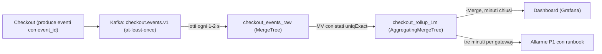

Un marketplace lancia una vendita lampo con circa 600 tentativi di pagamento al minuto trasmessi su Kafka. Alle 12:14 un gateway di carte prepagate smette di funzionare per quasi tutti i clienti. In quello stesso periodo un errore di rete fa ritentare l'invio di alcuni messaggi, e la dashboard mostra ricavi più alti del reale proprio mentre il flusso degli incassi si sta rompendo.

## Eventi doppi e un circuito spento nel totale

Lo scenario è costruito, con numeri di esempio generati dal codice che segue e rieseguibili in chDB, il motore ClickHouse in-process per Python. Il servizio di checkout pubblica sul topic `checkout.events.v1` ogni tentativo di pagamento con `event_id`, `order_id`, `occurred_at`, `payment_gateway`, `status` (`approved` o `declined`), `amount_eur` e `gateway_latency_ms`. I gateway sono quattro: `CARD_IT`, `PAYPAL`, `PREPAID_IT` e `WALLET`, con 150 tentativi al minuto ciascuno per 30 minuti.

Il prototipo costruito in fretta presenta due guasti concatenati. Il primo: un timeout sul bilanciatore induce il servizio a ritentare l'invio di una frazione dei messaggi, quindi sul topic compaiono eventi con lo stesso `event_id`. La vista che somma i messaggi in arrivo li conta due volte. Il secondo: alle 12:14 `PREPAID_IT` inizia a rifiutare circa il 92% dei pagamenti con latenza sopra i 4 secondi. L'unico allarme controlla il totale degli ordini approvati del sito, e gli altri tre gateway compensano abbastanza da non farlo scattare.

> **Idea chiave:** una pipeline real-time è affidabile solo se separa tre responsabilità: l'idempotenza sull'identità dell'evento, il rollup incrementale con stati componibili e l'allarme scomposto per gateway con persistenza. Ognuna ripara un guasto diverso e nessuna sostituisce le altre.

La lezione costruisce l'intera catena in un unico dataset sintetico e misura, a ogni passo, la differenza tra la versione ingenua e quella corretta.

## Quattro stadi, quattro responsabilità

Una pipeline end-to-end per questo caso ha quattro stadi accoppiati ma con responsabilità distinte.



Il primo stadio è il trasporto. I produttori scrivono su un topic Kafka e la consegna è *at-least-once*: un messaggio può arrivare più di una volta. L'identità dell'evento, cioè `event_id`, è l'unico strumento per riconoscere i doppioni a valle.

Il secondo stadio è la tabella raw, che conserva gli eventi come sono arrivati, doppioni compresi. Il terzo è il rollup per minuto e gateway: una vista materializzata scrive stati binari e non numeri finiti, così le finestre larghe si ottengono fondendo stati. Il quarto stadio sono dashboard e allarme, che leggono solo il rollup e solo i minuti chiusi.

La scelta di fondo è che la deduplica non può affidarsi ai merge della raw. Una vista materializzata si attiva su ogni blocco inserito, prima di qualsiasi merge: se lo stesso evento arriva in due blocchi, la vista lo vede due volte. Lo stato `uniqExact` risolve questo problema perché è un insieme di identificatori, non un contatore.

## Tre errori che il carico di picco porta a galla

Il blocco seguente crea la tabella raw e la vista ingenua che somma direttamente i messaggi. È l'implementazione che si scrive per prima, e funziona finché nessun messaggio arriva due volte.

```sql
-- Tabella di atterraggio: eventi come arrivano da Kafka, doppioni inclusi.
CREATE TABLE checkout_events_raw
(
    event_id String,
    order_id UInt64,
    occurred_at DateTime('UTC'),
    payment_gateway LowCardinality(String),
    status LowCardinality(String),
    amount_eur Decimal(10, 2),
    gateway_latency_ms UInt32,
    ingested_at DateTime('UTC')
)
ENGINE = MergeTree
PARTITION BY toYYYYMM(occurred_at)
ORDER BY (payment_gateway, toStartOfHour(occurred_at), event_id);

-- ERRORE 1: count e somma dentro la vista contano ogni arrivo, anche i retry.
CREATE TABLE rollup_bad
(
    payment_gateway LowCardinality(String),
    minuto DateTime('UTC'),
    approvati UInt64,
    ricavo_eur Decimal(18, 2)
)
ENGINE = SummingMergeTree
ORDER BY (payment_gateway, minuto);

CREATE MATERIALIZED VIEW mv_bad TO rollup_bad AS
SELECT
    payment_gateway,
    toStartOfMinute(occurred_at) AS minuto,
    countIf(status = 'approved') AS approvati,
    sumIf(amount_eur, status = 'approved') AS ricavo_eur
FROM checkout_events_raw
GROUP BY payment_gateway, minuto;
```

### Sommare i messaggi nella vista senza proteggersi dai retry

Sintomo: i ricavi live sono più alti dei ricavi contabili di fine giornata. Sembra ragionevole perché la raw usa un motore che deduplica, ma la vista viene eseguita prima della deduplica su disco. Se il retry arriva cinque secondi dopo il primo invio, la vista scatta due volte e aggiunge conteggio e importo due volte. La correzione è un'identità nello stato: `uniqExactState(event_id)`.

### Non separare salute tecnica e metriche di business

Sintomo: gli ordini di un gateway scendono e nessuno sa dire perché. Se il rollup traccia solo approvati e ricavi, il reperibile non distingue in trenta secondi tra clienti che hanno cambiato metodo, banca in timeout o connettore fermo. Il rollup deve portare anche il tasso di rifiuto e il 95° percentile della latenza, nello stesso posto, per gateway.

### Allarme sul totale del sito invece che per gateway

Sintomo: un circuito perde il 90% dei pagamenti e nessuno viene avvertito. Un controllo sul totale vede una discesa, ma un picco di visite o gli altri gateway la compensano. Solo un controllo raggruppato per `payment_gateway` su tre minuti chiusi consecutivi isola il circuito rotto.

## Il rollup che resiste ai retry

I criteri di costruzione, in ordine:

1. Il rollup è una tabella `AggregatingMergeTree` ordinata per `(payment_gateway, minuto)`.
2. Ogni misura non additiva è uno stato: `uniqExactState(event_id)` per i tentativi, `uniqExactIfState` per approvati e rifiutati, `quantileState(0.95)` per la latenza, `avgIfState` per l'importo medio.
3. La vista materializzata scrive nel rollup con `TO` e solo stati, mai numeri finiti.
4. Il dataset di prova inserisce prima gli eventi e poi un secondo lotto con circa il 9% di doppioni, per simulare i retry.

```sql
-- Rollup per minuto e gateway: ogni misura è uno stato componibile.
CREATE TABLE checkout_rollup_1m
(
    payment_gateway LowCardinality(String),
    minuto DateTime('UTC'),
    tentativi_state AggregateFunction(uniqExact, String),
    approvati_state AggregateFunction(uniqExactIf, String, UInt8),
    rifiutati_state AggregateFunction(uniqExactIf, String, UInt8),
    importo_medio_state AggregateFunction(avgIf, Float64, UInt8),
    p95_state AggregateFunction(quantile(0.95), UInt32)
)
ENGINE = AggregatingMergeTree
ORDER BY (payment_gateway, minuto);

CREATE MATERIALIZED VIEW mv_checkout_rollup_1m TO checkout_rollup_1m AS
SELECT
    payment_gateway,
    toStartOfMinute(occurred_at) AS minuto,
    uniqExactState(event_id) AS tentativi_state,
    uniqExactIfState(event_id, status = 'approved') AS approvati_state,
    uniqExactIfState(event_id, status = 'declined') AS rifiutati_state,
    avgIfState(toFloat64(amount_eur), status = 'approved') AS importo_medio_state,
    quantileState(0.95)(gateway_latency_ms) AS p95_state
FROM checkout_events_raw
GROUP BY payment_gateway, minuto;

-- Sorgente sintetica: 18.000 eventi in 30 minuti, 4 gateway, 150 tentativi al minuto ciascuno.
-- Dal minuto 14 PREPAID_IT rifiuta circa il 92% dei pagamenti con latenza sopra 4 secondi.
CREATE VIEW sorgente_eventi AS
SELECT
    concat('ev-', toString(n)) AS event_id,
    n AS order_id,
    toDateTime('2026-11-15 12:00:00', 'UTC') + intDiv(n, 600) * 60 + intDiv(n % 600, 10) AS occurred_at,
    ['CARD_IT', 'PAYPAL', 'PREPAID_IT', 'WALLET'][1 + n % 4] AS payment_gateway,
    if(cityHash64(n, 1) % 100 < if(payment_gateway = 'PREPAID_IT' AND intDiv(n, 600) >= 14, 92, 6), 'declined', 'approved') AS status,
    toDecimal64(round(20 + (cityHash64(n, 3) % 8000) / 100, 2), 2) AS amount_eur,
    toUInt32(if(payment_gateway = 'PREPAID_IT' AND intDiv(n, 600) >= 14, 4000, 200) + cityHash64(n, 2) % 300) AS gateway_latency_ms,
    occurred_at + 1 AS ingested_at
FROM (SELECT number AS n FROM numbers(18000));

-- Primo invio: tutti gli eventi. Secondo invio: i retry, circa il 9% degli stessi event_id.
INSERT INTO checkout_events_raw SELECT * FROM sorgente_eventi;
INSERT INTO checkout_events_raw SELECT * FROM sorgente_eventi WHERE cityHash64(order_id, 9) % 100 < 9;
```

## Il conto del danno: vista ingenua contro stati esatti

Con i dati caricati il confronto si fa con poche query. Il blocco misura le righe nella raw, i conteggi delle due viste e i ricavi in tre modi.

```sql
-- Raw: 19.602 righe per 18.000 eventi unici, cioè 8,9% di doppioni.
SELECT count() AS righe_raw, uniqExact(event_id) AS eventi_unici,
       round((count() - uniqExact(event_id)) * 100 / uniqExact(event_id), 1) AS duplicati_pct
FROM checkout_events_raw;

-- Vista ingenua: 16.143 approvati e 968.010,27 euro.
SELECT sum(approvati) AS approvati_vista_ingenua, sum(ricavo_eur) AS ricavo_ingenuo FROM rollup_bad;

-- Rollup con stati: 14.835 approvati unici.
SELECT uniqExactIfMerge(approvati_state) AS approvati_unici FROM checkout_rollup_1m;

-- Valore contabile: deduplica sulla raw con l'ultima versione di ogni event_id.
SELECT sum(amount_eur) AS ricavo_esatto, count() AS approvati
FROM (
    SELECT event_id, argMax(amount_eur, ingested_at) AS amount_eur, argMax(status, ingested_at) AS status
    FROM checkout_events_raw GROUP BY event_id
)
WHERE status = 'approved';

-- Stima live dal rollup: approvati unici per importo medio: 889.576,43 euro.
SELECT round(uniqExactIfMerge(approvati_state) * avgIfMerge(importo_medio_state), 2) AS ricavo_stimato
FROM checkout_rollup_1m;
```

Il calcolo, passo per passo. Gli eventi unici sono 18.000 e la raw ne contiene 19.602: la differenza è 19.602 − 18.000 = 1.602 righe doppie, pari a 1.602 ÷ 18.000 = 8,9%.

La vista ingenua conta 16.143 approvati. Quelli veri sono 14.835. L'eccesso è 16.143 − 14.835 = 1.308 approvati, cioè +8,8%. Il rollup con stati restituisce 14.835, esattamente il valore corretto, perché lo stesso `event_id` entra una sola volta nell'insieme.

Sui ricavi, la vista ingenua mostra 968.010,27 euro e la deduplica esatta sulla raw dà 890.062,24 euro. La differenza è 968.010,27 − 890.062,24 = 77.948,03 euro, cioè +8,8%: la dashboard sovrastima di quasi 78.000 euro in mezz'ora. Sono i doppioni, non un errore di calcolo.

Il ricavo del rollup non è un numero esatto. `uniqExact` conta gli eventi ma non somma gli importi, quindi la stima live è approvati unici × importo medio: 14.835 × 59,96 euro circa = 889.576,43 euro. Lo scarto dal valore esatto è 889.576,43 − 890.062,24 = −485,81 euro, cioè −0,05%. Per una dashboard operativa è un errore trascurabile. Per un bilancio no, e per quello si usa la query contabile sulla raw, deduplicata per `event_id`.

## Dashboard sul rollup e allarme per gateway

I pannelli leggono solo il rollup, con i combinatori `-Merge`, e si fermano ai minuti chiusi (`minuto < toStartOfMinute(now())`). L'allarme controlla gli ultimi tre minuti chiusi per ogni gateway. Nel blocco `adesso` è fissato alle 12:17 per rendere il risultato riproducibile.

```sql
-- Dashboard: PREPAID_IT minuto per minuto attorno al guasto.
SELECT
    payment_gateway,
    minuto,
    uniqExactMerge(tentativi_state) AS tentativi,
    round(uniqExactIfMerge(rifiutati_state) * 100 / uniqExactMerge(tentativi_state), 1) AS rifiuto_pct,
    round(quantileMerge(0.95)(p95_state)) AS p95_ms
FROM checkout_rollup_1m
WHERE minuto >= toDateTime('2026-11-15 12:13:00', 'UTC')
  AND minuto < toDateTime('2026-11-15 12:17:00', 'UTC')
  AND payment_gateway = 'PREPAID_IT'
GROUP BY payment_gateway, minuto
ORDER BY minuto;

-- Allarme: tre minuti chiusi critici su tre, per gateway.
-- Un minuto è critico se ha almeno 20 tentativi e (rifiuto > 25% oppure p95 > 2.500 ms).
WITH
    toDateTime('2026-11-15 12:17:00', 'UTC') AS adesso,
    finestra AS
    (
        SELECT
            payment_gateway,
            minuto,
            uniqExactMerge(tentativi_state) AS tentativi,
            uniqExactIfMerge(rifiutati_state) * 100 / tentativi AS rifiuto_pct,
            quantileMerge(0.95)(p95_state) AS p95_ms,
            (tentativi >= 20 AND (rifiuto_pct > 25 OR p95_ms > 2500)) AS critico
        FROM checkout_rollup_1m
        WHERE minuto >= adesso - INTERVAL 3 MINUTE AND minuto < adesso
        GROUP BY payment_gateway, minuto
    )
SELECT payment_gateway, countIf(critico) AS minuti_critici_su_3,
       round(avg(rifiuto_pct), 1) AS rifiuto_medio_pct, round(max(p95_ms)) AS p95_max_ms
FROM finestra
GROUP BY payment_gateway
HAVING minuti_critici_su_3 = 3;

-- Cosa vedrebbe un allarme sul totale: approvati al minuto su tutto il sito.
SELECT minuto, uniqExactIfMerge(approvati_state) AS approvati_totali
FROM checkout_rollup_1m
WHERE minuto >= toDateTime('2026-11-15 12:13:00', 'UTC') AND minuto < toDateTime('2026-11-15 12:17:00', 'UTC')
GROUP BY minuto ORDER BY minuto;
```

La prima query mostra il guasto: al minuto 12:13 `PREPAID_IT` ha un rifiuto del 7,3% e una latenza p95 di 475 millisecondi, poi dal minuto 12:14 il rifiuto sale al 91,3%, al 90,7% e al 92%, con un p95 intorno ai 4.280 millisecondi. L'allarme si accende alle 12:17, dopo tre minuti chiusi, e restituisce una sola riga: `PREPAID_IT`, tre minuti critici, rifiuto medio 91,3%, p95 massimo 4.289 millisecondi.

L'allarme sul totale racconta un'altra storia. Gli approvati totali passano da 555 al minuto alle 12:13 a 428, 424 e 443. È un calo, circa il 23%, ma un controllo con soglia fissa sul totale a 300 non scatta mai, e uno con soglia a 800 scatterebbe anche prima del guasto. Il danno si stima così: 555 − 428 = 127 approvati in meno al minuto, a circa 60 euro l'uno, cioè 127 × 60 = 7.620 euro al minuto. Con tre minuti di attesa sono 3 × 7.620 = 22.860 euro prima dell'allarme, che con la deviazione del traffico su un gateway di riserva evita di perdere i restanti minuti della vendita.

Il pannello dovrebbe mostrare anche il ritardo di freschezza, `now() - max(ingested_at)`, e non solo gli ordini. Senza di esso un connettore Kafka fermo produce una serie che sembra un calo di vendite.

## Ingestione nativa o connettore esterno

Il primo anello della pipeline, dal topic alla tabella, ha due soluzioni: il motore `ENGINE = Kafka` di ClickHouse, abbinato a una vista materializzata che scrive nella `MergeTree`, oppure un connettore esterno come Kafka Connect, Vector o Bento che scrive a lotti via interfaccia HTTP o nativa.

Il criterio: **motore Kafka nativo quando il flusso è JSON o Avro già validato e vuoi zero componenti in più; connettore esterno quando servono una coda per i messaggi malformati (dead letter queue), una scala indipendente dai nodi del database o un mascheramento dei dati personali prima della scrittura.**

L'errore tipico è usare il motore nativo senza gestire i messaggi rotti: un singolo JSON corrotto può fermare il consumo della partizione se non imposti `kafka_skip_broken_messages`. L'errore opposto è mettere in piedi un cluster di connettori per leggere un solo topic interno già validato, con un costo operativo senza beneficio.

In entrambi i casi la dimensione del lotto segue la regola già vista nel modulo: raggruppare le righe, con un tempo massimo di attesa. In questo scenario 600 tentativi al minuto sono 10 al secondo, quindi un flush ogni secondo scrive lotti da circa 10 righe, cioè 60 parti al minuto, mentre un lotto da 10.000 righe richiederebbe 1.000 secondi di attesa, oltre sedici minuti. Il tempo massimo decide, e il rollup assorbe senza problemi lotti piccoli, perché ogni lotto aggiorna una sola riga per gateway e per minuto.

Quello che qui resta fuori è la riconciliazione finanziaria del giorno dopo con i file di regolamento delle carte, che avviene in un processo batch separato. Per i ricavi esatti al centesimo vale la query contabile sulla raw, deduplicata per `event_id`.

## Collaudo prima del go-live

1. Nel dataset di prova il 9% dei messaggi è duplicato. Quali tre numeri confronti per dimostrare che il rollup è corretto?

<details>
<summary>Mostra risposta</summary>

Righe nella raw contro eventi unici (19.602 contro 18.000), approvati della vista ingenua contro approvati del rollup con stati (16.143 contro 14.835) e ricavo ingenuo contro ricavo esatto sulla raw (968.010,27 contro 890.062,24 euro). Il rollup deve coincidere con gli unici, non con le righe.

</details>

2. La stima live del ricavo è approvati unici per importo medio. Quanto vale lo scarto sul dataset e quando non è accettabile?

<details>
<summary>Mostra risposta</summary>

Lo scarto è 889.576,43 − 890.062,24 = −485,81 euro, cioè −0,05%. Per una dashboard operativa è accettabile. Per chiusure contabili, report ai finanziari o riconciliazioni con la banca serve il valore esatto, calcolato sulla raw deduplicata per `event_id`.

</details>

3. Perché l'allarme scatta alle 12:17 e non alle 12:15, e quanto costa quell'attesa?

<details>
<summary>Mostra risposta</summary>

Perché richiede tre minuti chiusi consecutivi critici: 12:14, 12:15 e 12:16, e il minuto 12:17 è ancora aperto. La persistenza elimina i falsi positivi da fluttuazione. Il costo è 3 × 7.620 = 22.860 euro di vendite perse nel caso costruito, un prezzo da dichiarare nel progetto come tempo di rilevazione.

</details>

4. Un collega propone di sostituire `uniqExactState` con `uniqState` per risparmiare memoria. Che cosa controlli prima di accettare?

<details>
<summary>Mostra risposta</summary>

`uniq` è approssimato, `uniqExact` conserva l'insieme degli identificatori. Con 150 tentativi per gateway al minuto la memoria dell'insieme è piccola, quindi il risparmio è modesto, e l'errore potrebbe sporcare il conteggio che vuoi usare come verità. Si confronta l'errore su un periodo reale e si accetta `uniq` solo se resta entro la tolleranza concordata e la cardinalità per cella è molto più alta.

</details>
