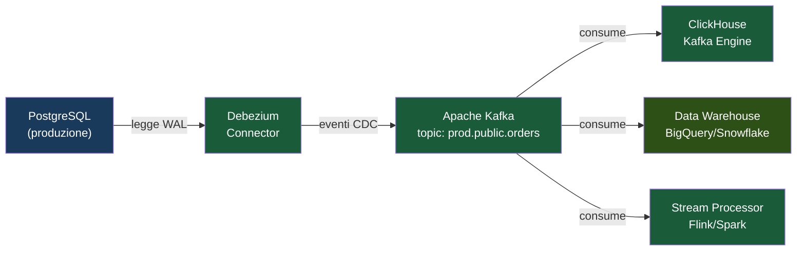

import { Aside, Steps, Tabs, TabItem } from '@astrojs/starlight/components'

Yelp gestisce oltre 100 tabelle MySQL in produzione. Ogni ordine, ogni recensione, ogni aggiornamento di business — tutto passa dal database operazionale. Il problema: il data warehouse per l'analytics era sempre in ritardo di 24 ore. Quando hanno costruito "Maxwell" — il loro sistema CDC open-source — hanno portato la latenza da 24 ore a meno di 10 secondi, senza impatto sulla produzione.

Change Data Capture (CDC) è la tecnica che risolve il problema strutturale di ogni architettura dati: il database operazionale ha dati aggiornati al secondo, il data warehouse ha dati di ieri. Colmare questo gap senza toccare la produzione è il cuore del CDC.

## Il problema che CDC risolve

Prima del CDC, i team sincronizzavano i dati in tre modi, tutti problematici:

**Full table scan notturno**: `SELECT *` ogni notte su tutta la tabella. Funziona per tabelle piccole, distrugge le performance su tabelle da miliardi di righe. Non scala.

**Timestamp-based polling**: `SELECT * WHERE updated_at > last_run`. Migliore, ma ha un difetto critico: i `DELETE` sono invisibili. Se un record viene cancellato, il data warehouse non lo saprà mai. Genera data drift silenzioso nel tempo.

**Trigger-based CDC**: trigger DB su ogni operazione che scrive su una tabella di audit. Funziona, ma aggiunge overhead a ogni scrittura. Su database ad alto traffico, questo overhead può degradare le performance del 15-30%.

Il **Log-based CDC** è il gold standard: legge direttamente il transaction log del database (WAL in PostgreSQL, binlog in MySQL) già scritto per garantire la durabilità delle transazioni. Zero impatto sulle performance. Ogni cambiamento è catturato fedelmente.

## I quattro approcci CDC a confronto

| Approccio | Latenza | Impatto DB | Cattura DELETE | Scalabilità |
|-----------|---------|------------|----------------|-------------|
| Full snapshot | Ore | Alto (I/O) | No | Scarsa |
| Timestamp polling | Minuti | Basso | **No** | Buona |
| Trigger-based | Secondi | **Alto** (CPU) | Sì | Media |
| Log-based (WAL/binlog) | Secondi | **Minimo** | Sì | Eccellente |

## Log-based CDC: come funziona internamente

### PostgreSQL WAL

PostgreSQL scrive ogni transazione nel WAL *prima* di applicarla al database, garantendo la durabilità. Il CDC log-based intercetta questo log come farebbe una replica standby.

Per abilitare il CDC su PostgreSQL:

```sql
-- In postgresql.conf (riavvio richiesto)
wal_level = logical        -- abilita la logical replication
max_replication_slots = 4  -- slot CDC per connettore
max_wal_senders = 4        -- worker che inviano il WAL

-- Utente dedicato con permessi minimi
CREATE USER debezium_user REPLICATION LOGIN PASSWORD 'secure_password';
GRANT SELECT ON ALL TABLES IN SCHEMA public TO debezium_user;

-- Publication: cosa replicare
CREATE PUBLICATION debezium_pub FOR TABLE orders, customers, products;
```

### MySQL binlog

```ini
# in my.cnf
[mysqld]
server-id     = 1
log_bin       = /var/lib/mysql/mysql-bin.log
binlog_format = ROW     # CRITICO: deve essere ROW, non STATEMENT
binlog_row_image = FULL # cattura il record completo (before + after)
expire_logs_days = 7    # retention del binlog
```

### MongoDB Change Streams

MongoDB offre Change Streams nativamente dalla versione 3.6, senza configurazione del log:

```javascript
const changeStream = db.collection('orders').watch();
changeStream.on('change', (change) => {
  // change.operationType: 'insert', 'update', 'replace', 'delete'
  // change.fullDocument: documento dopo il cambiamento
  // change.updateDescription: campi modificati (solo per update)
});
```

## Debezium: il connettore CDC più usato

Debezium è il progetto open-source di Red Hat che implementa CDC log-based per PostgreSQL, MySQL, MongoDB, SQL Server, Oracle. Funziona come insieme di Kafka Connect connectors.



### Configurazione del connettore PostgreSQL

```json
{
  "name": "pg-orders-connector",
  "config": {
    "connector.class": "io.debezium.connector.postgresql.PostgresConnector",
    "database.hostname": "postgres.internal",
    "database.port": "5432",
    "database.user": "debezium_user",
    "database.password": "${file:/opt/kafka/secrets/debezium.properties:db.password}",
    "database.dbname": "production",
    "table.include.list": "public.orders,public.order_items,public.customers",
    "plugin.name": "pgoutput",
    "slot.name": "debezium_orders_slot",
    "publication.name": "debezium_pub",
    "decimal.handling.mode": "double",
    "snapshot.mode": "initial",
    "heartbeat.interval.ms": "30000",
    "topic.prefix": "prod"
  }
}
```

<Aside type="caution">
Non mettere mai le password in chiaro nella configurazione. Usa il pattern `${file:...}` o meglio ancora HashiCorp Vault / AWS Secrets Manager tramite il Kafka Connect ExternalSecretConfigProvider.
</Aside>

## Riepilogo Operativo

- Un pipeline CDC affidabile dipende piu' da monitoring e schema governance che dalla sola replica iniziale.
- Slot lag, consumer lag e schema evolution sono i tre punti da controllare prima che diventino incidenti.
- UPDATE e DELETE vanno progettati esplicitamente nella destinazione, non lasciati impliciti.
- Testare la pipeline in locale e simulare i failure mode riduce molto il rischio in produzione.

### Il formato del messaggio Debezium

```json
{
  "payload": {
    "op": "u",
    "before": {
      "id": 1234,
      "status": "pending",
      "amount": 99.99,
      "updated_at": 1706789000000
    },
    "after": {
      "id": 1234,
      "status": "shipped",
      "amount": 99.99,
      "updated_at": 1706789012345
    },
    "source": {
      "ts_ms": 1706789012345,
      "db": "production",
      "table": "orders",
      "lsn": 987654321
    }
  }
}
```

Valori di `op`: `"c"` (INSERT), `"u"` (UPDATE), `"d"` (DELETE), `"r"` (snapshot).

## CDC verso ClickHouse: tre pattern

<Tabs>
<TabItem label="Kafka Engine (semplice)">

```sql
-- 1. Tabella Kafka che legge il topic Debezium
CREATE TABLE cdc_orders_kafka (
    op String,
    after_id     Nullable(UInt64),
    after_status Nullable(String),
    after_amount Nullable(Float64),
    source_ts_ms UInt64
) ENGINE = Kafka
SETTINGS
    kafka_broker_list   = 'kafka:9092',
    kafka_topic_list    = 'prod.public.orders',
    kafka_group_name    = 'clickhouse_cdc_orders',
    kafka_format        = 'JSONEachRow',
    kafka_skip_broken_messages = 100;

-- 2. Tabella destinazione
CREATE TABLE orders (
    id         UInt64,
    status     LowCardinality(String),
    amount     Float64,
    updated_at DateTime,
    _deleted   UInt8 DEFAULT 0
) ENGINE = ReplacingMergeTree(updated_at)
ORDER BY id;

-- 3. Materialized View che trasforma e carica
CREATE MATERIALIZED VIEW cdc_orders_mv TO orders AS
SELECT
    after_id AS id,
    if(op = 'd', '', after_status)  AS status,
    if(op = 'd', 0,  after_amount)  AS amount,
    toDateTime(intDiv(source_ts_ms, 1000)) AS updated_at,
    if(op = 'd', 1, 0) AS _deleted
FROM cdc_orders_kafka
WHERE op IN ('c', 'u', 'd');
```

</TabItem>
<TabItem label="CollapsingMergeTree (DELETE fisici)">

```sql
-- Per DELETE fisici reali usa CollapsingMergeTree
CREATE TABLE orders_collapsing (
    id         UInt64,
    status     String,
    amount     Float64,
    updated_at DateTime,
    sign       Int8   -- +1 per insert/update, -1 per delete
) ENGINE = CollapsingMergeTree(sign)
ORDER BY id;

-- Query corretta (somma i sign)
SELECT id, sum(sign * amount) AS amount
FROM orders_collapsing
GROUP BY id
HAVING sum(sign) > 0;
```

</TabItem>
</Tabs>

### Leggere dati deduplicati da ReplacingMergeTree

```sql
-- Query con FINAL: deduplicazione sincrona (più lenta ma corretta)
SELECT id, status, amount
FROM orders FINAL
WHERE _deleted = 0;

-- Pattern alternativo per grandi tabelle: window function
SELECT id, status, amount
FROM (
    SELECT *,
           row_number() OVER (PARTITION BY id ORDER BY updated_at DESC) AS rn
    FROM orders
    WHERE id IN (1234, 5678)
)
WHERE rn = 1 AND _deleted = 0;
```

## Schema Evolution: gestire i cambiamenti del database

Il problema più insidioso del CDC in produzione è quando lo schema del database sorgente cambia senza preavviso.

**Operazioni sicure** (non rompono il CDC):
- Aggiungere una colonna con valore DEFAULT
- Aumentare la lunghezza di un campo VARCHAR
- Aggiungere un nuovo indice

**Operazioni pericolose** (richiedono coordinamento preventivo):
- Rinominare una colonna → Debezium non la trova più
- Cambiare il tipo (es. `INT` → `BIGINT`) → errore di deserializzazione
- Aggiungere `NOT NULL` su colonna esistente → rompe lo snapshot iniziale

<Steps>
1. Comunicare le modifiche schema al team data engineering *prima* del deploy in produzione
2. Usare Schema Registry con Avro per versioning esplicito degli schemi
3. Seguire la policy di compatibilità BACKWARD: aggiungere è ok, rinominare e rimuovere no
4. Testare sempre in staging con traffico simulato prima della produzione
</Steps>

## Monitoring: il CDC silenziosamente rotto è il peggiore

Un CDC che non funziona è ovvio. Un CDC che funziona a metà genera dati sbagliati che nessuno sa essere sbagliati — molto peggio.

```sql
-- Replication slot lag in PostgreSQL (WAL in attesa)
SELECT
    slot_name,
    pg_size_pretty(pg_wal_lsn_diff(pg_current_wal_lsn(), restart_lsn)) AS lag_size,
    active
FROM pg_replication_slots;
-- Alert se lag_size > 500 MB
```

**Heartbeat pattern** — verifica che il CDC sia vivo end-to-end:

```sql
-- Nel DB sorgente: aggiorna ogni 30 secondi
CREATE TABLE cdc_heartbeat (
    id INT PRIMARY KEY DEFAULT 1,
    ts TIMESTAMP DEFAULT NOW()
);
UPDATE cdc_heartbeat SET ts = NOW() WHERE id = 1;

-- Nel data warehouse: alert se heartbeat > 2 minuti fa
SELECT ts FROM heartbeat_replica
WHERE source_ts > NOW() - INTERVAL 120 SECOND
LIMIT 1;
-- Se 0 righe → CDC interrotto
```

## Snapshot iniziale: la fase più critica

Quando configuri Debezium su un database esistente con milioni di righe, prima di iniziare a streammare i cambiamenti incrementali deve fare uno **snapshot iniziale** dell'intero stato corrente. Questa fase è spesso sottovalutata — e causa i problemi più seri in produzione.

### Modalità di snapshot

Debezium supporta quattro `snapshot.mode`:

| Modalità | Comportamento | Quando usarla |
|----------|---------------|---------------|
| `initial` | Snapshot completo, poi stream | Prima installazione (default) |
| `initial_only` | Solo snapshot, poi stop | Backfill una-tantum |
| `schema_only` | Solo schema, nessun dato | Il DW è già sincronizzato |
| `never` | Assume dati allineati | Restart dopo interruzione breve |

### Il problema dello snapshot su tabelle grandi

Su una tabella `orders` da 500 milioni di righe, lo snapshot `initial` può richiedere ore — durante le quali:
1. Il replication slot continua ad accumulare WAL (che cresce fino al termine dello snapshot)
2. Il lock di snapshot acquisito da Debezium blocca i `VACUUM FULL` di PostgreSQL
3. Il carico I/O sul database può impattare le performance applicative

La soluzione sono i **chunked snapshots** (Debezium 2.0+):

```json
{
  "snapshot.mode": "initial",
  "snapshot.fetch.size": "10240",          // righe per batch
  "snapshot.max.threads": "4",             // parallelismo (una tabella per thread)
  "snapshot.select.statement.overrides": {
    "public.orders": "SELECT * FROM public.orders WHERE created_at > '2023-01-01'"
  }
}
```

La configurazione `snapshot.select.statement.overrides` permette di limitare lo snapshot a un sottoinsieme di dati — ad esempio, solo gli ordini degli ultimi 2 anni — riducendo drasticamente il tempo di inizializzazione.

### Il rischio del "gap" tra snapshot e stream

C'è un momento critico nello snapshot iniziale: Debezium legge i dati dal database *mentre* le transazioni continuano. Il WAL position del replication slot viene salvato all'inizio dello snapshot. Tutti i cambiamenti avvenuti durante lo snapshot vengono poi applicati in ordine — garantendo consistenza finale.

```
T=0: Debezium acquisisce LSN=1000, inizia snapshot
T=10min: ordine #9999 viene creato (LSN=1050)
T=30min: snapshot completato (ha letto il DB all'LSN=1000)
T=31min: Debezium riprende dal LSN=1001 → emette evento INSERT per ordine #9999
→ Il DW riceve correttamente l'ordine (ReplacingMergeTree deduplication)
```

Questo è il motivo per cui in destinazione si usa `ReplacingMergeTree` e non una tabella semplice: i duplicate INSERT dal gap snapshot→stream sono normali e attesi.

## Setup locale con Docker Compose

Per sviluppare e testare la pipeline CDC prima del deploy in produzione, questo `docker-compose.yml` avvia l'intero stack in locale:

```yaml
version: '3.8'

services:
  postgres:
    image: postgres:16
    environment:
      POSTGRES_DB: production
      POSTGRES_USER: admin
      POSTGRES_PASSWORD: secret
    command: >
      postgres
        -c wal_level=logical
        -c max_replication_slots=4
        -c max_wal_senders=4
    ports:
      - "5432:5432"
    volumes:
      - ./init.sql:/docker-entrypoint-initdb.d/init.sql

  zookeeper:
    image: confluentinc/cp-zookeeper:7.5.0
    environment:
      ZOOKEEPER_CLIENT_PORT: 2181

  kafka:
    image: confluentinc/cp-kafka:7.5.0
    depends_on: [zookeeper]
    environment:
      KAFKA_ZOOKEEPER_CONNECT: zookeeper:2181
      KAFKA_ADVERTISED_LISTENERS: PLAINTEXT://kafka:9092
      KAFKA_OFFSETS_TOPIC_REPLICATION_FACTOR: 1
    ports:
      - "9092:9092"

  kafka-connect:
    image: debezium/connect:2.5
    depends_on: [kafka]
    environment:
      BOOTSTRAP_SERVERS: kafka:9092
      GROUP_ID: connect-cluster
      CONFIG_STORAGE_TOPIC: _connect-configs
      OFFSET_STORAGE_TOPIC: _connect-offsets
      STATUS_STORAGE_TOPIC: _connect-statuses
    ports:
      - "8083:8083"
```

**File `init.sql`** per inizializzare il database di test:

```sql
CREATE TABLE orders (
    id         SERIAL PRIMARY KEY,
    user_id    INTEGER NOT NULL,
    status     VARCHAR(20) NOT NULL DEFAULT 'pending',
    amount     NUMERIC(10,2),
    created_at TIMESTAMPTZ DEFAULT NOW(),
    updated_at TIMESTAMPTZ DEFAULT NOW()
);

CREATE PUBLICATION debezium_pub FOR TABLE orders;
```

**Registra il connettore** dopo che il container è in esecuzione:

```bash
curl -X POST http://localhost:8083/connectors \
  -H 'Content-Type: application/json' \
  -d '{
    "name": "orders-connector",
    "config": {
      "connector.class": "io.debezium.connector.postgresql.PostgresConnector",
      "database.hostname": "postgres",
      "database.port": "5432",
      "database.user": "admin",
      "database.password": "secret",
      "database.dbname": "production",
      "table.include.list": "public.orders",
      "plugin.name": "pgoutput",
      "topic.prefix": "local"
    }
  }'

# Verifica lo stato
curl http://localhost:8083/connectors/orders-connector/status
```

**Test rapido**: inserisci dati nel database e controlla che arrivino su Kafka:

```bash
# Inserisci un ordine
docker exec -it <postgres-container> psql -U admin -d production \
  -c "INSERT INTO orders(user_id, amount) VALUES(1, 99.99);"

# Leggi il messaggio Kafka
docker exec -it <kafka-container> \
  kafka-console-consumer --bootstrap-server kafka:9092 \
  --topic local.public.orders --from-beginning
```

## Problemi comuni in produzione (e come risolverli)

### 1. Replication slot overflow (WAL accumulation)

**Sintomo**: il disco del server PostgreSQL si riempie improvvisamente.

**Causa**: se Debezium si disconnette e non è attivo, il replication slot continua ad accumulare WAL che non può essere eliminato da PostgreSQL. Su un database ad alto traffico, questo può riempire il disco in ore.

**Soluzione**:
```sql
-- Monitora il WAL accumulato per ogni slot (alert > 1 GB)
SELECT
    slot_name,
    pg_size_pretty(pg_wal_lsn_diff(pg_current_wal_lsn(), restart_lsn)) AS wal_lag,
    active
FROM pg_replication_slots;

-- Se Debezium è offline per > 30 min e il WAL cresce: considera drop del slot
-- (perdi la posizione, ma mantieni il disco)
SELECT pg_drop_replication_slot('debezium_orders_slot');
-- Poi: restart Debezium con snapshot.mode=initial
```

**Prevenzione**: configura un alert su WAL lag > 500 MB e un circuit breaker che stoppa Debezium se il DB non è raggiungibile.

### 2. Consumer group rebalancing su Kafka

**Sintomo**: durante un restart di Kafka Connect, il consumer lag esplode temporaneamente.

**Causa**: il rebalancing del consumer group riassegna le partizioni Kafka tra i worker. Durante il rebalancing, il consumo si ferma.

**Soluzione**: aumenta il timeout di sessione e usa un numero fisso di partizioni per il topic CDC:
```json
{
  "consumer.session.timeout.ms": "60000",
  "consumer.max.poll.interval.ms": "300000"
}
```

### 3. Null handling tra JSON e ClickHouse

**Sintomo**: errori di inserimento in ClickHouse per valori NULL che non corrispondono al tipo della colonna.

**Causa**: Debezium emette `null` per campi non valorizzati nel record `before`/`after`. Se la colonna ClickHouse non è `Nullable`, l'insert fallisce silenziosamente (con `kafka_skip_broken_messages`).

**Soluzione**: usa `Nullable(Type)` per le colonne che possono essere null nel DB sorgente, oppure gestiscili nella Materialized View con `coalesce(after_status, '')`.

### 4. Timezone e timestamp

PostgreSQL archivia i timestamp in UTC quando il tipo è `TIMESTAMPTZ`. Con Debezium, i timestamp vengono serializzati come **millisecondi da epoch** (non come stringa ISO). In ClickHouse:

```sql
-- Converti millisecondi da epoch in DateTime
toDateTime(intDiv(source_ts_ms, 1000)) AS event_time

-- Per microsecondi (TIMESTAMP(6) in PostgreSQL)
toDateTime64(intDiv(source_ts_us, 1000000), 6) AS event_time_precise
```

## Garanzie di consegna e idempotenza

CDC log-based garantisce **at-least-once delivery**: ogni evento viene consegnato almeno una volta, ma in caso di failover può arrivare due volte. Questo significa che la destinazione deve essere **idempotente** — ricevere lo stesso evento due volte deve produrre lo stesso risultato di riceverlo una volta.

Come ClickHouse gestisce questa garanzia:

```sql
-- ReplacingMergeTree: la deduplica avviene al merge
-- Se lo stesso (id, updated_at) arriva due volte, viene deduplicato automaticamente
-- NB: la deduplica definitiva avviene solo nel background merge
-- Per query accurate nel frattempo: usa FINAL

-- Idempotenza garantita a livello di query
SELECT id, status, amount
FROM orders FINAL  -- forza la deduplica sincrona
WHERE _deleted = 0;
```

Per pipeline critiche dove even-exactly-once è necessario, usa **Kafka transactions** con `transactional.id` sul producer. Ma nella maggior parte dei casi analitici, at-least-once + ReplacingMergeTree è sufficiente.

## CDC come abilitatore di use case di business

Il CDC non è solo una soluzione tecnica — abilita categorie intere di analisi che prima erano impossibili o richiedevano compromessi importanti.

**Analisi in near-real-time**: senza CDC, le analisi di comportamento utente erano sempre "ieri". Con CDC a latenza ≤ 10 secondi, puoi rispondere a domande come "quanti ordini sono stati completati negli ultimi 5 minuti?" in modo operativo, non solo storico.

**Audit trail completo**: il log CDC cattura ogni stato intermedio di un record. Se un ordine passa da `pending` → `in_processing` → `shipped` → `returned`, hai la storia completa con i timestamp esatti di ogni transizione — utile per SLA analysis e dispute resolution.

**Sincronizzazione microservizi**: in architetture a microservizi, il CDC diventa il bus di eventi tra servizi. Il servizio `orders` non deve sapere che esiste il servizio `notifications` — il servizio `notifications` si iscrive al topic CDC degli ordini e agisce di conseguenza. Questo pattern è chiamato **Event-Driven Architecture** ed è reso possibile praticamente solo dal CDC.

**Invalidazione cache**: quando un record cambia nel DB sorgente, il CDC emette un evento che può essere usato per invalidare immediatamente la cache Redis corrispondente — eliminando la classica discrepanza tra DB e cache.

## Alternative a Debezium

Debezium è eccellente per architetture Kafka-native, ma non è sempre la scelta giusta. Ecco un confronto:

| Tool | Tipo | Migliore per | Limitazione principale |
|------|------|-------------|----------------------|
| **Debezium** | Open source, self-hosted | Architetture Kafka esistenti, controllo totale | Complessità operativa alta |
| **Airbyte** | Open source, UI-driven | Team con meno expertise infra | Latenza minuti, non secondi |
| **AWS DMS** | Managed (AWS) | Ecosistema AWS, migrazioni one-shot | Vendor lock-in, costi variabili |
| **Estuary Flow** | Managed, real-time | CDC real-time senza gestire Kafka | Costo per volume dati |
| **Fivetran** | Managed, no-code | Integrazioni veloci, poca customizzazione | Costo alto, meno flessibile |
| **PeerDB** | Open source, CDC-native | CDC da PostgreSQL a ClickHouse direttamente | Solo sorgente PostgreSQL |

**PeerDB** merita attenzione speciale: è costruito specificamente per replicare PostgreSQL → ClickHouse, supporta `ReplacingMergeTree` nativamente, e ha performance native superiori a Debezium+Kafka per questo caso d'uso specifico.

```sql
-- PeerDB: sincronizzazione PostgreSQL → ClickHouse senza Kafka intermedio
CREATE PEER pg_source WITH (
    TYPE = POSTGRES,
    HOST = 'postgres.internal',
    ...
);

CREATE MIRROR orders_sync
FROM pg_source.public.orders
INTO clickhouse_dest.analytics.orders
WITH (
    do_initial_copy = true,
    publication_name = 'peerdb_pub'
);
```

## Checklist pre-produzione CDC

- [ ] Utente DB con permessi minimi (REPLICATION + SELECT)
- [ ] Replication slot con nome descrittivo e cleanup policy
- [ ] Schema Registry configurato con compatibilità BACKWARD
- [ ] Monitoring del replication slot lag (alert su > 500 MB)
- [ ] Monitoring del consumer lag Kafka (alert su > 10.000 messaggi)
- [ ] Heartbeat table nel DB sorgente con alert su > 2 minuti
- [ ] Strategia UPDATE in destinazione (ReplacingMergeTree o soft delete)
- [ ] Strategia DELETE in destinazione documentata
- [ ] Piano per schema evolution comunicato ai team
- [ ] Test con failover simulato (Debezium offline per 30 minuti → recovery)
- [ ] Runbook di troubleshooting scritto e testato
- [ ] Alert WAL accumulation attivo in monitoring
- [ ] Docker Compose per ambiente di sviluppo locale documentato

<Aside type="tip">
Un CDC ben monitorato può avere SLA di latenza ≤ 10 secondi con uptime del 99.9%. La maggior parte degli incidenti CDC deriva da slot lag non monitorato o da schema evolution non coordinata — entrambi prevenibili. Inizia sempre con un ambiente Docker locale per testare la pipeline prima di toccare il database di produzione.
</Aside>
