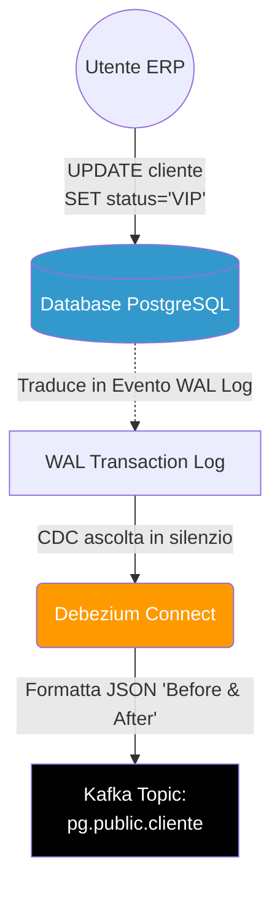

import { Aside, Steps, Tabs, TabItem, CardGrid, Card } from '@astrojs/starlight/components'

# Change Data Capture (CDC): Intercettare il Flusso

C'è un problema enorme quando un'azienda tenta di passare ad un'infrastruttura Streaming (Kafka) o ad un Data Warehouse analitico rapido (ClickHouse). L'azienda sta *già* funzionando. 
Le vendite avvengono su un gigantesco database monolitico PostgreSQL o MySQL (magari gestito da Shopify o da un ERP legacy) e tu non puoi certamente chiedere ai 40 sviluppatori Backend di fermare il mondo per riscrivere l'App. Non inseriranno *mai* una direttiva Kafka in ogni singola riga di codice del loro server transazionale per inviarti l'evento di acquisto. 

Come porti i dati transazionali (gli aggiornamenti bancari, i resi prodotti, le modifiche d'indirizzo utente) nel tuo Streaming in meno di un secondo senza toccare l'applicativo principale?

La risposta e l'arma segreta del Data Engineer è il **CDC (Change Data Capture)**.

---

## 1. Il problema del Batch Polling

Senza CDC, i Data Team estraggono i dati dai database produttivi usando il famigerato trucco della notte: il **Batch Polling**.

Ogni notte alle 3:00, attivano uno script (es. Fivetran, Airbyte) che interroga il Database interrogandolo brutalmente: 
`SELECT * FROM ordini WHERE data_aggiornamento >= Ieri`

<CardGrid>
  <Card title="Problema 1: Lo Sforzo (Impact)" icon="close">
    Il Database Centrale sta servendo vendite live ai clienti. Una query del genere (che scansiona mezzo milione di ordini) blocca i dischi del database per tre minuti. Il sito dell'azienda rallenta pesantemente ogni volta che tu fai estrazione dati.
  </Card>
  <Card title="Problema 2: Lo Stato Fantasma" icon="warning">
    Se un utente crea un ordine alle 14:00, lo cancella alle 14:05 e lo modifica alle 14:10... quando tu estrai il dato alle 3:00 di notte vedrai SOLO la modifica delle 14:10. Quello che è successo nel mezzo svanisce. Il customer journey è muto.
  </Card>
</CardGrid>

---

## 2. La Magia Nera del CDC: Ascoltare il Log

Tutti i veri Database Relazionali (PostgreSQL, MySQL, Oracle, SQL Server) possiedono sotto la superficie un organo segreto: il **Transaction Log** (chiamato *WAL* in Postgres o *Binlog* in MySQL).

Prima ancora che il Database scriva un dato sul disco fisso in tabella, annota di sfuggita un rigo in un minuscolo File di Testo di recupero: *"Riga inserita", "Riga cancellata"*. Questo Log serve al Database per sopravvivere e recuperare se salta la corrente elettrica.

Il CDC non fa query sulla tua tabella, e non legge la Tabella. **Un programma CDC si fissa come un parassita silente sul Transaction Log del Database e legge direttamente i byte binari** prima ancora che avvenga materialmente l'aggiornamento SQL.



### Debezium: Il Re Mida dell'Integrazione

Il software Open-Source più letale per questo lavoro si chiama **Debezium** (Sviluppato da RedHat e costantemente integrato in Kafka Connect).
Si aggancia nativamente a Postgres o MySQL e non dà nessun impatto sensibile al server.
Non si limita a dirti "Cosa è cambiato", Debezium forma un pacchetto mostruoso che ti svela il *"Prima e Dopo"*.

```json
// Evento CDC sparato in Streaming su Kafka da Debezium
{
  "op": "u", // UPDATE Operation
  "ts_ms": 1690947230,
  "before": {
    "id": 105,
    "nome": "Luca",
    "status": "Regular",
    "credito_residuo": 10.00
  },
  "after": {
    "id": 105,
    "nome": "Luca",
    "status": "VIP",
    "credito_residuo": 0.00
  }
}
```

<Aside type="tip">
**Cosa fa il Marketing con questo?** Da questa operazione non estrai solo il dato del credito residuo. Hai letteralmente appena scoperto in Sub-secondo che *l'utente Luca si è diplomato utente VIP bruciando credito*. Inoltrare la variabile `after.status == "VIP"` a un server email può triggerare l'invio della mail di Onboarding in tempo reale. Nessun Batch notturno avrebbe mai reagito in tempo.
</Aside>

---

## 3. Le Tre Regole per CDC verso ClickHouse

Ora che abbiamo lo streaming live del backend su Kafka, vogliamo atterrare queste tabelle speculari su ClickHouse per interrogare coi Cruscotti Analitici. Ma ClickHouse (essendo append-only col suo MergeTree) come gestisce le righe eliminate (`DELETE`) o modificate (`UPDATE`) se odia riscrivere?

In ClickHouse usiamo pattern avanzati, principalmente il **ReplacingMergeTree** per decodificare il CDC:

### Il Pattern ReplacingMergeTree
Quando ricevi eventi CDC su ClickHouse, ClickHouse accoderà ciecamente le operazioni aggiungendo le righe alla fine del disco. 
Per "Aggiornare" visualmente la riga, si usa un motore speciale che fonde via via i doppioni storici tenendo viva solo l'ultima versione.

<Tabs>
  <TabItem label="Codice SQL CDC-Ready" icon="pencil">
    ```sql
    CREATE TABLE clienti_live (
        id UInt32,
        nome String,
        status String,
        credito_residuo Decimal(10,2),
        -- Colonne Obbligatorie CDC:
        kafka_timestamp DateTime, 
        deleted UInt8             
    ) ENGINE = ReplacingMergeTree(kafka_timestamp) -- Sostituisce i vecchi basandosi sul timestamp maggiore!
    ORDER BY id;
    ```
  </TabItem>
</Tabs>

### Handle delle Cancellazioni (Tombstones)
Quando Debezium nota un "DELETE sql" scaturito nel database utente originario, spara l'operazione `op: d`.
In ClickHouse l'unica maniera non folle per gestirlo è il pattern *Soft-Delete (Il Tombestone)*. Ingerisci la riga identica a quella vecchia ma setti il flag `deleted = 1`. 
Nei tuoi cruscotti Looker Studio / Grafana, dovrai forzare analiticamente tutti i report aggiungendo:
`WHERE deleted = 0`. Meno computazione, ma storicità intera del ciclo vitale preservata per gli Auditing log.

---

## Takeaway: Perché le Aziende Elite usano il CDC

Se adotti un'architettura CDC spazzi via il 50% del comparto ingegneristico che normalmente si distruggerebbe di orari festivi per scrivere pipeline ETL. 

- **Estrai Log, non Modelli:** Non dipendi dagli sviluppatori software della tua azienda e non alteri né carichi brutalmente i Database Produttivi Transazionali (Zero Lock!).
- **Recupero del Passato:** Usando Snapshot loggati e l'event tracking massiccio di Debezium, il tuo Data Lake assume una proprietà quadridimensionale: se l'ufficio legale ti chiede *"Qual era l'indirizzo esatto di Marco del 14 Ottobre alle 15:32 prima del cambio fattura?"*, tu avrai *fisicamente* salvato l'evento `before` in formato inalterabile su object storage.
- **Microservizi Decoupled:** Permetti al team di Machine Learning o Pricing Dinamico di ispezionare costantemente lo stato delle scorte in magazino o lo status dei saldi VIP, senza mai scocciare il team dell'IT e le API vecchie dell'applicativo.

Con Kafka acceso e il CDC installato sul cuore transazionale, andiamo a esplorare l'anello finale della catena che rende il tutto un prodotto di Business: **ClickHouse Ottimizzazione e Tuning.**
