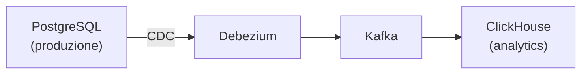

# Change Data Capture (CDC) Patterns

> **Obiettivo:** Catturare le modifiche ai database in tempo reale per alimentare analytics senza impattare la produzione.

## 1. Cos'è il CDC
Il CDC cattura ogni INSERT, UPDATE, DELETE su un database e lo trasforma in un evento stream.



## 2. Debezium: Setup
```json
{
  "name": "pg-connector",
  "config": {
    "connector.class": "io.debezium.connector.postgresql.PostgresConnector",
    "database.hostname": "postgres",
    "database.port": "5432",
    "database.user": "debezium",
    "database.dbname": "production",
    "topic.prefix": "cdc",
    "table.include.list": "public.orders,public.users",
    "slot.name": "debezium_slot",
    "plugin.name": "pgoutput"
  }
}
```

## 3. Formato degli Eventi CDC
```json
{
  "before": {"id": 1, "status": "pending", "amount": 99.99},
  "after":  {"id": 1, "status": "paid", "amount": 99.99},
  "source": {"table": "orders", "ts_ms": 1708790400000},
  "op": "u"  // c=create, u=update, d=delete, r=read(snapshot)
}
```

## 4. Pattern di Consumo in ClickHouse
```sql
-- ReplacingMergeTree per gestire update
CREATE TABLE orders_cdc (
    id UInt64,
    status LowCardinality(String),
    amount Decimal(10,2),
    updated_at DateTime64(3),
    _version UInt64
) ENGINE = ReplacingMergeTree(_version)
ORDER BY id;
```

## 5. Quando Usare il CDC
| Use Case | Alternativa | Perché CDC |
|:---|:---|:---|
| Replica DB per analytics | Query dirette su prod | Zero impatto sulla produzione |
| Audit log | Trigger nel DB | Disaccoppiato, scalabile |
| Sincronizzazione sistemi | API polling | Tempo reale, nessun dato perso |
| Event sourcing | Custom events | Automatico, schema-aware |

## Risorse
- **Tool:** Debezium, Kafka Connect
- **Pattern:** Outbox Pattern per microservizi
